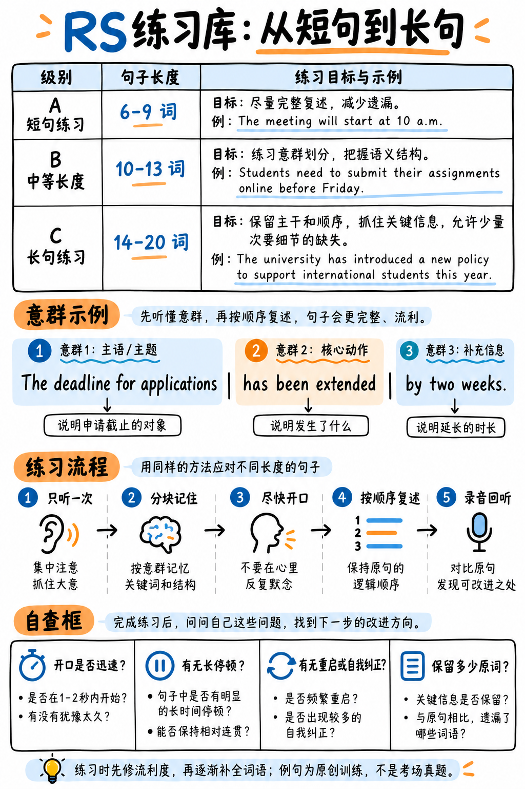

如图 26 所示，从短句逐渐过渡到长句，用同一句子示范如何切意群、尽快开口、保持原词顺序并回听自查。

*图 26：RS 原创练习句的分级方法与分块复述流程。*

:::{admonition} 题库设计初衷与实战价值
:class: important
本特训库收录的 60 个句子严格按照真实 PTE 考场 Repeat Sentence 题目的**学术语料库、句式语法骨架与句长梯度**编撰。
核心训练目标是培养你的**秒开嗓神经反射（音频结束 1 秒内开嗓）、意群旋律跟读能力（Chunking）与绝对不倒车纠错的平稳流利度**。

**牢记官方 Content 2/3 红线**：只要顺畅复述出原句 50% 以上的词汇，内容分就能稳拿 2 分（满分 3 分）！平稳流利地说出半句，总分大幅碾压结巴纠错的整句。
:::

---

## 如何使用本题库进行自测与质检

1. **TTS 单次播放**：使用 TTS 语音工具单次播放句子，语速设定为标准学术语速（约 150 词/分钟）。
2. **手机录音回放质检（最关键动作！）**：听完后立刻对着手机录音，回放时**优先检查以下三大流利度核心指标**，而不是单词数量：
   - **起步开嗓延迟**：是否在音频播完后 1.0 秒内开口？（目标：< 1.0 秒）
   - **超过 1 秒的长停顿次数**：整句输出中是否有气口卡壳？（目标：0 次）
   - **倒车自我纠错次数**：是否中途重读了单词？（目标：0 次）
3. **在指标 1–3 全部达标后，再去统计词汇还原率！**

---

## 组别 A：基础短句（6–9 词，共 15 句）—— 目标：100% 完整平稳复述

白送的基础分。如果短句丢词，问题出在开嗓太慢或分心翻译，请强化 1 秒内开嗓神经反射：

1. **The lecture / begins at nine o'clock.**  
   *【译文】* 讲座在九点整开始。  
   *【意群连读】* begins at 连读 / nine o'clock 重读

2. **All students / must register before Friday.**  
   *【译文】* 所有学生必须在周五之前完成注册。  
   *【意群连读】* register before / Friday 降调

3. **The library / closes early on Sundays.**  
   *【译文】* 图书馆在周日提前闭馆。  
   *【意群连读】* closes early / Sundays

4. **Please submit your assignment / by Thursday.**  
   *【译文】* 请在周四之前提交你的作业。  
   *【意群连读】* submit your 连读 / assignment

5. **The seminar room / is on the third floor.**  
   *【译文】* 研讨室位于大楼三层。  
   *【意群连读】* is on the 弱读连读 / third floor

6. **Attendance at tutorials / is compulsory.**  
   *【译文】* 辅导小组讨论课的出勤是强制性的。  
   *【意群连读】* tutorials / compulsory 重音在第二音节

7. **The results / will be published next month.**  
   *【译文】* 考试结果将于下个月正式发布。  
   *【意群连读】* will be 弱读 / published next month

8. **Several courses / are still open for enrolment.**  
   *【译文】* 目前仍有数门课程开放注册报名。  
   *【意群连读】* Several courses / open for enrolment

9. **Your supervisor / will contact you shortly.**  
   *【译文】* 你的导师稍后会尽快与你取得联系。  
   *【意群连读】* supervisor 重音在第一音节 / shortly

10. **The deadline / has been moved forward.**  
    *【译文】* 截止日期已经被提前了。  
    *【意群连读】* deadline / moved forward

11. **Reading lists / are available online.**  
    *【译文】* 必读书目清单已在网上公布。  
    *【意群连读】* available online 连读

12. **The laboratory / requires protective clothing.**  
    *【译文】* 进入实验室必须穿戴防护服。  
    *【意群连读】* laboratory / protective clothing

13. **Applications / close at the end of March.**  
    *【译文】* 申请将于三月底截止。  
    *【意群连读】* close at the / end of March

14. **The conference / takes place in September.**  
    *【译文】* 学术会议将于九月份举行。  
    *【意群连读】* takes place / in September

15. **Please collect / your student card today.**  
    *【译文】* 请于今天前往领取您的学生证。  
    *【意群连读】* student card / today

---

## 组别 B：核心中长句（10–13 词，共 25 句）—— 考场主流题型

拆分为 3 个节奏块（主干 / 动作 / 修饰），锁定原声的重音韵律：

16. **The deadline for applications / has been extended / by two weeks.**  
    *【译文】* 申请截止日期已经延长了两周。  
    *【经典句式】* The [noun] for [noun] has been [verb]ed.

17. **Students are required / to register online / before the end of term.**  
    *【译文】* 学生须在学期结束前在网上完成注册。  
    *【经典句式】* Students are required to [verb].

18. **You can find the reading list / on the department website.**  
    *【译文】* 你可以在系所官方网站上找到参考书单。  
    *【经典句式】* You can find [noun] on [place].

19. **The seminar will take place / in the main lecture theatre.**  
    *【译文】* 研讨会将在主演讲厅正式举行。  
    *【经典句式】* [Noun] will take place in [place].

20. **There are several scholarships / available / for postgraduate students.**  
    *【译文】* 目前有数个奖学金名额供研究生申请。  
    *【经典句式】* There are [quantifier] [noun] available.

21. **Make sure you bring / your personal identification / to the examination.**  
    *【译文】* 请务必携带个人身份证件参加考试。  
    *【经典句式】* Make sure you [verb].

22. **The study indicates / that attendance significantly affects / academic performance.**  
    *【译文】* 该项研究表明，出勤率会显著影响学业成绩。  
    *【经典句式】* The study indicates that [clause].

23. **Many researchers argue / that the existing empirical data / is inconclusive.**  
    *【译文】* 许多研究人员指出，现有的实证数据尚无定论。  
    *【经典句式】* Many researchers argue that [clause].

24. **Economics is one of the most popular / academic subjects / in the faculty.**  
    *【译文】* 经济学是该学院中最受欢迎的学科之一。  
    *【经典句式】* [Subject] is one of the most [adj] in [field].

25. **The department has announced / a brand new programme / in environmental science.**  
    *【译文】* 该系刚刚公布了一项全新的环境科学专业项目。

26. **All laboratory sessions / must be completed / before the final examination.**  
    *【译文】* 所有实验课环节必须在期末考试前全部修完。

27. **Please note / that the university library / will close for refurbishment.**  
    *【译文】* 请注意，大学图书馆将因翻新装修而临时闭馆。

28. **The committee meets / on the first Tuesday / of every calendar month.**  
    *【译文】* 委员会在每个月的第一个周二召开例会。

29. **Students may apply for an extension / under exceptional circumstances.**  
    *【译文】* 在极其特殊的特殊情况下，学生可以申请作业延期。

30. **The results of the survey / were published / earlier this academic year.**  
    *【译文】* 该项问卷调查的结果已于本学年早些时候公布。

31. **Our research focuses / on the complex behaviour / of biological systems.**  
    *【译文】* 我们的研究重点聚焦于生物系统的复杂动态行为。

32. **The university offers / extensive academic support / for international students.**  
    *【译文】* 学校为广大国际留学生提供了全方位的学术支持服务。

33. **Lecture recordings / will be made available online / within forty-eight hours.**  
    *【译文】* 课堂录像将在四十八小时内上传至网络平台。

34. **It is essential / that you consult your tutor / before submitting the proposal.**  
    *【译文】* 在正式提交开题报告前，与导师进行深入咨询是至关重要的。

35. **The municipal museum / houses one of the finest collections / in northern Europe.**  
    *【译文】* 这座市立博物馆珍藏着北欧地区最精美绝伦的艺术藏品之一。

36. **Considerable funding / has been officially allocated / to the new research centre.**  
    *【译文】* 相当可观的专项科研经费已被正式划拨给该新建研究中心。

37. **The workshop will cover / practical techniques / for analysing survey data.**  
    *【译文】* 本次研讨会将讲授用于分析问卷调查数据的实用统计技术。

38. **Participants must complete / the consent form / before the interview begins.**  
    *【译文】* 参与者在面试开始前必须完整填写知情同意书。

39. **Several departments / have introduced online assessment / for first-year courses.**  
    *【译文】* 数个院系已针对大一基础课程全面推行了线上考核评估机制。

40. **The report recommends / substantial changes / to the current funding model.**  
    *【译文】* 该官方报告建议对现行的资助拨款模式做出实质性变革。

---

## 组别 C：高难度长句（14–20 词，共 20 句）—— 目标：50–70% 稳拿 Content 2 分

长句执行“**首尾锁定保底战术**”：保死开头的 4 个词和结尾的 4 个词，中间平稳带过，绝不卡壳长停顿！

41. **The committee has recommended / that the assessment procedures be reviewed / before the start of next year.**  
    *【译文】* 委员会建议在下学年伊始之前对考核程序进行全面复审。  
    *【首尾锁定】* The committee has recommended... / ...before the start of next year.

42. **Although the initial findings appeared encouraging, / further analysis revealed / several significant limitations.**  
    *【译文】* 尽管初步研究结果看起来令人鼓舞，但后续深入分析却暴露出了数项重大局限。  
    *【首尾锁定】* Although the initial findings... / ...several significant limitations.

43. **Students who wish to change programmes / must obtain written approval / from both of the departments concerned.**  
    *【译文】* 希望转专业的学生必须事先获得所涉及两个院系的双重书面批准。  
    *【首尾锁定】* Students who wish to change... / ...from both departments concerned.

44. **The reduction in government funding / for the humanities / has provoked criticism from universities across the country.**  
    *【译文】* 政府对人文学科资助的缩减招致了全国各大高校的严厉批评。  
    *【首尾锁定】* The reduction in government funding... / ...from universities across the country.

45. **Researchers studying the decline in bee populations / have identified pesticide use / as a principal factor.**  
    *【译文】* 调查蜜蜂种群骤减的研究人员指出，农药滥用是其中一项最主要的致因。  
    *【首尾锁定】* Researchers studying the decline... / ...as a principal factor.

46. **It is widely accepted / that the relationship between economic growth and environmental damage / is considerably complex.**  
    *【译文】* 人们普遍认为，经济增长与环境破坏之间的相互关系远比想象的更为复杂。  
    *【首尾锁定】* It is widely accepted that... / ...is considerably complex.

47. **The library has invested / in a comprehensive collection of electronic journals / accessible to all registered members.**  
    *【译文】* 图书馆引进了门类齐全的电子学术期刊数据库，所有注册会员均可查阅。  
    *【首尾锁定】* The library has invested in... / ...accessible to all registered members.

48. **Candidates should note / that the examination consists of two separate papers, / each lasting ninety minutes.**  
    *【译文】* 考生须留意，本次考试由两部分独立试卷组成，各部分时长约九十分钟。  
    *【首尾锁定】* Candidates should note that... / ...each lasting ninety minutes.

49. **Archaeological evidence suggests / the settlement was occupied continuously / for four hundred years before being abandoned.**  
    *【译文】* 考古证据表明，该聚落在被彻底废弃前，曾连续居住繁衍了四百年之久。  
    *【首尾锁定】* Archaeological evidence suggests... / ...four hundred years before being abandoned.

50. **Participants were asked / to complete a questionnaire / about their previous experience and course expectations.**  
    *【译文】* 参与者被要求完成一份关于其过往经验以及对课程预期的调查问卷。  
    *【首尾锁定】* Participants were asked to... / ...their expectations of the course.

51. **The faculty has emphasised / that maintaining academic integrity / is the responsibility of every community member.**  
    *【译文】* 学院方面再三强调，恪守学术道德诚信是大学社区每一位成员的应尽之责。  
    *【首尾锁定】* The faculty has emphasised that... / ...responsibility of every member.

52. **Recent developments in computational modelling / allow scientists to predict / the behaviour of complex systems.**  
    *【译文】* 计算机计算建模领域的最新进展使科学家们得以高精度预测复杂系统的动态。  
    *【首尾锁定】* Recent developments in computational... / ...behaviour of complex systems.

53. **Although the proposal received broad support / from academic staff, / several colleagues expressed reservations.**  
    *【译文】* 尽管该项方案得到了学术教职员工的广泛支持，但数位同行仍对其可行性持保留态度。  
    *【首尾锁定】* Although the proposal received... / ...several colleagues expressed reservations.

54. **The findings of the investigation / will be presented / to the university governing body at its next meeting.**  
    *【译文】* 该项专门调查的结论将在大学理事会的下一次全体例会上正式呈报。  
    *【首尾锁定】* The findings of the investigation... / ...at its next scheduled meeting.

55. **Students are reminded / that submitting work containing unacknowledged material / is a serious disciplinary offence.**  
    *【译文】* 再次提醒广大同学，提交包含未注明出处资料的学术作业属于严重的学术违纪。  
    *【首尾锁定】* Students are reminded that... / ...is a serious offence.

56. **The research council has announced / that applications for the next funding round / must arrive before March.**  
    *【译文】* 科学研究理事会日前发布公告，下一轮科研项目资助的申请必须在三月前送达。  
    *【首尾锁定】* The research council has announced... / ...must arrive before March.

57. **Historians of science argue / that the invention of the microscope / fundamentally transformed medicine.**  
    *【译文】* 科学史学家们指出，显微镜的发明从根本上深刻改变并重塑了现代医学研究。  
    *【首尾锁定】* Historians of science argue that... / ...fundamentally transformed the study.

58. **The university's environmental strategy / includes a commitment / to reducing carbon emissions across all campuses.**  
    *【译文】* 大学所制定的绿色环境战略包括了一项承诺，即在所有校区大幅缩减碳排放。  
    *【首尾锁定】* The university's environmental strategy... / ...reducing energy consumption.

59. **It has become increasingly clear / that the existing infrastructure / cannot accommodate the growing student body.**  
    *【译文】* 愈发显而易见的是，现有的各项基础设施配置已经无法容纳日益庞大的学生群体。  
    *【首尾锁定】* It has become increasingly clear... / ...cannot accommodate the growing number.

60. **Evidence from several independent studies / suggests that early intervention / produces considerably better outcomes.**  
    *【译文】* 来自数项独立研究的实证表明，及早的科学干预能为患者带来显著更优的远期预后。  
    *【首尾锁定】* Evidence from several studies... / ...produces considerably better outcomes.

---

## 终极自检提示：流利度重于完整度

:::{warning} 切忌为追求 100% 完整而丢掉流利度
很多初学者由于太想说全整句话，中途反复停顿回忆、结巴倒车。
**再次提醒：流利度和发音占了口语三项特质中的两项！** 哪怕你只顺畅说出了 7 个词，也比磕磕绊绊说全 12 个词的总分高得多！永远保住稳定平滑的语流节拍！
:::
