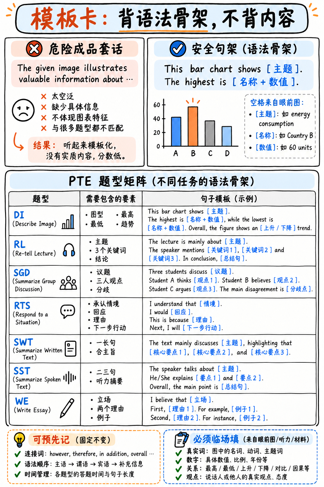

如图 32 所示，句架只预留语法位置，主题、数字、观点和关系必须从当前题目取得；可用矩阵快速复习各题的输出结构。



*图 32：成品套话与安全句架对照，附口语、写作题型的内容填充框架。*

:::{danger} 使用本页内容前，必须牢记 2025 官方评分红线
培生官方在 2025 官方评分指南中明确指出：**“包含预先背诵或机械记忆内容（Pre-prepared or memorized material）的作答将被归类为无关作答（Irrelevant responses）”**，其内容分（Content）将直接被判 **0 分**。

一旦内容分判定为 0 分，发音（Pronunciation）与流利度（Oral Fluency）**将彻底失去评分资格，整道题目全部分数直接归零！**

自 2025 年 8 月起，官方对 **7 种核心题型**全面引入**人类专家双重人工复核评分（Double-marked by human experts）**：Describe Image、Retell Lecture、Respond to a Situation、Summarize Group Discussion、Summarize Written Text、Write Essay、Summarize Spoken Text。

**本页提供的所有内容均为“语法骨架（Frames）”，绝非机械套用的“万能死模板（Templates）”！**  
- **骨架（Frame）**：仅提供承前启后的语法衔接与逻辑框架；
- **内容词（Meaning-bearing words）**：必须 **100% 提取自你眼前的图表、录音或题干**。

**检验句子是否合规的唯一黄金标准：**  
*“这句话如果不做任何修改，能否直接套用到另一个完全不同的话题上？”*  
如果答案是**“能”**，请立即将其从你的大脑中删除！它不仅无法为你带来任何分数，还会严重危及整道题的人工复核合规性。
:::

---

## 口语核心题型句式骨架（Speaking Frames）

### 1. 看图说画（Describe Image）—— 40 秒 · 约 12 个固定骨架词

> "This **[chart type]** shows **[what the title/axes say]**.  
> The highest is **[named item]** at about **[number]**.  
> The lowest is **[named item]**, at roughly **[number]**.  
> **[One pattern: a trend, a comparison, or how the middle groups together.]**  
> So overall, **[the one-line message].**"

**中文结构五步法：**
1. **识别图表与主题：** "This line graph/bar chart shows..."（说明图表类型与标题/轴线含义）
2. **抓取极值峰值：** "The highest is [具体项目] at about [数值]."
3. **抓取极值谷值：** "The lowest is [具体项目] at roughly [数值]."
4. **归纳关键走势或对比：** 说明一组明显的上升/下降趋势或横向对比。
5. **一句话简短收尾：** "So overall, [图表反映的核心宏观趋势]."

> **实战禁忌：** 绝对不要在 40 秒结束前过早闭麦停顿！每个具体数值前必须加上 `about` / `roughly` / `just over` 等模糊修饰词，防止因犹豫卡顿而被扣流利度。

---

### 2. 复述讲座（Retell Lecture）—— 40 秒 · 约 15 个固定骨架词

> "The lecture was about **[topic]**.  
> The speaker's main point was that **[keyword claim]**.  
> They explained **[keyword 1]** and discussed **[keyword 2]**, giving the example of **[example]**.  
> They also mentioned **[keyword 3]**.  
> Overall, the speaker concluded that **[conclusion]**."

**实战要领：**
- 采用 **7 格笔记法**（主题 · 3 个核心学术词 · 2 个案例细节 · 1 个最终结论）。
- 音频播放时，**最集中精力捕捉前 10 秒（引入主旨）与最后 10 秒（最终结论）**。
- 如果输出时间不足，**宁可把抓到的真实关键词再展开复述一遍，也绝不要背诵毫无实质内容的万能空话套句**！

---

### 3. 小组讨论总结（Summarize Group Discussion）—— 2 分钟 · 约 30 个固定骨架词

> "The discussion was about **[topic]**.  
> The first speaker argued that **[position 1]**, because **[reason 1]**.  
> Another speaker took a different view, suggesting that **[position 2]**. They pointed out that **[reason 2]**.  
> The third speaker **[agreed with / questioned]** this, adding that **[position 3]**.  
> One point they discussed in detail was **[sub-topic]**, where **[what was said]**.  
> There was **[agreement / disagreement]** about **[aspect]**, although they differed on **[aspect]**.  
> Overall, the discussion suggested that **[topic]** is **[contested / complex / dependent on circumstances]**."

**当笔记内容即将耗尽时的四步正规扩展法（按此顺序）：**
1. 补充你在录音中听到的发言者推理逻辑与支撑论据；
2. 更具体地换词重申各方核心立场；
3. 描述各方产生分歧与争议的具体焦点与形态；
4. 明确指出讨论中尚未达成共识的未决问题。  
*(严禁擅自插入个人主观观点或空洞泛化的赞美词句！)*

---

### 4. 情境应对（Respond to a Situation）—— 40 秒 · 四步应对法

> **第一步【承认知情 Acknowledge】：** 点出情境事件，表明你完全理解当前的状况或问题所在。  
> **第二步【表明立场 Respond】：** 给出你的核心答复、具体态度或处理决定。  
> **第三步【解释原因 Reason】：** 用 1–2 句话解释做出该决定的合理性与背后的原因。  
> **第四步【后续行动 Next Step】：** 提出接下来的补救措施、替代方案或行动提议。

**语域得体性（Register）是核心考察特质：**  
熟练运用软化礼貌句型：*I'm afraid… · Would it be possible to…? · I'd be happy to… · It might be worth… · perhaps / might / quite.*  
初学者最容易遗漏的是**第四步“后续行动”**，而这恰恰是撑满 40 秒并展现高情商沟通能力的关键！

---

### 5. 朗读文本（RA）与 重复句子（RS）—— 无模板

这类题型**没有任何结构模板需要构建**，考核的是纯粹的语音输出能力：
- **朗读文本（Read Aloud）：** 在 35–40 秒准备时间内在脑海中切分意群停顿；以 130–150 wpm 稳定语速朗读；重读实词、弱读虚词；**一气呵成，一旦卡壳绝不回头重念**。
- **重复句子（Repeat Sentence）：** 听到提示音后 1 秒内果断开口；复刻原声抑扬顿挫的语调节奏；**只要按顺序说对 50% 的单词即可稳保 Content 2/3 分**；**严禁中途自我修正，宁可含糊滑过也绝不停顿**！

---

### 6. 简短回答（Answer Short Question）—— 无模板

**1 到 2 个核心英文单词立即秒答！** 严禁组织冗长的主谓完整句子。遇到不会的常识词果断猜一个，绝不要在麦克风前沉默超过 3 秒。

---

## 写作核心题型句式骨架（Writing Frames）

### 1. 总结文本（Summarize Written Text）—— 严格单句，30–40 词

根据原文的逻辑脉络，选择以下三种复合句结构之一：

| 句型结构 | 语法框架公式 | 适用文本逻辑类型 |
|---|---|---|
| **模式 1** | `"Although [common view], [main claim], because [key reason]."` | 原文颠覆常识、提出修正或带有限定条件时 |
| **模式 2** | `"While [point A], [point B], and [consequence]."` | 原文存在两派对立观点、双向对比时 |
| **模式 3** | `"[Topic + main characteristic], which [significance], although [limitation]."` | 原文为客观陈述性、阐释性学术文本时 |

:::{warning} 格式死线（Form Rules）—— 违反任何一项直接判 0 分！
✅ **整篇摘要必须且只能有一个句号（One full stop）置于末尾**  
❌ **严禁使用分号（Semicolon `;`）**  
❌ **严禁回车换行分段**  
📏 **总词数必须严格落在 5–75 词之间**（建议黄金区间：30–40 词）  
✂️ **剔除一切细枝末节的举例说明（Examples）与补充数据**
:::

---

### 2. 总结口语（Summarize Spoken Text）—— 55–65 词，2–3 个完整句子

> "The speaker discussed **[topic]**, explaining that **[main point]**.  
> They noted that **[detail 1]** and that **[detail 2]**.  
> The speaker concluded that **[conclusion]**."

**格式要求：**  
- 严格锁定在 **55–65 词**（官方区间为 50–70 词；**低于 40 词或超过 100 词直接判 0 分**）。
- 叙述统一使用一般过去时（Past Simple）。
- 提交前务必核对左下方实时计词器。

---

### 3. 大作文（Write Essay）—— 240–280 词，标准四段式，20 分钟

> **【引言段 Introduction ~50词】**  
> The question of whether **[题目核心争议话题改写]** has attracted considerable debate. While some argue that **[反方观点]**, I believe that **[你的明确立场]**, for two main reasons.
>
> **【主体一段 Body 1 ~80词】**  
> The most important consideration is **[支撑原因 1]**. **[展开阐述核心机制与逻辑链条——两句话]**. For example, **[引入一个具体生动的实证案例]**. This suggests that **[小结扣题，回扣中心论点]**.
>
> **【主体二段 Body 2 ~80词】**  
> A second factor is **[支撑原因 2]**. **[展开阐述原因逻辑——两句话]**. It is true that **[承认反方最具说服力的反驳点]**; however, **[说明为何你的立场在权衡下依然成立]**.
>
> **【结论段 Conclusion ~45词】**  
> In conclusion, although **[反方观点在某些情境下有其合理性]**, the evidence points toward **[用全新词汇换词重申你的立场]**, principally because **[在一个从句中高度浓缩两点支撑原因]**. **[补充一句富有前瞻性的总结性评价]**.

**脚手架安全边界：**  
全文骨架词数约 35 词，在 260 词的总篇幅中**仅占约 13%**。这既能保障语法规范，又完全符合 2025 年人工复核的安全界限！

**20 分钟作战时间轴：**  
- `0–2 分钟`：审题拆题，列出两点核心原因与案例  
- `2–5 分钟`：撰写引言段  
- `5–10 分钟`：撰写主体一段  
- `10–15 分钟`：撰写主体二段  
- `15–18 分钟`：撰写结论段  
- `18–20 分钟`：留出整整两分钟，逐字逐句排查拼写与单复数  

---

## 阅读与听力解题标准化规程（Procedures）

客观选择题与填空题不是靠死记硬背，而是依靠确定性的排查流水线：

### 1. 完形填空五步破题漏斗（适用于所有 FIB 题型）

```
1. 词性初筛 (Part of Speech) → 该空缺少什么词性？秒杀错误词类
2. 语法排查 (Grammar)        → 单复数一致性、时态形态、后接搭配介词
3. 固定搭配 (Collocation)    → 空格周围与哪个词属于习惯固定搭配？
4. 逻辑方向 (Direction)      → 顺承递进 / 反向转折 / 因果推导 / 举例说明
5. 果断止损 (Move on)        → 单空纠结不得超过 20 秒，全填满无负分
```

> **拖拽填空战术：** 优先将 100% 确定的词汇拖入对应空格，迅速缩小备选词池。

---

### 2. 段落重排（Reorder Paragraphs）—— 代词与指代排查法

- **凡是以 `It`, `They`, `This`, `These`, `Such`, `Another`, `The former` 开头的句子，绝对不能作为首句！**
- 找出包含独立完整名词主语、且毫无向上回指成分的句子作为**第一段（首句）**。
- 随后沿着定冠词 `the`、代词和逻辑关联词串联起指代链条。
- **牢记其相邻对计分规则**：锁定有把握的连续段落对，拿满确定分后果断提交，绝不超时。

---

### 3. 多选倒扣分排雷卡（Negative Marking Rule）

:::{important} 全场 22 种题型中，仅有 3 处存在倒扣分机制！
| 题型名称 | 计分规则 | 应对铁律 |
|---|---|---|
| **阅读多选题（R-MCMA）** | 选错一项 **倒扣 1 分**（最低保底 0 分） | **只选你在文中亲眼看到的 100% 确定选项，绝不贪选** |
| **听力多选题（L-MCMA）** | 选错一项 **倒扣 1 分**（最低保底 0 分） | 听音时在草稿板记录，没有明确支撑的选项绝不勾选 |
| **突出错误单词（HIW）** | 点错一个假词 **倒扣 1 分**（最低保底 0 分） | 鼠标跟随原声移动，**音频结束后严禁任何脑补乱点** |

**除此 3 项之外的全部题型：**  
所有的填空空格、单项选择、段落排序、听写句子，**一律不存在倒扣分**！即使完全不会，也必须猜满每一个空，白送的机会绝不留白！
:::

---

## 考场草稿板开考 30 秒速记图（Noteboard Setup）

进入考场试音结束后、正式做第一道计分题前的黄金 30 秒，在塑封草稿板上默写以下速记卡：

```
┌─────────────────────────────────────────────────────┐
│ 阅读时间硬死线: FIB 2分 · RO 2分 · MCSA 90秒 · MCMA 2.5分│
│                                                     │
│ 写作字数红线:   SWT 30–40词，严格单句，绝不用分号 ';'  │
│                SST 55–65词  (低于40或高于100判0分!) │
│                ESSAY 240–280词 (预留2分钟检查拼写)   │
│                                                     │
│ 口语执行铁律:   听到哔声 <1秒内开麦 · 停顿严禁 >1秒   │
│                绝对不自我纠错 · 语速稳定撑满时间槽  │
│                                                     │
│ 倒扣分防守区:   MCMA(阅读/听力) · HIW(听力选错词)     │
│                → 仅勾选 100% 确定的选项             │
│ 其余全部题型:   → 彻底填满，绝不允许任何留白         │
│                                                     │
│ SGD 讨论速记槽: S1发言人1 ___  S2发言人2 ___ S3发言人3 ___ │
└─────────────────────────────────────────────────────┘
```

---

## 安全合规 vs 危险违规行为对照表

| ✅ 官方合规的安全备考行为 | ❌ 极度危险的违规操作（内容判 0 分） |
|---|---|
| 熟练掌握上述语法逻辑骨架（Frames） | 死记硬背包含具体事实内容的整段范文套句 |
| 掌握地道学术功能句（*I'm afraid…*, *Would it be possible…*） | 强行给 Describe Image 套用空洞通用的套话开场白 |
| 灵活运用多样化的逻辑连接词与时序副词 | 在大作文中机械背诵放之四海而皆准的“万能假大空段落” |
| 记忆各话题核心学术搭配与精准词汇 | 背诵所谓的“万能大作文模板”强行套入所有考题 |
| **为各大作文母题准备 1 个真实的实证案例**（这是知识积累） | 忽视题目具体问法，通篇默写与题意无关的背诵内容 |
| 熟练使用草稿板速记框架与缩写符号 | 任何脱离眼前试题内容、机械背诵朗读的无意义句子 |

---

**各题型战术深度研读：**  
- {doc}`../10-speaking/03-describe-image`：DI 五步破题法与全类型图表解构  
- {doc}`../20-writing/02-write-essay`：大作文四段式结构与高分逻辑链条  
- {doc}`../20-writing/01-summarize-written-text`：SWT 极简单句提炼与九项自检  
- {doc}`../00-foundations/03-how-scoring-works`：官方评分引擎机制与 Content 闸门规则
