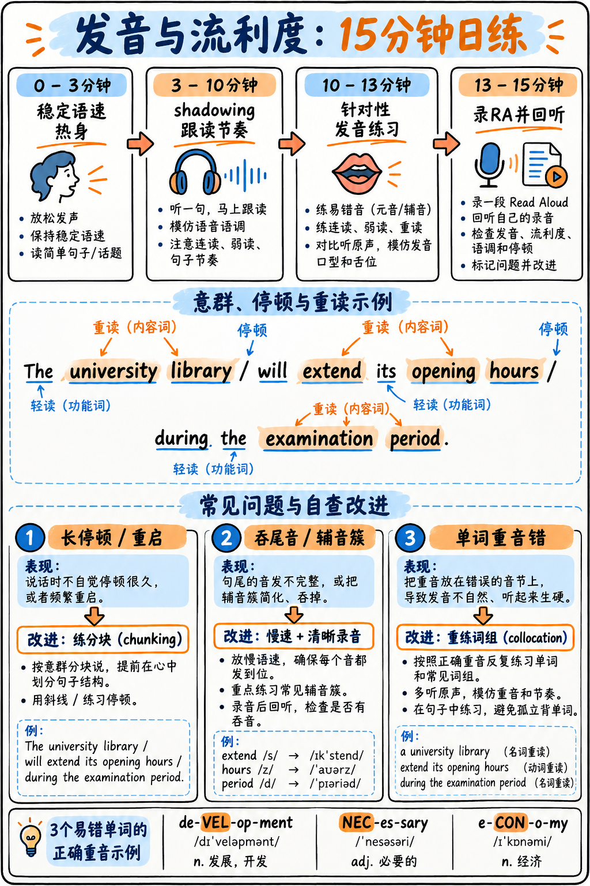

如图 33 所示，十五分钟练习从语速热身、跟读到录音回听；中部句子展示意群停顿与内容词重读。



*图 33：口语日练时间表、意群示例及常见发音问题的修复动作。*

:::{admonition} 为什么发音与流利度是全考场提分杠杆率最高的基础训练？
:class: important
1. **纯 AI 自动化评分（无人工主观干预）：** 在整场口语考试中，发音（Pronunciation）与口语流利度（Oral Fluency）作为交叉特质分，同时渗透进 **28–34 道题目**。它们完全由语音识别算法模型自动测算，是最具**机械化刻意练习条件**的模块。
2. **分数跳档效应极强：** 参考 {doc}`../00-foundations/03-how-scoring-works` 中的官方雅思对照表，PTE 口语从 54 分跃升到 65 分，对应跨越了雅思整整一个分数梯队。
3. **官方绝不考察英音/美音等特定“口音”（Accent）：** 培生官方评分标准最高档对发音的要求是：**“由具备一般语言理解能力的常规使用者能够轻松听懂（Easily understood）”**，核心考察的是**清晰度与韵律节奏（Intelligibility and Rhythm）**，而非是否像母语者那样地道。第 4 档标准甚至明确允许“存在少量辅音、元音或重音瑕疵”。

**核心原则：** 彻底停止浪费时间搞所谓“纠音消除母语口音”，集中精力攻克下文列出的五大可机械化训练的核心发音规律！
:::

---

## 每日 15 分钟高杠杆语音操练流程

| 时间区间 | 执行训练 | 核心训练目标 |
|---|---|---|
| **0–3 分钟** | **平稳朗读热身** | 随意挑选一段学术文本，以刻意保持绝对平稳的匀速朗读，建立稳定配速。 |
| **3–10 分钟** | **影子跟读训练（Shadowing）** | **节奏、断句停顿与重音——口语流利度的灵魂核心（详见下文）。** |
| **10–13 分钟** | **专项排雷操练** | 轮流练习下文中的 5 项针对性发音技巧（重音、词尾屈折、辅音连缀）。 |
| **13–15 分钟** | **录音回放自检复盘** | 完整录制一段 Read Aloud 文本，对照自检清单排查犹豫卡顿与掉音问题。 |

坚持将这 15 分钟作为每日备考的固定起点，它能同时为口语部分的每一个题型注入稳定性。

---

## 训练一：影子跟读法（Shadowing）—— 最具实战价值的语音练习

### 1. 什么是影子跟读？
播放一段纯正、清晰的学术或新闻英语原声，你的声音在原声音频后**延迟约 0.5 秒紧随其后同步开口跟读**。你不仅要复述单词，更要像影子一样**原汁原味地复刻原声说话者的语调节奏、意群停顿与重音强弱**。

### 2. 标准五步操作法
1. 挑选一段时长约 60 秒、语速适中且吐字清晰的学术演讲或新闻慢速原声。
2. **第一遍只听不读**：感受文本的逻辑起伏与呼吸节点。
3. **第二遍同步跟读**：延迟半秒开口。**不求字字绝对咬准，哪怕中途丢词也必须跟紧音频的原生节奏，绝不中断！**
4. 将同一段音频**连续重复跟读 5 遍**。到了第 5 遍时，你应该能够极其贴合原声的韵律。
5. **同一段音频连续练习 3 天**，直至形成生理肌肉记忆，随后更换新素材。

### 3. 为什么影子跟读远胜于单纯的默读或自顾自朗读？
自己朗读只能练习单词的认读准确性；而影子跟读直接塑造**大脑的语流节奏感（Rhythm）**。而在官方评分标准中，口语流利度（Oral Fluency）考核的核心本质正是**“节奏、断句与重音（Rhythm, phrasing and stress）”**。

```bash
# 音频速度调整辅助命令示例：初学者先将原声放慢至 85%，熟练后再恢复原速
ffmpeg -i clip.mp3 -filter:a "atempo=0.85" clip-slow.mp3

# 熟练后可提升至 1.15 倍速挑战极限反应
ffmpeg -i clip.mp3 -filter:a "atempo=1.15" clip-fast.mp3
```

---

## 训练二：句子重音律动（实词重读 vs 虚词弱读）

**这是区分口语流利度 2 分与 4 分的关键分水岭。**

- **核心铁律：**  
  - **实词（Content Words）必须重读发饱满：** 名词、主要行为动词、形容词、副词。  
  - **虚词（Function Words）必须轻微、快速、弱读滑过：** 冠词、介词、助动词、人称代词、并列连词。

### 经典长难句重音专项跟读（大写加粗部分用力重击，其余轻快滑过）

1. The re**SEARCH** was con**DUC**ted at the uni**VER**sity over a **PER**iod of **THREE YEARS**.  
   *(这项研究是在该大学历时三年进行的。)*
2. **MOST** of the **STU**dents who **AP**plied were of**FERED** a **PLACE** on the **COURSE**.  
   *(大多数提出申请的学生都获得了该课程的录取名额。)*
3. There has **BEEN** a **SIG**nificant **IN**crease in the **NUM**ber of **IN**ternational ap**PLI**cants.  
   *(国际申请者的数量出现了极为显著的增长。)*
4. The re**SULTS** of the ex**PER**iment were **PUB**lished in a **LEAD**ing **SCI**entific **JOUR**nal.  
   *(该实验的结果发表在了一家顶尖科学期刊上。)*
5. **AL**though the **FIND**ings are **IN**teresting, they **NEED** to be **CON**firmed by **FUR**ther **STU**dy.  
   *(尽管这些发现引人关注，但仍需进一步研究予以证实。)*
6. The com**MIT**tee has re**COM**mended that the ex**IST**ing **REG**ulations be a**MEND**ed.  
   *(委员会已建议对现有规章制度进行修订。)*
7. It is **WIDE**ly ac**CEP**ted that the re**LA**tionship is more **COM**plex than **PRE**viously **THOUGHT**.  
   *(人们普遍认为，这种关系比先前设想的更加错综复杂。)*
8. **STU**dents should con**SULT** their super**VI**sor be**FORE** sub**MIT**ting the pro**PO**sal.  
   *(学生在提交开题报告之前，应当咨询其导师的意见。)*

:::{tip} 虚词弱读国际音标速查表（千万别把每个单词读成机器人！）
- `the` → `/ðə/`（绝不要读成强调式的 `/ðiː/`）  
- `a` → `/ə/`  
- `of` → `/əv/`  
- `to` → `/tə/`  
- `for` → `/fə/`  
- `and` → `/ən/`  
- `was` → `/wəz/`  
- `are` → `/ə/`  
- `have` → `/həv/`  
- `can` → `/kən/`  

如果把每一个 "of" 都字正腔圆地念成 "/ɒv/"，把每一个 "the" 都重读，整段语音将失去英语特有的**轻重交替节拍（Stress-timed Rhythm）**，在 AI 算法眼中会被直接判定为机械死板的机器人发音，流利度得分极低！
:::

---

## 训练三：学术词汇单词重音（Word Stress）

重音位置一旦颠倒，即使每个音素都念对，语音识别算法也会将其识别为完全不同的生词甚至乱码：

| 单词 | 正确重音音节位置 | 常见错误重音陷阱 | 中文释义 |
|---|---|---|---|
| **de·vel·op·ment** | de-**VEL**-op-ment | **DEV**-elopment | 发展 / 研发 |
| **nec·es·sary** | **NEC**-es-sary | nec-**ESS**-ary | 必要的 |
| **com·pa·ra·ble** | **COM**-par-able | com-**PAR**-able | 可比较的 / 相当的 |
| **pho·tog·ra·phy** | pho-**TOG**-ra-phy | **PHO**-to-graphy | 摄影术 |
| **pol·i·tics / po·lit·i·cal** | **POL**-itics / po-**LIT**-ical | 重音漂移混淆 | 政治 / 政治的 |
| **e·con·o·my / eco·nom·ic** | e-**CON**-omy / ec-o-**NOM**-ic | 重音漂移混淆 | 经济 / 经济学的 |
| **ad·min·is·ter / admin·is·tra·tion** | ad-**MIN**-ister / ad-min-i-**STRA**-tion | 重音漂移混淆 | 管理实施 / 行政管理 |
| **pre·fer / pref·er·ence** | pre-**FER** / **PREF**-erence | 重音漂移混淆 | 偏好 / 优先选择 |
| **sig·nif·i·cant** | sig-**NIF**-i-cant | **SIG**-nificant | 显著的 / 重大的 |
| **char·ac·ter·is·tic** | char-ac-ter-**IS**-tic | **CHAR**-acteristic | 特征 / 典型的 |
| **in·dus·try / in·dus·tri·al** | **IN**-dustry / in-**DUS**-trial | 重音漂移混淆 | 工业行业 / 工业的 |
| **an·a·lyse / a·nal·y·sis** | **AN**-a-lyse / a-**NAL**-y-sis | 重音漂移混淆 | 分析（动词）/ 分析（名词） |
| **hy·poth·e·sis** | hy-**POTH**-e-sis | **HY**-pothesis | 假说 / 假设 |
| **tech·nique** | tech-**NIQUE** | **TECH**-nique | 技术 / 技法 |

---

### 名词 vs 动词重音转移规律（前名后动规则）

Read Aloud 文本中极易考查这类双音节词。**作为名词时重音在第一音节，作为动词时重音后移到第二音节：**

| 名词形态（重音在前） | 动词形态（重音在后） | 典型中英文对比例句 |
|---|---|---|
| an **IN**crease | to in**CREASE** | There was a significant **IN**crease. / Costs are expected to in**CREASE**. |
| a **DE**crease | to de**CREASE** | A sharp **DE**crease in sales. / The figures will de**CREASE** next year. |
| a **REC**ord | to re**CORD** | Keep an official **REC**ord. / The researchers will re**CORD** the data. |
| a **CON**tract | to con**TRACT** | Sign a legal **CON**tract. / Metals con**TRACT** as they cool. |
| the **PRES**ent | to pre**SENT** | Focus on the **PRES**ent. / They will pre**SENT** their findings. |
| a **PRO**ject | to pro**JECT** | Lead a research **PRO**ject. / Experts pro**JECT** further growth. |
| **CON**duct | to con**DUCT** | Unethical **CON**duct. / They decided to con**DUCT** an experiment. |

---

## 训练四：动词词尾 -ed 与名词复数 -s 的发音规则

国内考生在口语中极易丢失词尾发音，或把不该增加音节的单词读成额外音节，导致严重失分。

### 1. 词尾 -ed 的三类发音规则

| 词尾前接音素 | 规则发音音标 | 是否增加音节 | 经典学术词汇范例 |
|---|---|---|---|
| 以 **/t/ 或 /d/** 结尾 | **/ɪd/** | **增加一个音节** | wan**ted** · nee**ded** · expec**ted** · repor**ted** · recor**ded** |
| 以 **清辅音** 结尾（p, k, f, s, ʃ, tʃ） | **/t/** | 不增加音节 | hel**ped** · as**ked** · publi**shed** · develo**ped** · increa**sed** |
| 以 **浊辅音或元音** 结尾（其余全部） | **/d/** | 不增加音节 | explai**ned** · requi**red** · obser**ved** · ar**gued** · allo**wed** |

> **整句大声操练：**  
> *"The study repor**ted** (/ɪd/) that costs increa**sed** (/t/) while output decli**ned** (/d/)."*  
> *(研究报告指出，在产出下降的同时，成本却上升了。)*

---

### 2. 词尾 -s 的三类发音规则

| 词尾前接音素 | 规则发音音标 | 是否增加音节 | 经典学术词汇范例 |
|---|---|---|---|
| 以 **咝音** 结尾（s, z, ʃ, tʃ, dʒ） | **/ɪz/** | **增加一个音节** | cour**ses** · chan**ges** · analy**ses** · pla**ces** |
| 以 **清辅音** 结尾（p, t, k, f, θ） | **/s/** | 不增加音节 | studen**ts** · resul**ts** · boo**ks** · effec**ts** |
| 以 **浊辅音或元音** 结尾（其余全部） | **/z/** | 不增加音节 | studi**es** · metho**ds** · tren**ds** · progra**ms** |

> **整句大声操练：**  
> *"The students' resul**ts** (/s/) from several cour**ses** (/ɪz/) show consistent tren**ds** (/z/)."*  
> *(来自几门课程的学生成绩显示出了持续一致的趋势。)*

---

## 训练五：辅音连缀（Consonant Clusters）排雷

汉语普通话以“辅音+元音”为主，没有连续辅音结构。因此中国考生极易犯两类致命错误：
1. **中途擅自插入元音**（把 `strength` 念成 "suh-trength"）；
2. **吞音省略辅音**（把 `facts` 念成 "fack"）。

### 专项辅音连缀速读库（先慢后快，每个连续读 5 遍）

| 连缀结构 | 高频学术词汇 |
|---|---|
| **str-** | **str**ength · **str**ucture · **str**ategy · **str**aightforward · **str**ess |
| **spr- / scr-** | **spr**ead · **spr**ing · **scr**ipt · **scr**een · **scr**utiny |
| **-cts** | fa**cts** · effe**cts** · contra**cts** · aspe**cts** · proje**cts** · distri**cts** |
| **-sts** | te**sts** · co**sts** · te**xts** · insi**sts** · consi**sts** · statisti**cs** |
| **-ngth** | stre**ngth** · le**ngth** · le**ngths** |
| **-pt / -pts** | conce**pt** · conce**pts** · ada**pt** · acce**pts** |
| **thr-** | **thr**ee · **thr**ough · **thr**oughout · **thr**eshold |
| **-lvd** | so**lved** · invo**lved** · reso**lved** |

### 连缀专项绕口令（强化肌肉耐力）

> 1. *The statistics in these texts confirm the costs of the tests.*  
> 2. *Six strategies for strengthening the structure were thoroughly scrutinised.*  
> 3. *The contracts specify the effects of the projects on the districts.*  
> 4. *Three months of thorough research resolved the problems they had involved.*

---

## 咬舌音 th 的专项对比训练

`th` 必须将舌尖轻触上下齿之间，绝不能用中文里的 `/s/`, `/z/`, `/t/`, `/d/` 偷懒代替：
- **清辅音 `/θ/`：** **th**ink · **th**ree · **th**rough · **th**eory · **th**orough · me**th**od · bo**th** · heal**th** · grow**th**
- **浊辅音 `/ð/`：** **th**e · **th**is · **th**at · **th**ese · **th**ose · **th**ere · **th**an · **th**ey · toge**th**er

> **绕口练习：**  
> *"These three methods of thorough research were thought to be both theoretically and practically better than those they replaced."*

---

## 适用于所有口语题型的四大不可逾越铁律

:::{important} 四大非受迫性失误规避铁律
1. **绝对不要自我修正（Never self-correct）：**  
   单词念错或漏读仅仅损失该词微小的个别分数；一旦你刹车回头重读，整句话的节奏会被彻底斩断，整道题的**口语流利度将遭受毁灭性打击**！**念错了就当作没发生，坚决向下推进！**
2. **中间停顿严禁超过 1 秒，全场严禁沉默超过 3 秒：**  
   任何超过 1 秒的犹豫都会被 AI 捕捉为卡顿；若麦克风连续监测到 3 秒静音，将**自动判定答题结束并强行闭麦**，该题直接判 0 分！
3. **保持全程恒定配速，宁可稍慢也绝不忽快忽慢：**  
   AI 考察的是节奏的一致性（Consistency）。遇到简单的词不要疯狂飙速，遇到生词也不要拖长音等待。
4. **尾音音量必须饱满挺拔：**  
   许多考生习惯在句子末尾音量衰减、叹气或吞字，导致录音波形末端极其微弱，被引擎判定为句子残缺。深吸一口气，保持充沛音量直至读完最后一个词。
:::

---

## 必须执行的录音自检复盘表（Audit Sheet）

不戴耳机听自己的录音，你永远无法察觉自己潜意识里的吞音与卡顿！

```
口语录音诊断自查表                      日期: ______  题型: __________

1. 听到提示音后开口反应时间:         ____ 秒 (合格线: <1.0 秒)
2. 超过 1 秒的迟疑停顿次数:          ____ 次 (合格线: 0 次)
3. 试图回头纠错/重新起头次数:        ____ 次 (合格线: 0 次)
4. 口头禅与无意义填充音 (um, uh, er): ____ 次 (合格线: 0 次)
5. 句子末尾是否存在音量衰减/吞音?    是 / 否 (目标: 否)
6. 是否充分填满了规定作答时长?       是 / 否 (目标: 是)
7. 本次卡壳或发音不顺畅的具体生词:   _________________________________
8. 全局语速评估:                     偏快 / 稳定适中 / 偏慢
```

---

## 考场麦克风佩戴核心技巧

口语成绩不仅取决于你的发音，更取决于**送入麦克风的声音波形质量**：
- **位置距离：** 麦克风应位于**嘴角斜侧约一指到两指处**，绝对不要正对鼻腔或正对嘴唇正前方，以彻底避免呼吸喷麦（Air pops）与破音。
- **音量控制：** 采用**隔着一张办公桌与考官正常对话的适中音量**。不要窃窃私语，也不要歇斯底里大喊。
- **开考试音回放（最关键的 30 秒）：** 佩戴好耳机后，系统会让你试音并回放。**仔细聆听耳机里自己的回放原声**——如果声音发虚、发闷、有电流杂音或伴随严重喷气声，**立刻举手示意监考老师更换耳机或调整硬件**！切勿带着有问题的设备勉强开考！

---

**各题型针对性训练：**  
- {doc}`../10-speaking/01-read-aloud`：RA 意群切分与学术重音精讲  
- {doc}`../10-speaking/02-repeat-sentence`：RS 回声跟读法与半句保底法则  
- {doc}`../10-speaking/03-describe-image`：DI 五步流利度实战  
- {doc}`../50-practice/03-read-aloud-bank`：全真学术短文朗读特训库
