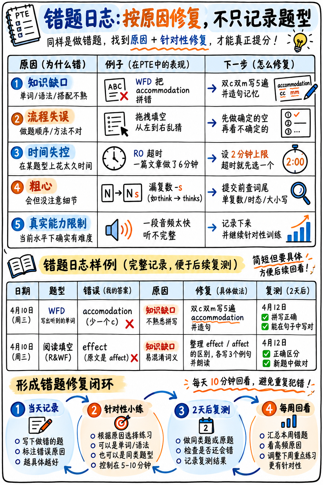

如图 34 所示，先按知识、流程、时间和粗心等原因分类，再写出可执行的修复动作，并在两天后复测。



*图 34：错题日志样例及记录、修复、复测、周回看的循环。*

:::{admonition} 为什么短期冲刺课程比长期备考更依赖错题本？
:class: important
如果备考时间长达半年，你可以靠海量刷题碰运气积累；但如果你只有 **1 到 2 周** 的黄金冲刺期，提分的**唯一可行途径就是：绝不重复犯同样的错误**！

绝大多数考生每天盲目刷几百道题却从不复盘，结果只是把原有的错误习惯、拼写误区和卡顿毛病**练得越来越熟练、越来越根深蒂固**。错题本正是将单纯的“机械做题”转化为“稳定提分”的唯一抓手。
:::

---

## 核心原则：按致错原因归类，而非按题型归类

当你做错一道题目时，最无价值的问题是“这是哪道题型”，真正具有诊断价值的问题是：**“我究竟是因为什么原因做错的？”**

不同的致错原因，对应的修复方案和提分回报率天差地别：

| 致错原因归类 | 核心特征定义 | 纠偏修复方案 | 冲刺提分回报率（ROI） |
|---|---|---|---|
| **原因 1：知识盲区**<br>*(Knowledge Gap)* | 词汇拼写不会 / 固定搭配未知 / 介词盲区 | 查词典针对性记忆，手写 5 遍巩固。耗时 3 分钟。 | ✅ **极高**（稳赚固定分） |
| **原因 2：流程方法失误**<br>*(Process Error)* | 明明有能力，但用了错误解题顺序（如先读全文才看题、阅读完形从左到右硬蒙、SWT用了分号） | 纠正错误做题习惯，机械操练标准化做题流水线。 | ✅ **极高**（属于本该到手的白送分） |
| **原因 3：时间管理失控**<br>*(Timing Error)* | 在某道小题过度纠结超时，导致末尾题目来不及做 | 强制执行单题时间死线（Time Caps），带倒计时操练。 | ✅ **高**（彻底杜绝考场崩盘） |
| **原因 4：粗心马虎**<br>*(Carelessness)* | 漏加名词复数 `-s`、字数超标或不足、误触点错 | 提炼为“考前自检清单”，提交前强制扫描。 | ✅ **高**（非受迫性失误排雷） |
| **原因 5：能力硬天花板**<br>*(Genuine Ability Limit)* | 语速极快完全听不懂、文章学术生词极多超纲 | **果断接受失误，记录后立刻跳过，坚决不纠结！** | ❌ **极低**（冲刺阶段切勿死磕） |

:::{tip} 冲刺阶段的战略洞察
在 14 天冲刺期内，**原因 2（流程失误）、原因 3（时间失控）和原因 4（粗心马虎）贡献了超过 80% 的可抢救分数！** 这些分数是“完全免费的”——你已经具备了相应的英语基础，仅仅因为操作流程变形而丢分。

**初学者最常犯的错误，就是把 80% 的复盘时间浪费在“原因 5（能力硬天花板）”上**：反复将一段语速飞快、生词云集的复述讲座（RL）录音听 8 遍，既痛苦又毫无提分意义。一旦确认为原因 5，标记后直接跳过，把宝贵的时间留给 WFD 单词听写！
:::

---

## 错题记录标准格式与全真实战范例

每一条错误只占一行。建议记录在单张纸质笔记本或纯文本表格中，**格式越简洁越好**：

```
日期 | 题型 | 发生了什么具体错误 | 原因分类(1-5) | 纠偏修复措施 | 复测合格?
```

### 10 条全真错题诊断日志示范

```
10/10 | WFD    | 把 accommodation 拼成了 accomodation       | 1 | 记住双c双m，手写默写 5 遍        | ✅ 12/10 听写正确
10/10 | WFD    | 漏掉了复数形式：写成了 student 漏了 -s       | 4 | 在草稿纸写下检查单：交卷前必查 -s | ✅ 12/10 正确
10/10 | RW-FIB | 误将 affect 选成了 effect                  | 1 | 牢记 affect 是动词，effect 是名词  | ✅ 13/10 正确
10/10 | R-MCMA | 贪心勾选了 5 个选项，倒扣分导致净得 0 分     | 2 | 铁律：只选 100% 确定的，绝不多选  | ✅ 11/10 稳拿+2
10/10 | 阅读全区| 纠结超时，导致末尾 4 个拖拽填空完全来不及做 | 3 | 单题 2 分钟硬死线，到点立刻猜并跳过| ⬜ 待 12/10 模考验证
10/10 | RS     | 句子中间卡壳犹豫停顿了 2 秒                 | 2 | 听不懂的词含糊滑过，绝对不停顿     | ⬜
10/10 | DI     | 念到第 24 秒就没话说了提前闭麦              | 2 | 备用一句话对比套话兜底撑满 40 秒    | ⬜
10/10 | 大作文  | 全文写了 312 词，险些超时超限               | 4 | 严格锁定在 240-280 词区间，写完看字数| ✅ 11/10 控在 265 词
10/10 | SWT    | 句子中误用了一个分号 (;)                    | 2 | 铁律：全文必须且只能有 1 个英文句号 | ✅ 11/10 格式合规
10/10 | RL     | 原声语速极快含糊，仅听懂约 20%              | 5 | 果断接受；用听到的词流利输出即可    | n/a (无需修复)
```

> **特别注意最后一条：** 面对“原因 5（能力硬天花板）”，记录并释怀即可——不搞无意义的精听纠结，这是冲刺备考最理性的时间止损。

---

## 拼写专项子错题本（提分回报率最高的一页清单）

在听写句子（WFD）和听力填空（L-FIB）中，**拼写错误是分数流失的最大黑洞，也是最容易 100% 修复的失分点**。

建立单独的拼写清单。每一个拼错的单词必须**立即正确抄写 5 遍**，并在随后的第 2 天（D+2）和第 7 天（D+7）进行两次盲写复测：

```
拼写专项复测表 (SPELLING LOG)

单词原形           当时错写形式       手写5遍   D+2盲测   D+7盲测   状态
──────────────────────────────────────────────────────────────────────────
accommodation      accomodation         ✅        ✅        ✅     已彻底攻克 (退役)
questionnaire      questionaire         ✅        ❌        ✅     持续观察
maintenance        maintainance         ✅        ✅        ⬜     待 D+7 复测
separate           seperate             ✅        ✅        ✅     已彻底攻克 (退役)
occurrence         occurence            ✅        ❌        ⬜     → 重新手写5遍
bibliography       bibilography         ✅        ⬜        ⬜     待 D+2 复测
```

> **单词退役标准：** 只有连续两次间隔复测均 100% 正确的单词，才能标注为“退役（Retired）”。仅仅蒙对一次绝不等于真正掌握。

```bash
# 本地利用 TTS 脚本循环朗读生词表，实现自动化听写自测
while IFS= read -r w; do
  espeak-ng -s 140 -v en-gb "$w"; sleep 6
done < spelling-log.txt
```

---

## 每周 20 分钟宏观复盘工作表（Weekly Review）

每周日晚上打开错题本，统计各类错误的分布比例：

```
每周错因诊断分析表                          复盘周期: ______

原因 1 (知识盲区):    ____ 处
原因 2 (流程失误):    ____ 处  ← 若此项最多：恭喜，你有一大批立即可捡的分数！
原因 3 (时间超限):    ____ 处  ← 若此项最多：必须严格佩戴倒计时做题
原因 4 (粗心马虎):    ____ 处  ← 若此项最多：强制建立提交前自检流水线
原因 5 (能力天花板):  ____ 处  ← 忽略此项，勿受影响

出现频率最高的单一失误: _________________________________
失分最集中的题型名称:   _________________________________

本周必须攻克的一项核心动作 (THIS WEEK'S ONE CHANGE): ___________________
```

:::{important} 每周只纠偏一个核心习惯，切勿贪多求全！
从本周统计中挑选出**发生频率最高的一项“流程失误”或“粗心习惯”**，本周只集中精力消灭这一个问题。如果试图同时改掉 6 个坏习惯，最终一个也改不掉。

例如，如果本周错题本记录了 4 次“阅读填空因犹豫超时导致末尾空题”，那么本周的唯一核心目标就是：**“到点必须闭眼猜选并跳过，绝不在任何一题上停留超过 2 分钟”**。直到该动作形成条件反射，再去解决下一个毛病。
:::

---

## 如何自动生成考场草稿板的“个性化自检避坑清单”

错题本的最大威力，在于它能在考前为你**量身定制一份专属于你个人的防踩坑指南**。备考一周后，你最容易犯的低级错误会一目了然地浮现出来：

```
【我在考场草稿板上必须提醒自己的 5 大高危失误】（开考前写在草稿板上）
  1. 大作文务必数单词数 —— 我经常写多超时
  2. WFD 提交前必须检查单复数 —— 我极容易漏掉词尾 -s
  3. 阅读与听力多选题：只勾选 100% 确定的选项 —— 我总是手痒多选
  4. RS 听到不会的词含糊滑过 —— 绝不在中间停顿卡壳
  5. 阅读填空彻底填满 —— 绝不在交卷时留空任何一个空格
```

这份清单比任何通用考试指南都管用 10 倍，因为上面的每一条规则都是用你自己的真题失分换来的教训！

---

## 模考成绩的正确复盘姿势

在完成一套全真模考后，**切忌只盯着最终给出的分数发呆或沮丧**。单纯的总分数值对于后续提分没有任何指导意义。你应当记录以下结构化指标：

| 必须统计记录的指标 | 绝不应该记录的无用感叹 |
|---|---|
| 究竟有哪些题目没来得及做完？原因是什么？ | “我才考了 58 分，完了” |
| 阅读和听力全场究竟空了几个填空格？ | “阅读文章实在太难了” |
| 在哪几道题上超出了时间预警线？ | “我得多多刷题” |
| 口语各个题型中分别出现了多少秒的尴尬沉默？ | “我的口语太差了” |
| 大作文、SWT、SST 的实际字数分别是多少？ | — |
| 模考中所有写错的拼写单词清单 | — |

:::{warning} 严禁反复重做已做过的旧阅读题来“测量水平”
重新做一套已经见过答案的阅读填空题，测试出来的只是你对答案的记忆力，而非真正的学术阅读理解能力。这会给你带来虚假的安全感。

**原则：** 见过的材料用来做**刻意操练（Drill）**；全新的生题才用来**评估水平（Measure）**。
:::

---

## 每日学习前 10 分钟固定复盘程序

在开启任何全新的练习或背诵之前，必须将每次学习的**前 10 分钟**雷打不动地分配给错题复盘：

| 时间分配 | 执行动作 |
|---|---|
| **0–4 分钟** | **拼写复测：** 盲写复测昨日记录在拼写子本中的单词。依然写错的词立即再次抄写 5 遍。 |
| **4–7 分钟** | **流程口诵：** 重读昨日记录的原因 2（流程失误），在脑海中或大声说出标准的执行规程。 |
| **7–10 分钟** | **错题重演：** 挑选昨日做错的 **2 道真题**，严格按照修复后的方法重新做一遍。 |

每天拿出这 10 分钟，其提分价值远胜于多刷 30 分钟盲目做题。因为它是你的整个备战体系中，唯一在**真正消灭错误**的动作！

---

**相关联动工具与指南：**  
- {doc}`05-study-plans`：错题复盘在每日作息日程中的具体排期  
- {doc}`06-exam-day-checklist`：考场当天避坑自检清单  
- {doc}`01-core-vocabulary`：高频核心拼写与固定搭配词库
