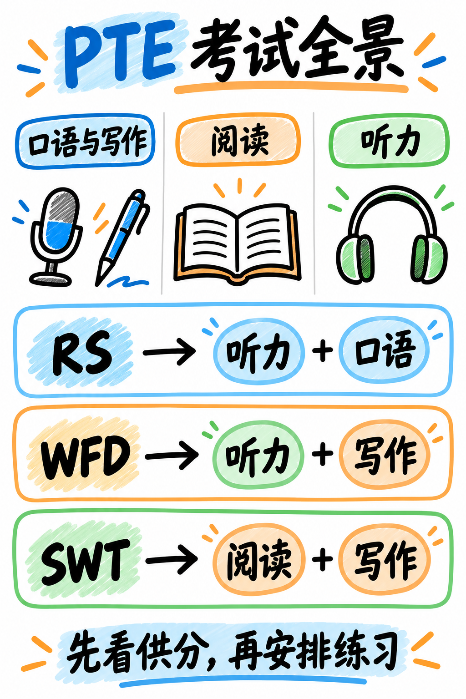

# PTE 学术英语极速通关指南：零基础到目标分通关手册 (PTE Academic Crash Course)

> **课程定位**：专为**零 PTE 基础**、**备考时间紧迫**、追求**“以最少时间精力斩获最高目标分（50 / 65 / 79+ 炸分）”**的中国考生量身打造的战略级实战课程。  
> **核心破局哲学**：PTE 是一场已知固定题库（22 种题型）与纯机器算法评分（AI 声学与语义模型）的标准化考试。只要彻底吃透机器评分逻辑与**交叉供分（Integrated Scoring）**规则，考前就能精准决策：**哪些题必须死磕、哪些题保底拿分、哪些题坚决战略放弃**。  
> **考制版本与时效性**：完整契合 **2025 年 8 月官方重大改革（August 2025 Update）**，全量覆盖两大新增口语题型（SGD、RTS）、新版技能供分映射规则，以及针对模板死记硬背的“Content 闸门清零”与人工专家双重审核机制。

---

## 🧭 课程架构与备考战术决策树 (Course Overview & Tactical Architecture)

```{mermaid}
graph TD
    subgraph Update["2025年8月改版三大核心命脉"]
        U1["两项新增口语实战题型<br/>• SGD (三人讨论总结, 2分钟长口播)<br/>• RTS (真实情境应对, 40秒表达)"]
        U2["交叉供分规则重置<br/>• RA 仅供分 Speaking (不再供分 Reading)<br/>• ASQ 仅供分 Listening<br/>• RW-FIB 仅供分 Reading"]
        U3["模板严惩机制 (The Content Gate)<br/>• 预背生硬套话判 Content 0分并连带整题作废<br/>• 7大主观题型引入 Human Review 人工双审"]
    end

    subgraph Strategy["四级精力投入与性价比梯队 (Priority Triage)"]
        T_S["Tier S (王炸主力 · 提分杠杆最高 · 每日必练)<br/>• WFD (听写句子): 写作分半壁江山, 每词1分无倒扣<br/>• RS (复述句子): 全场数量第一, 50%词序稳拿2/3分<br/>• RA (朗读短文): 文本全可见, 奠定整场口语流利度基石<br/>• FIB (阅读填空): 完形填空送分项, 靠固定搭配捡分"]
        T_A["Tier A (稳定达标 · 掌握框架 · 高效拿分)<br/>• ASQ (简答题): 生活常识单字送分<br/>• DI (看图说话): 5步弹性语法框架, 严禁死记模板<br/>• Write Essay (大作文): 7项评分Trait骨架, 严控字数<br/>• SWT (文本概括): 5-75词单句合并公式化拿分<br/>• L-FIB & RO (听力填空与段落重排相邻对)"]
        T_B["Tier B (合格即可 · 不花超额时间过度精修)<br/>• 单选 (R/L)、HCS (摘要选择)、SMW (补全尾句)<br/>• RTS (情境应对)、SST (音频摘要)"]
        T_C["Tier C (战略放弃 · 严防倒扣 · 绝不瞎猜)<br/>• Retell & SGD: 听懂核心词保流畅即可, 不死磕细节<br/>• 多选题 (R/L) & HIW (选错词): 存在 -1 倒扣分惩罚!"]
    end

    subgraph Toolkit["提分核武器工具箱"]
        TK1["一页纸 Frame 语法框架卡<br/>(只给句式语法骨架, 实词现场提取)"]
        TK2["发音流利度肌肉记忆集训<br/>(暗影跟读法 · 3秒静音防断电)"]
        TK3["错题本复盘 SOP 与分级真题库<br/>(针对性消灭拼写与启动停顿)"]
    end

    Update ==> Strategy ==> Toolkit
```



---

## 📌 2025 年 8 月官方考制改革深度剖析（避坑必读）

| 改革维度 | 旧版传统认知（已过时，切勿盲从） | 2025 年 8 月新版官方现行标准（本手册基准） | 对中国考生的实战破局策略 |
| :--- | :--- | :--- | :--- |
| **新增口语题型** | 口语仅 5 种题型（RA / RS / DI / RL / ASQ） | 新增 **SGD (小组讨论总结)** 与 **RTS (情境应对)**，口语共 7 种题型 | SGD 需持续口播 2 分钟，必须掌握论点转折框架；RTS 侧重职场与校园礼貌得体表达 |
| **交叉供分映射** | • 朗读短文 (RA) 大量供分给阅读 (Reading)<br>• 完形填空 (RW-FIB) 供分给写作 (Writing) | • **RA 仅供分给口语 (Speaking)**<br>• **ASQ 仅供分给听力 (Listening)**<br>• **RW-FIB 仅供分给阅读 (Reading)** | 破除“靠 RA 拯救阅读”的陈旧神话，阅读分数必须靠 FIB 搭配词与代词链扎实拿下 |
| **模板判定规则** | 机械背诵各类“万能万能模板”，套入任何考题都能混分 | **严惩死记硬背！** 预背无关套话直接判 **Content 0 分**；且 7 大题型引入人工专家双审抽查 | 坚决废除机械套话，改用本手册提供的**“弹性 Frame（语法框架）”**：语法由框架提供，实词全部就地取材 |
| **评分连带清零** | 只要说得流畅，哪怕内容无关也能拿流利度高分 | **内容闸门机制 (The Content Gate)**：若 Content 判为 0，流利度与发音**直接不予评分**，整题 0 分！ | 口语第一要务：必须准确命中题目核心名词与关键信息，确保 Content > 0 后再爆发流利度 |

---

## 📖 推荐通关阅读顺序与全课程模块导航 (Curriculum Navigation)

本课程建议按照**战略前置、优先级排序、真题演练、工具落地**的节奏推进。切勿按考场题型顺序机械平铺直叙复习！

### 阶段一：基础底座篇 (Foundations) — 考前必读 90 分钟

> 在动笔做任何一套练习题之前，必须先花 90 分钟彻底读完基础底座的 5 篇内容。搞懂规则，胜过盲目刷题 100 篇。

```{toctree}
:maxdepth: 1
:caption: 00 基础底座篇 (Foundations)

00-foundations/01-what-the-test-is
00-foundations/02-item-inventory
00-foundations/03-how-scoring-works
00-foundations/04-priority-triage
00-foundations/05-glossary-and-banks
```

### 阶段二：口语专攻篇 (Speaking) — 7 大题型与流利度破局

> 口语是全场最吃技巧、提分最快的模块。牢记：机器给流利度打分的敏感度远高于发音！

```{toctree}
:maxdepth: 1
:caption: 10 口语专攻篇 (Speaking)

10-speaking/01-read-aloud
10-speaking/02-repeat-sentence
10-speaking/03-describe-image
10-speaking/04-retell-lecture
10-speaking/05-answer-short-question
10-speaking/06-summarize-group-discussion
10-speaking/07-respond-to-a-situation
```

### 阶段三：写作专攻篇 (Writing) — 格式第一、单句结构与七大评分维度

> 写作题目极少，但分数大半来自听力（WFD）。大作文与 SWT 核心在于守住“格式与拼写”，杜绝低级语法失误。

```{toctree}
:maxdepth: 1
:caption: 20 写作专攻篇 (Writing)

20-writing/01-summarize-written-text
20-writing/02-write-essay
```

### 阶段四：阅读专攻篇 (Reading) — 搭配词积累、代词链与做题配速

> 阅读是整体倒计时！绝不可在一道题上死磕。填空题是得分大户，多选题必须严格防范倒扣分。

```{toctree}
:maxdepth: 1
:caption: 30 阅读专攻篇 (Reading)

30-reading/01-fill-in-the-blanks
30-reading/02-reorder-paragraphs
30-reading/03-multiple-choice
30-reading/04-section-tactics
```

### 阶段五：听力交叉篇 (Listening) — 听写句子核武器与负分避坑

> 听力是全场最大的“供分中枢”。WFD 是决定听力与写作双项生死的终极题型，必须放到每日备考的核心位置。

```{toctree}
:maxdepth: 1
:caption: 40 听力交叉篇 (Listening)

40-listening/01-write-from-dictation
40-listening/02-summarize-spoken-text
40-listening/03-fill-in-the-blanks
40-listening/04-highlight-incorrect-words
40-listening/05-multiple-choice-and-friends
```

### 阶段六：分级实战题库 (Practice Banks) — 原版英文试题 + 中文精解

> 题目本体保留 100% 官方全真英文语料，配以中文译文、意群切分标记、考点剖析与易错排查。

```{toctree}
:maxdepth: 1
:caption: 50 分级实战题库 (Practice Material)

50-practice/01-write-from-dictation-bank
50-practice/02-repeat-sentence-bank
50-practice/03-read-aloud-bank
50-practice/04-describe-image-bank
50-practice/05-essay-and-swt-bank
50-practice/06-reading-practice-set
```

### 阶段七：备考工具箱与工业化 SOP (Toolkit) — 一页纸框架与冲刺排期

> 涵盖高危词汇表、万能 Frame 框架口诀卡、肌肉记忆发音法、错题本复盘 SOP、多套冲刺日程表与考场 Checklist。

```{toctree}
:maxdepth: 1
:caption: 60 备考工具箱 (Toolkit)

60-toolkit/01-core-vocabulary
60-toolkit/02-template-card
60-toolkit/03-pronunciation-drills
60-toolkit/04-error-log-method
60-toolkit/05-study-plans
60-toolkit/06-exam-day-checklist
60-toolkit/07-sources-and-reliability
```

---

## ⚡ 一页纸极速通关速记卡 (The One-Page Cheat Sheet)

如果您备考时间极度紧迫，请务必牢记以下 7 条铁律：

1. **考试总览**：全场约 2 小时 15 分钟，包含 65~75 道题，跨 22 种题型，满分 90 分（10~90 分制），成绩通常 48 小时内出分。
2. **交叉供分是最大杠杆**：一道听写句子（WFD）同时贡献听力与写作两个技能分！3~4 句 WFD 决定了写作近半壁江山，务必每日精听精写。
3. **口语评分闸门**：内容（Content）$\to$ 流利度（Oral Fluency）$\to$ 发音（Pronunciation）。若内容判为 0，流利度与发音直接清零！
4. **坚决杜绝死记硬背**：2025 年新规明令禁止预背无关生硬套话，7 大题型有人工双审。必须使用本课程提供的**弹性 Frame 语法框架**，词汇全部现场提取。
5. **绝对精力优先级**：**WFD (听写句子) $\to$ RS (复述句子) $\to$ RA (朗读流利度) $\to$ FIB (阅读填空) $\to$ ASQ (简答) $\to$ DI (看图) $\to$ Essay (大作文) $\to$ 其他题目**。
6. **坚决战略放弃与防倒扣**：多选题（MCMA）与听力选错词（HIW）存在 **-1 倒扣分惩罚**！不确定的绝不选，选对 1 个保拿 1 分即走。Retell Lecture 与 SGD 抓几个关键词保持流畅说满即可。
7. **口语三秒绝对死线**：麦克风开始录音后，若出现连续 3 秒停顿，录音将永久自动关闭，整题直接判 0 分！宁可说平稳连词，绝不可卡壳发呆。
