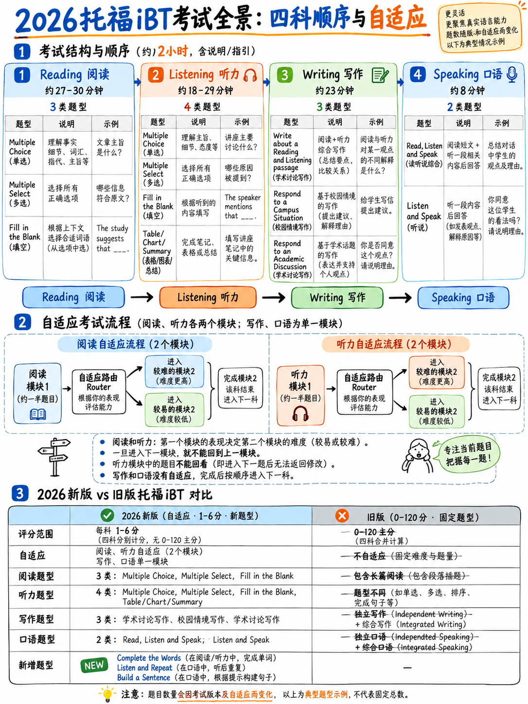

# 0.1 2026 TOEFL iBT 实际上是什么




:::{admonition} 首先要了解的一件事
:class: important

**The TOEFL iBT you are preparing for is not the TOEFL iBT that 99% of books, videos and
课程描述。** 在 **2026 年 1 月 21 日**，ETS 替换了测试中的几乎所有任务类型。
700字阅读文章、5分钟讲座、独立论文、45秒
“描述个人偏好”口语任务，综合读-听-说任务 - 全部
走了。量表也发生了变化：分数现在报告为**1-6，以半带步进**，而不是0-120。

如果资源不使用“*完成单词*”、“*听并重复*”、“构建一个
句子*或*接受采访*，它描述的是旧测试。参见
{doc}`../70-references/02-outdated-advice-red-flags`。
:::

## 0.1.1 基本事实

|事实|价值|来源 |
|---|---|---|
|此版本的发布日期 | **2026 年 1 月 21 日** | [14] |
|总时间 | **大约 2 小时**，包括说明 | [1][3] |
|实际测试时间（仅限项目）| **1 小时 23 分钟 – 1 小时 29 分钟** | [2] |
|栏目| 4：阅读、听力、写作、口语| [1] |
|栏目顺序| **始终阅读→听力→写作→口语** | [1] |
|总项目 | 120 | 120 [2] |
|预定的休息时间| **无** | [12] |
|交货|仅限计算机 — 测试中心或 **家庭版** | [3] |
|自适应？ | **是的，阅读和听力。**写作和口语是线性的| [2] |
|可用分数 | **~3 天/72 小时** | [12][13] |
|评分标准| **1-6，0.5 步**，每部分和整体 | [1][8] |
|分数有效性 | **自测试日期起 2 年** | [12] |
|重考限制 |没有限制，但**在任何 3 天内不得超过一次** | [12] |

>“更新后的托福考试可以在家中或在考试中心参加。大约需要
> 两个小时即可完成，72 小时内即可获得官方考试成绩。” [1]

## 0.1.2 一表结构

这是官方结构表，添加了ETS蓝图中的原始点列。
**记住这张表。** 这个包中的其他所有内容都是它的结果。

|部分|任务类型 |项目 |预计。时间 |原始点 |
|---|---|---|---|---|
| **阅读**（自适应）|完成单词·日常生活中阅读·阅读学术文章| 35–48（蓝图：50）|约 27 分钟 | 30–35 | 30–35
| **听力**（自适应）|聆听并选择回应 · 聆听对话 · 聆听公告 · 聆听学术演讲 | 35–45（蓝图：47）|约 18–27 分钟 | 30–35 | 30–35
| **写作**（线性）|造一个句子·写一封电子邮件·撰写学术讨论| 12 | 12约 23 分钟 | **20** |
| **说话**（线性）|听并重复·接受采访| 11 | 11约 8 分钟 | **55** |

Sources：来自[1][3][13]的结构和时序；蓝图中的物品和原始点数字
[2]； [1].

:::{note} 表 1 中的原始分数范围为 0–30 / 0–30 / 0–20 / 0–55 为什么两个不同的项目计数
ETS蓝图[2]列出了50个阅读项目和47个听力项目；面向考生的页面和
传单 [1][13] 上写着 35–48 和 35–45。区别在于**预测试项目** - 不计分的问题 ETS
正在试用。蓝图注释中写道：“项目包括阅读中不计分的项目
聆听部分……收集物品性能数据以供将来使用。”概述补充道：
“所有考生都将收到阅读或听力预测试项目” [1].

**实际结果：** 您回答的某些问题不算数，您也无法分辨哪些问题。
永远不要为一件看起来怪异的物品而苦恼。
:::

## 0.1.3 九种任务类型各一行

| ＃|部分|任务类型|你实际上在做什么 |
|---|---|---|---|
| 1 |阅读| **完成单词** |在短段落中输入缺少的 10 个单词的后半部分 |
| 2 |阅读| **日常生活中阅读** |阅读通知/电子邮件/帖子/时间表，回答 2-3 项多项选择 |
| 3 |阅读| **阅读学术文章** |阅读约 200 个单词，回答 5 项选择题 |
| 4 |听力| **聆听并选择回应** |听到一句话，从 4 个打印选项中选择最佳回复 |
| 5 |听力| **听对话** |听一段简短的 2 人对话，回答 2 项多项选择 |
| 6 |听力| **收听公告** |听到 40-85 字的公告，回答问题 |
| 7 |听力| **聆听学术讲座** |听一段 100-250 字的演讲，回答 4 项多项选择 |
| 8 |写作 | **造一个句子** |将混乱的单词拖入一个符合语法的句子中 (×10) |
| 9 |写作 | **写一封电子邮件** | 7分钟；阅读一个场景，写一封包含 3 个要点的电子邮件 |
| 10 | 10写作 | **为学术讨论而写作** | 10分钟；在班级论坛帖子中发帖 ≥100 字 |
| 11 | 11演讲| **听并重复** |听到一个句子，准确地重复它 (×7) |
| 12 | 12演讲| **接受采访** |回答 4 道面试问题，每道 45 秒 |

（十二行，九种命名任务类型 - 写作和口语，每个都包含多项项目
名称。）每一个的详细信息：{doc}`02-task-type-inventory`.

## 0.1.4“两阶段自适应”对您意味着什么

阅读和听力是**多阶段自适应**：

>“测试部分第一部分的表现用于选择第二部分的内容
> 部分部分，以便测试任务的难度与考生的能力水平相匹配
> 考生。” [1]
>
> “测试的阅读和听力部分会根据学习者的水平进行调整。” [15]

```
                    ┌──────────────┐
  everyone starts → │    ROUTER    │ ← the first and LONGER part
                    │  (module 1)  │
                    └──────┬───────┘
                           │  your score here decides the next module
              ┌────────────┴────────────┐
              ▼                         ▼
      ┌───────────────┐         ┌───────────────┐
      │ LOWER module  │         │ UPPER module  │
      │ easier items  │         │ harder items  │
      │ lower ceiling │         │ higher ceiling│
      └───────────────┘         └───────────────┘
```

蓝图 [2]:

 的官方计时|部分|路由器|第二个模块 |
|---|---|---|
|阅读| **18–21 分钟** | 9 分钟 |
|听力| **18 分钟** |下7分钟/上11分钟|

**没有人告诉初学者的三个后果：**

1。 **路由器占该部分的大部分。** 在阅读中，它大约占您的三分之二
   时间。没有“热身”。您的第一个屏幕是最重要的测试。
2. **你无法返回。** 在阅读中：“一旦你完成了，你将无法返回到模块 1
   开始模块 2" [10]。在听力中：“你将无法返回到之前的问题”
   完全是[10]。
3. **做得好会给你带来更多的测试，而不是更少。** 在听力中，上层模块是 11 分钟，
   较低的是7。上限越高意味着得分的机会越多。

:::{warning} 上限效应
如果路由器将您路由到较低的模块，那么您将看到的最难的项目都会受到限制。
这是有效的衡量标准，而不是惩罚——但这确实意味着**前 18-21 分钟
阅读的分量不成比例**。不要在半梦半醒的状态下度过。该软件包的模块 40
正是出于这个原因，我们制定了热身程序。
:::

## 0.1.5 考试中不再包含哪些内容

 将这些内容从你的学习清单中永久划掉。他们每一位都出现在畅销托福考试中
2026年之前出版的书籍。

|走了 |是 |
|---|---|
| **独立写作论文** | 30 分钟，300 多个字，“你同意还是不同意……”|
| **综合写作** |读一篇文章+听一场讲座+总结冲突|
| **口语任务 1** | 45 秒个人喜好，15 秒准备 |
| **口语任务 2–4** |读+听+说校园/学术综合任务|
| **700字阅读文章** | 3–4 篇文章，每篇 10 个问题 |
| **插入句子/散文摘要** |方形标记和 6 个选项摘要项目 |
| **4-6 分钟讲座** |长篇学术讲座，共 6 个问题 |
| **服务遭遇对话 + 5 个问题** | — |
| **0–120 分数** |现在仅作为*参考*数字，持续 2 年 |
| **休息 10 分钟** | 2026 年之前删除；仍然缺席 |

:::{danger} 最昂贵的一个错误
花一周时间学习五段托福独立论文模板。 **该任务确实
不存在。** 您将写的最长内容是 100 字的讨论帖子。
:::

## 0.1.6 测试现在试图测量什么

ETS 蓝图规定了四个“声明”——每个部分一个 [2]。阅读它们会改变你的方式
做好准备，因为它们会告诉您机器正在寻找什么：

1。 **阅读：**“考生可以阅读并理解学术和非学术书面文本
   以多种形式呈现。”
2. **听力：**“……能够理解学术和社会环境中的英语口语，包括
   单一交流、简短对话、公告和学术演讲，以便识别
   意义、目的和适当的反应。”
3. **写作：**“……可以写出语法准确且符合上下文的书面英语
   跨越一系列学术和人际情境，**包括句子级别
   结构**、多句回应和扩展的学术讨论。”
4. **口语：**“……可以说出可理解且连贯的英语口语，以有效地进行交流
   在一般和学术背景下的简短和扩展互动中。”

注意写作和口语方面的变化。 **“句子级结构”**这个词现在出现在
写作声明中，**“可理解”**是口语声明中的第一个形容词。 2026年
测试奖励*小单位的准确率*远远超过旧测试，并且奖励*作文技巧*


## 0.1.7 谁标记什么

|任务类型 |标记为 |寓意 |
|---|---|---|
|所有阅读、所有听力、造句 | **机器，基于规则** — “精确匹配或预定义评分逻辑” [2] |拼写必须准确。没有部分信用。没有人能看到你的推理。 |
|写电子邮件、撰写学术讨论、聆听并重复、接受采访 | **人工智能评分** — “自然语言处理和机器学习，以评估流畅性、连贯性和语法等特征” [2] |使用简单、清晰、结构良好的语言说话和打字。不寻常的繁荣是一种风险，而不是回报。 |

**正常评分路径中没有人工评分者**。 （只有当你支付了
30 天内口语或写作的分数复习 [12].)

:::{tip} 这在实践中意味着什么
人工智能得分手无法被迷住。可以喂它。给它：完整的句子，可见的结构，
主题内容、一系列动词时态和可听词尾。不要给予它：长时间的沉默，
复制提示语言，或中途停止的响应。
:::

## 0.1.8 交付：考试中心与家庭版

 两者交付相同的测试和相同的分数。

| |检测中心|家庭版 |
|---|---|---|
|抵达/登记 | **至少提前 30 分钟** [12] |提前 15 分钟开始办理登机手续；开始时间后最多 30 分钟 [12] |
|做笔记|提供铅笔和**草稿纸**；您不得携带自己的[12] | **一块带有可擦记号笔的小白板**，或者带有可擦记号笔的透明纸张保护器内的一张空白纸 [12] |
|设备|提供包括ETS“立体声耳机”[16] |您自己的台式机/笔记本电脑（**不是**平板电脑或手机），**只有一台显示器**，**没有头戴式耳机或耳机** [20] |
|普洛克托 |客房内工作人员|真人监考+AI监控[1][12] |
|房间|检测中心|您必须**独自一人**，门关闭，360° 摄像头扫描 [12][20] |
|休息时间 |无 | **不允许计划外休息** [12] |

:::{warning} 家庭版禁止耳机
家庭版[20]“不允许使用耳机和耳机”。您将使用您计算机的
扬声器和麦克风。 **以这种方式练习。** 如果您完成的每一次练习都使用
耳机，测试日的声音和感觉会有所不同，并且您的“聆听”和“重复”录音可能会拾取
房间回声。使用实际测试日的音频设置进行完整的演练。
:::

## 0.1.9 违反信息公告 [12] 的规则，您可能会被逐出 

。这些都不是手续——违反这些规定将取消您的资格


- **房间内没有个人物品**，除了身份证件和（在中心）存放的食物/饮料/药物
  外面。没有电话、手表、耳机、扫描或录音设备。
- **除提供的草稿纸外，禁止在任何东西上书写** — 桌子上、电脑上都不能写字，
  不是你的身份证件。
- **考试前或各部分之间不得使用草稿纸。** 所有纸张必须经过
  回来了。
- **无需使用笔记或草稿纸提前准备书面回复。
- **禁止讨论问题** - 休息期间、休息期间或之后。
- 进入前必须脱掉发饰、领带、围巾、夹克、大型珠宝。
  结婚戒指和订婚戒指可能会保留。
- 如果您**15 岁或以下**，则必须有 18 岁以上的授权成年人陪同您前往考试中心。

## 0.1.10 预订前需要检查的一件事

:::{danger} 澳大利亚签证例外情况
2026-2027 年信息公告指出：“**仅在 2026 年 1 月 21 日之前进行的考试和托福考试
iBT Australia 目前已批准用于澳大利亚签证目的**" [12].

如果您的目的是澳大利亚学生签证，则可能不接受普通更新的 TOEFL iBT。
**在**预订之前，请咨询内政部和您的机构。
:::

更一般地说：在您花一个小时学习之前，请确认 **(a)** 您的机构
接受 TOEFL iBT，**(b)** 它需要什么分数 - 以及该要求是否仍然有效
以 0–120 书写或已按 1–6 等级重述，以及 **(c)** 是否设置了 **最小值
每节**。最后一个改变了你的整个策略。参见{doc}`06-choose-your-target`.

---

**下一篇：** {doc}`02-task-type-inventory` — 每个任务类型的详细信息，与官方
您将在网上遇到的示例和缩写。