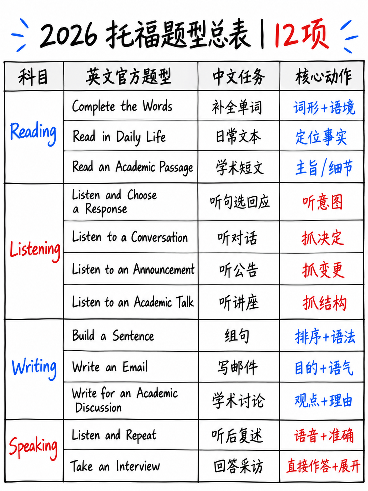

# 0.2 完整的任务型盘点




 2026 TOEFL iBT 可以要求你做的一切，按照你会遇到的顺序，与官方
描述、官方示例和重要数字。

此文件中的所有任务描述均引用或浓缩自*更新的 TOEFL iBT 测试
概述* [1]、2026 *测试蓝图和规范文档* [2] 以及 ETS 部分
页码 [4][5][6][7]。所有示例均为 ETS 自己发布的示例 [1][10][11].

---

## 0.2.1 阅读 — 三种任务类型

> “TOEFL iBT 阅读部分衡量您在两种语言中阅读和理解英语的能力
> 日常校园生活和学术背景。阅读部分取代了冗长的教科书段落
> 使用有重点的文本和交互式任务。” [4]

### 任务 1 — 完成单词 (CTW)

| | |
|---|---|
|蓝图中的项目 | **50 个阅读项目中的 30 个** [2] |
|形状| 3 段 × 10 个空白单词（纸质练习测试显示每个模块 10 个）|
|文字长度| **每段 70–100 个字** [1] |
| CEFR 频段目标 | **B1–C1+** [2] |
|标记|机器，完全匹配，**1分，无部分学分** [2] |

>“它向考生提供段落长度（约70-100字）的学术文本。以下
> 完整的第一句话，**每隔一个单词的后半部分被删除**，考生
> 必须提供缺失的字母。每个文本包含 10 个缺少字母的单词。” [1]

**官方示例** [1][10]:

```text
Fill in the missing letters in the paragraph.  (Questions 1–10)

We know from drawings that have been preserved in caves for over 10,000 years that
early humans performed dances as a group activity. We mi_ _ _ think th_ _ prehistoric
peo_ _ _ concentrated on_ _ on ba_ _ _ survival. How_ _ _ _, it i_ clear fr_ _ the
rec_ _ _ that dan_ _ _ _ was important to them. They recorded more drawings of dances
than any other group activity. Dances served various purposes, including ritualistic
communication with the divine, storytelling, and social cohesion.
```

官方答案 [10]： 1 **ght** · 2 **at** · 3 **ple** · 4 **ly** · 5 **sic** · 6 **曾经** ·
7 **s** · 8 **om** · 9 **ord** · 10 **cing**
→ *可能，那个，人，仅，基本，然而，是，来自，记录，跳舞。*

:::{important} 再次阅读答案键
在十个答案中，**六个是普通虚词或极其常见的词**：*那个，仅，
是、来自、可能、但是*。只有*录音*和*跳舞*带有话题意义，而且都是重复的
该段其他地方。这不是词汇测试。这是一个语法和搭配测试
有拼写要求。全方法：{doc}`../40-reading/02-complete-the-words`。
:::

这是**整个测试中最大的单一任务类型** — 120 项中的 30 项。四分之一
您回答的问题是完成单词空白。几乎没有2026年之前的准备材料
解决它，因为它不存在。

### 任务 2 — 日常生活阅读 (RDL)

| | |
|---|---|
|项目 | **5–15** [2] |
|文字长度| **15–150 个字** [1] |
|每个文本的问题 | **2 或 3**，取决于长度 [1] |
| CEFR 频段 | A1–C1 [2] |
|格式| 4 项多项选择 (A–D) |

 ETS [1] 列出的刺激类型：**通知·社交媒体帖子或网页·表格·a
时间表·发票·电子邮件·一串短信·收据**。

问题要求您“理解常见的非线性文本格式的信息；识别
书面沟通的主要目的；理解非正式语言，包括常见的惯用语
表达式；根据文本做出推论；理解电报语言；并浏览和扫描
信息。” [1]

**官方示例** [1]:

```text
Read a notice.

    Municipal Charter
    Sign up for paperless billing statements today.
    Safe, convenient, easy. Enroll in paperless billing to receive monthly savings
    account statements in an electronic PDF document. Access your Municipal Charter
    account through the mobile app and select account preferences in the upper
    right-hand corner to enroll.

What type of business issued the notice?
  A. An Internet provider     C. A paper company
  B. A computer company       D. A bank
```

答案：**D**。 （陷阱是三个选项与表面词相呼应——*电子*、*纸质*、
*移动应用程序*。只有“储蓄账户报表”才能识别企业。）

### 任务 3 — 阅读学术文章 (RAP)

| | |
|---|---|
|项目 | **5–15** [2] |
|文字长度| **约200字** [1] |
|每篇文章的问题| **五** [1] |
| CEFR 频段 | B1–C2 [2] |
|学科领域 |历史、艺术和音乐、商业和经济、生命科学、物理科学、社会科学 [1] |

> “该任务的设计不需要背景知识。” [1]

里面的问题类型：“事实信息、上下文词汇、推论、关系
想法与全部或部分文本的目的之间的关系”[1].

已发布的示例是一篇 213 字的文章，标题为“镜子测试”，关于自我认知
动物，然后是五个问题，包括上下文词汇项（“‘里程碑’这个词
第一句中的含义最接近“）和一个例外项 [10].

:::{note} 200 个单词，而不是 700 个单词
老托福的阅读文章是650-750字，10题。新的**200字
有 5 个问题**。为旧格式建立的速读训练在这里大多是浪费精力；
*精确*训练不是。参见 {doc}`../40-reading/04-read-an-academic-passage`。
:::

---

## 0.2.2 听力 — 四种任务类型

>“听力部分使用简短、集中的音频剪辑。” [5] 音频 **播放一次** [2].

Audio 被描述为“**人工智能生成的音频，有时是人类配音演员**”，具有“一般
平衡地体现地区口音……例如美国/加拿大、澳大利亚和英国英语
品种“[2]。 （ETS 页面 [5] 还列出了新西兰。）

### 任务 4 — 聆听并选择响应 (LCR)

| | |
|---|---|
|项目 | **15–19** — 最大的听力任务 [2] |
|音频长度|一句话，**“不超过六个重读音节”** [2] |
| CEFR 频段 | A1–B2 [2] |
|格式|听到一行（**不打印**），读四个选项，选出最佳回复|

>“问题或陈述只是听到的，没有写在屏幕上。” [1]

**官方示例** [1]:

```text
Test takers hear:   Didn't I just see you in the library an hour ago?

Choose the best response.
  A. As a matter of fact, I was returning a book.
  B. Yes, you can find it in the reference section.
  C. I don't think I'll have enough time to do that.
  D. Actually, I think I can get there a little earlier.
```

答案要点：**A**.

:::{tip} 整个听力部分最便宜的分数
15–19 个项目，每个句子长，每个项目的 CEFR **A1–B2** — 难度级别最低
测试任务。如果你时间不够，这就是听力学习应该开始的地方。
{doc}`../50-listening/02-listen-and-choose-a-response`。
:::

### 任务 5 — 聆听对话 (LTC)

| | |
|---|---|
|项目 | **10** [2] |
|音频 |简短的两人对话；中等长度音频为 **35–100 个字** [2] |
|问题 | **每次对话 2 个** [1] |
| CEFR 频段 | A2–C1 [2] |
|主题 | “餐饮、社交活动、教育、娱乐、服务、健康、爱好、家庭、购物、通讯和旅行” [1] |

 已发布的示例是一个 9 轮超市/游戏对话，其中有一个习语 — *“我会忘记我的”
头，如果它没有拧紧”* - 和两个问题，其中之一是一个推论（“什么是
女人 **暗示** 她正要做什么？") [1][10].

### 任务 6 — 收听公告 (LTA)

| | |
|---|---|
|项目 | **6–10** [2] |
|音频 | **40–85 个字** [1] |
| CEFR 频段 | A2–C1 [2] |
|内容 | “时间表、方向、规则和规定，或学生成绩” [1] |

 该示例是关于客座讲座的课堂公告，其中包含有关主题和主题的问题
**演讲者目的**（“为什么教授提到 Palmer 博士的受欢迎程度？”） [10].

### 任务 7 — 听学术演讲 (LAT)

| | |
|---|---|
|项目 | **8–16** [2] |
|音频 | **100–250 个字** [1] —“最多 250 个字的扩展独白演讲” [2] |
|问题 | **每讲四个** [1] |
| CEFR 频段 | A2–C2 — 唯一达到 C2 的听力任务 [2] |

> “……识别主要和支持性观点，做出推论，有时较少解释
> 常用或惯用词汇。” [2]

发布的示例是一个关于*硬*与*软迷恋*的心理学播客 - 大约 250 个字，
四个问题，包括“演讲者为什么提到一部电影？” （答案：**B**，“引入一个
[1].

---

## 0.2.3 写作 — 三种任务类型，23 分钟，20 个原始点

### 任务 8 — 造句 (BAS)

| | |
|---|---|
|项目 | **10** [2] |
|原始点 | **每项 1 → 写作部分 20 分中的 10 分** [2] |
| CEFR 频段 | A1–C2 [2] |
|标记| **机器** [2] |

>“考生看到一个完整的句子，后面跟着另一个句子，其中包含单词或短语
> 顺序错误。这两个句子形成说话者之间的交流。考生移动单词并
> 短语来形成一个符合上下文的语法句子，作为上下文中的适当答复。” [1]

**官方示例** [1]:

```text
Make an appropriate sentence.

  What was the highlight of your trip?

  The ____ ____ ____ ____ ____ ____ fantastic.

  were   the   was   old city   showed us around   who   tour guides
```

Sample high-level response: *The tour guides who showed us around the old city were fantastic.*

:::{important} Half of your Writing score is a word-ordering puzzle
十个机器标记的项目，价值**写作部分原始分的**50%**，要求**零**
构图、零想法、零词汇，超出了屏幕上的内容。这是纯粹的语法——相对的
从句、嵌入题、问题形成。

对于一个三周的初学者来说，这是测试中每小时回报最高的任务。
{doc}`../30-writing/02-build-a-sentence`。
:::

注意示例中给定的单词池在某些项目中包含**多于空白**
官方练习测试 - 但空白会准确地告诉您要放置多少块。数一下。

### 任务 9 — 写一封电子邮件 (WE)

| | |
|---|---|
|项目 | 1 |
|原始点 | **5** [2] |
|时间 | **总共 7 分钟，阅读并回复** [1][18] |
| CEFR 频段 | B1–C2 [2] |
|标记| AI，**0–5 评分指南** [1] |
|字数统计工具 | **是** [18] |
|拼写检查 | **否** [18] |

>“考生被要求以书面形式分享信息以达到特定的交流目的——
> 例如，提出建议、发出邀请或提出解决方案
> 问题。” [1]

提示总是给出**三个要点说明**。发布的两个例子[10][11]
是一封写给杂志编辑的投诉和询问电子邮件，以及一封写给同事的工作场所电子邮件，内容涉及某件事
令人失望的餐厅。

官方**样本高级响应**是**118字长**并且包含至少四个真实的
错误：*参与*、*使用在线提交表格*（缺少文章）、*我的诗可以成功
已发送*（断续动词短语），*已收到* [1][18]。它仍然被标记为高级。完整分析：
{doc}`../30-writing/03-write-an-email`.

### 任务 10 — 撰写学术讨论 (WAD)

| | |
|---|---|
|项目 | 1 |
|原始点 | **5** [2] |
|时间 | **10 分钟** [1] |
|规定的目标长度| “有效的回复将包含**至少100个字**”[1] |
| CEFR 频段 | B1–C2 [2] |
|标记| AI，0–5 评分指南 [1] |

>“教授的帖子简要阐述了主题并提出了意见问题……简短的帖子
> 然后两名学生就该问题提出不同的立场。考生贡献自己的力量
> 对问题的自己的立场，用自己的推理、经验或支持自己的观点
> 知识。” [1]

屏幕上的ETS指令块显示：“表达并支持您的意见。**做出贡献
用你自己的话进行讨论。**”

:::{note} ETS自己的范例是79个字
已发布的对志愿服务提示的高层回应样本为 **79 个字** — 低于
规定最少 100 字。 （直接从[1]中的文字计算。）

不要以此为许可写79个字。将其作为**相关性、明确的证据
位置，以及一个比长度更重要的具体示例。** 目标为 100-140 个单词；不要填充到200。
:::

这是旧测试中幸存下来的一项任务 - 它于 2023 年 7 月添加到托福中 - 所以
2023 年后有关“学术讨论写作”的材料仍然有效。这是**唯一**


---

## 0.2.4 口语 — 两种任务类型，8 分钟，55 个原始分

### 任务 11 — 听并重复 (LR)

| | |
|---|---|
|项目 | **7** [1][2] |
|原始点 | **各 5 分 → 口语部分 55 分中的 35 分** [2] |
|准备时间| **没有。** “不会提供准备时间。” [10] |
|录音窗口| **每句话 8–12 秒** [1] |
| CEFR 频段 | A1–C2 [2] |
|标记| AI，0–5 评分指南 [1] |

>“考生在学术或校园生活环境中的场景中重复七个句子......
> 每句话之后都有一个停顿，然后考生准确地重复所说的内容。
> **随着考生的进步，句子会逐渐变得更长、更复杂**
> 场景。” [1]

该场景是一个带图片的导览框架：ETS 发布的两个示例*受欢迎
参观动物园的游客* [1][10] 和*引导新生穿过校园体育馆* [11].

 在两个官方集合中测量的句子长度：

|造句|动物园套装|健身套装|
|---|---|---|
| 1 | 6 个字 | 5 个字 |
| 2 | 9 | 6 |
| 3 | 11 | 11 6 |
| 4 | 12 | 12 11 | 11
| 5 | 9 | 8 |
| 6 | 11 | 11 10 | 10
| 7 | **13** | **15** |

所以真正的范围大约是 **5 到 15 个单词**，爬升到带有嵌入的长最后句子
条款（“游客中心，**位于正门附近**，可以为您提供更多信息”）。

:::{important} 测试中最大的战略事实
**口语部分的 55 个原始点中有 35 个来自于重复句子
刚刚听说。** 没有意见。没有想法。您无需提供任何词汇。没有准备时间
需要，因为没有什么需要准备的。

对于初学者来说，这是托福考试中最容易学习的部分——而且它在
初学者最害怕的部分。模块 {doc}`../10-pronunciation/01-start-here-sound-system` 和
{doc}`../20-speaking/02-listen-and-repeat` 是围绕它构建的。
:::

### 任务 12 — 接受采访 (TI)

| | |
|---|---|
|项目 | **4 个问题** [1][2] |
|原始点 | **各 5 个 → 20 个，共 55 个** [2] |
|时间 | **每题 45 秒** [1] |
|准备时间| **无** [10][11] |
| CEFR 频段 | A1–C2 [2] |
|标记| AI，0–5 评分指南 [1] |

>“考生与预先录制的面试官进行模拟对话。面试
> 发生在各种情况下，例如申请奖学金或参加
> 一项研究……最初的问题集中于事实信息和个人经验，而
> 随后的问题要求考生就更广泛的问题表达和支持意见。” [1]

 **这四个问题遵循固定升级。** 这在所有三篇已发表的采访中都可见
（城市生活[1][10]，通勤习惯[11]）：

|问 |功能|城市生活的例子|通勤示例|
|---|---|---|---|
| 1 | **个人事实/过去的经历** | “回想一下你上次访问一个城市......你为什么去那里旅行？你喜欢什么？” | “住在学校或工作单位附近很重要吗？为什么？” |
| 2 | **个人反应+解释** | “你对城市有什么样的反应？你认为你为什么会有这样的反应？” | “想象一下，您可以乘坐汽车……或公共交通……您会选择哪一个，为什么？” |
| 3 | **同意/不同意所陈述的观点** | “有些人认为生活在城市的人过着更有趣的生活……你同意吗？为什么或为什么不呢？” | “有些人认为通勤可能会带来压力……有什么一两种方法可以让通勤变得更愉快？” |
| 4 | **广泛的政策/假设，举例** | “市政府是否应该创建更多公园……？为什么或为什么不？” | “通勤的严重减少会对企业产生怎样的积极和消极影响？请分别举一个例子。” |

:::{tip} 即使您无法排练主题，也可以排练形状
因为*功能*是固定的，所以您可以为每个功能预先构建一个 45 秒的答案框架
四个插槽并将任何主题放入其中。这就是全部
{doc}`../20-speaking/03-take-an-interview`。
:::

官方**示例高级响应**记录了所有犹豫 - *“
我上次访问的城市是……德里。我去那里，嗯，拜访我的朋友……”* - 包括
*嗯*，*呃*，*喜欢*，自我纠正（“食物也——太棒了”）和非标准复数
（“不同类型的地方”）。它仍然是高级范例 [1].

---

## 0.2.5 您将在网上遇到的缩写和术语

 社区和准备网站已经为新任务创造了简写。 **没有官方
缩写集** — 这些是社区用法，列出是为了让您可以阅读论坛，而不是为了让您可以使用
他们在答案中。

|缩写 |意义|
|---|---|
| **iBT** |基于互联网的测试——标准托福。大多数人都拿的唯一一个 |
| **CTW** |完成单词（阅读）|
| **RDL** |日常生活中的阅读（阅读）|
| **说唱** |阅读学术文章（阅读）|
| **LCR** |聆听并选择一个回应（聆听）|
| **LTC / LTA / LAT** |聆听对话/公告/学术演讲 |
| **巴斯克** |造一个句子（写作）|
| **我们** |写一封电子邮件（写作）|
| **WAD** |为学术讨论写作（写作）|
| **LR** |听并重复（口语）|
| **TI** |接受采访（口语）|
| **路由器** |自适应部分的第一个较长模块 |
| **上/下模块** |您将进入更难/更容易的第二个模块 |
| **我的最佳** | ETS官方超级分数：两年来最佳单项分数 [12] |
| **测试准备** | ETS 官方备考门户 [19] |
| **家庭版** |家庭监考版本|
| **CEFR** |欧洲共同参考框架（A1→C2）|
| **美国教育考试服务中心** |教育考试服务中心——考试制作者|
| **成绩单/成绩报告** |结果的 PDF |
| **预测试项目** |混合到阅读或听力中的不计分试题 [2] |
| **独立/集成** | **旧测试术语。** 如果某个资源将它们用于写作或口语，那么它是 2026 年之前的 |
| **TPO** | 《托福在线练习》——**现有的所有TPO材料都是旧格式** |

:::{danger} “TPO”是托福备考中最大的陷阱词
数以千计的免费“TPO 1–75”练习套件在网上流传。他们每一个都是**老**
测试：700字短文、综合口语、独立论文。他们的英语都很棒
练习和**完全误导性的模拟**。参见
{doc}`../70-references/02-outdated-advice-red-flags`。
:::

---

**下一个：** {doc}`03-how-scoring-works` — 1-6 级、CEFR 映射、与
旧的 0-120 等级，以及决定学习哪个部分的算术。