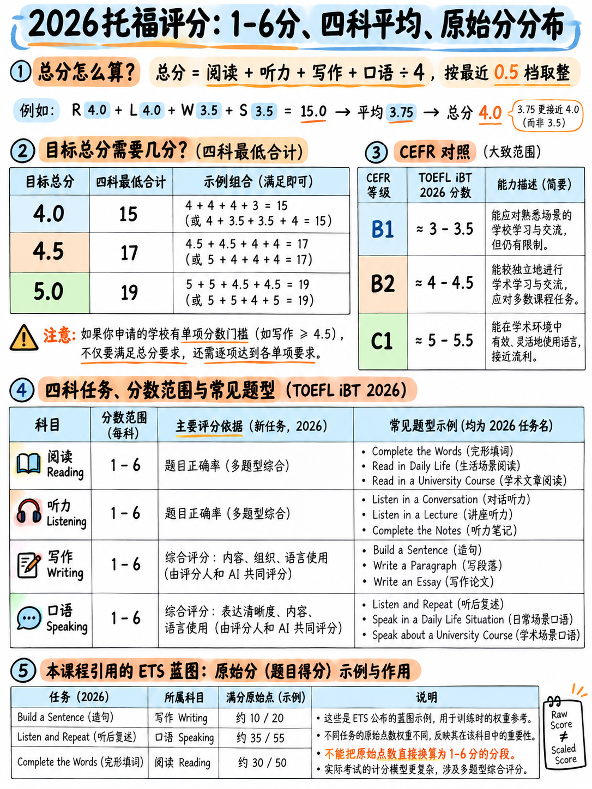

# 0.3 How scoring works — and what it tells you to study




This is the most useful chapter in the package. Read it twice.

## 0.3.1 The band scale

Since 21 January 2026, every TOEFL iBT score — each section and the overall — is reported on a
**1–6 scale in half-band steps** [1][8]. There are therefore exactly **eleven possible scores**:

```
1  1.5  2  2.5  3  3.5  4  4.5  5  5.5  6
```

> “四个部分中每个部分的表现和整体测试以频段的形式报告
> 分数从 1 到 6，增量为 0.5，四舍五入到最接近的整分或半分。整体
> 测试分数是通过平均各个部分的分数得出的。” [1]

## 0.3.2 The CEFR mapping (Table 2 of the ETS overview)

| CEFR 级别 |阅读|听力|写作 |演讲|总体 |
|---|---|---|---|---|---|
| **C2** | 6 | 6 | 6 | 6 | 6 |
| **C1** | 5–5.5 | 5–5.5 | 5–5.5 | 5–5.5 | 5–5.5 |
| **B2** | 4–4.5 | 4–4.5 | 4–4.5 | 4–4.5 | 4–4.5 |
| **B1** | 3–3.5 | 3–3.5 | 3–3.5 | 3–3.5 | 3–3.5 |
| **A2** | 2–2.5 | 2–2.5 | 2–2.5 | 2–2.5 | 2–2.5 |
| **A1** | 1–1.5 | 1–1.5 | 1–1.5 | 1–1.5 | 1–1.5 |

 来源：表 2，[1]； identical mapping on [8].

This is the cleanest thing about the new scale: **each CEFR level is exactly two bands wide**, and
每个部分的映射都是相同的。带 4 是 B2 的底部。 Band 5 is the bottom of C1.

## 0.3.3 Translating an old requirement into the new scale

Your university's website almost certainly still says something like "TOEFL 80" or "TOEFL 100".
ETS publishes the official translation [8]:

|旧要求 (0–120) |推荐的新要求 (1–6) |
|---|---|
| 100 | 100 **5** |
| 90 | 90 **4.5** |
| 80| **4** |
| 70 | 70 **3.5** |

> "a 5 on TOEFL iBT is equivalent to a 95 and up (through 106)." [8]

And the full concordance (Table 3 of [1], also on [8]).部分列是 **旧的 0–30
缩放分数**，不是原始分数：

|乐队 (1–6) |阅读|听力|写作 |演讲|总体 (0–120) |
|---|---|---|---|---|---|
| **6** | 29-30 | 29-30 28–30 | 29-30 | 29-30 28–30 | 114 | 114
| **5.5** | 27-28 | 27-28 26-27 | 26-27 27-28 | 27-28 27 | 27 107+ |
| **5** | 24-26 | 24-26 22-25 | 22-25 24-26 | 24-26 25-26 | 25-26 95+ |
| **4.5** | 22-23 | 22-23 20-21 | 20-21 21-23 | 21-23 23-24 | 23-24 86+ |
| **4** | 18–21 | 17-19 | 17-19 17-20 | 17-20 20-22 | 20-22 72+ |
| **3.5** | 12-17 | 12-17 13–16 | 15-16 | 15-16 18-19 | 18-19 58+ |
| **3** | 6–11 | 9–12 | 13–14 | 16-17 | 16-17 44+ |
| **2.5** | 4-5 | 4-5 6–8 | 10-12 | 10-12 13–15 | 34+ |
| **2** | 3 | 4-5 | 4-5 5-9 | 5-9 11-12 | 11-12 24+ |
| **1.5** | 2 | 2-3 | 2-3 3-6 | 3-6 5-9 | 5-9 12+ |
| **1** | 0–1 | 0–1 | 0–4 | 0–2 | 0+ |

:::{note} 两年内您将获得这两个号码
“两年内，托福将在成绩报告中提供旧分数等级的参考”[1]。
您的报告显示 1-6 个频段**加上**可比较的 0-120 整体，这是“
等效范围”[8] — 例如4.5 与 **90** 一起报告。

 因此，如果机构仍然要求“90”，则**4.5** 在报告的正面即可满足要求。
:::

:::{warning} ETS 自己的页面不一致
分数等级页面 [8] 在范围表中将 4.5 行显示为“86+”，但在其常见问题解答中表示
4.5 附有报告的 90。两种陈述都在同一页上。范围是频带
边界； 90 是报告的中点。写信给招生办公室时引用中点，
并附上 ETS 索引链接。
:::

## 0.3.4 总分是未加权的平均值 - 并且可以利用

>“总分是四个部分的平均值，四舍五入到最接近的半带。对于
> 例如，平均分 5.125 得出的总分为 5。” [3]
> “平均 5.25 变成 5.5。” [8]

所有四个部分**同等**。阅读并不比口语更有价值。 8分钟演讲


### (4 × target − 1) 规则

 根据舍入规则，四个部分的分数必须**总**为至少：

$$\text{required sum} = 4 \times \text{target} - 1$$

|总体目标 |四个部分的总和必须至少 |
|---|---|
| 3.0 | **11.0** |
| 3.5 | 3.5 **13.0** |
| **4.0** | **15.0** |
| **4.5** | **17.0** |
| **5.0** | **19.0** |
| 5.5 | 5.5 **21.0** |
| 6.0 | 23.0 |

**针对 ETS 自己的工作示例进行验证：**

- ETS：平均 5.25 → 总体 5.5。总和 = 21.0。规则规定 5.5 需要 ≥ 21.0。 ✓
- ETS：平均 5.125 → 总体 5.0。总和 = 20.5，小于 21.0，因此不是 5.5。 ✓

### target-4.0 配置文件看起来像

所有这些总计 ≥ 15.0，因此给出**总体 4.0**：

|右 |左 |西 | S |总和 |总体 |
|---|---|---|---|---|---|
| 4.0 | 4.0 | 4.0 | 4.0 | 16.0 | 4.0 |
| 4.5 | 4.5 4.5 | 4.5 3.5 | 3.5 3.5 | 3.5 16.0 | 4.0 |
| 5.0 | 5.0 | 3.0 | 3.0 | 16.0 | 4.0 |
| 4.5 | 4.5 4.5 | 4.5 4.0 | 3.0 | 16.0 | 4.0 |
| 4.0 | 4.5 | 4.5 3.5 | 3.5 3.0 | 15.0 | 15.0 4.0 |

第三行是重点：**两个强的部分可以承载两个弱的部分两个完整的频段。**

:::{danger} 使整个游戏无效的警告
如果您的机构设置了**每个部分的最低要求** —“总体 80 分，每个部分至少 20 分”是
经典的旧式措辞，类似于“整体 4 分，写作至少 4 分”——
那么平衡策略就失效了，地板就成了你的目标。 **先检查一下
计划任何事情。** {doc}`06-choose-your-target`。
:::

### 整体带具有粘性 — 这是个好消息

，因为部分以 0.5 步移动，而整体需要 **2.0** 总改进才能移动半步
乐队，单个部分提高一个档次没有任何改变。你需要四个一级增益，
或**一个部分由两个完整频段**。

这强烈反对稀疏地分散努力。选择两个最便宜的路段并驾驶它们
很难。 {doc}`04-priority-triage` 识别这些是哪些。

## 0.3.5 原始点：标记实际存在的位置

ETS 发布原始分数范围（[1] 的表 1）和蓝图的每项点 [2]:

|部分|原始系列 [1] |蓝图原点[2] |每件商品积分 |
|---|---|---|---|
|阅读| 0–30 | 35 | 35 **1** |
|听力| 0–30 | 35 | 35 **1** |
|写作 | **0–20** | 20 | 1（造句）/ **5**（电子邮件）/ **5**（讨论）|
|演讲| **0–55** | 55 | 55 **每项 5**，11 项 |

（阅读和听力的 30 与 35 差异是预测项目；参见
{doc}`01-what-the-test-is` §0.1.2。 ETS 已将该蓝图标记为“需进行细微修改”。）

### 每个部分内的分布 — 此包中最可操作的表

|部分|任务|项目 |原始点 | **% 的部分** |
|---|---|---|---|---|
| **写作** |造一个句子 | 10 | 10 10 | 10 **50%** |
| |写一封电子邮件 | 1 | 5 | 25% |
| |为学术讨论撰写| 1 | 5 | 25% |
| **讲话** | **听并重复** | 7 | **35** | **64%** |
| |接受采访 | 4 | 20 | 36% |
| **阅读** |完成单词| 50 项中的 30 项 | — | **~60% 的物品** |
| |日常生活中阅读 | 5–15 | — | — |
| |阅读学术文章 | 5–15 | — | — |
| **聆听** |聆听并选择回应 | 15–19 共 47 | — | **~34–40% 的项目** |
| |听一段对话 | 10 | 10 — | — |
| |收听公告 | 6–10 | — | — |
| |聆听学术讲座 | 8–16 | — | — |

:::{important} 再读一遍
- **口语部分的 64% 是重复句子。**
- **写作部分的 50% 是词序谜题。**
- **60% 的阅读项目是填字练习。**
- **~37% 的听力项目是一行“选择最佳答复”问题。**

四项任务。它们都不要求你有想法、提出论点或认识学者
主题。他们占了测试的大部分。 **这就是初学者的有限之处
时间应该花在他们的时间上。** {doc}`04-priority-triage` 的全部内容均从此表得出。
:::

:::{warning} ETS 不发布的内容
**没有公开的原始分数 → 等级转换表。** 我们知道口语的得分为 55 分，
频段 4 存在；我们不知道“38/55 = band 4”。任何为您提供此类表格的网站都有
发明了它。

 在这个包中建议原始分数阈值的所有地方，它都被标记为**分析**
并且是一个规划辅助工具，而不是已公布的事实。
:::

## 0.3.6 如何对四项类似人类的任务进行评分

 四项任务是根据已发布的 0-5 评分指南 [1] 进行 AI 评分的。四篇全文
指南在相关模块中复制；这就是这些乐队的区别。

### 写电子邮件/写学术讨论 (0–5)

|分数 |标题|决定性特征|
|---|---|---|
| **5** | “完全成功的回应”|有效支持目的的阐述； “**几乎没有**词汇或语法错误**除了有能力的作家在定时条件下写作所预期的错误之外**（例如，常见的拼写错误或常见的拼写错误或像there/their这样的替换）” |
| **4** | “总体上是成功的回应” |充分阐述； “**很少**词汇或语法错误”|
| **3** | “部分成功的回应”| “阐述解释、示例或细节的哪一部分可能缺失、不清楚或不相关”； “**一些明显的**错误”|
| **2** | “基本上不成功的回应”| “错误的**累积**”；有限或不相关的阐述|
| **1** | “不成功的回应”|电报语言； “**最少的原始语言**；任何连贯的语言大多是从刺激中借用的”|
| **0** | — |空白、离题、非英语、完全复制或任意击键 |

### 听并重复 (0–5)

|分数 |官方字样[1] |
|---|---|
| **5** | “响应**完全重复**提示......完全可以理解” |
| **4** | “抓住了意思……但不是精确的重复”——一两个功能词丢失/改变，一个实词被相关词替换，时态/数字标记错误，或者两个词调换 |
| **3** | “基本完整，但没有准确捕捉原意”——**大部分内容词**； “回复是一个完整的句子”|
| **2** | “缺少提示的重要部分和/或高度不准确”； “不是一个独立的句子” |
| **1** | “简短的几句话回应……大多难以理解”|
| **0** |没有回应，完全听不懂，没有英语，或者只是“我不知道”|

###接受采访(0–5)

|分数 |官方字样[1] |
|---|---|
| **5** | “主题明确且阐述充分”； “良好的对话语速……适当且自然地使用停顿”； “节奏和语调有效地传达意义”|
| **4** | “主题明确且详尽，但可能缺乏有效的句子级连接器”； “一些可能对流程影响最小的暂停” |
| **3** | “有限的阐述”； “**频繁或长时间的停顿会导致节奏不稳定；填充词很常见**” |
| **2** | “最小连接......主要由问题中的语言组成” |
| **1** | “只有模糊的联系……大部分难以理解……孤立的单词或短语”|
| **0** |如上所述|

## 0.3.7 这些标题证明了大多数建议都是错误的六件事

**1。聆听和重复的部分功劳是巨大的。**
保留句子框架和最有内容的单词但删除 *the* 并变得时态的响应
标记错误仍得分 **4（共 5 分）**。即使是半截断的完整句子也得分 **3**。只有沉默
或者碎片会让你的分数下降到 1-2。 *策略：总是说一个完整的句子，即使是一个错误的句子。*
全程治疗：{doc}`../20-speaking/02-listen-and-repeat`.

**2。拼写错误不会影响最高的写作分数。**
第 5 级明确容忍“常见错别字或常见拼写错误”。 ETS 自己的高级电子邮件
示例包含*参与*、*成功*和*收到* [1][18]。 *策略：永远不要花你的钱
最后40秒校对拼写；花它完成第三颗子弹。*

**3。填充词是口语中的第 3 级功能，但前提是与断断续续的语气搭配使用。**
频段 3 表示“频繁或长时间的停顿会导致节奏不稳定；**填充词很频繁**”。
第 5 段说“适当且**自然**地使用停顿”。 ETS 的高层面试范例是
充满*嗯*和*呃* [1]。 *策略：填充剂不是敌人。沉默和停止是。*

**4。在这两种技能中，复制提示都会受到明确的惩罚。**
写作第一组：“任何连贯的语言大多是从刺激中借用的。”口语乐队2：
“主要由问题中的语言组成。” *策略：复述第一个问题
条款，然后远离它。*

**5。 “连接器”仅被命名一次，位于第 4 级，并且是轻度缺陷。**
“主题明确且详尽，但可能**缺乏有效的句子级连接器**。”他们是
没有任何地方被描述为通往频段 5 的路线。*策略：少量自然连接器，而不是记忆的连接器
二十人名单。*

**6。任何标题中都没有奖励口音。**
使用的词语是**可理解**、*节奏*、*语调*、*节奏*。第五组口语：“发音
容易理解；节奏和语调有效地传达了意义。” *策略：训练节奏，
重音和词尾——不是美国口音。*这就是为什么
{doc}`../10-pronunciation/05-rhythm-and-chunking` 出现在音素练习之前。

## 0.3.8 MyBest® 分数 — 安静的快捷方式

>“您的 MyBest® 分数，它结合了您所有有效托福考试中每个部分的最佳分数
> 过去2年的iBT成绩，让您在每项技能上展示您的最佳表现
> 区域。” [12]

MyBest 是 ETS 的官方超级分数。它**包含在您的费用中**，打印在每份报告上，并且
它的总成绩是你最好的四个部分成绩的平均值 [1].

 结合重考政策——“没有限制你可以参加考试的次数，但你
三天内不能多次服用”[12]——这创建了一个合法的策略：
**参加两次测试，每次攻击两个部分。**

:::{warning} 两个条件
1. **该机构必须接受 MyBest。** 许多机构都这样做；许多人没有。付款前以书面形式询问
   第二次坐会。
2. 每次坐席均需缴纳全额费用，费用因国家而异。这仅在差距时才有意义
   你的两个最薄弱的部分之间的距离很大。
:::

## 0.3.9 实用评分机制

|事情|规则|来源 |
|---|---|---|
|最低得分 | **至少一项阅读问题、一项听力问题、一项口语任务和一项写作任务** | [3][12] |
|跳过整个部分 | **没有任何部分得分** | [3] |
|错误答案 | **没有处罚。** 切勿将多项选择留空 | [2]（机器，精确匹配计分）|
|非官方分数| **最后屏幕上显示阅读和听力** | [12] |
|取消 |测试结束后，您可以取消 - 但**所有四个部分一起**，且不予退款 | [12] |
|恢复取消的分数 |可以付费；报告“收到您的请求和付款后大约 3 周”| [12] |
|分数回顾 |仅口语和/或写作，**30 天内**，需付费，并且**仅当您尚未发送分数时** | [12] |
|官方发帖 | **~测试后3天** | [12] |
|有效期 | **2 年** | [12] |

:::{tip} 非官方得分判定点
在您决定是否取消之前，您将看到您的阅读和听力成绩。如果两者都远
低于目标，取消会花费您费用，但会在您的记录中保留较低的分数 - 尽管大多数
无论如何，机构只看您最好的报告，而 MyBest 只会帮助您。 **对于几乎
每个考生，正确的答案是：报告分数。** 取消会丢弃写作和
说出你需要改进的数据。
:::

---

**下一篇：** {doc}`04-priority-triage` — 将本章的数字变成每小时的研究
分配。