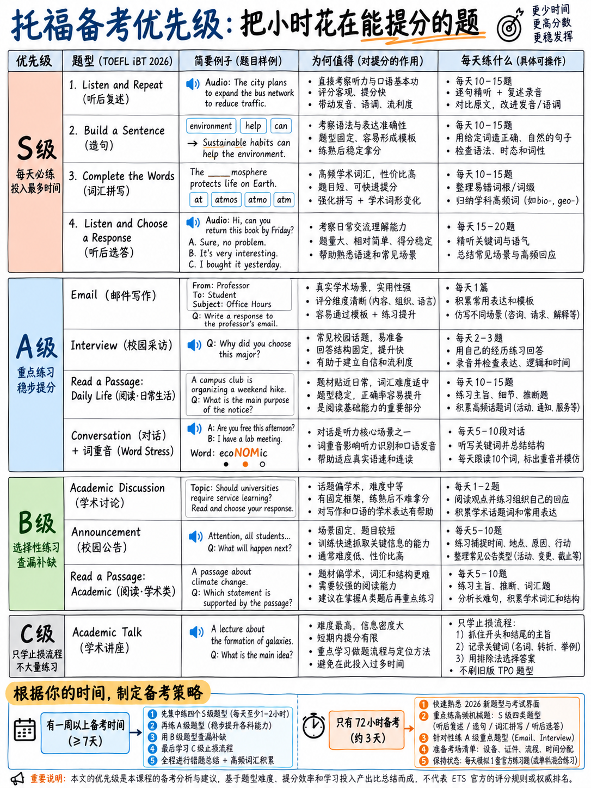

# 0.4 优先分类——学习什么、浏览什么、放弃什么




:::{admonition} 治理原则
:class: important
你并不是想学英语。您正试图将固定的学习时间转换为
最大可能的带总数。这些是不同的项目。本章对每个任务进行排序
2026 年托福成绩**（可用分数）×（初学者可以提高的速度）÷（所需时间）**。
:::

## 0.4.1 等级列表

**S 等级 — 首先每天执行这些操作，直到测试。** 高分份额、机械技能、


| 在几天而不是几个月内即可改进。任务|部分|为什么选择 S 级 |
|---|---|---|
| **听并重复** |演讲| **口语部分原始分数的 64%** [2]。不需要任何想法。部分计分是慷慨的（带 3 =“大部分内容词”）。可通过纯钻探进行训练。 |
| **造一个句子** |写作 | **写作部分原始分数的 50%** [2]。十个机器标记的语法难题。有限的、可学习的模式。 |
| **聆听并选择回应** |听力| 15–19 个项目，CEFR **A1–B2** — 测试 [2] 中最简单的项目。每句音频。 |
| **完成单词** |阅读| **50 个阅读项目中的 30 个** [2]。以功能词和常见后缀为主，而不是词汇。 |

**A 级 — 高价值，中等成本。在第一周或第二周开始这些。**

|任务|部分|为什么 |
|---|---|---|
| **写一封电子邮件** |写作 |写作的25%。固定三子弹结构。测试中最适合模板的任务 - 模板在这里是安全的，因为*情况*发生了变化，而不是*移动*。 |
| **接受采访** |演讲|口语占36%。您可以排练四个固定问题功能。 |
| **日常生活中阅读** |阅读|短文、A1–C1、具体问题。一旦你学会了四种陷阱模式，就能快速获胜。 |
| **听对话** |听力| 10 项。困难的部分是习语和推理——可以用简短的习语列表来解决。 |
| **单词重音+句子节奏** |横切|同时提供聆听和重复、接受采访*和*所有听力理解。 |

**B 级 — 值得做，但不能以牺牲 S 或 A 为代价。**

|任务|部分|为什么只有B |
|---|---|---|
| **为学术讨论而写作** |写作 |写作的 25%，但它需要想法、观点和 10 分钟内的 100 个单词——对于初学者来说，这是进步最慢的写作任务。获得可靠的乐队 3 并继续前进。 |
| **收听公告** |听力| 6–10 项；这些技能与对话有很大的重叠。几乎不需要针对特定​​任务的培训。 |
| **阅读学术文章** |阅读|每篇文章 5 个问题，B1–C2。奖励一般的阅读能力，但这种能力的培养是缓慢的。 |

**C 层 — 做最少的事情，高效猜测，继续前进。**

|任务|为什么 |
|---|---|
| **聆听学术讲座** |唯一达到 **C2** [2] 的任务。 100-250字的独白，听一次，四个问题。对于初学者来说，这是测试中收益最低的研究：花费几个小时才能得到几个分数。在 {doc}`../50-listening/04-announcements-and-talks` 中学习损害限制协议，然后把时间花在其他地方。 |
| **学术科目词汇** | “该任务的设计不需要背景知识”[1]。学习天文词汇是白费力气。 |
| **旧格式 TPO 练习套装** |优秀的英语接触，零格式有效性。不是学习——娱乐。 |
| **减少重音** |没有标题提到口音。清晰度、节奏、语调评分为[1]。 |

## 0.4.2 建议的努力分配

 对于总时长为 40-90 小时的初学者。百分比，而不是小时，因此您可以对其进行缩放。

```
Listen and Repeat + pronunciation base   ████████████████████  20%
Build a Sentence + grammar minimum       ███████████████       15%
Complete the Words + spelling            ███████████████       15%
Listening: LCR + conversations           ██████████████        14%
Take an Interview                        ████████████          12%
Write an Email                           █████████             9%
Read in Daily Life + Academic Passage     ████████             8%
Write for an Academic Discussion          ██████               6%
Test mechanics, timing, dry runs          █                    1%
```

:::{note} 为什么发音在托福计划中获得 20%
在旧的考试中，发音工作是一项缓慢的投资，只有在口语方面才能获得回报。上
2026年测试它同时支付四种方式：

1。 **听并重复**（35 个原始点）“直接”是一项发音和记忆任务。
2. **接受采访** 第5段要求“节奏和语调有效地传达意义”[1]。
3. **聆听并选择答案**要求您“识别并区分英语音素和
   使用常见的语调和重音模式来传达意思”——ETS 明确地命名了这一点
   作为测试技能[1]。
4. 当您可以预测英语如何减少非重读音节时，每项听力任务都会变得更容易。

它不再是仅口语的投资。这是关于该领域最高的横截面支出研究
测试。
:::

## 0.4.3 每个部分的瓶颈，对于真正的初学者

|部分|到底是什么阻碍了你得分？修复|修复速度|
|---|---|---|---|
| **阅读** |不是阅读速度 - **有效的拼写**和识别补全单词中的功能词槽 | 120 个单词的拼写列表 + 每天 10 分钟的 C 测试练习 | **快**（天）|
| **聆听** |音频经过一次，当单词 9 到达时您仍在解码单词 3 |训练“块级”听力，而不是单词级：跟读和听写 | **中**（2-3 周）|
| **写作** |对于造句：不知道嵌入问题和关系从句的固定词序。对于电子邮件/讨论：时间不多了，而不是英语 |八个句型+一个7分钟和一个10分钟的练习时钟| **对于 BAS 来说是快速**，对于其余的来说是中等 |
| **讲话** |对于聆听和重复：**工作记忆**，而不是发音。你听懂了这句话，但仍然记不住 13 个单词 |刻意的记忆广度训练（这是可练习的并且可以快速提高）| **快速**（每天练习 1-2 周）|

:::{important} 反直觉的一个
大多数人认为“聆听和重复”失败是因为口音。由于**语音而失败
短期记忆**。 13 个单词的句子超出了未经训练的范围。培训不是“说*th*”
更好”——它是“保持四个块四秒钟”。这是一个不同的练习，但它有效
快。 {doc}`../20-speaking/02-listen-and-repeat` §2.2.4。
:::

## 0.4.4 如果您的时间少于一周

，请按照此顺序执行此操作，不要执行其他操作：

1。 **参加一次官方练习测试** [10] 端到端 - 不是为了分数，而是为了震撼。 （2小时）
2. **听并重复练习**，每天 30 分钟，每天。 （参见
   {doc}`../20-speaking/02-listen-and-repeat` §2.2.6 用于钻台。）
3. **造句**：学习 {doc}`../30-writing/02-build-a-sentence` §3.2.3 中的八种模式
   并进行两次 40 项练习。
4. **完成单词**：完成以下 10 个练习段落
   {doc}`../40-reading/02-complete-the-words` §4.2.7。学习虚词反射。
5. **记住电子邮件移动列表** ({doc}`../30-writing/03-write-an-email` §3.3.4) 并写下三个
   定时发送电子邮件的时间正好是 7 分钟。
6. **前一天晚上阅读考试日检查清单** ({doc}`../60-toolkit/06-exam-day-checklist`)。

其他一切 — 学术演讲、讨论后润色、词汇表、口音练习 — **跳过**。

:::{danger} 如果您的时间少于 72 小时并且从未见过格式
考虑重新安排。您可以重新安排，费用为 [12]，浪费一次座位的费用为
更高。从未见过“完成单词”屏幕的考生将失去分数
光是混乱，再多的英语也不会丢失。
:::

## 0.4.5 感觉像学习但不是的东西

|活动 |为什么这里失败了 |
|---|---|
|阅读长篇学术文章 |段落为 **200 字**。您正在训练的距离不是跑步的距离。 |
|记住 2,000 个托福单词 | “不需要背景知识”[1]；完整的单词由 *that、only、from、is* 主导。 |
|观看托福策略视频 |大多数描述的是 2026 年之前的测试。检查上传日期**和**他们为新任务命名。 |
|被动收听播客|熟悉度的建立非常缓慢；没有检索，没有反馈。听写以 10:1 击败它。 |
|写作300字练习论文|不存在这样的任务。你训练的长度和时钟都是错误的。 |
|做TPO组|旧格式。参见 {doc}`../70-references/02-outdated-advice-red-flags`。 |
|完善一封电子邮件，直到它变得漂亮为止 |您有一次 **7 分钟**。训练时钟，而不是人工制品。 |

## 0.4.6 当你不确定时的决策规则

> **问：“除了了解更多英语之外，这项任务还给我其他方面的分数吗？”**
> 如果是，则为 S 级或 A 级。立即执行。

- 聆听并重复：*记忆力和清晰度* 点。 → 是的。
- 构建一个句子：*词序规则*的要点。 → 是的。
- 完成单词：*拼写和语法槽*的分数。 → 是的。
- 聆听并选择回应：*识别对话动作*的分数。 → 是的。
- 聆听学术演讲：*理解 C2 独白*的要点。 → 不，那只是
  “了解更多英语”，没有初学者三周就能掌握。

---

**下一篇：** {doc}`05-glossary-and-myths`——托福备考词汇，好一个“题库”
确实是为了这个测试，以及为什么记忆的模板在四个部分中的两个中是一个陷阱，但是
安全在一处。