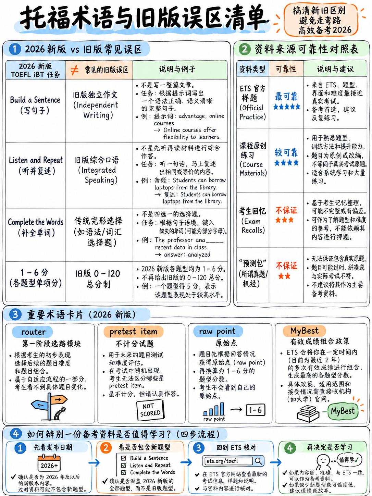

# 0.5 词汇表、题库和模板题

## 0.5.1 “题库”、“过往试卷”、“回忆”——TOEFL

 存在的三个不同的东西在网上被称为同一个名字。其中只有一个是真实的。

|术语 |这意味着什么 | 2026 年托福考试有吗？ |
|---|---|---|
| **官方练习材料** |由 ETS 编写并发布用于练习的项目 | **是的。** 与 2026 年 1 月 21 日 [10][11] 的测试一致的两份完整纸质练习测试，以及官方概述 [1] 和免费 TestReady 门户 [19] 中的示例项目。这是*真实*物品的唯一值得信赖的来源。 |
| **过去的论文** |实际测试管理| **不会。** ETS 绝不会发布实时表格。删除或复制测试内容将构成取消分数和起诉 [12] 的理由。 |
| **回忆/机经/“题库”** |考生根据记忆重建项目并出售或共享 | **存在，不可靠，并且有风险。**对于旧测试，这些广泛流传。对于 2026 年的测试，大多数流通的“银行”都是**重新包装的旧格式材料**。使用真实的泄露内容是一种安全违规行为。 |
| **“预测”** |一份声称知道下个月主题的清单 | **毫无价值。** 写作和口语提示来自大量的题库；阅读和听力项目是自适应的，包括预测试项目。 |

:::{danger} 2026 年具体风险
由于考试于 2026 年 1 月 21 日发生变化，免费托福在线材料的全部库存 -
TPO集，“100个托福口语题目”，“185个托福写作题目”，Barron's/Kaplan/Princeton Review
2026 年之前印刷的版本 — 描述了不再存在的测试。

A 卖家在推出三个月后提供“2026 托福题库”几乎可以肯定
向您出售带有新封面的 2026 年之前的内容。 **五秒钟内测试一下：**在文件中搜索
单词*完成单词*。如果他们缺席，那就是旧的测试。
:::

### 你应该使用什么来代替

|需要|使用|
|---|---|
|真实物品，正确格式 | ETS 模拟测试 1 和 2 [10][11]； [1]中的样品； TestReady 免费项目 [19] |
|采访和讨论的主题*领域* |格局是稳定的——校园生活、技术、环境、工作、教育、城市生活、健康。一次构建内容，随处重复使用 ({doc}`../20-speaking/04-fluency-engine`) |
|练习量| **创作或生成它** — 该软件包提供 60 个听并重复句子、40 个构建句子项目、10 个完整单词段落、12 个电子邮件场景、20 个讨论提示和 3 个完整听力集，全部为 2026 年格式编写 |

这个包的练习模块中的所有内容都是**为这个包编写的**，与
长度、CEFR 等级和问题风格的官方规范。不记得测试

## 0.5.2 模板问题

初学者总会问：*我能记住模板吗？* 四个答案各不相同
取得了富有成效的任务，并且标题明确地说明了这一点。

|任务|你能使用记住的模板吗？ |官方依据|
|---|---|---|
| **造一个句子** | **除了语法规则，没什么可记的。**内容给定了。 |机器评分的词序 [2] |
| **写一封电子邮件** | **是的 - *移动*模板是安全且推荐的。** 三个项目符号规定了三个移动；问候/结束是固定的约定。 |标题奖励“一致使用适当的社会惯例（例如礼貌、注册……）”[1] |
| **为学术讨论而写作** | **部分。** 句子框架骨架是安全的；记住的*内容*会受到惩罚。 |第 1 段：“最少的原始语言；任何连贯的语言大多都是 **从刺激中借用的**” [1] |
| **接受采访** | **框架是，脚本否。** |第 2 段：“主要由 **问题中的语言**组成” [1] |
| **听并重复** |无关紧要——你重复你所听到的。 | — |

:::{important} 重要的区别
**内容模板**提供您未为此提示生成的想法和句子：
*“在当今的现代社会，这是一个备受争议且被广泛讨论的问题……”*

A **句子框架**仅提供语法，您可以根据提示填写每个槽位：
*“我认为 ______ 因为 ______。例如，______。”*

 规则惩罚借用的语言，奖励“详细阐述”和“贡献……用你自己的语言”
字“[1]。框架通过了该测试。内容模板失败了——在人工智能评分测试中，一个短语
成千上万的候选人逐字提交正是模型注意到的信号。
:::

### 从你的曲目中删除的短语

 这些是旧托福课程教授的股票开场白。在 100 字的讨论帖中，他们可以吃东西
四分之一字数却没有表达任何想法。

-“在当今的现代社会/随着科学技术的飞速发展……”
- “这是一个极具争议性的问题，各界人士都在广泛讨论。”
- “无可否认/不言而喻……”
- “每枚硬币都有两个面。”
- “最后但并非最不重要的，/简而言之，/总结一下，就我而言……”

将它们全部替换为直接位置句。参见
{doc}`../30-writing/04-write-for-an-academic-discussion` §3.4.3。

### 一句话测试

> **如果您可以在阅读提示之前写下这句话，那么它就是一个模板。如果它包含一个
> 您自己选择的提示中的单词，它是一个框架。**

## 0.5.3 来源可靠性 - 如何对您读到的有关此测试的任何内容进行评分

|等级 |来源类型 |示例 |
|---|---|---|
| **A — 明确** | ETS官方文档发布此版本 | [1][2][10][11][12] 和 ets.org 部分页面 |
| **B — 可靠** | ETS 营销页面、传单、新闻稿、课程计划 | [13][16][17][18]。偶尔内部不一致 - 请参阅 {doc}`03-how-scoring-works` §0.3.3 | 中的 86/90 差异
| **C — 有用，验证** |明确命名新任务类型并引用 ETS 的知名预科出版商和教师 |来自考试准备公司的一些 2026 篇博客文章 |
| **D — 视为谣言** |转述其他博客的博客； AI 生成的“TOEFL 2026”页面；任何没有日期的东西|大部分搜索结果首页|
| **F — 积极误导** |任何描述独立/综合任务的资源、30 分制的 0-120 部分分数或 700 字的段落，以当前 | 形式呈现几乎所有 2026 年之前的书籍、课程和视频 |

**过滤几乎所有内容的三个问题：**

1。它是否使用“**完成单词**”、“**造一个句子**”、“**听并重复**”等词？
2. 它给出的部分分数是 **1-6**，而不是 0-30？
3. 是否说测试**大约 2 小时**，**无中断**？

A 资源未通过其中任何一项都是 2026 年之前的。

## 0.5.4 完整术语词汇表

**自适应（多阶段）** — 一项根据您的表现选择第二个模块的测试
第一个。仅阅读和听力 [2].

**AI 评分** —“构建的响应……使用自然语言处理和机器进行评估
学习评估流畅性、连贯性和语法等特征”[2]。适用于电子邮件，
讨论、聆听和重复，接受采访。

**乐队/乐队分数** — 十一个值 1, 1.5 … 6 之一。

**C-test** — 完成单词格式的学术名称：后半部分为
规则间隔的单词被删除。长期以来在应用语言学中用作快速熟练程度衡量标准。
了解名称可以帮助您找到练习材料。

**CEFR** — 欧洲共同语言参考框架； A1（初级）至 C2 六个级别
（掌握）。 2026 TOEFL 直接映射到它 [1][8].

**Claim** — ETS 的术语，表示每个部分旨在证明您的内容 [2].

**Concordance** — 该表格将 1-6 个频段转换为旧的 0-30 和 0-120 等级[1][8]。

**构造响应** — 您生成的答案（说出或键入），而不是选定的响应
（单击一个选项）。

**ETS** — 教育考试服务机构，制作和管理 TOEFL 的组织。

**表格** — 测试的一个特定组装版本。

**家庭版** — 在家进行相同测试的人工监考 [20].

**可理解/可理解性** — 测试中的中心词讲规矩。这意味着*一个听众
能说出你说的话*。它**不**意味着*无重音*。

**线性部分** - 不自适应；给定形式的每个考生都会得到相同的任务。写作和
说到 [2].

**机器评分** - “基于规则的算法......基于精确匹配或预定义的评分逻辑”
[2]。阅读、听力、造句。

**MyBest® 分数** — 官方超级分数，结合了您过去 2 年的最佳部分分数
[12].

**预测试项目** — 嵌入阅读或听力中的不计分试题 [2].

**原始分数** — 转换为乐队之前的分数。阅读 0–30、听力 0–30、写作 0–20、
说 0–55 [1].

**路由器** — 自适应部分的第一个较长模块，它决定您选择哪个第二个模块
接收 [1][2].

**评分指南/细则** — 已发布的 0-5 描述，用于对四个构建的评分
响应任务类型 [1].

**草稿纸** - 考试中心提供的便条纸。在家里它是一块白板或一张纸
在保护器中 [12].

**刺激** — 项目所基于的文本、音频或场景。 

**TestReady** — ETS 的官方备考门户，具有免费和付费级别 [19].

**TPO（托福在线练习）** — ETS 长期运行的练习产品。 **所有广泛流通的TPO
套数为 2026 年之前的格式。**

**非官方分数** — 阅读和听力结果在考试结束后立即显示在屏幕上
测试；可能会发生变化 [12].

**上/下模块** - 自适应部分的第二阶段更难或更容易。

---

**下一步：** {doc}`06-choose-your-target` - 选择一个现实的频段，检查每个部分的最小值，
和第一天的诊断。