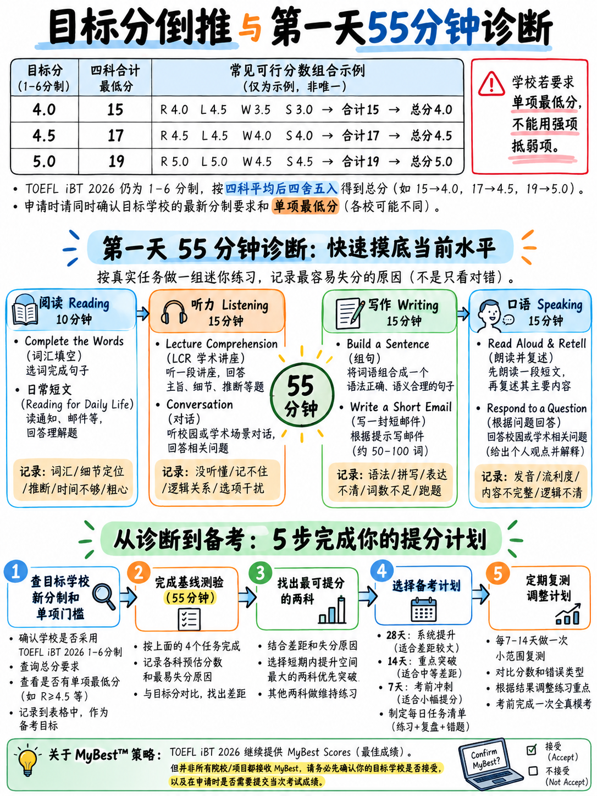

# 0.6 选择你的目标，以及第一天诊断

## 0.6.1 首先：找出你真正需要的

三个问题。从机构自己的招生页面而不是从网站上以书面形式回答问题
论坛.

:::{admonition} 三个问题
:class: important

**1. What overall score does the programme require?**
如果页面仍然显示“TOEFL iBT 80”，请用 ETS 官方表格 [8] 进行翻译：
100 → **5** · 90 → **4.5** · 80 → **4** · 70 → **3.5**.

**2。每部分有最低要求吗？**
要查找的短语：“下面没有部分”、“每个至少 20 个”、“写作至少 22 个”、
“小分要求”。在旧的量表上，“最低 20 分”大约是口语中的 **4** 段，口语中的 **4** 段。
阅读，写作 **4**，听力 **4** [1，表 3]。 **如果存在每节最小值，则
{doc}`03-how-scoring-works` §0.3.4 中的平衡策略不适用于您**和最低要求
成为你每个部分的真正目标。

**3。该机构是否接受 MyBest®（超级分数）结果？**
如果是，您可以将工作分两次进行。如果不是，则每个部分必须在同一天达到峰值。
:::

:::{warning} 明确询问新比例
2026 年 1 月后的头几个月，许多招生页面尚未更新。发送电子邮件至
招生办公室并询问：*“我的成绩报告将使用 1 月份推出的新 1-6 分等级
2026. 您需要什么频段，您是否设置了每个部分的最低限度？”* 保留回复。碳排放交易体系
准确地发布了索引 [8]，以便机构可以回答这个问题。
:::

## 0.6.2 从一开始就可以实际实现什么

此表是**分析**，而不是 ETS 出版物。没有关于比率的官方数据
改善。它是根据蓝图 [2] 中的 CEFR 目标和原始点分布构建的
在 {doc}`03-how-scoring-works` §0.3.5.

|你现在的英语 |经过 3-4 周的集中训练后，真实的整体乐队 |欧洲共同语言参考标准 |
|---|---|---|
|能读简单的英语，说得很少 | **2.5 – 3.0** | A2 |
|学校英语，生疏；可以阅读，但说话有困难| **3.0 – 3.5** | B1 |
|阅读舒适，能跟上缓慢讲话、犹豫不决的讲话者 | **3.5 – 4.0** | B1–B2 |
|每周在工作/学习中使用英语 | **4.0 – 4.5** | B2 |
|用英语学习或每天用英语工作 | **4.5 – 5.0** | B2–C1 |

:::{note} “重点周”是什么意思
40–90 小时，按照 {doc}`04-priority-triage` §0.4.2 中的分配，每天收听和
重复练习和至少四次定时完整练习。阅读语法解释确实可以
不算作专注时间；生成和检查答案确实如此。
:::

### 诚实的天花板

A 真正的初学者一个月内无法达到 5 级（C1）。没有人可以。如果你的程序需要 100
（带 5）并且您在 A2，正确的计划是 **更长的跑道或不同的测试**，而不是
更难的一个月。现在就对自己说这句话，而不是在结果当天发现它。

快速实现的*是**地板**：从“我将冻结并且不生产任何东西”到“我
将在每个项目上产生一些可评分的东西”值得一个完整的乐队或更多，而且它主要是
机械。

## 0.6.3 第一天诊断（55 分钟）

 今天执行此操作。不到一个小时的时间，它决定了你的整个计划。

| ＃|什么 |时间 |它告诉你什么 |
|---|---|---|---|
| 1 | **听并重复自测。** 让某人阅读 {doc}`02-task-type-inventory` §0.2.4 中的 7 个动物园句子，或使用文本转语音功能。听完一次后，将自己重复的录音录下来。 | 10 分钟 |你的记忆广度。计算您复制了多少个“完整句子”（任何准确性）。 |
| 2 | **构建句子自测。** 完成 {doc}`../30-writing/02-build-a-sentence` §3.2.6 中的第 1–10 项。 | 10 分钟 |您对英语词序的控制。 |
| 3 | **完成单词自测。** 完成 {doc}`02-task-type-inventory` §0.2.1 中的官方段落和 {doc}`../40-reading/02-complete-the-words` §4.2.7 中的第 1 段。 | 10 分钟 |你的功能词本能和你的拼写。 |
| 4 | **定时电子邮件。** 设置**7 分钟**的计时器。撰写第 §0.2.3 节中的杂志编辑电子邮件。 | 7 分钟 |无论您的瓶颈是英语还是时钟。 |
| 5 | **定时采访回答。** 记录**45秒**回答：*“回想一下您上次访问一个您不住的城市时。您为什么去，您喜欢它的什么？”* | 5 分钟 |是否能填满45秒。 |
| 6 | **听力示例。** 使用音频完成 {doc}`../50-listening/02-listen-and-choose-a-response` §5.2.6 中的 8 个“聆听并选择”项目。 | 10 分钟 |您对测试中最简单项目的基线。 |

### 读取结果

|结果 |这意味着什么 |从哪里开始 |
|---|---|---|
| 7 个重复中少于 4 个是完整的句子 |记忆广度，而不是发音，是你的极限| {doc}`../20-speaking/02-listen-and-repeat` §2.2.4 — 每日记忆练习 |
|重复完整但播放时难以理解|清晰度 | {doc}`../10-pronunciation/01-start-here-sound-system`，然后是 02 和 04 |
| 10 条中少于 5 条正确造句 |核心语法差距| {doc}`../60-toolkit/02-grammar-minimum`，然后 {doc}`../30-writing/02-build-a-sentence` |
|完成单词：正确的单词，错误的拼写 |纯拼写 | {doc}`../60-toolkit/03-spelling-and-typing` — 测试中最快的点 |
|完成单词：不知道那里有什么单词 |虚词失明 | {doc}`../40-reading/02-complete-the-words` §4.2.3 |
| 7 分钟未完成的电子邮件 |时钟，不是英文| {doc}`../30-writing/03-write-an-email` §3.3.5 — 每颗子弹 90 秒的方法 |
|无法填满 45 秒 |流畅脚手架 | {doc}`../20-speaking/04-fluency-engine` |
| 6+ 共 8 听力正确 |倾听是你的强项——保护它，不要过度投入| {doc}`../50-listening/01-scoring-and-section-tactics` |

## 0.6.4 选择两个部分来驱动

 使用 {doc}`03-how-scoring-works` §0.3.4：您总共需要 **+2.0** 来移动整个半个频段。的
最便宜的+2.0几乎总是来自：

|如果您的诊断结果显示……驾驶这两个 |为什么 |
|---|---|---|
|到处都是弱者（真正的初学者） | **口语+写作** |因为64%的口语和50%的写作是机械任务。初学者可以仅通过“聆听”和“重复”练习来移动整个频段的口语。 |
|阅读/听力良好，口语冻结 | **口语+写作** |同样的理由；你的 R 和 L 已经包含了总和。 |
|好的演讲者，糟糕的读者 | **阅读+听力** |完成单词和聆听并选择都是可练习的。 |
|一切都中等，时间很多| **听力+阅读** |他们共享一个技能基础（快速解码），加起来只是总和的一半。 |

:::{tip} 非明显默认值
对于大多数初学者来说，正确的一对是**口语 + 写作**——这两个部分是传统的建议
告诉初学者放弃。这个建议对于 2026 年之前的考试来说是正确的，其中口语意味着
“60秒总结一次讲座”。现在错了。
:::

## 0.6.5 两次考试（如果您负担得起）

 允许：无限次重考，**任何 3 天内不得超过一次** [12]。分数在约 3 天内发布
[12]。 MyBest 结合了您 2 年来最好的部分成绩 [12].

A 两人计划，在 MyBest 被接受时有效：

| |准备重点|目标|
|---|---|---|
| **坐 1**（第 3 周结束）|口语+写作技巧|南峰和西峰 |
| **之间**（2 周）|仅限阅读+听力 | — |
| **坐 2**（第 5 周结束）|阅读+听力|峰值 R 和 L |
| **结果** | MyBest 集各家之长|与任一坐姿相比，总体上可能 +0.5 |

 条件：该机构必须接受 MyBest；您必须能够支付两次；以及你的截止日期
必须留出约 6 周加 3 天的时间才能得出结果。

:::{warning} 不要计划重考*而不是*准备
三天规则允许快速第二次尝试，但毫无准备的第二次会产生
毫无准备的第二分。重考策略是对准备的补充，而不是替代。
:::

## 0.6.6 一个工作 60 小时的计划，目标为 4.0

 假设初学者大约为 B1，四个星期，每周 15 小时。完整的每日版本
{doc}`../60-toolkit/05-study-plans`.

|块|营业时间 |内容 |
|---|---|---|
|发音基础| 8 |模块 10 文件 01、02、04、05 — 声音、辅音、单词重音、节奏 |
|聆听并重复练习 | 12 | 12每天20分钟，60句库，记录并检查|
|造一个句子 | 8 |八个模式 + 40 个练习项目 + 最低语法 |
|完成单词| 8 |功能词反射、后缀规则、拼写列表，10 段 |
|听力（LCR + 对话）| 8 | 8套+成语表+听写|
|接受采访 | 7 |四槽框架 + 20 个录制答案 |
|写一封电子邮件 | 5 |移动模板 + 8 封定时电子邮件 |
|为学术讨论撰写| 3 |骨架 + 4 个定时帖子 |
|全时模拟 | 1 | 2 × 练习测试，评分 |
| **总计** | **60** | |

## 0.6.7 决策表 — 立即选择您的计划

|您的情况|计划|
|---|---|
| 4 周以上，目标 4.0–4.5 | 28 天计划，{doc}`../60-toolkit/05-study-plans` §6.5.2 |
| 2 周 | 14 天计划，§6.5.3 |
| 1 周 | 7 天计划，§6.5.4 |
| 3 天 |紧急协议，§6.5.5 — **并阅读重新安排警告** |
|初级目标 5.0+ |延长跑道。最少三个月。使用 28 天计划作为第一个月，然后用较硬的材料重复 |
|薄弱部分中每部分的最小值 |忽略平衡策略。将 50% 的时间花在该部分上 |

---

**下一篇：** {doc}`../10-pronunciation/01-start-here-sound-system` — 从零开始的英语发音系统，
这才是口语准备真正开始的地方。