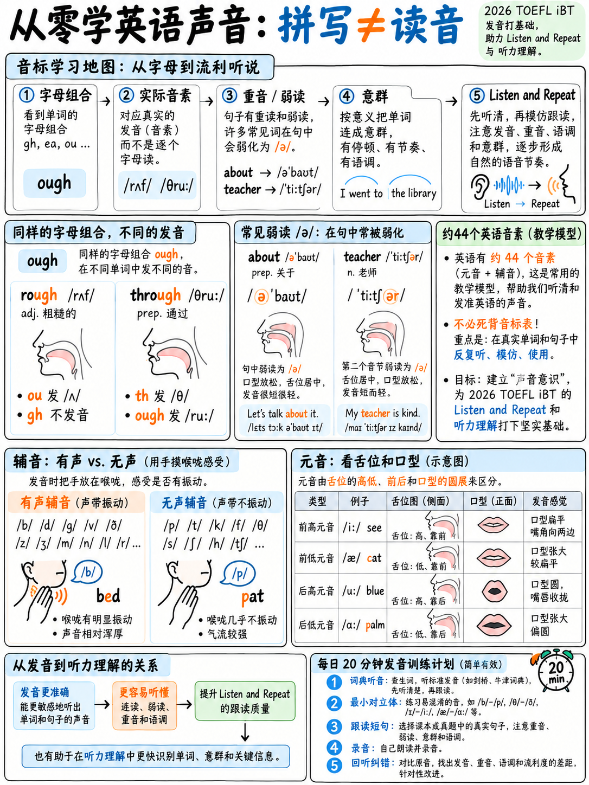

# 1.1 从这里开始：从零开始的英语发音系统




:::{admonition} 这个模块适合谁
:class: note
从书本上学过英语的人，可以读一些英语，但很少或从未说过话的人
它。我们从“英语有 26 个字母，大约 44 个发音”开始，构建出以下两件事：
2026托福实际上得分：**清晰度**和**节奏**。

如果你已经可以用英语进行对话，请浏览1.1和1.2，然后转到
{doc}`04-word-stress`和{doc}`05-rhythm-and-chunking`，这就是托福分数所在。
:::

## 1.1.1 为什么托福包中存在这个模块

在2026年的考试中，发音并不是口语的唯一关注点。它的命名有四个地方：

|哪里 |官方措辞|
|---|---|
|发言主张| “可以说**可理解**且连贯的英语口语” [2] |
|聆听并重复第 5 段 | “完全**可理解**并且是精确的重复”[1] |
|参加面试标题，第 5 级 | “发音清晰易懂；**节奏语调**有效传达意思” [1] |
| **倾听**，倾听并选择一个回应 |测试您“识别和区分英语音素以及使用常见**语调和重音模式**来传达含义”的能力。 [1] |

 最后一行是人们错过的。 **发音训练是听力训练。** 你不能
可靠地听到你无法发出的声音，并且你无法分割其节奏的语音流
你不分享。

:::{important} 什么是不得分
本次测试的评分标准中不包含*口音*一词。 Take an Interview 的 Band 5 没有说
“听起来很美国”。它说**可理解**，它说节奏和语调必须*传达
意思是*.

你的目标是不要失去你的口音。你的目标是听众永远不必停下来锻炼
你说的话。这些是完全不同的项目，并且只有其中一个可以在同一时间实现
月。
:::

## 1.1.2 核心问题：拼写不正确

 英语拼写在几个世纪前就被冻结了；发音不断移动。结果就是字母


**一种拼写，七个声音** — 字母 *ough*:

|词|听起来像 |国际音标 |
|---|---|---|
|虽然**够** | “哦”| /oʊ/ |
|通过**够** | “哦”| /uː/ |
|虽然**应该| “噢”| /ɔː/ |
|太**了** | “呃”| /ʌf/ |
|咳** | “关闭”| /ɒf, ɔːf/ |
|哎呀** | “噢”| /aʊ/ |
|彻底**够** | “呃”| /ə/ |

**一个声音，九种拼写** — 元音 /iː/ 如 *see*:

> s**ee** · s**ea** · k**ey** · f**ie**ld · rec**ei**ve · mach**i**ne · p**eo**ple · amoeb**a** ·
> 去**好**

**结论：**你必须学会​​用声音而不是字母来思考。实现此目的的工具是 44 个符号
一个符号始终等于一种声音的字母表：**IPA**.

:::{tip} 您不需要编写 IPA。你需要阅读它。
每个字典条目都给出了它。一旦你能读懂它，你就可以查找任何单词的发音
五秒钟内说出的话并且是正确的。仅这项技能就值得模仿一个多月。
:::

## 1.1.3 英语的 44 个发音

 托福在其音频 [2] 中使用“美国/加拿大、澳大利亚和英国英语变体”。的
下面的符号是标准集，其中不同之处首先给出美国值。学会
认出他们；您不需要将符号作为列表来记忆。

### 短元音 (7)

|国际音标 |关键词 |学习者注意事项 |
|---|---|---|
| /ɪ/ | s**i**t | s**i**t |简短而轻松。 **不是***座位*的/iː/。 |
| /e/ /ɛ/ | b**e**d |中前部。 |
| /æ/ | c**a**t |嘴巴张得大大的。对于大多数学习者来说很难 - 请参阅 {doc}`03-vowels`。 |
| /ʌ/ | c**u**p |中央，短。也拼写为*o*：*爱，金钱，来*。 |
| /ʊ/ | b**oo**k |嘴唇短，嘴唇稍圆。 **不是** /uː/。 |
| /ɒ/ /ɑː/ | h**o**t | US 将其合并为 /ɑː/。 |
| /ə/ | **来一趟，老师** | **the schwa。** 英语中最常见的发音 — 请参阅§1.1.5。 |

### 长元音 (5)

|国际音标 |关键词 |
|---|---|
| /iː/ | s**ee** |
| /ɑː/ |该死的，该死的** |
| /ɔː/ | s**aw**，f**ou**r |
| /uː/ |蓝色** |
| /ɜː/ /ɝ/ | b**ir**d, w**or**k |

### 双元音 — 两个元音粘在一起 (8)

|国际音标 |关键词 |运动 |
|---|---|---|
| /eɪ/ | d**ay** | e → 我 |
| /aɪ/ |米**y** |一个 → 我 |
| /ɔɪ/ | b**oy** | o → 我 |
| /aʊ/ |不**哦** |一个 → 你 |
| /oʊ/ /əʊ/ | g**o** | o → u |
| /ɪə/ | h**这里** (BrE) |我 → ə |
| /eə/ | h**空气** (BrE) | e → ə |
| /ʊə/ |我们的** (BrE) | u → ə |

### 辅音 (24)

| |无声|有声| |无声|有声|
|---|---|---|---|---|---|
| **停止** | /p/ **p**en | /b/ **b**ad | | /t/ **t**en | /d/ **d**og |
| | /k/ **c**at | /ɡ/ **g**o | /ɡ/ **g**o | | | |
| **摩擦音** | /f/ **f**ish | /f/ **f**ish | /v/ **v**an | | /θ/ **th**墨水 | /ð/ **第**是 |
| | /s/ **s**ee | /z/ **z**oo | | /ʃ/ **嘘**e | /ʒ/ 测量**s**ure |
| | /h/ **h**at | — | | | |
| **塞摩擦音** | /tʃ/ **ch**air | /dʒ/ **j**ob | | | |
| **鼻音** | — | /m/ **m**an、/n/ **n**o、/ŋ/ si**ng** | | | |
| **近似值** | — | /l/ **l**eg、/r/ **r**ed、/w/ **w**e、/j/ **y**es | | | |

## 1.1.4 浊音与清音 — 一项测试，多种答案

将两根手指放在喉咙上。说一声长**ssssss**。现在说**zzzzzz**。您感受到的嗡嗡声
第二个是**发声**。

```
   /p/ ←→ /b/        /f/ ←→ /v/        /θ/ ←→ /ð/
   /t/ ←→ /d/        /s/ ←→ /z/        /ʃ/ ←→ /ʒ/
   /k/ ←→ /ɡ/        /tʃ/ ←→ /dʒ/
    ↑        ↑
 voiceless  voiced
 (no buzz) (buzz)
```

八对。相同的嘴位，一处不同。结对学习可以事半功倍
立即解释您需要单独记住的三个英语规则 - 请参阅
{doc}`02-consonants` §1.2.6.

## 1.1.5 schwa /ə/ — 最重要的一个声音

**/ə/ 是英语口语中最常见的声音**，几乎所有语言都发这种声音
*无重读*音节，无论拼写如何。

|词|书面元音 |其实说|
|---|---|---|
| **关于**一个 | /ə/ |
|香蕉**a** |一个 | /ə/ |
|老师**老师|呃| /ə/ |
|医生**o**r |哦| /ə/ |
|困难**u**lt |你| /ə/ |
|铅笔**我**l |我| /ə/ |
| **到**日 |哦| /ə/ |

 并且在句子内的虚词中：

|词|独自（坚强）|造句（弱）|
|---|---|---|
|至 | /tuː/ | /tə/ — “我想要**去**”|
|的| /ɒv/ | /əv/ — “一杯**茶”|
|对于 | /fɔː/ | /fə/ — “这是**为了**你”|
|和 | /ænd/ | /ən/ —“鱼**和**薯条”|
|可以| /kæn/ | /kən/ — “我**可以**帮忙”|
|是 | /ɑː/ | /ə/ —“他们**来了” |

:::{important} 为什么 schwa 决定你的托福听力成绩
当你听到“我不是一小时前在图书馆见过你吗？”以自然速度，单词
*an* 和 *a-* 简化为 schwa 并且问题一起运行。学习者希望每一个词都能
听起来就像它的字典形式hear mush。期望减少的学习者听到这句话。

**听并选择一个答案**正是这一点的 15-19 项，音频“不超过 6
重读音节“[2]。训练 schwa，你就训练该任务。
:::

## 1.1.6 字典法——你的永久工具

每当你遇到新单词时：

1。在在线词典中查找，该词典提供 **IPA + 音频**（剑桥、韦氏词典、
   朗文）。
2. 注意**重音符号的位置**。在 /ˈfəʊ.tə.ɡrɑːf/ 中，ˈ 出现在 *fo* 之前。
3. 注意**哪些元音是/ə/** - 这些是您必须*不*完全发音的音节。
4. 说三遍：慢速、正常、短句。

一个词两分钟。一天二十个字。三周之内 420 个单词你永远不会
再次发音错误——最重要的是，当托福音频显示时，您现在可以**识别** 420 个单词


## 1.1.7 你的 20 分钟日常例程 

 从今天到考试每天都这样做。它可以培养口语*和*听力。

|分钟 |活动 |
|---|---|
| 0–3 | **当天的声音。** {doc}`02-consonants` 或 {doc}`03-vowels` 的最小一对。重复20次，交替进行。 |
| 3–8 | **影子。** 播放 60-90 秒的英语音频。 *跟着它说话*，落后半秒，匹配节奏而不是单词。 （{doc}`05-rhythm-and-chunking` §1.5.6。）|
| 8–15 | **听并重复练习。** {doc}`../20-speaking/05-speaking-practice-bank` 中银行的 7 个句子。记录一下自己。 |
| 15–18 | **回放并标记。** 聆听您自己的录音。根据官方指南，每次重复得分为 0-5。记下你掉落的东西。 |
| 18–20 | **单词重音。** {doc}`04-word-stress` 中的 10 个单词，标记并大声朗读。 |

:::{tip} 录音不可选
当你发出自己的讲话时，你无法准确地听到自己的讲话。每个人——无一例外——
在播放时发现他们确定没有犯过的错误。手机语音备忘录应用程序是
够了。计算机的命令位于 {doc}`../60-toolkit/07-free-tools-and-self-testing` 中。
:::

## 1.1.8 自我诊断：60 秒审核

 记录自己以正常速度大声朗读的内容，然后对照下面的清单进行回听。

> *上周四，三位研究人员提前到达了游客中心。他们原计划
> 测量了河流的宽度，但是他们订购的设备还在河边等着
> 前台。 “我们应该昨天检查一下，”她说。这是一个彻底令人沮丧的
> 情况，全组一致认为日程必须改变。*

|检查 |听|如果错误，请前往 |
|---|---|---|
| **-ed 结局** | *已到达* /d/，*计划* /d/，*已订购* /d/，*已检查* **/t/**，*同意* /d/ | {doc}`02-consonants` §1.2.7 |
| **-s 结尾** | *研究人员* /z/，*周*… | {doc}`02-consonants` §1.2.7 |
| **/θ/ 和 /ð/** | *周四三彻底* vs *他们、那个、那个* | {doc}`02-consonants` §1.2.2 |
| **/r/ 和 /l/** | *研究人员、河流、早期、静止、整体* | {doc}`02-consonants` §1.2.3 |
| **辅音群** | *星期四*，*应该检查*，*令人沮丧* | {doc}`02-consonants` §1.2.8 |
| **单词重音** |研究人员 · 设备 · 紧张？不—— **令人沮丧** · 时间表| {doc}`04-word-stress` |
| **弱形式** | *到*、*of*、*the*、*at*、*had*、*would*都应该是弱的| §1.1.5 和 {doc}`06-connected-speech` |
| **分块** |您是否在有意义的组中或每 3 个单词停顿一次？ | {doc}`05-rhythm-and-chunking` |

 无论两行失败，都是您的优先事项。不要试图修复所有内容。

## 1.1.9 学习该模块的顺序

```
  01 (you are here) ──► 02 Consonants ──► 04 Word stress ──► 05 Rhythm & chunking
                   │                                               │
                   └──► 03 Vowels ────────────────────────────────┤
                                                                   ▼
                                       06 Connected speech ──► 07 Your first language
```

**如果你的时间少于 10 天：** 做 01，然后 04，然后 05，然后 07。单词重音和节奏是
每小时比单个音素更值托福分数，因为它们就是“聆听和重复”
并进行面试实际测量。

---

**下一个：** {doc}`02-consonants` - 按每个错误对清晰度造成的损害程度排名。