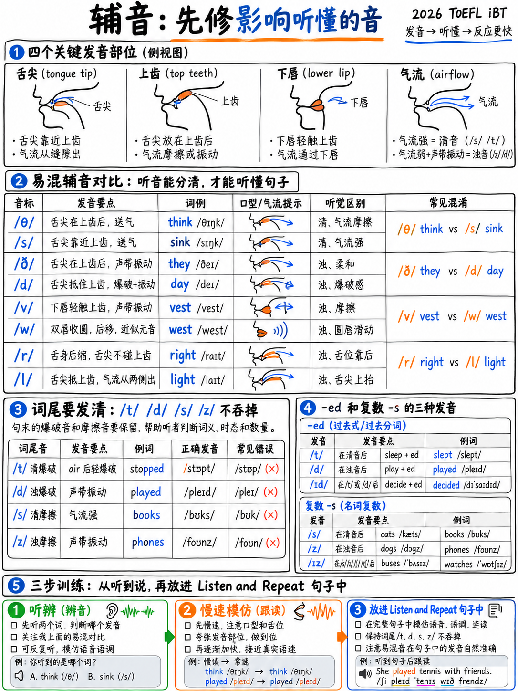

# 1.2 辅音，按损坏程度排序




 并非所有发音错误的代价都相同。本章按**听众需要听的程度排序
当你做错时，工作**——这正是托福评分标准所说的*可理解性*。

|排名|问题 |伤害|修复速度|
|---|---|---|---|
| 1 | **删除最后辅音** (-ed, -s, 结尾 /t d k/) |严重——破坏时态、数量、占有|天|
| 2 | **/r/ 与 /l/** |严重 — 更改词语（*收集/更正*）|周 |
| 3 | **/θ/ /ð/**（“th”）|中等——很少阻碍意义，非常明显 |天|
| 4 | **/v/ 对比 /w/ 对比 /b/** |中度-重度 — *背心/西/最佳* |周 |
| 5 | **/ʃ/ /tʃ/ /dʒ/ /ʒ/** |中等|天|
| 6 | **辅音簇**（添加元音）|节奏严重 — 参见 §1.2.8 |周 |
| 7 | **/p t k/ 愿望** |温和| Days |

:::{important} 排名 1 不是发音问题 — 这是一个听起来像语法问题
如果“worked”显示为“work”，人工智能评分员会听到一个现在时动词。关于**听并重复**
该标题明确列出了“时态/体/数的标记可能丢失或不正确”作为什么
将您从 5 [1] 降至 4 [1]。最后的辅音是整个模块中最便宜的标记。
:::

## 1.2.1 如何使用每个部分

 下面的每个部分都有：声音是什么、为什么你的嘴会抗拒它、一个最小对钻和一个
句子练习。 **大声说出所有内容。** 默默地阅读本文不会有任何作用。

 最小对是在一个声音上完全相同的单词对。钻孔*交替*
(*think–sink–think–sink*)，不是成块的。

## 1.2.2 /θ/ 和 /ð/ — “th”的发音

**它是什么：** 舌尖轻轻接触上门牙的下边缘，并空气
在舌头和牙齿*之间*流动。 /θ/ 清音，/ð/ 浊音。

 **为什么难：** 很少有语言有它。学习者替换 /s z/（许多欧洲、东
亚洲语）、/t d/（法语、俄语、加勒比语）或 /f v/（某些英语方言、日语）。

|拼写 → 声音 |话|
|---|---|
| **/θ/**（清音）——通常是实词的词首，以及*-th*词尾 | **第**墨水、**第**李、**第**粗糙、**第**理论、**第**银行、**第**、月**、波**、北**、价值** |
| **/ð/**（浊音）——几乎所有功能词，以及*-ther* | **th**e, **th**is, **th**at, **th**ese, **th**ose, **th**ey, **th**ere, **th**an, **th**en, o**th**er, wea**th**er, toge**th**er, **th**er, **th**er |

**涵盖 90% 情况的经验法则：** 如果该单词是语法单词 (*the, this,他们，
比*)，它是**浊音/ð/**。如果是以*th*开头的实词，则为**清音/θ/**。

###最小对

| /θ/|与 /s/ | | /ð/ |与 /d/ 或 /z/ | 对比
|---|---|---|---|---|
|认为|水槽| |他们|日 |
|薄|罪恶| |那么|书房|
|厚|生病了| |呼吸|品种 |
|路径|通过 | |服装 |关闭|
|嘴|鼠标| |与|维兹 |
|主题|似乎| |其他|乳房 |

### 句子练习

> 1. **Th**ree **th**ousand **th**ings。
> 2. **他们**认为**认为**财富**是值得关注的。
> 3. 两个**兄弟**们通常都**经历**艰难**。
> 4. **这**是本月**的**报告**是非常**的**。

:::{tip} 30秒版本
将舌尖明显地放在牙齿之间，夸张一周，然后放松。做得太过分
首先是最快的路线；从微妙开始是行不通的。
:::

## 1.2.3 /r/ 和 /l/

**/l/** — 舌尖牢固地位于**上牙后面的脊上**，空气在两侧流动。
**/r/**（美国）- 舌尖向后卷曲或束起，**什么都不碰**，嘴唇略微圆润。

 关键见解：**/l/ 碰触，/r/ 不碰触。** 如果您不确定，碰触 = /l/.

| /r/| /l/ |
|---|---|
|对|光 |
|道路 |负载|
|摇滚|锁|
|正确 |收集|
|到达 |活着|
|海盗|飞行员 |
|草 |玻璃|
|人群|云|
|炒 |飞 |
|浆果|腹部|

### 音节末尾的深色/l/

在*感觉、饱满、好、小、学校、人*中，/l/是“深色”：舌后部上升为
好吧。许多学习者将其替换为 /u/（“fee-oo”）。这在许多母语口音中是可以接受的——做
不用担心。 **首字母 /l/ 是要修复的。**

### 句子练习

> 1. **R**eally **l**arge **l**ibrary。
> 2. **l**讲师**c**o**ll**ected **c**o**rr**ect **r**结果。
> 3. **请放心**记住**早**领导**主义者**。
> 4. **r**ura**l** 区域为 **r**ea**ll**y **r**emote.

## 1.2.4 /v/、/w/ 和 /b/

|声音|嘴|
|---|---|
| **/v/** |上牙抵住下唇，空气嗡嗡作响|
| **/w/** |嘴唇圆润，**不涉及牙齿**，就像开始说*oo* |
| **/b/** |双唇闭上，然后松开 |

| /v/ | /w/| /b/ |
|---|---|---|
|背心|西 |最好的|
|藤蔓|酒 |宾|
|非常|警惕|浆果|
|兽医 |湿 |打赌|
|小瓶|同时|胆 |

 语言常见问题：印地语/乌尔都语和许多南亚语言合并/v/和/w/；西班牙语,
韩语和日语合并/v/和/b/；德语使用者可能会说 /v/ 代表 *w*.

### 句子演习

> 1. **W**e **v**isited the **v**ery **b**ig **v**illage in **W**ales。
> 2. **w**天气**v**ery **b**ad，但是**v**view **w**as **b**美丽。
> 3. **B**ob **将**将**v**erify **是否**v**到达**v**ed。

## 1.2.5 /ʃ/、/tʃ/、/dʒ/、/ʒ/

|声音|关键词 |嘴|
|---|---|---|
| /ʃ/ | **sh**e，na**ti**on，su**r**e |长长的嘶嘶声，舌头向后拉，嘴唇微圆|
| /tʃ/ | **ch**空气，na**tu**re，wa**tch** | /t/ + /ʃ/ 作为一次爆发 |
| /dʒ/ | **j**ob，**g**将军，桥**ge** | /tʃ/ 的浊音版本 |
| /ʒ/ |测量**s**ure、vi**si**on、gara**g**e | /ʃ/ 的浊音版本 — 罕见 |

| /ʃ/ | /tʃ/ | | /dʒ/ | /ʒ/ |
|---|---|---|---|---|
|船舶 |芯片| |吉普车| — |
|分享 |椅子| |笑话| — |
|洗|手表 | |徽章|米色 |
|片材|作弊 | |军团| lesion |

注意拼写陷阱：*-tion* = /ʃən/ (*nation、education、situation*)、*-sion* 元音后 =
/ʒən/ (*决定、愿景*), *-sion* 辅音后 = /ʃən/ (*张力、使命*).

## 1.2.6 为什么清音对可以节省你的工作

{doc}`01-start-here-sound-system` 中的八个浊音/清音对 §1.1.4 解释三个
立即单独的英语规则。学习配对，所有三个都变成自动的。

```
  /p b/   /t d/   /k ɡ/   /f v/   /θ ð/   /s z/   /ʃ ʒ/   /tʃ dʒ/
```

## 1.2.7 结尾辅音：-ed 和 -s 规则

:::{important} 本模块中价值最高的页面
三个规则。两者都是由**发声**决定的——你在§1.2.6中学到的东西。他们一起
影响你的每一个过去式动词，每一个复数，每一个所有格和每一个第三人称动词
口语和写作。
:::

### -ed 规则（过去式和过去分词）

|如果动词以...结尾-ed 听起来像 |示例 |
|---|---|---|
| **/t/ 或 /d/** | **/ɪd/** — 一个额外的音节 |想要**ted**、需要**ted**、加星**ted**、决定**ted**、访问**ted** |
|任何其他 **无声** 声音 (/p k f s ʃ tʃ θ/) | **/t/** — 没有多余的音节 |停止**ped** /pt/、工作**ked** /kt/、笑**ghed** /ft/、miss**sed** /st/、wat**ched** /tʃt/、fini**shed** /ʃt/ |
|任何其他**浊音**声音（包括所有元音）| **/d/** — 没有多余的音节 | play**ed** /d/, arriv**ed** /vd/, call**ed** /ld/, open**ed** /nd/, agre**ed** /d/, chang**ed** /dʒd/ |

 大声说出这些并听听区别：**wanted**（2 个音节→ 3？不：*wan-ted*, 2）·
**worked**（1 个音节，结尾为 /kt/） · **played**（1 个音节，结尾为 /d/）。

:::{warning} 最常见的初学者错误
说“work-ED”、“play-ED”、“stopp-ED”——到处都添加一个音节。 **仅限 /t/ 和 /d/ 结尾
添加一个音节。** 其他所有内容都是粘在末尾的一个额外辅音。
:::

### -s 规则（复数、第三人称、所有格）

|如果这个词以...结尾-s 听起来像 |示例 |
|---|---|---|
| **/s z ʃ ʒ tʃ dʒ/**（嘶嘶声）| **/ɪz/** — 额外音节 |类**es**、盒子**es**、愿望**es**、手表**es**、桥**es**、选择**es** |
|任何其他**无声**声音 | **/s/** |书**s** /ks/，猫**s** /ts/，地图**s** /ps/，笑**s** /fs/ |
|任何其他**浊音**声音（包括元音）| **/z/** |狗**s** /ɡz/、汽车**s** /z/、想法**s** /z/、跑**s** /nz/、活**s** /vz/ |

### 20句尾辅音练习

各说两次。第二遍时，夸大结局。

> 1. 她**工作**到很晚，并**完成**报告。
> 2. 学生**问**三个问题**。
> 3. 他参观过**两个校园**。
> 4. 他们想要**改变日程**。
> 5. 研究人员**上个月**发布了**他们的结果**。
> 6. 我检查了**盒子**并关上了**门。
> 7. 我朋友的**直播**已经改变**。  *（连续三个 /z/ 或 /d/ 结尾）*
> 8. 他停下**，看**，听**。
> 9. 她还需要**两天**。
> 10. 课程**于八点**开始**。
> 11. 我们讨论了**提出的**变更**。
> 12. 机器**的设计**旨在降低成本**。
> 13. 他观看了**视频并复制了**笔记**。
> 14. 委员会决定**批准该请求**。
> 15. 几座建筑物**被风暴损坏**。
> 16. 她练习**她的答案**并记录**它们。
> 17. 他们提前**到达**并在外面等候**。
> 18. 图书管理员**整理**书架**。
> 19. 我意识到**期限**已经过去**。
> 20. 讲师**将规则**解释清楚。

记录下来。数一数你放弃了多少个结局。这个数字是你最好的预测
聆听和重复损失。

## 1.2.8 辅音簇 - 以及您不能添加的元音

英语允许长辅音运行：*strengths* /streŋkθs/、*sixths* /sɪksθs/、*texts* /teksts/。
许多语言没有，说话者会插入元音来将它们分开：*s-tudent*、*e-school*、
*fil-m*, *work-ed-a*.

这是最损害**节奏**的错误，因为它增加了音节。 “我问”（2个音节）
变成“I Ask-ed-a”（4）会破坏句子的节拍——并且节奏在 Take an 上明确评分
专访[1].

###分级集群演练

|水平|话|
|---|---|
| 2 个辅音开头 | **st**op、**sp**eak、**skill**ill、**pl**an、**tr**y、**dr**ive、**fr**om、**gr**ow |
| 3 个辅音开头 | **str**ong、**spr**ing、**scr**een、**spl**it、**str**ucture、**str**ategy |
| 2-辅音结尾 | ha**nd**、wa**nt**、he**lp**、mi**lk**、be**st**、as**k**ed |
| 3-辅音结尾 | te**xts**、le**ngth**、wo**rld**、first**、ne**xt** |
| 4-辅音结尾 |强**ngths**，六**xths**，十二**lfths** |
|跨词|下一步·六件事·他问**或·世界|

> **练习句子：** *她要求提供文本，但第一个脚本的优点是
> 更强。*

**技巧：**慢慢地说出簇，中间没有元音，然后加快速度。如果你必须作弊，那就做
连接音是一个*非常*短的schwa，不是一个完整的元音。

## 1.2.9 /p t k/ aspiration

在重读音节的开头，英语/p t k/带有一小股空气：**p**in，
**t**op，**c**at。如果没有它，母语听众可能会听到 /b d ɡ/.

Test：将一张纸条放在嘴前。 *Pin* 应该移动它； *旋转*不应该（不
/s/).

|后吸气送气|不送气|
|---|---|
| **p**在 | s**p**in | s**p**in |
| **t**操作 |操蛋 |
| **c**ool | s**c**hool |

低优先级 - 仅在§1.2.2–2.8.

##之后修复它 1.2.10 关于美式 /t/

 的注释在美式英语中，/t/ 位于两个元音之间，其中第二个元音不重读会快速翻动，
接近/d/：*水*→“wadder”，*better*→“bedder”，*city*→“ciddy”，*很多*→“a lodda”。

**你不需要出示这个。**但你必须**识别**它，因为托福听力使用
美国的声音和简化形式。练习听力：*你要做什么？* → “Whataddaya要做什么？”

---

**下一个：** {doc}`03-vowels` - 元音空间，最难的对，以及为什么*船/羊*不太重要
比你想象的要多。