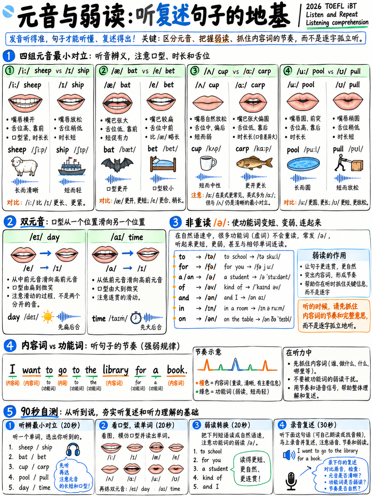

# 1.3 元音和双元音




:::{note} 优先警告
对于托福可懂度来说，元音的重要性不如词尾辅音和单词重音。本地人
听众能够容忍令人惊讶的元音变化——这就是地区口音*的特点*。
如果时间有限，先做{doc}`02-consonants` §1.2.7和{doc}`04-word-stress`，然后再来
回到这里。

例外是**schwa和弱形式**（§1.3.5），它们具有高优先级，因为它们驱动
*听力*理解。
:::

## 1.3.1 元音间距

元音在三个方面有所不同：舌头的高度、向前的距离以及嘴唇是否圆。

```
            FRONT            CENTRAL             BACK
          ┌───────────────────────────────────────────┐
   HIGH   │  iː (see)                        uː (blue)│
          │    ɪ (sit)                   ʊ (book)     │
          │                                           │
    MID   │  e/ɛ (bed)      ə (about)       ɔː (saw)  │
          │                  ɜː (bird)                │
          │                   ʌ (cup)                 │
    LOW   │     æ (cat)                   ɑː (father) │
          └───────────────────────────────────────────┘
             lips spread      neutral      lips rounded
```

实际结果：**/iː/ 和 /ɪ/ 不是“长 i”和“短 i”——它们是不同的舌头
位置。** /iː/ 紧张而高亢，双唇张开（几乎是微笑）。 /ɪ/ 较低且放松。
通过“缩短”/iː/ 来制作 /ɪ/ 会发出仍然错误的声音。

## 1.3.2 最重要的四对

### /iː/ vs /ɪ/

| /iː/ | /ɪ/ |
|---|---|
|羊|船舶 |
|座位 |坐|
|离开 |直播|
|感觉|填充|
|到达|丰富 |
|每个 |痒|
|热 |击中|
|绿色|咧嘴笑|

> *他将**住在这里**并于下周**离开**。 **船**的**羊**需要**饲料**。*

### /æ/ vs /e/ vs /ʌ/

三个“open-ish”元音学习者合二为一。

| /æ/（猫）| /e/（床）| /ʌ/（杯子）|
|---|---|---|
|坏|床 |芽|
|曾经|头|平视显示器 |
|男人|男士 | — |
|帽 | — |杯子|
|蝙蝠 |打赌|但是|
|跑|鹪鹩 |运行|
|轨道 |跋涉|卡车 |

**/æ/** 是大多数语言所缺乏的一种：将嘴张得比感觉更自然，然后拉动


> ***男装区的**男**跑去追**卡车**。*

### /ɒ ɑː/ vs /ʌ/ vs /ɔː/

| /ɑː ɒ/（热）| /ʌ/（杯子）| /ɔː/（锯）|
|---|---|---|
|不|坚果 |没有 |
|警察 |杯子| — |
|老板|巴士 | — |
|锁|运气| — |
|锅|推杆|端口 |

### /uː/ vs /ʊ/

| /uː/ | /ʊ/ |
|---|---|
|泳池|拉|
|傻瓜|完整|
|卢克|看看|
|西装| soot |

## 1.3.3 八个双元音

A 双元音是一个音节内的一个元音**移动**到另一个元音。运动就是声音——a
静态元音是错误的。

|国际音标 |关键词 |说成 |常用词|
|---|---|---|---|
| /eɪ/ | d**ay** | e → 我 |使、取、名、迟、能、站、八|
| /aɪ/ |米**y** |一个 → 我 |时间，五，写，高，想法，决定，九|
| /ɔɪ/ | b**oy** | o → 我 |声音、选择、要点、享受、避免、使用 |
| /aʊ/ |不**哦** |一个 → 你 |房子，关于，周围，发现，城镇，允许|
| /oʊ əʊ/ | g**o** | o → u |家，知道，开放，最，慢慢地，虽然|
| /ɪə/ | h**这里** |我 → ə |近、年、清晰、想法、认真、经验|
| /eə/ | h**空气** | e → ə |关心、分享、地点、比较、各种 |
| /ʊə/ |我们的** | u → ə |当然，纯粹，期间，游客 |

:::{warning} /eɪ/ 和 /oʊ/ 陷阱
西班牙语、意大利语、日语、韩语和许多其他语言的使用者将这些称为**纯**元音：*make*
变成“mek”，*go* 变成“gor”/“go”，没有滑行。英语听众听到的是不同的词。
夸张一周的运动。
:::

> **钻：** *他们说**八** **老** **男孩** **找到**一条**清晰** **路** **回家**
> **大约** **九**.*

## 1.3.4 Rhotic 与非 rhotic — 以及为什么你可以忽略它

 在美式英语中，元音后面的 *r* 发音为：*car、work、four、teacher*。
在标准英国和澳大利亚英语中，它不是：*cah、wuhk、foh、teachuh*。

TOEFL 音频使用**两者** [2]。在你自己的演讲中，两者都没有受到惩罚——两者都是标准的
品种。选择一个并保持一致。 **美国是托福的自然默认**，因为
测试是美式的，大多数词典学习者都使用默认值。

## 1.3.5 弱形式——本章的优先项目

在连接语音中，语法单词失去完整的元音并采取**/ə/**或消失。这不是
草率；这是规则，也是英语听起来像英语的原因。

|词|强|弱|示例|
|---|---|---|---|
|一个 | /eɪ/ | **/ə/** | *一本书* |
| | 的 | /ðiː/ | **/ðə/** | *汽车*（/ðiː/ 仅在元音之前）|
|至 | /tuː/ | **/tə/** | *我得走了* |
|的| /ɒv/ | **/əv/ /ə/** | *一杯茶*→“cuppa”|
|对于 | /fɔː/ | **/fə/** | *为你* |
|和 | /ænd/ | **/ən/ /n/** | *炸鱼和薯条* → “炸鱼薯条”|
|但是| /bʌt/ | **/bət/** | *但我认为* |
|作为| /æz/ | **/əz/** | *尽快* |
|在 | /æt/ | **/ət/** | *在家* |
|来自| /frɒm/ | **/frəm/** | *从这里开始* |
|可以| /kæn/ | **/kən/** | *我会游泳* |
|有| /hæv/ | **/həv/ /əv/** | *我曾经* → “我曾经”|
|有| /哈兹/ | **/həz/ /əz/** | *她走了* |
|是 | /wɒz/ | **/wəz/** | *已经迟到了* |
|是 | /wɜː/ | **/wə/** | *他们在这里* |
|是 | /ɑː/ | **/ə/** | *他们准备好了* |
|做| /duː/ | **/də/** | *你觉得怎么样*→“你觉得怎么样”|
|确实 | /dʌz/ | **/dəz/** | *这是什么意思* |
|你| /juː/ | **/jə/** | *稍后见* |
|你的| /jɔː/ | **/jə/** | *你的书* |
|会/应该/可以|完整| **/wəd/ /ʃəd/ /kəd/** | *我会去*→“我会去”|
|他们| /ðem/ | **/ðəm/ /əm/** | *告诉他们* →“告诉他们”|

:::{important} 两个托福后果
1. **听。** “你能告诉他们吗？”速度为/kədʒəv ˈtoʊld əm/。如果你在等待
   对于“你可以……告诉……他们吗”，你什么也听不到。倾听并选择回应是建立在
   正是这种类型的简短话语。
2. **说话。** 如果你每一个字都用强形式说，你的节奏就变得机关枪一样，
   《接受采访》第5段要求“节奏和语调有效传达意义”[1]。
:::

### 弱式练习

 各说两遍：先每个字强（错），然后自然（对）。听听区别。

> 1. 我想**跟**她**谈谈**这件事。
> 2. 我们班**有**很多**人**。
> 3.您**想要**做什么？
> 4. 他**可以**来，**但**他**必须**早走。
> 5. 他们**在**车站**等**我们。
> 6. 我昨天**应该**告诉**他们**。
> 7. 一些**书籍**已**发送至**图书馆。
> 8. **你**会**为**我做这件事吗？

## 1.3.6 浊辅音和清辅音之前的元音长度

A 免费奖励规则。元音在浊辅音之前**更长**：

|短元音 |长元音|
|---|---|
|巴**t** |巴**d** |
| s**nt** |第二**第二** |
|回**k** |巴**克** |
|莉**他妈的** |离开**已经** |
| ri**ce** | ri**se** |
|听到**t** | har**d** |

Native 听众像辅音本身一样使用这种长度差异。如果你的最后
辅音很弱，在浊音恢复大部分信息之前**延长元音**
免费。

## 1.3.7 音节辅音

 在非重读音节中，/l/ 和 /n/ 可以*成为*音节，根本没有元音：

|词|说成|
|---|---|
|按钮| /ˈbʌt.n̩/ — “但是-n” |
|棉 | /ˈkɒt.n̩/ |
|小| /ˈlɪt.l̩/ — "lit-l" |
|瓶子| /ˈbɒt.l̩/ |
|突然| /ˈsʌd.n̩.li/ |
|写| /ˈrɪt.n̩/ |

添加完整元音（“but-ton”、“lit-tle”）听起来过于小心并且破坏节奏。

## 1.3.8 90秒元音审核

记录自己阅读此内容。它包含清单中的每个元音。

> *三个学生坐在后面的房间。其中一人咳嗽得很厉害，无法看电视。
> 板。 “我们回家吧？”在旅游巴士附近发现纯净水的男孩问道。原来是
> 八点左右，空气晴朗，他们沿着马路慢慢向老城区走去，
> 谈论他们明年会选择的课程。*

|听|话|
|---|---|
| /iː/ 与 /ɪ/ | thr**ee** · st**u**dents (/juː/) · **i**n · cl**ea**r |
| /æ/ | b**a**ck · h**a**d · b**a**d · **a**sked |
| /ʌ/ | **o**ne · b**u**s · **u**p | **o**ne
| /ɔː/ | b**oar**d · t**al**king · c**our**se |
| /eɪ/ | **八**t |
| /oʊ/ | g**o** · h**o**me · **o**ld · r**oa**d · 缓慢**地 |
| /aʊ/ | f**ou**nd · **一次**关于 · d**ow**n · t**ow**n |
| /ɔɪ/ | b**oy** |
| /uː/ | ch**oo**se · r**oo**m | ch**oo**se · r**oo**m |
| /ɪə/ | cl**ear** · y**ear** · n**ear** |
| /ʊə/ |你的** · 你的** |
|施瓦 | th**e** · **a**bout · Stud**e**nts · tow**ar**ds · c**ou**rse |

---

**下一步：** {doc}`04-word-stress` — 此模块中托福分数价值最高的页面。