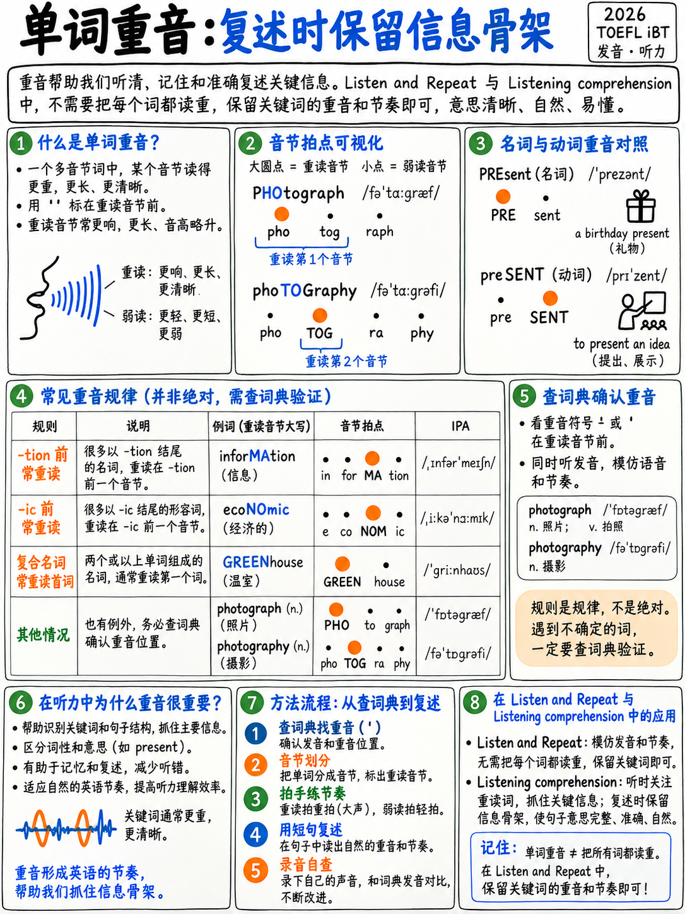

# 1.4 单词重音




:::{admonition} 为什么这是模块中价值最高的页面
:class: important
英语是一种**有压力的**语言。听众在听之前会根据重音模式来定位单词
处理各个声音。把重音放在错误的地方，母语听众可能会失败
认出一个你发音完美的单词。

托福直接将这项技能命名为：聆听并选择一个答案，测试“识别”的能力
并区分英语音素以及常见语调和**重音**模式的使用
convey meaning" [1];接受采访乐队 3 表示“清晰度有时会受到以下因素的影响
单词级发音或**重音/节奏**不准确”[1]。
:::

## 1.4.1 重读实际上是什么

A 重读音节**更长、更大声、音高更高，并且有一个完整的元音**。一个无压力的
音节短、安静、低，元音通常减少为**/ə/**。

```
   P H O T O G R A P H          p h o T O G r a p h e r      p h o t o G R A P H i c

   ███                                  ███                           ███
   ▄▄▄  ▁▁▁  ▁▁▁                 ▁▁▁    ███   ▁▁▁  ▁▁▁        ▁▁▁ ▁▁▁ ███  ▁▁▁
   PHO - to - graph             pho - TOG - ra - pher       pho-to-GRAPH-ic
   /ˈfoʊ.tə.ɡræf/              /fəˈtɑː.ɡrə.fɚ/            /ˌfoʊ.təˈɡræf.ɪk/
```

相同的词根，三个重音位置，并且元音每次都会变化。在*照片*中，第一张
元音是/oʊ/，第二个是/ə/。在 *phoTOGrapher* 中，第一个是 /ə/，第二个是 /ɑː/。
**重音驱动元音质量，而不是相反。**

## 1.4.2 如何标记重音

词典将**ˈ** *之前*重读音节：/rɪˈzʌlt/ = re-SULT。
第二个重音是 **ˌ**: /ˌɪn.təˈnæʃ.n̩.əl/ = in-ter-NA-tion-al，*in* 上节奏较轻。

 在笔记中，只需使用大写字母：reSULT、INternet、interNAtional.

## 1.4.3 实际有效的规则

 英语重音不是随机的。三个规则组涵盖了大多数学术词汇。

### A 组 — 将重音拉到*之前*音节上的后缀

|后缀 |图案|示例 |
|---|---|---|
| **-tion、-sion、-cion** |重读前面的音节 |教育、信息、决策、讨论、录取、解决方案 |
| **-ity** |之前|能力、活动、大学、可能性、社区 |
| **-ical，-ic** |之前|经济、科学、历史、地理、原子、具体 |
| **-ian** |之前|音乐家、技术员、图书管理员、历史学家 |
| **-ious，-eous** |之前|神秘、有利、宗教 |
| **-ial，-ual** |之前|必要的、财务的、个人的、习惯的 |
| **-化** |前两个 |识别、澄清、简化 |
| **-logy、-graphy、-nomy、-cracy** |两个之前（即 -o- 之前）|生物学、摄影、经济、民主 |

### B 组 — 本身带有压力的后缀

|后缀 |示例 |
|---|---|
| **-ee** |雇员EE、实习生E、难民EE、担保人|
| **-eer** |工程师、志愿者、职业 |
| **-ese** |中文、日语 |
| **-ette** |香烟、厨房ETTE |
| **-式** |画风 |
| **-恩** |下午，气球 |

### C 组 — 不改变任何内容的后缀

 添加它们，压力保持在原来的位置：**-ment、-ness、-ful、-less、-ly、-er、-ing、-ed、-al
（动词），-ize/-ise，-y**.

> 发展 → 发展 · 快乐 → 幸福 · 细心 → 细心 · 教导 → 老师 ·
> 组织 → ORganising

## 1.4.4 名词/动词重音变换

一大组双音节词将**第一个**音节重音为名词，将**第二个**音节重音为名词
动词。犯这个错误是最明显的错误之一。

|词|名词（第一）|动词（第二）|
|---|---|---|
|记录| **RE**线|重新**CORD** |
|现在 | **PRE** 已发送 |预先**发送** |
|对象| **对象**对象 |对象**JECT** |
|增加| **IN**折痕 |到**折痕** |
|减少 | **DE**折痕|消除**皱纹** |
|行为 | **CON**管道|连接**管道** |
|对比| **CON**对比 |骗**TRAST** |
|合同| **合同**合同 |骗**TRACT** |
|冲突| **CON**冲突 |骗**FLICT** |
|出口| **EX**端口 |至出口**港口** |
|进口| **IM**端口 |到我**港口** |
|进展| **进展**进度 |亲**GRESS** |
|许可证 | **PER**mit |根据**麻省理工学院** |
|生产 | **PRO**duce（蔬菜）|亲**DUCE** |
|项目|一个**项目**项目|亲**JECT** |
|叛逆| **RE**贝尔|重新**贝尔** |
|主题 | **主题**项目 |到子**JECT** |
|嫌疑人| **SUS**观点|暂停**PECT** |
|调查| **SUR**vey |超越**VEY** |
|转让| **转**转 |转**FER** |

:::{tip} 托福相关性
*记录、调查、增加、进行、项目、呈现*都是高频学术词汇，
出现在阅读学术文章和聆听学术演讲中。在 Take an 中对他们施加了错误的压力
面试是教科书的band-3“单词重音不准确”。
:::

## 1.4.5 复合名词

 两个名词连成一个概念：**强调第一个**.

> **BUS** 车站 · **POST** 办公室 · **CREDIT** 卡 · **AIR**端口 · **CLASS**房间 ·
> **足球**球· **咖啡**店· **停车场** 停车场· **研究**论文· **校园**参观·
> **访客**中心·**储物柜**房间·**学习**指南

与形容词+名词比较，其中**第二个**词重读：

>炎热的**日**·一本新的**书**·一个困难的**测试**·主要的**想法**

迷你测试：它是一个*GREEN house*（绿色的房子）还是一个*GREENhouse*（一座玻璃建筑
植物）？压力是唯一的区别。

:::{note} 与聆听和重复直接相关
两个官方场景充满了化合物：*游客中心*、*正门*、*夏天
营地*、*更衣室*、*校园健身房*、*有氧运动器材*、*自由重量*、*服务台*。得到
右复合重音是听起来像录音的一半。
:::

## 1.4.6 短语动词

 重读**助词**：*turn **ON**，look **UP**，give **UP**，find **OUT**，put **OFF***。
但由它构成的名词强调第一部分：a **TAKE**off、a **PRINT**out、a **CHECK**up。

## 1.4.7 有多少个音节？ （计数问题）

学习者经常添加或删除音节，这会破坏重音放置。

|词|音节|不|
|---|---|---|
|舒适 | **3** — COMF 表 | com 换表 (4) |
|蔬菜 | **3** — VEJ-ta-bul |蔬菜 (4) |
|有趣| **3** — IN-tres-ting |有趣 (4) |
|不同| **2–3** — DIF 租金 |不同的租金 |
|温度| **3** — TEM-pra-cher |温度 (4) |
|业务 | **2** — 商业性 |商业 (3) |
|巧克力| **2** — CHOK-lat |巧克力 (3) |
|每个| **2** — EV-ry |电子非常|
|图书馆 | **2–3** — LY-bra-ry / LY-bry |仔细图书馆|
|可能| **2–3** — PROB-ly |亲宝贝 |
|餐厅 | **2–3** — RES-tront |餐厅|
|星期三 | **2** — 温茨日 |周三 (3) |
|衣服| **1** — /kloʊz/ |衣服 (2) |
|问| **1** — /æskt/ |询问 (2) |
|完成 | **2**——FIN-isht | fi-nish-ed (3) |

**技术：** 在说出单词时，每个音节敲击桌子一次。如果您点击四次
*舒服*，你说错了。

## 1.4.8 60字重音练习

标记重音，然后大声说出来。下面的答案 — 不要先看。

**组 1 — 学术名词：**
分析·研究·发展·环境·技术·经济·百分比·机会·
实验 · 管理 · 绩效 · 参与者 · 假设 · 结果 · 要求

**组 2 — 以 -tion/-sion/-ity 结尾的单词：**
教育·决策·社区·活动·情况·人口·大学·信息·
竞争 · 可能性 · 组织 · 讨论 · 解决方案 · 反应 · 责任

**组 3 — 形容词：**
重要 · 困难 · 必要 · 可用 · 特别 · 重要 · 舒适 · 经济 ·
具体·工业·传统·适当·科学·相关·有益

**第4组-动词：**
发展·考虑·建议·要求·建立·示范·参与·认识·
确定·维持·发生·偏好·分析·组织·贡献

:::{admonition} 答案 - 首先标记所有 60 个
:class: tip
**第 1 组：** 分析·研究（美国：也称为研究）·发展·环境·技术·
经济·百分比·机会·实验·管理·绩效·参与者·
假设 · 结果 · 要求

**第 2 组：** 教育 · 决策 · 社区 · 活动 · 情况 · 人口 · 大学 ·
信息·竞争·可能性·组织·讨论·解决方案·反应·
责任

**第 3 组：** 重要 · 困难 · 必要 · 可用 · 特别 · 重要 · 舒适 ·
经济·具体·工业·传统·适当·科学·相关·有益

**第4组：**开发·考虑·建议·要求·建立·示范·参与·
识别·确定·维护·发生·偏好·分析·组织·贡献
:::

## 1.4.9 修复僵化的压力错误

 如果你把*deVELOPment* 说成*DEvelopment* 十年了，一次修正就不会坚持下去。使用
这个：

1。 **夸张。** 用可笑的重音重复 10 遍：*de-VELLL-op-ment*。
2. **嵌入。** 将其放入一个固定句子中，并说该句子 10 次。
3. **对比。** 将错误版本和正确版本交替 5 次，以便您听出差异。
4. **留出空间。** 明天和三天后重复上述操作。三个间隔的会话胜过三十个会话
   集中重复。

---

**下一个：** {doc}`05-rhythm-and-chunking` — 其中单词重音变为句子节奏，并且其中
听并重复是赢还是输。