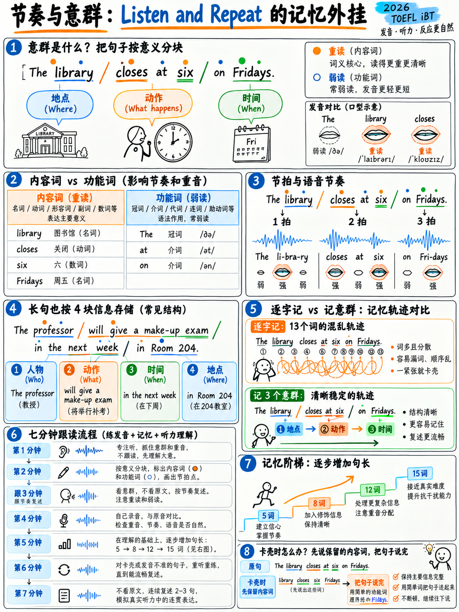

# 1.5 节奏、组块和句子重音




:::{admonition} 这是赢得“聆听和重复”的章节
:class: important
听到一次后重复一个 13 个单词的句子不是词汇任务或口音任务。它
是一个**分块**任务。人类短期记忆大约有四个*单位*。一个13字的句子是
如果您听到单词，则需要 13 个单元；如果您听到块，则 **4 个单元**。

 本章中的所有内容都服务于一个目标：将逐字听力转换为逐块听力
听力。这个单一的改变比你可以花费的任何其他时间都值得更多的演讲积分。
:::

## 1.5.1 英语是重音计时

 在音节计时语言（西班牙语、法语、日语、普通话、韩语、意大利语）中每个音节
花费大致相同的时间。在英语中，**重读音节大致以规则的间隔出现**
它们之间的所有内容都被挤压以适合。

说这三个句子，在每个 **CAPITAL** 上敲击桌子并保持敲击间隔均匀：

```
   TAP        TAP        TAP        TAP
   CATS       CHASE      MICE
   The CATS   will CHASE the MICE
   The CATS   have been CHASing   the little MICE
```

这三者大约需要相同的时间。多余的单词会被吸收，而不是添加。这就是为什么“我应该
告诉他们”听起来像 /aɪ ʃədəv ˈtoʊld əm/ — 三个非重读单词压缩成一个节拍。

:::{warning} 如果你说的是音节计时语言
你的本能是赋予每个单词同等的权重和长度。对于英语听众来说
听起来费力且“断断续续”——这正是“接受采访”乐队 3 描述词所用的词
（“频繁或长时间的停顿会导致**断断续续**的节奏”）[1].

解决办法不是说得更快。它**压制非重读的单词**。
:::

## 1.5.2 实词与语法词

| **强调**（内容）| **无重音**（语法）|
|---|---|
|名词：*学生、图书馆、结果* |文章：*a、an、the* |
|主要动词：*到达、思考、测量* |助动词：*is、are、have、has、do、can、will、would* |
|形容词：*大、困难、自由* |介词：*of、to、for、at、in、from* |
|副词：*很快、真的、从不* |代词：*我、你、他、它、他们* |
|疑问词：*什么、哪里、为什么* |连词：*and、but、or、that* |
|负面：*不，从不，不* |所有形式的动词*be* |

将其应用于官方的聆听和重复句子[1]:

> **VIS**itor的**CEN**ter，lo**CAT**ed靠近**FRONT** **EN**trance，可以**给**你更多
> 信息**MA**tion.

 13 个单词的句子中有七个节拍。如果你能坚持**七拍**，你就可以重现这句话，
因为非重读单词是可以从语法中预测出来的。

## 1.5.3 分块：在哪里断句

 分块是作为一个单元说的一组单词，有一个主重音，内部没有停顿。

|边界类型|示例|
|---|---|
|在主题之后（如果很长）| *三位研究人员* │ *提前到达。* |
|介词组 | 之前*你可以找到海狮和大象* │ *沿着小路继续走。* |
|关系从句或分词从句之前/之后 | *游客中心，* │ *位于正门附近，* │ *可以为您提供更多信息。* |
|在合相处| *请不要吃外面的食物或饮料，* │ *并且不要喂动物。* |
|目的不定式前面 | *我来得早* │ *查看日程。* |
|逗号和句号 |总是 |

### 官方的句子，标注为

Zoo场景[1]:

```
We have a variety of wildlife.
│ We have a VAriety │ of WILDlife. │                                  (2 chunks)

Bears, wolves, and large cats are to the right.
│ BEARS, │ WOLVES, │ and large CATS │ are to the RIGHT. │             (4 chunks)

You can find sea lions and elephants further down the path.
│ You can find SEA lions │ and ELephants │ further down the PATH. │   (3 chunks)

Please, no outside food or drinks, and do not feed the animals.
│ PLEASE, │ no outside FOOD or DRINKS, │ and do NOT feed the Animals. │ (3 chunks)

Avoid banging or tapping on the displays and enclosures.
│ aVOID BANGing or TAPping │ on the disPLAYS and enCLOsures. │        (2 chunks)

For those with children, we offer summer camps and educational opportunities.
│ For those with CHILdren, │ we offer SUMmer camps │ and eduCAtional opporTUnities. │ (3 chunks)

The visitor's center, located near the front entrance, can give you more information.
│ The VISitor's CENter, │ located near the FRONT ENtrance, │ can GIVE you more inforMAtion. │ (3 chunks)
```

**注意模式：**即使是 13 个单词的句子也只有 **三个块**。那是记忆里的
跨度。现在任务可以完成了。

## 1.5.4 句子重音——承载信息的一个词

 在句子中，一个实词通常占据**主要**重音。默认是最后一个
内容词。但移动它就完全改变了意义：

> **我**没有说她拿了这本书。 *（别人说过的）*
> 我**没有**说她拿走了这本书。 *（我否认这么说）*
> 我没**说**她拿走了这本书。 *（我暗示了）*
> 我没说**她**拿走了这本书。 *（别人拿走了）*
> 我没说她**拿走了**这本书。 *（她借的）*
> 我没说她拿走了**那本**书。 *（她拿了另一张）*
> 我没说她拿走了**书**。 *（她拿了别的东西）*

七个意思，一个词序。这就是 Take an Interview 乐队 5 所说的“节奏和节奏”。
语调有效传达意思” [1].

### 对比重音练习

> A: *是周一上课吗？*
> B：*不，是在**周二**日。*

> A：*你是说**前**入口吗？*
> B：*不，**后**入口。*

## 1.5.5 语调：拥有三种模式

|图案|用于 |示例|
|---|---|---|
| **坠落 ↘** |陈述、wh-问题、命令、完成的想法| *我去了图书馆。* ↘ / *你去哪儿了？* ↘ |
| **上升↗** |是/否问题、不确定性、“请继续”| *周五你有空吗？* ↗ |
| **下跌–上涨↘↗** |犹豫，部分同意，“但是……” | *嗯，这很有趣......* ↘↗ *（但我不同意）* |
| **上市** |上升，上升，上升，下降| *我们有熊 ↗、狼 ↗ 和大型猫科动物 ↘。* |

:::{tip} 最常见的语调错误
以上升结束陈述。它使每个句子听起来都像一个问题和信号
对于听众以及受过本土韵律训练的人工智能评分员来说，不确定性。 **声明失败。**
练习：说*“我同意这一点。”*并让你的音调落在*那个*上。
:::

## 1.5.6 影子——核心技术

Shadowing 正在随着录音说话，大约落后半秒，与其**节奏**相匹配。
这是已知的最有效的发音练习，因为它训练感知和


### 七分钟协议

|最小|步骤|
|---|---|
| 0–1 | **听一次。** 不要说话。顺着意思就行了。 |
| 1-2 | 1-2 **听并标记。** 在抄本中标记块边界 │ 和重读音节。 |
| 2-3 | 2-3 **哼唱。** 播放音频并哼唱旋律 - 没有文字，只有音高和节奏。这隔离了韵律。 |
| 3-5 | 3-5 **带有文字的阴影。** 跟着声音读半秒。不要暂停音频。 |
| 5-6 | 5-6 **没有文字的阴影。** 一样，闭着眼睛。 |
| 6–7 | **记录自己**的影子，然后进行比较。 |

 使用 60–90 秒的音频。 **使用同一剪辑一周**，而不是每天使用新剪辑。收获来了
来自重复。

### TOEFL

 的影子是什么|来源 |为什么 |
|---|---|
| ETS 官方模拟考试“听力和重复句子 [10][11] |精确的格式匹配 |
| {doc}`../20-speaking/05-speaking-practice-bank` §2.5.2 中的 60 个句子库 |按长度分级|
|任何清晰的新闻广播（VOA Learning English、BBC 6 Minute English）|清晰、有脚本、有记录 |
| YouTube 上的大学迎新视频 |聆听和重复场景的精确寄存器 |

## 1.5.7 记忆广度阶梯

 这是移动聆听和重复分数的练习。每天做10分钟。

|日 |句子长度|目标|
|---|---|---|
| 1-3 | 1-3 5–7 个字 | 7/7 准确 |
| 4-6 | 4-6 8–10 个字 | 6/7 准确 |
| 7–10 | 11–13 个字 | 5/7 准确，7/7 完整句子 |
| 11-14 | 11-14 14–16 个字 | 4/7 准确，7/7 完整句子 |
| 15+ |混合 5–16 | 5/7 准确 |

**方法：**听一次 → *不要立即重复* → 等待一秒钟 → 重复。一秒的差距
迫使你保持句子而不是重复它，这才是真正的任务所需要的（有
每句话后有一个停顿 [1]).

:::{important} 关键习惯
**即使您失去了单词，也始终能说出一个完整的句子。** 聆听和重复标题
给出带 3 的响应“是一个完整的句子”，其中包含“大部分内容词”，
仅当“响应不是一个独立的句子；含义是
零碎”[1].

所以：*“游客中心，靠近正门，可以给你信息”* - 四个字错误，
仍然是 3 或 4。*“游客中心……位于……嗯……”* — 2。**永远不要减弱。完成。**
:::

## 1.5.8 四周节奏计划

|周 |每日（15 分钟）|每周检查|
|---|---|---|
| 1 |嗡嗡声+影子一个60秒的剪辑；用 10 句话标记重音 |记录§1.1.8审核段落|
| 2 |为新剪辑添加阴影；记忆阶梯 8–10 个字 | 7 个听并重复项目，自评分 |
| 3 |阴影;内存阶梯 11–13 个字；对比应力训练| 7 项，目标 5 准确 |
| 4 |混合阶梯 5-16 个单词；快速完整的 7 句话场景 |完整口语部分时间 |

---

**下一篇：** {doc}`06-connected-speech` — 为什么“你吃了吗？”听起来像“Jet jet？”。