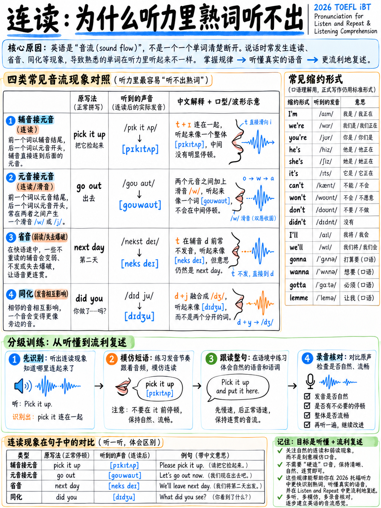

# 1.6 连接语音

:::{note} 范围：先听
对于大多数托福考生来说，连贯演讲首先是一种“听力”技能，然后才是一种口语技能。
你不必通过省略和同化来获得好成绩——《接受面试》的第 5 级
要求“良好的会话语速”，而不是像母语一样的减慢。但你绝对
必须**识别**它们，因为托福音频是“以自然的节奏传递的” [2].

|您的目标乐队 |本章要做什么 |
|---|---|
| 3 或以下 |仅阅读第 1.6.1 节和第 1.6.5 节。练习*听力*，而不是生产。 |
| 3.5 – 4.5 |进行第 1.6.2 节中的链接练习；认识其他一切。 |
| 5+ |全部生产出来。 |
:::

## 1.6.1 五个进程

|流程|会发生什么 |示例|
|---|---|---|
| **连接C→V** |最后辅音连接下一个单词的首元音 | *一个苹果* → “一个苹果”|
| **连接V→V** |元音之间出现一个微小的 /w/ 或 /j/ | *出去*→“出去”； *我是*→“我-山药”|
| **省略** |声音消失| *第二天*→“下一天”|
| **同化** |声音发生变化以匹配其邻居 | *十个男孩*→“tem 男孩”|
| **收缩** |两个字保险丝| *I would have* → "I'd've" |

## 1.6.2 连接辅音和元音——最有用的一个

这就是让流利的英语听起来像一股连续的溪流的原因。生产也很容易。

|写 |说|
|---|---|
|一个小时 | a-**n**我们的 |
|捡起来| pi-**ck**i-**t**up | pi-**ck**i-**t**up |
|看看它|厕所-**k**a-**t**it |
|打开它 |转-**n**i-**t**on |
|远方| fa-**r**走 |
|一分钟后 |我-**n**一分钟|
|起床| ge-**t**起来 |
|首先|冷杉-**s**tovall |
|很多冰|一个 lo-**t**o-**v**ice |
|一点也不|不-**t**a-**t**all |

### 练习 — 将每个单词说成一个词

> 1. 将其取下。
> 2. 将其放入盒子中。
> 3.他是一名工程师。
> 4. 检查一下。
> 5. 进来坐下。
> 6. 工作量很大。
> 7. 了解一下。
> 8. 拿起它的副本。

## 1.6.3 元音到元音的链接

|词尾元音 |插入滑轨|示例|
|---|---|---|
| /iː ɪ eɪ aɪ ɔɪ/（前）| **/j/**（“y”）|结束→“-**y**结束”；我是→“我-**y**am”；说出来→“说-**y**it”|
| /uː ʊ oʊ aʊ/（背面，圆角）| **/w/** |继续→“继续-**w**on”；谁是→“谁-**w**是”；时不时→“现在-**w**然后”|

## 1.6.4 消除——消失的声音

|规则|示例 |
|---|---|
| **/t/ 和 /d/ 在两个辅音之间消失** |下(t)日·下(t)周·必须(t)是·汉(d)包·朋友(d)船·然后(d)|
| **/h/ 在非重读代词中消失** |告诉 (h)im · 问 (h)er · 给 (h)im |
| **整个非重读音节去** |舒适（或）餐桌 · 差异（e）租金 · 蔬菜（e）餐桌 · 休息（​​休息） · fam(i)ly · ev(e)ry |
| **/ə/ 之前 /l/ /n/ /r/** |开场→“op'ning”·相机→“cam'ra”·一般→“gen'ral” |

## 1.6.5 同化 - 变化的声音

|改变|规则|示例 |
|---|---|---|
| /n/ → /m/ | /p b m/ 之前 |十磅→“TEM磅”；在床上→“我在床上”|
| /n/ → /ŋ/ |之前 /k ɡ/ |十辆车→“腾车”；加拿大→“ing 加拿大”|
| /d/ → /ɡ/ |之前 /k ɡ/ |好女孩→“好女孩”|
| /t/ + /j/ → /tʃ/ |跨越文字|难道你→“doncha”；你是什​​么 → “whatcha” |
| /d/ + /j/ → /dʒ/ |跨越文字|你是→“didja”吗？你愿意→“Wouldja”|
| /s/ + /j/ → /ʃ/ | |想念你 → “mishoo” |
| /z/ + /j/ → /ʒ/ | | as you → "azhoo" |

**著名例子：** *你吃了吗？* → /ˈdʒiːt ˈjet/ — “Jeet jet?”

:::{important} 为什么这会出现在你的托福教学大纲上
聆听并选择响应为您提供一个单一的话语，听过一次，而不是打印在屏幕上 [1]。
如果这句话是*“我不是一小时前在图书馆见过你吗？”* [1]，你实际上是什么
听到的内容大约是：

> /ˈdɪdn̩aɪ dʒəs ˈsiː jə ɪn ðə ˈlaɪbreri ənˈaʊər əˈɡoʊ/

*我*没有熔断，*只是看到*失去了/t/，*再见*滑翔，*一个小时*链接。候选人谁有
从来没有研究过这个听到四个单词并猜测。听到有关以下问题的考生
图书馆。
:::

## 1.6.6 您必须听到并使用收缩

|完整|签约|听起来像 |
|---|---|---|
|我是 |我是| /aɪm/ |
|我有|我已经| /aɪv/ |
|我愿意/我曾经|我会 | /aɪd/ |
|我会|我会 | /aɪl/ |
|他是/他有|他是| /hiz/|
|他们是 |他们是 | /ðer/ |
|我们有|我们已经 | /wiv/ |
|不|不要| /doʊnt/ |
|不|不| /ˈdʌznt/ |
|没有|没有 | /ˈdɪdn̩t/ |
|不能|不能| /kænt/（美国）/kɑːnt/（英国）|
|会有|会| /ˈwʊdəv/ — **不是**“会”|
|应该有|应该有| /ˈʃʊdəv/ |
|可以有|本来可以| /ˈkʊdəv/ |
|有|有| /ðerz/ |
|那就是 |那是| /ðæts/ |
|让我们|让我们| /lets/ |

:::{warning} 可以 vs 不可以
在美式英语中，正数 *can* 简化为 /kən/ 而 *cant* 保留完整元音 /kænt/ 且
经常失去最后的/t/。所以你听到的区别是**元音，而不是/t/**：
*我可以**去***（强调去）与*我**不能**去*（强调不能）。

这是一个经典的聆听并选择响应陷阱。训练它：听哪个单词重读。
:::

## 1.6.7 十五级钻孔线

先慢慢地说每一个，然后以自然速度说出所有链接和省略。

> 1. 拿起它并把它收起来。
> 2.你想对此做什么？
> 3. 我上周就应该问她的。
> 4. 他是我的老朋友。
> 5. 你知道几点开始吗？
> 6.里面有很多有趣的信息。
> 7. 您介意等几分钟吗？
> 8. 如果没有任何帮助，我不可能做到这一点。
> 9.首先我们来说说下一步。
> 10.你不觉得这有点问题吗？
> 11. 她已经为此工作了大约一个小时。
> 12. 我们需要尽快找到他们。
> 13. 这根本不是我想象的那样。
> 14. 如果我知道的话我就会告诉他。
> 15. 位于正门附近的游客中心可以为您提供更多信息。

（第15行是官方收听并重复句子[1]。数一下您建立了多少个链接。）

## 1.6.8 每周10分钟检查

1。查找 30 秒的自然英语音频和文字记录。
2、听三遍。写下您“听到”的内容，而不是您所知道的内容。
3. 与成绩单进行比较。
4. 标记您的版本不同的每个地方 - 这些是您的互联语音盲点。
5. 影子这五秒二十次。

 每周做一次。重复四次此练习通常可以缩小大部分差距。

---

**下一步：** {doc}`07-first-language-interference` - 最重要的具体两个或三个错误
对于以您的母语为母语的人。