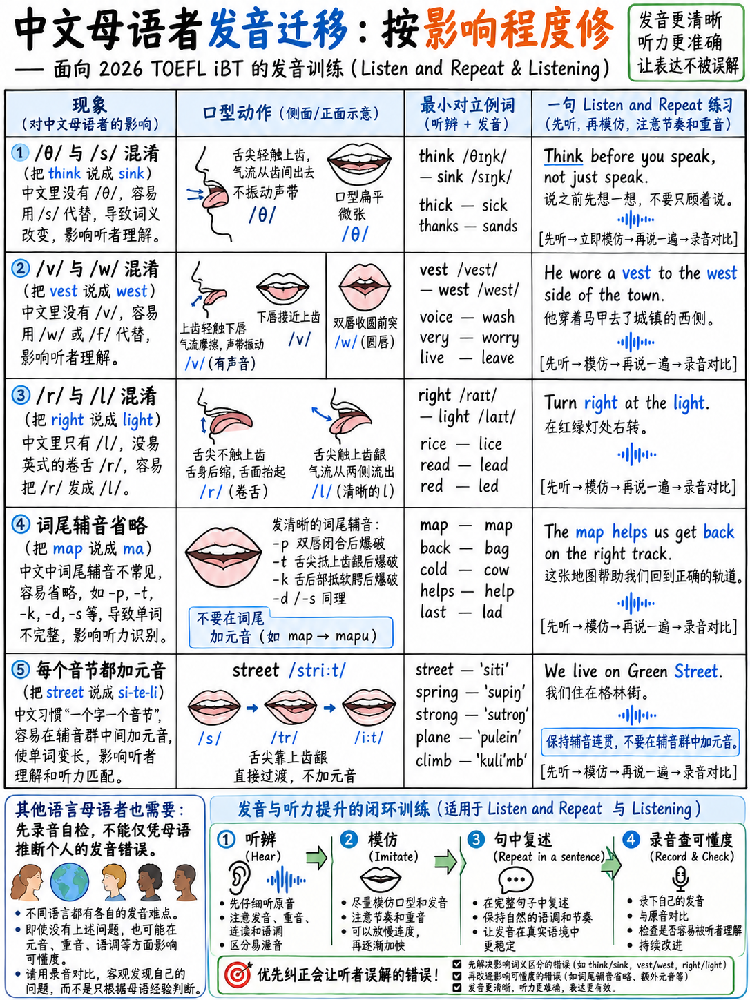

# 1.7 第一语言干扰

:::{admonition} 本章是什么和不是什么
:class: note
这是**对比音系**：对英语声音和模式的典型描述
对于特定第一语言的使用者来说是困难的，以及原因。这不是托福内容，而是 ETS

之所以在这里，是因为实现清晰度的最快途径是修复以下两三个错误：
您特定的语言背景使可能性成为可能——而不是研究所有 44 个音素
同样。

**你的口音不是问题。** 托福标准中没有提到口音；全文使用的词是
*可理解* [1]。下面标记为**关键**的项目是真正需要花费的项目
理解，而不是那些听起来很陌生的东西。
:::

## 1.7.1 如何使用本章

1.找到您的语言组。
2. 首先处理 **CRITICAL** 行，持续两周。
3. 记录前后的§1.1.8 审核段落。
4. 忽略您所在组中未列出的所有内容。

---

## 1.7.2 普通话

|问题 |详情 |优先|
|---|---|---|
| **最后的辅音被删除** |普通话音节仅以元音、/n/ 或 /ŋ/ 结尾。 *工作*→“工作”，*办公桌*→“des”，*和*→“an”。破坏时态和复数。 | **关键** |
| **辅音簇破碎** | *街道*→“si-treet”，*询问*→“询问-ed”| **关键** |
| /l/ 与 /r/ 和最终 /l/ | *轻/右*； *感觉*→“费-o”|高|
| /n/ 与 /l/（南方品种）| *夜晚/灯光* |高|
| /θ/ /ð/ → /s/ /z/ | *思考*→“下沉” |中等|
| /v/ → /w/ | *非常*→“非常”|中等|
| **音节节奏+音调延续** |每个词的权重相等；音调用于词汇而不是句子含义 | **对于接受采访至关重要**
| /iː/ 与 /ɪ/ | *羊/船* |中 |

**开头：** 结尾辅音 ({doc}`02-consonants` §1.2.7) 和节奏
({doc}`05-rhythm-and-chunking`).

## 1.7.3 粤语

所有普通话列表，加上：

|问题 |详情 |优先|
|---|---|---|
| **未发布的最后一站** |粤语有最终版/p t k/但未发布；英语释放他们| **关键** |
| /n/ ↔ /l/ 合并 |广泛 |高|
|最后 /ŋ/ ↔ /n/ | *东西/薄* |中等|
| /r/ 缺席 |替换为 /w/ 或 /l/ |高 |

## 1.7.4 日语

|问题 |详情 |优先|
|---|---|---|
| **元音插入簇** |日语的音节节奏主要是 CV 音节。 *桌子*→“desuku”，*街道*→“sutoriito”。增加音节并破坏节奏| **关键** |
| **/r/ 与 /l/** |日本人有一种介于两者之间的液体 | **关键** |
| /f/ 与 /h/ | *食物*→“引擎盖” |高|
| /v/ → /b/ | *非常*→“浆果” |高|
| /θ/ /ð/ → /s/ /z/ | |中等|
| /æ/ /ʌ/ /ɑː/ 合并到 /a/ | *猫/切割/推车* |高|
| /si/ → /ʃi/ | *参见*→“shee”|中等|
| **音调重音遗留** |平句旋律|高|

**开始于：**集群练习（{doc}`02-consonants` §1.2.8）和/r/–/l/（§1.2.3）。

## 1.7.5 韩语

|问题 |详情 |优先|
|---|---|---|
| **/r/ 与 /l/** |一个液体音素；位置相关 | **关键** |
| **最后辅音释放** |韩国最后一站尚未公布 | **关键** |
| /f/ → /p/、/v/ → /b/ | *咖啡* → “copi”，*very* → “bery” |高|
| /z/ → /dʒ/ | *动物园* → “joo” |高|
|簇元音插入 | *罢工*→“seu-teu-ra-i-keu”|高|
| /æ/ 与 /e/ |为许多发言者合并|中等|
| /ʃ/ 与 /s/ | |中 |

## 1.7.6 越南语和泰语

|问题 |详情 |优先|
|---|---|---|
| **最后的辅音被删除或未释放** |严重;时态和复数丢失 | **关键** |
| **集群简化** | *停止*→“顶部”； *朋友*→“芬” | **关键** |
|色调延续 |每个单词而不是每个句子使用的音调 |高|
| /θ/ /ð/ | → /t/ /d/ |中等|
|最后 /s/ /z/ |经常完全掉线| **关键** |
| /ʃ/ /tʃ/ /dʒ/ |合并|中 |

## 1.7.7 西班牙语和葡萄牙语

|问题 |详情 |优先|
|---|---|---|
| **/e/ 在声母/s/+辅音之前** | *西班牙* → “西班牙”，*学生* → “学生”| **关键** |
| **五元音系统** | /iː ɪ/, /uː ʊ/, /æ e ʌ/ 全部合并 | **关键** |
| /b/ 与 /v/ |合并西班牙语|高|
|尾辅音弱 |特别是 /d/ /t/ |高|
| /h/ 与 /x/ |西班牙语 *j* 是软腭 |低|
| **音节计时** |等重音节| **对于接受采访至关重要**
|纯双元音 | *走* → 没有滑行的“走”； *制作*→“mek”|高|
| /z/ → /s/（西班牙语）| *玫瑰* → “带有 s 的玫瑰”|中等|
| /ʃ/ → /tʃ/（西班牙语）| *她*→“哎呀”|中等|
|鼻化（葡萄牙语）| |低 |

## 1.7.8 阿拉伯语

|问题 |详情 |优先|
|---|---|---|
| **/p/ → /b/** |大多数品种中没有/p/。 *公园*→“吠叫”| **关键** |
| **/v/ → /f/** | *非常*→“费里”|高|
| **三元音系统** | /我一个你/;英语12个元音崩溃| **关键** |
|簇中的元音插入 | *春天*→“esbring”|高|
| /ŋ/ → /n/ + /ɡ/ | *唱歌*→“唱-g” |低|
| /tʃ/ → /ʃ/（某些变体）| |中等|
|强调辅音延续| |低|
|压力模式不同 | | Medium |

## 1.7.9 印地语、乌尔都语、孟加拉语、泰米尔语等南亚语言

|问题 |详情 |优先|
|---|---|---|
| **Retroflex /t/ /d/** |英语齿槽音 /t d/ 替换为卷舌音；非常好听|高|
| **/v/ 和 /w/ 合并** | *背心/西* | **关键** |
| **音节节奏** |加上错误音节的重音 | **关键** |
| /θ/ /ð/ → 送气 /t̪/ /d̪/ | |中等|
| /z/ → /dʒ/（部分发言者）| *动物园* → “joo” |中等|
| /f/ → /pʰ/ | |中等|
|英语中没有送气对比 | |低|
|元音插入：*school*→“iskool”| |中 |

## 1.7.10 俄语、波兰语、乌克兰语和其他斯拉夫语言

|问题 |详情 |优先|
|---|---|---|
| **最后辅音清音** | *床*→“赌注”，*狗*→“码头”。更改单词 | **关键** |
| **没有/æ/，没有/ə/** |每个元音都发音完整；节奏变得平淡| **关键** |
| /θ/ /ð/ → /s/ /z/ 或 /t/ /d/ | |中等|
| /w/ → /v/ | *水*→“vater”|高|
| /h/ → /x/ | |低|
| /r/ 颤音 |完全可理解 - 低优先级 |低|
|文章省略|口语中出现的语法问题 |高|
|前元音前的腭化 | |低 |

## 1.7.11 法语

|问题 |详情 |优先|
|---|---|---|
| **始终强调最后一个音节** |法语强调短语-finally；英语在词汇上重音 | **关键** |
| **/h/ 掉落** | *房子* → “ouse”|高|
| /θ/ /ð/ → /s/ /z/ | |中等|
| /r/ 小舌 |可理解的；低优先级 |低|
| /ɪ/ → /iː/, /ʊ/ → /uː/ | |中等|
|鼻元音延续 | |低|
|音节计时 | |高|
| *-ed* 和 *-s* 结尾被删除 |法语最后的辅音通常是不发音的 | **关键** |

## 1.7.12 德语和荷兰语

|问题 |详情 |优先|
|---|---|---|
| **最终清音** | *有*→“哈夫”，*床*→“赌注” | **关键** |
| /w/ → /v/ | *我们*→“ve” |高|
| /θ/ /ð/ → /s/ /z/ 或 /t/ /d/ | |中等|
| /ʤ/ → /j/ 或 /ʃ/ | |中等|
|过度吸气 /p t k/ |无害|低|
|动词词尾词序泄漏到语音中 |语法 |高 |

## 1.7.13 土耳其语和波斯语

|问题 |详情 |优先|
|---|---|---|
| **元音插入初始簇** | *运动*→“sipor”，*火车*→“tiren” | **关键** |
| /w/ → /v/ | |高|
| /θ/ /ð/ | → /t/ /s/ |中等|
| /æ/ 与 /e/ |合并|中等|
|重音通常是最后的（土耳其语） | |高|
| /ŋ/ |终于困难了|低 |

## 1.7.14 如果您的语言未列出

 在十五分钟内制定您自己的个人资料：

1。记录自己阅读 §1.1.8 审核段落的内容。
2. 听该部分的清单。
3. 问：*我的语言有这个发音吗？是否允许结尾辅音
   音节？它允许集群吗？是重音计时还是音节计时？*
4. 这四个问题的答案预测了 80% 的错误。

:::{important} 通用候选名单
无论您使用哪种语言，这四种几乎总是 2026 年 TOEFL:

1 的最高价值修复。 **发音最后的辅音，尤其是 -ed 和 -s** - 它们携带人工智能评分器检查的语法。
2. **不要将元音插入到簇中** - 它会增加音节并破坏节奏。
3. **将非重读单词减少为 schwa** — 这可以让你听起来流利并且能够
   *听到*流利的英语。
4. **将单词重音放在正确的位置** — 听众根据单词的重音形状来识别单词。
:::

---

**下一步:** {doc}`../20-speaking/01-how-speaking-is-scored` — 口语部分，该模块在此
转换成点。