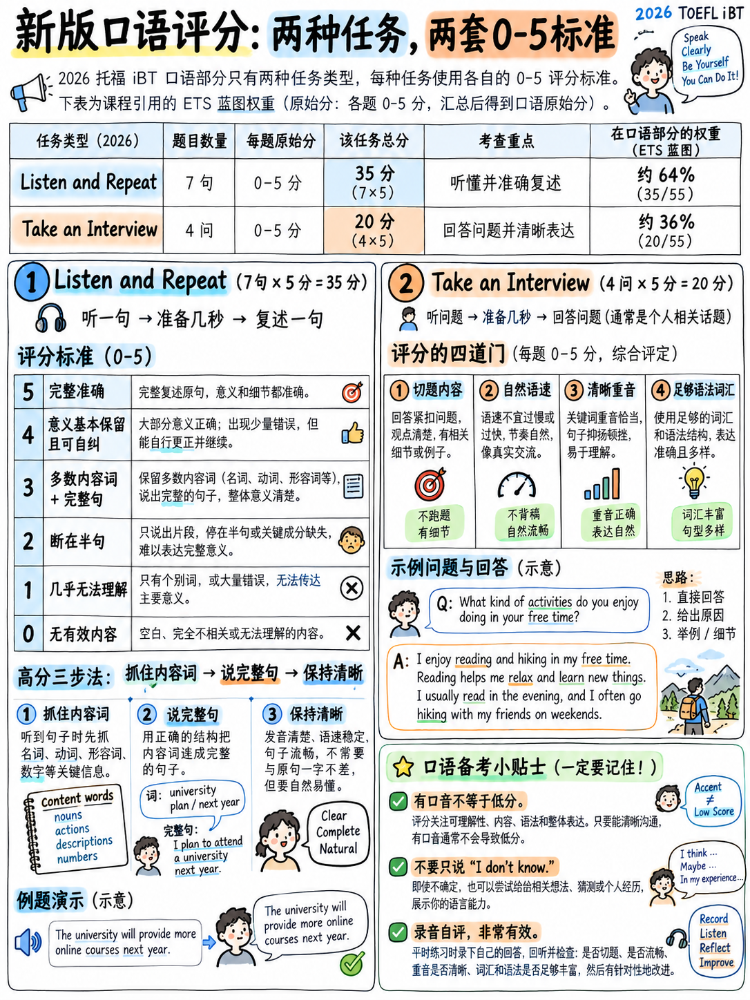

# 2.1 口语部分如何评分




## 2.1.1 部分概览

| | |
|---|---|
|测试中的位置 | **最后**，写完后 |
|长度 | **约8分钟** [1] |
|项目 | **11** [1][2] |
|原始点 | **55**（每项 5 个）[1][2] |
|频段范围 | 1-6 | 1-6
|准备时间| **无，对于任一任务** [10][11] |
|标记| **AI**，针对两个已发布的 0-5 评分指南 [1][2] |
|语言使用情境| 《学术导航》——校园和学习情况 [2] |

```
  SPEAKING  (11 items, 55 raw points, ~8 minutes)
  ┌────────────────────────────────────────────────┬──────────────────────┐
  │  Listen and Repeat                             │  Take an Interview   │
  │  7 sentences × 5 points = 35 points  (64%)     │  4 Q × 5 = 20  (36%) │
  │  8–12 seconds to record each                   │  45 seconds each     │
  └────────────────────────────────────────────────┴──────────────────────┘
```

:::{important} 战略事实
近**你的口语分数的三分之二来自于重复你刚刚听到的句子。**
没有想法。没有意见。没有主题词汇。没有准备时间，因为没有什么可做的
准备。

对于从零开始学习英语的人来说，这是最有利的设计决策 ETS
曾经做过。旧的托福口语部分要求你在 60 秒内总结一个讲座。
这个要求你说*“自由重量在后面。”*
:::

## 2.1.2 官方声明

> **声明 4：** “考生能够有效地说出清晰、连贯的英语口语
> 在一般和学术背景下进行简短和扩展的互动交流。” [2]

 两半 — *简短*互动（聆听和重复）和*扩展*互动（接受采访） — 以及
一个控制形容词：**可理解**.

## 2.1.3 评分指南 — 聆听并重复 (0–5)

 完整转载自官方概述 [1]。

|分数 |描述 |
|---|---|
| **5** | “响应**完全重复**提示。典型的响应表现出以下内容：响应**完全可理解**并且是提示的精确重复。” |
| **4** | “响应**捕获了提示中表达的含义**，但不是精确的重复。单词或语法上存在微小变化，**不会实质上改变含义**......一两个**功能词**可能会丢失或更改，内容词可能会丢失（在较长的刺激中）或被相关词替换，**时态/体/数字**的标记可能会丢失或不正确，或者**两个词可能会被调换**。一两个内容词可能会因为以下原因而产生歧义：发音不精确。 **说话者可能会自我纠正**，但成功完成了回答。” |
| **3** | “回复**基本完整**，但没有准确捕捉原始含义……包含提示中的**大部分实词**或想法。多个功能词可能会被更改或缺失；一个或多个实词可能会缺失或发生实质性变化。**回复是一个完整的句子。**在某些情况下，可理解性问题会导致偶尔难以理解含义。” |
| **2** | “响应**缺少提示的重要部分**和/或非常不准确……说话者可能会重复句子的第一部分。然后说话者可能会停下来或填写不准确的内容和/或包含最后几个单词。**响应不是一个独立的句子**；含义支离破碎。可理解性较低。” |
| **1** | “响应只捕获了提示的**很少**，或者基本上难以理解。只做了几句话的最小响应；大部分提示都丢失了。” |
| **0** | “没有回应，或者回应完全无法理解，或者回应中没有英文，或者内容完全与提示无关（**或仅包含诸如“我不知道”**之类的短语）。” |

### 此标题告诉您要做的五件事

|标题证据|它要求的行为|
|---|---|
|第 4 级可以容忍功能词缺失、时态标记错误、换位、**和自我更正** | **自由自我更正。** 在频段 4 中明确允许。
|第 3 级仅需要“大部分内容词”加上“完整的句子”| **如果你有名词和动词，请完成句子。** 你至少有 3 个。 |
|第 2 段的定义是“不是一个独立的句子”并且逐渐减弱 | **永远不要落后。** 成绩不佳 (3) 和停止 (2) 之间的差距是每项 1 分 — **整个任务最多 7 分**。 |
| Band 0 包括说“我不知道”| **永远不要说“我不知道”或“抱歉”。** 这是一个零，而沉默加尝试将是一个 1。
| “完全可理解”是第 5 级唯一的额外要求 | 4 与 5 的区别在于清晰度，而不是速度。 |

:::{important} 整理的算术
七项。假设你听懂了每个句子的大部分内容，但习惯性地听不懂长句子。
在四个项目上获得 2 分（而不是 3 分）需要 **4 个原始分（满分 55 分）**——大约占该部分的 7%。
假设您总是生成一个完整的句子：这四个项目得分 3，其中两个项目得分
可能 4.

**“始终完成句子”是此包中单个最高值的指令。**
:::

## 2.1.4 评分指南 — 参加面试 (0–5)

 完整转载 [1]。

|分数 |描述 |
|---|---|
| **5** | “完全成功的回答。回答完全解决了问题，而且清晰流畅。 • 回答**切题且详尽**。 • **良好的对话语速**通过**适当和自然的停顿**来保持。 • 发音**容易理解**； **节奏和语调有效地传达意思**。 • 一系列准确的语法和词汇可以清晰地表达精确的含义。” |
| **4** | “总体上成功的回应…… • 围绕主题且详尽阐述，但 ** 可能缺乏有效的句子级连接器**。 • 总体上保持良好的说话节奏，有一些停顿可能 ** 最小化** 影响流畅。 • 可理解性和意义不会受到阻碍……，尽管 ** 偶尔出现的单词/短语可能需要少量努力才能理解**。 • 语法和词汇在大多数情况下足以表达一般含义。” |
| **3** | “部分成功的回应…… • 一般都在主题上，但**阐述可能相对有限**。 • **频繁或长时间的停顿会导致节奏不稳定；填充词频繁出现。** • 可理解性有时会受到 **单词级发音或重音/节奏** 不准确的影响。 • 语法和词汇的范围和准确性有限，明显限制了含义的精确性和清晰度。” |
| **2** | “基本上不成功的回答…… • **与面试官的问题联系最少**，很少或根本没有相关阐述**或主要由问题中的语言组成**。 • 可理解性有限。 • 语法和词汇范围非常有限。” |
| **1** | “不成功的回答…… • 仅与面试官问题中的语言**模糊地联系**。 • 大部分难以理解。 • **主要由孤立的单词或短语组成。**” |
| **0** |至于聆听和重复。 |

### 四个门

 垂直读取条带，每次都会出现相同的四个维度：

```
  ┌──────────────────┬────────────────────────────────────────────────┐
  │ 1. CONTENT       │ on topic? elaborated? your own words?          │
  ├──────────────────┼────────────────────────────────────────────────┤
  │ 2. PACE          │ conversational? or choppy with long pauses?    │
  ├──────────────────┼────────────────────────────────────────────────┤
  │ 3. INTELLIGIBILITY│ does the listener have to work? rhythm/stress?│
  ├──────────────────┼────────────────────────────────────────────────┤
  │ 4. LANGUAGE RANGE│ enough grammar and vocabulary for the meaning? │
  └──────────────────┴────────────────────────────────────────────────┘
```

初学者可以快速移动门 1 和门 2，并通过发音模块移动门 3。 4号门是
慢一点。 **通过最大化门 1-3 并接受当前门 4 来实现目标频段 3-4。**

## 2.1.5 什么会花费你的标记，什么不会

|不花费你的分数|证据|
|---|---|
|有口音| [1] | 标题中没有出现“accent”一词
|说*嗯*和*呃* |官方**高层**面试样本全是[1] |
|自我修正 |明确允许在收听和重复 [1] 的频段 4 |
|简单的意见|没有标题奖励复杂的内容|
|事实错误 |未评估 |
|短暂停下来思考一下 | Band 5 希望“适当且**自然**地使用停顿” |
|使用短句 |只提到了“范围”，没有提到长度 |

|会花费你的分数吗？证据|
|---|---|
| **在句子结束之前停止** | LR band 2：“不是一个独立的句子”|
| **长时间或频繁的停顿会让你变得不稳定** | TI 频段 3 |
| **重复面试官的措辞** | TI 2 级：“主要由问题中的语言组成”|
| **孤立的单词而不是句子** | TI 频段 1 |
| **重读错误的单词** | TI 等级 3：“单词级发音或重音/节奏不准确”|
| **说“我不知道”** |两个指南上的频段 0 |
| **根本不说话** | 0 级 — 口语部分空白意味着**没有任何部分得分** [3] |
| **内容贫乏**（“是的，我同意。这很好。”​​）| TI 3 级：“阐述可能相对有限”|

## 2.1.6 定义良好口语表现的三个习惯

**1。填满时间。** 45秒并不长；它也不短。 3 级答案止于 15
秒。 5 级答案会占用大部分窗口。训练到时钟，而不是想法。

**2。完成你开始的每一个句子。** 在这两项任务中。在聆听和重复中，它确实值得
每个项目的频段；采访中，遗弃的句子读作不流畅。

**3。说一些具体的事情。**“例如，去年我……”是来自频段 3 的最便宜的路线
（“阐述可能相对有限”）至第 4 级（“围绕主题并进行阐述”）。一项具体
每个答案的示例。 Always.

## 2.1.7 如何在没有伙伴的情况下练习

|需要|方法|
|---|---|
|聆听并重复输入 |文字转语音（`espeak-ng -v en-us -s 150 "sentence"`），朋友朗读，或者官方练习测试音频[19] |
|录音|电话语音备忘录，或 `arecord` / Audacity — 请参阅 {doc}`../60-toolkit/07-free-tools-and-self-testing` |
|给自己打分 |按字面意思使用上面的 0-5 指南。在每个项目旁边写下编号。 |
|采访输入|自己大声朗读 4 个问题，启动 45 秒计时器，冷酷回答 |
|检查清晰度 | **一天后以 1.0× 收听您的录音**。如果您无法理解您所说的某个短语，那么记分员也无法理解。 |

:::{tip} 播放规则
根据录音给自己评分，而不是根据记忆的感觉。每个这样做的人
第一次以同样的两种方式感到惊讶：停顿时间比他们想象的要长，
他们完成的句子比他们想象的要少。
:::

---

**下一篇：** {doc}`02-listen-and-repeat` — 35 点任务，以及如何训练其所需的记忆力。