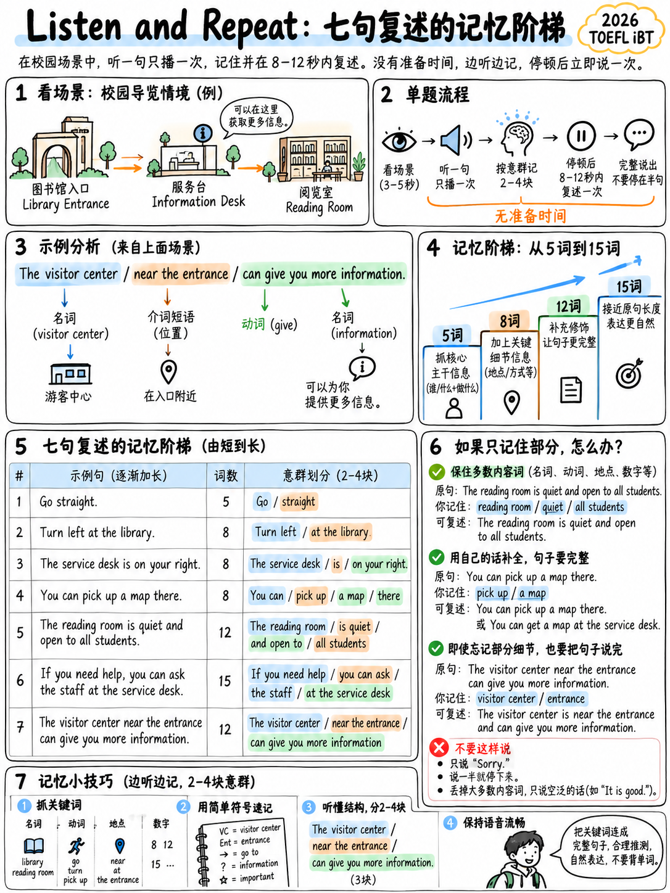

# 2.2 听并重复口语部分 55 个原始点中的 




**35。七项。没有准备时间。最值得学习的
2026 TOEFL 的分数块。**

## 2.2.1 到底发生了什么

> “在听和重复任务中，考生在一个场景中重复**一个场景中的七个句子**
> 学术或校园生活环境。该场景提供了倾听和交流的目的
> 重复句子。每个系列的句子都与**视觉表示相关联
> 设置**，句子的进展对应于相关的视觉运动
> 屏幕上的部分插图。每句话后面**有一个停顿**，然后测试
> 接受者准确地重复所说的话。句子变得**逐渐更长和更复杂**
> 考生在场景中取得进展。对于每个句子，考生的**最多为 8
> 12 秒** 来记录响应。” [1]

 练习测试的屏幕说明 [10]:

> “您将聆听有人对您说话。仔细聆听，然后重复您所听到的内容。
> 时钟将显示您需要发言的时间。 **没有时间准备
> 提供。** … **仅重复一次。**"

 每项的顺序：

```
  [picture of the setting]  →  🔊 sentence (played ONCE)  →  pause  →  🎙 8–12 s to speak
       ↑                                                                      │
       └──────────────────  repeat ×7, sentences getting longer  ─────────────┘
```

## 2.2.2 两个官方场景，带测量值

ETS发布了两套完整的套装：动物园入门[1][10]和校园体育馆参观[11].

**套装A——“你正在学习欢迎游客来到动物园。”**

| ＃|造句|话|
|---|---|---|
| 1 |我们有各种各样的野生动物。 | 6 |
| 2 |熊、狼和大型猫科动物在右边。 | 9 |
| 3 |沿着小路继续前行，您会发现海狮和大象。 | 11 | 11
| 4 |请不要携带外来食物或饮料，也不要喂动物。 | 12 | 12
| 5 |避免敲击或敲击显示器和外壳。 | 9 |
| 6 |对于有孩子的人，我们提供夏令营和教育机会。 | 11 | 11
| 7 |游客中心位于正门附近，可以为您提供更多信息。 | **13** |

**B 组 — “您正在学习如何引导新生穿过校园体育馆。”**

| ＃|造句|话|
|---|---|---|
| 1 |欢迎来到我们的校园健身房。 | 5 |
| 2 |有氧运动器材位于入口附近。 | 6 |
| 3 |自由重量在后面。 | 6 |
| 4 |我们所有的更衣室均配有淋浴和毛巾。 | 11 | 11
| 5 |我们的健身教练在这里举办健身课程。 | 8 |
| 6 |您可以查看时间表以了解可用的课程和时间。 | 10 | 10
| 7 |如有疑问，请向服务台工作人员寻求帮助。 | **15** |

### 两套揭示了什么

|观察|对您的影响 |
|---|---|
| **范围：5-15 个单词**，最后一句很长 |训练到 16 个单词；真正的最大值约为 15 |
| **场景始终是导游/定向** - “你正在学习……” |词汇是可预测的：位置、设施、规则、服务 |
|两组中的第 7 句都包含一个**嵌入修饰语**：*“位于前门附近”* / *“如果您有任何问题”* |专门训练从句|
|重复结构：*X is/are + 位置*、*You can + 动词*、*Please + 命令式*、*We offer/have + 名词* |一组小型、封闭的框架|
|重复出现的词汇：*入口、路径、返回、附近、进一步向下、可用、帮助、信息、设备、课程、时间表* | 60 个单词的列表涵盖了大部分内容 ({doc}`../60-toolkit/01-core-vocabulary` §6.1.4) |

:::{tip} 预加载场景词汇
设置为校园及公共设施：体育馆、图书馆、实验室、博物馆、动物园、食堂、
健康中心、迎新活动、书店、宿舍、体育中心。学习 40 个设施单词和
在你听到七个句子之前，它们就变得可预测——这极大地减少了记忆负担。
:::

## 2.2.3 为什么人们会失败这个任务

几乎从来没有发音。有四种不同的故障模式，它们需要不同的
修复。

|失败|听起来像什么 |修复 |
|---|---|---|
| **内存溢出** |完美的 6 个字，然后沉默 | §2.2.4 内存梯形图 |
| **单词级听力** |你解码了 *vis-i-tor 的…中心…*并丢失了其余的 | {doc}`../10-pronunciation/05-rhythm-and-chunking` |
| **完美主义冻结** |你停下来是因为你知道你说错了一个词 | §2.2.5 恢复规则 |
| **清晰度滞后** |你记得但在8秒内说不出来 | §2.2.6 速度训练 |

## 2.2.4 记忆阶梯——核心训练

 人类言语短期记忆大约包含**四个块**。 13个单词的句子是不可能的，因为
13 件物品，只需 3 块即可轻松完成。整个训练是组块形成。

### 练习

1。让您读一个句子**一次**（文字转语音或与伙伴一起朗读）。不要看它。
2. **等待一整秒。** 不要立即回显。
3. 重复整个句子。
4. 核对文字。使用官方指南标记 0–5。

 一秒的间隙至关重要。即时回声使用不同的、较浅的内存系统，并且不会
不转移到真正的任务，其中有一个故意的暂停 [1].

### 梯子

|舞台|长度 |每日代表|继续前进 |
|---|---|---|---|
| 1 | 5–7 个字 | 10 句话 | 9/10 准确 |
| 2 | 8–10 个字 | 10 | 10 8/10 准确 |
| 3 | 11–13 个字 | 10 | 10 7/10 准确，10/10 完整句子 |
| 4 | 14–16 个字 | 10 | 10 6/10 准确，10/10 完整句子 |
| 5 |混合 5–16 | 7（全套）| 5/7 精确 |

A 60 句分级库位于 {doc}`05-speaking-practice-bank` §2.5.2.

### 分块技术，应用实时

 当您收听时，**不要**尝试存储单词。存储**三个插槽**：

```
   [ WHO / WHAT ]   [ DOES WHAT ]   [ WHERE / WHEN / HOW ]
```

> *“我们所有的更衣室 │ 都配备 │ 淋浴和毛巾。”*
> ↑ 插槽 1 ↑ 插槽 2 ↑ 插槽 3

> *“游客中心位于正门附近，│可以为您提供 │更多信息。”*
> ↑ 插槽 1（及其修饰符） ↑ 插槽 2 ↑ 插槽 3

 三个插槽位于跨度内。十三个字不是。

:::{important} 为什么这也会提高你的听力分数
同样的三槽习惯可以让你跟踪曾经播放过的对话。训练聆听和
重复训练听力。这些不是单独的投资。
:::

## 2.2.5 恢复规则 — 当您丢失部分句子时该怎么办

 这些规则直接来自标题。记住它们；它们值得几个原始点。

|情况|该怎么办 |为什么 |
|---|---|---|
|您错过了一个小单词 (*the, a, of, to*) | **无论如何都要说出这句话，没有它** |等级 4：“一两个功能词可能丢失或更改” |
|您不确定某个内容词 | **替换相关词并继续** |第 4 级：“实词可能……被相关词替换” |
|你把句子中的时态弄错了 | **继续前进;不要重新启动** |等级 4：“时态/体/数的标记可能丢失或不正确” |
|你说错一个字，注意到了| **自我更正一次并完成** |等级 4：“说话者可能会自我纠正，但成功完成了回答” |
|你只记得开始和结束| **用看似合理的单词桥接并产生一个完整的句子** |第 3 级要求“完整的句子”和“大部分内容词”|
|你几乎什么都不记得了 | **说出有关该设置的任何完整的相关句子** |乐队 1 击败乐队 0； “我不知道”是乐队 0 |
|您还剩 3 秒，您正在说完一句话 | **快速完成，甚至压缩** |带2是“不是一个独立的句子”|

:::{danger} 三件事永远不要说
1. **“我不知道。”** 显式的 band 0。
2. **“抱歉，您能再说一遍吗？”** 不存在重复；你烧毁了窗户。
3. **什么也没有。** 0 段。
:::

### 努力康复

提示：*“对于有孩子的人，我们提供夏令营和教育机会。”*

|你听到了什么 |说什么 |可能的乐队 |
|---|---|---|
|所有这一切|精确重复 | **5** |
|失去*教育* | “对于那些有孩子的人，我们提供夏令营和机会。” | **4** |
|迷失*夏令营* | “对于那些有孩子的人，我们提供营地和教育活动。” | **4** |
|只有“儿童……营地……机会”| “对于孩子们，我们提供营地和机会。” | **3** |
|只有“孩子” | “我们有针对儿童的活动。” | **1–2** |
|沉默| — | **0** |

第四行和第六行之间的差距是**一件物品上的三个原始点**。七岁以上


## 2.2.6 快速练习（8-12秒窗口）

A 自然节奏的15个单词句子大约需要5秒。你有 8-12 个。有时间——但没有时间
进行 3 秒思考，然后缓慢讲话。

**练习：** 将计时器设置为 8 秒。大声朗读 15 个单词的句子，从计时器开始计时
开始。你应该有 2-3 秒的空闲时间完成。如果你不这样做，那么你说得太慢了


目标速度：**每分钟大约150个单词**，这是正常的英语会话。

|句子长度|应该采取|
|---|---|
| 6 个字 | 〜2.5 秒 |
| 10 个字 | 〜4 秒 |
| 15 个字 | ~6 s |

## 2.2.7 句子中常见的内容陷阱

 两个已发布的集合包含特定的绊脚石。它们并非偶然——它们是
任务目标之类的东西。

|陷阱|示例|为什么很难|
|---|---|---|
| **三人名单** | “熊、狼和大型猫科动物”|一个插槽中的三个内容项 |
| **复合名词** | “游客中心”、“更衣室”、“服务台”、“有氧运动器械”|必须作为一个单元存储，且首词重音 |
| **否定命令** | “不要喂动物”|很容易删除“不”——这会颠倒含义并降低内容的成本 |
| **分词修饰语** | “位于前门附近”|主语内的整个子句|
| **有条件开场白** | “如果您有任何疑问，请……” |主要条款迟到 |
| **介词字符串** | “来自服务台服务员”|连续两个介词 |
| **近义词** | “课程和时间”、“淋浴和毛巾” |配对很容易交换或合并|

**刻意钻研所有七个模式。**围绕每个模式构建的句子都在
{doc}`05-speaking-practice-bank` §2.5.2，设置 C.

## 2.2.8 14 天聆听和重复计划

|日 |工作（20 分钟）|
|---|---|
| 1 |阶梯阶段 1（5-7 个字）×10。全部记录下来。分数。 |
| 2 |舞台 1 × 10 + 全速动物园 |
| 3 |第 2 阶段（8-10 个单词）×10 |
| 4 |第 2 阶段 ×10 + 发音：最后辅音 ({doc}`../10-pronunciation/02-consonants` §1.2.7) |
| 5 |阶段 2 × 10 + 在纸上标记 10 个句子 |
| 6 |第三阶段（11-13 个单词）×10 |
| 7 | **检查点：** 完整的 7 句话集，计时，每句得分 0-5。记录总数。 |
| 8 |第三阶段×10+恢复规则练习（小音量刻意听一次）|
| 9 |第 3 阶段 ×10 + 复合名词和列表练习 |
| 10 | 10第 4 阶段（14-16 个字）×10 |
| 11 | 11阶段 4 × 10 + 8 秒快速训练 |
| 12 | 12混合梯×14 |
| 13 |连续两套完整的 7 句话集 |
| 14 | 14 **检查点：**全套，计分。与第 7 天相比。|

 对于每天这样做的初学者来说，在 14 天内的实际收获：来自大约 2/7 个完整句子
到 7/7 的完整句子，其中 3-4 个句子准确。在原始点中，大约是 **14 → 26，共 35 个**。

（该预测是 **分析**，而不是 ETS 数据。没有关于改进率的公开数据。）

## 2.2.9 制作音频

 您需要一个不属于您自己的声音。三个选项，按优先顺序排列：

1。 **官方练习材料** [10][11][19] — 格式准确，但数量有限。
2. **文本转语音。** 在 Linux 上：`espeak-ng -v en-us -s 150 "Free weights are in the back."`
   更好的质量：任何带有美国语音的在线 TTS。命令和替代方案
   {doc}`../60-toolkit/07-free-tools-and-self-testing` §6.7.3。
3. **学习伙伴**以正常速度大声朗读银行——**不慢**。慢速输入列车
   错误的技能。

:::{warning} 切勿降低速度练习
真实的音频“以自然的节奏传递”[2]。以 0.75× 练习培养聆听习惯
考试当天失败了。如果句子太快，就缩短它；不要放慢速度。
:::

---

**下一个：** {doc}`03-take-an-interview` — 其他 20 个点，以及四个固定问题功能。