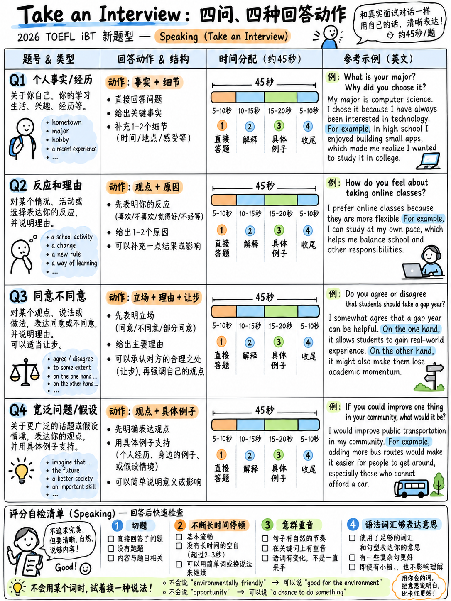

# 2.3 参加面试




**口语部分55个原始点中的20个。四个问题。每个 45 秒。没有准备
time.**

## 2.3.1 究竟发生了什么

>“考生参与与**预先录制的面试官**的模拟对话。
> 面试发生在多种情况下，例如申请奖学金或
> 参与研究。面试时，考生回答**四个问题**
> 与采访主题相关，他们描述自己的经历和观点。他们有
> **回答每个问题需要 45 秒**。 **初始问题侧重于事实信息和
> 个人经历，而后面的问题则要求考生表达和支持意见
> 关于更广泛的问题。**" [1]

 屏幕上 [10]：*"面试官会问您问题。回答问题并**一定要说
在允许的时间内尽可能多地进行**。不提供准备时间。"*

```
  scenario introduced (text + audio)
        ↓
  Q1 ──45 s──► Q2 ──45 s──► Q3 ──45 s──► Q4 ──45 s──►  done
  fact/        reaction      agree /       broad issue /
  experience   + why         disagree      hypothetical + example
```

## 2.3.2 四个槽——口语部分最有用的模式

*主题*变化。 **函数没有**。以下是并排发布的所有三篇采访
[1][10][11]:

|插槽|功能|都市生活|通勤|
|---|---|---|---|
| **Q1** |个人事实/过去的经历，通常是两个子问题 | “回想一下您上次访问您所在国家/地区的一座城市……**为什么**您去那个城市旅行？**您喜欢它什么**？” | “住在学校或工作单位附近很重要吗？**为什么？**” |
| **第二季度** |您的反应/偏好***+解释** | “有些人觉得城市充满活力和令人兴奋。另一些人则觉得它们势不可挡...... **你对城市有什么样的反应**？**你认为你为什么会有这样的反应？**” | “想象一下，您可以乘坐汽车上下班，前者速度更快，但价格更高，或者乘坐公共交通，后者速度较慢，但​​费用较低。**您会选择哪一种，为什么？**” |
| **第三季度** |同意/不同意**声明的立场** | “有些人认为生活在城市的人过着更有趣的生活……**你同意吗？**为什么或为什么不呢？” | “有些人认为通勤可能会带来压力和疲劳。**您认为有哪一两种不同的方法**可以让通勤变得更加愉快？请给出理由。” |
| **第四季度** |广泛/假设/政策，通常**“举个例子”** | “您认为市政府**应该**在城市地区创建更多公园以促进幸福感和生活满意度吗？为什么或为什么不呢？” | “有些人认为通勤可能会完全消失。**您认为通勤的严重减少可能会对企业产生积极和消极的影响吗？请分别举一个例子。**”

:::{important} 你可以排练什么
你不能排练这个话题。您*可以*排练四个 45 秒的答案形状，以便在测试时
那天你只提供内容，而不提供结构。这就是下面的整个技术。
:::

## 2.3.3 四个答案骨架

Each 设计为自然地填充 40–45 秒，每分钟约 150 个单词 → 大约 **100–110
字**.

### Q1 — 个人事实/经验

```
1. Direct answer in one sentence.        ("The last time I visited a big city was Istanbul,
                                           about two years ago.")
2. The reason / the circumstance.        ("I went there mainly to visit my cousin, who was
                                           studying at the university.")
3. Two or three concrete details.        ("What I liked most was the old market near the water.
                                           It was crowded, but the food was amazing, and you
                                           could walk everywhere.")
4. A short closing evaluation.           ("So overall it was a really good trip.")
```

**规则：** 在前五个单词中回答字面问题。然后添加细节。从不开始
“这是一个有趣的问题。”

### Q2 — 你的反应 + 为什么

```
1. State your reaction plainly.          ("Honestly, I find big cities quite energising.")
2. Give the reason.                      ("I think it's because there's always something
                                           happening, and I get bored easily.")
3. Concede the other side briefly.       ("Of course, after a few days the noise does get tiring.")
4. Example from your own life.           ("When I stayed in Seoul last summer, I enjoyed the
                                           first week much more than the second.")
5. Restate the position in one clause.   ("But generally, I prefer cities to small towns.")
```

### Q3 — 同意/不同意所陈述的观点

```
1. Take a side in the first sentence.    ("I partly agree with that idea.")
2. The strongest reason, with "because". ("People in cities do have more opportunities,
                                           because there are simply more jobs and more events.")
3. The limit / the counter-case.         ("But I don't think that automatically makes life more
                                           interesting. It depends on the person.")
4. A concrete example.                   ("My uncle lives in a small village and he's involved in
                                           far more activities than I am.")
5. Final position.                       ("So I'd say opportunity and interest aren't the same
                                           thing.")
```

:::{tip} “我部分同意”是最强的开场白
它既许可了支持性理由，又许可了限制性理由，这正是一个
“详细的”4/5 段答案。它还消除了必须选择立场的瘫痪。
:::

### Q4 — 广泛问题/假设，举例 

```
1. Position.                             ("Yes, I think city governments should definitely invest
                                           in more parks.")
2. Reason 1 + effect.                    ("The main reason is mental health. People who work
                                           indoors all day need somewhere quiet to go.")
3. Reason 2 or the negative side.        ("There's also a practical benefit — parks reduce heat
                                           in summer.")
4. Named example.                        ("For example, in my city they turned an old railway
                                           line into a park, and now it's full of people every
                                           evening.")
5. Short conclusion.                     ("So I think the investment pays off.")
```

当问题明确要求“各举一个例子”时（如在通勤面试中），
**大声数出它们**：*“一个正面例子是……，一个负面例子是……”*
记分员正在寻找任务完成情况。

## 2.3.4 填满四个槽的三十个短语

不是模板 - *移动*的词汇。每个槽位选择一个，根据提示填写其余部分。

|功能|短语|
|---|---|
| **以直接答案打开** | “上次我……是……”·“老实说，我会说……”·“是的，绝对是。” · “我部分同意。” ·“对我来说，这是……” |
| **给个理由** | “主要原因是……”·“这主要是因为……”·“我认为归根结底是……”·“其中一个原因是……”|
| **添加第二点** | “除此之外……”·“还有……”·“另一件事是……”·“除此之外……”|
| **承认** | “当然，这确实取决于……”·“我能理解为什么人们不同意，因为……”·“话虽如此……”|
| **举例** | “例如，去年……”·“一个很好的例子是……”·“就我自己而言……”·“我住的地方……”|
| **对冲/软化** | “我想说它倾向于……”·“这可能取决于……”·“在大多数情况下……”|
| **购买一刻** | “实际上，这是一个很好的问题——我想说……”·“让我考虑一下。” ·“嗯，这确实要看情况。” |
| **关闭** | “所以总的来说……”·“这就是为什么我认为……”·“无论如何，这是我的观点。” |

:::{warning} 谨慎使用购买时间的动作
第 3 段表示“**填充词很常见**”。每个答案有一个拖延短语是很自然的；三是一个
模式。更好的技巧是从直接答案开始——这样你就永远不需要拖延。
:::

## 2.3.5 节奏：45 秒的实际感觉

|秒|应该发生什么 |
|---|---|
| 0–3 |你已经在说话了。直接回答。 |
| 3–15 |原因，用*因为*。 |
| 15-30 | 15-30第二点或让步。 |
| 30–40 |具体例子。 |
| 40–45 | 40–45一个结束语。如果你用完了，就彻底停下来——不要在 43 秒时开始新的想法。 |

**使用可见计时器进行练习。** 两个最常见的故障是在 20 秒处停止（带 3、
“阐述可能相对有限”）并在 45 处被切断（听起来没有计划）。

## 2.3.6 官方高层回应的实际情况

ETS 发布了对城市生活采访 [1] 的转录**高层回应样本**。它是
正因为它如此不完美，才值得研究：

>“我上次访问一个城市是......德里。我去那里是为了，嗯，拜访我现在居住的朋友
> 那里。我，呃……我真的很喜欢那些历史悠久的地方，比如……嗯，红堡和库特卜塔。
> 有很多，呃……文化活动正在进行。食物也很棒，尤其是
> 嗯……街头小吃。我喜欢这里忙碌的氛围，嗯，它融合了旧的和现代的方式
> 新建筑。"

|特色 |计算 Q1 答案 |
|---|---|
|充满停顿（*嗯，呃*）| **7** |
|自我纠错| 1（“食物也很棒”）|
|语法滑条| “有**很多文化活动”（后来：“不同类型的地方”）|
| **具体命名示例** | **2**（红堡、库特卜塔）|
|直接回答第1句| **是** |

:::{important} 课程
这是 ETS 自己的高性能范例，它包含七个“ums”、一个错误的开始和一个
主谓一致错误。它不包含的是：沉默、废弃的句子、
重述问题，或没有具体细节的答案。

**不要试图变得完美。开始尝试变得完整和具体。**
:::

## 2.3.7 你可以提前准备的内容

因为Q1和Q2总是关于*你的*经验，所以你可以预先构建材料。花一小时


用英语填写此内容，然后大声排练每个内容 30 秒：

|主题 |您准备好的材料|
|---|---|
|您访问过的城市 |地点、时间、原因、两件事你喜欢，一件你不喜欢 |
|你的家乡 |尺寸，两件好事，一件事|
|你的学业/工作 |什么，为什么你选择它，你喜欢的一件事|
|一次难忘的旅行|在哪里、和谁在一起、一个特定的时刻 |
|您的日常生活/通勤 |你如何旅行，多久，一件烦恼|
|一个爱好|什么、多久、为什么开始 |
|您使用的技术 |哪个应用程序/设备，它有什么帮助，一个缺点|
|一个影响你的人|谁，他们做了一件具体的事情 |
|你所在城市的一个问题 |什么，它影响谁，一个可能的解决办法|
|您将对学校/工作场所做出的改变 |什么，为什么 |

 这十个内容涵盖了“奖学金申请”或“Q1/Q2”中绝大多数的提示
“研究性学习”框架。使用它们的二十个练习题位于
{doc}`05-speaking-practice-bank` §2.5.4.

## 2.3.8 处理不懂的题

听一次，没有重复，没有准备时间。

|情况|这样做|
|---|---|
|您抓住了主题，但没有抓住问题 |回答一下主题。 “说到公园——我认为它们很重要，因为……”部分相关的完整答案得分远远高于沉默。 |
|你抓住了一个关键词 |围绕它构建。一个相关的词就足以保持“主题”。 |
|你什么也没抓到|使用场景。你被告知了框架（“关于城市生活的研究”）。说一些关于那个框架的实质性内容。 |
|半途才发现自己误会了 | **不要重新启动。** 驾驶：“……虽然，更广泛地思考，真正重要的是……” |

:::{danger} 永远不要这样做
- 说“你能重复一下这个问题吗？” ——那里没有人。
- 说“我不明白”并停止——这是 0 级领域。
- 重复面试官的句子 - 第 2 段：“主要由问题中的语言组成”。
:::

## 2.3.9 释义习惯

因为重复使用问题的措辞会受到明确的惩罚[1]，训练相反的：说


| 不同的语言表达相同的想法。面试官说|你说|
|---|---|
| “过上更有趣的生活” | “他们的日常生活更加多样化”|
| “促进普遍的幸福感” | “让人们对自己居住的地方感觉更好”|
| “通勤严重下降”| “如果上班的人少得多”|
| “职业机会”| “更好的找到工作的机会”|
| “压倒并耗尽他们的能量”| “太多了，而且很累”|

Drill：从三个官方采访中选取任何一句话并重述两次。十分钟一次
一周中的一天使这种自动化成为可能——这与以下技能相同：
{doc}`../30-writing/04-write-for-an-academic-discussion` 要求。

## 2.3.10 自评分表

 每次练习答案后，播放录音并勾选：

| |是/否 |
|---|---|
|我是在 3 秒内开始说话的吗？ | |
|我在第一句话中回答了字面问题吗？ | |
|我是否用“因为”给出了至少一个理由？ | |
|我有没有给出**一个具体的例子**？ | |
| 45 秒中我讲话的时间是否至少为 35 秒？ | |
|我最后一句话说完了吗？ | |
|是否有超过 3 秒的停顿？ | |
|我是否重复了面试官的措辞？ | |

**前六行中有六个“是”，后两行有“否”= 第 4 组答案**，用以下术语来说：
官方指南。这就是目标。

---

**下一篇：** {doc}`04-fluency-engine` — 当你不认识这个词时如何继续说话。