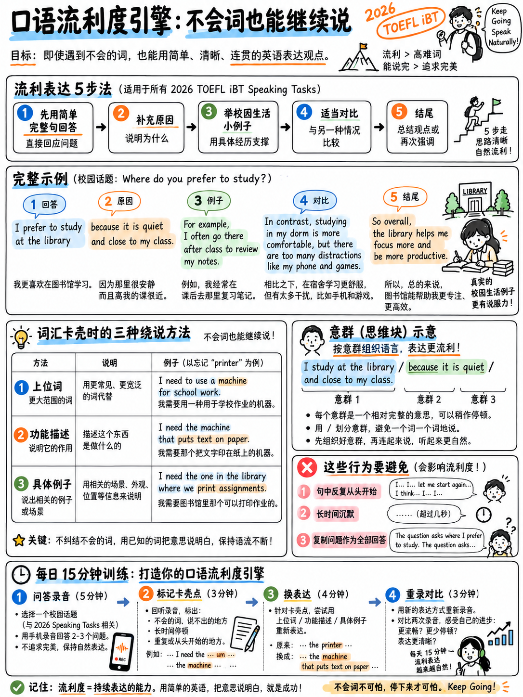

# 2.4 流畅度引擎

 流畅度不是速度，也不是词汇量。在托福评分标准中，它是**“良好的会话能力”
说话的节奏……适当且自然地使用停顿“** [1]。它的相反带 3 是
**“频繁或长时间的停顿会导致节奏不稳定”**。

这一章是一套机械习惯，当你的英语不流畅时，这些习惯可以让句子保持流畅。
合作。

## 2.4.1 初学者为什么会说到一半就停下来

|原因 |会发生什么 |维修|
|---|---|---|
|你一个字都不认识|你在寻找它时冻结了 | §2.4.2 描述周围移动 |
|你开始了一个无法完成的句子 |语法陷阱：“我认为这是因为……” | §2.4.3 开始简单 |
|您正在翻译 |每个子句之前有 2 秒的延迟 | §2.4.4 块级说话 |
| 20 秒后你就没有想法了 |沉默，然后“嗯……是的” | §2.4.5 扩展菜单 |
|您正在监控自己的语法 |自编辑中句 | §2.4.6 一次通过规则 |

## 2.4.2 围绕缺失的单词进行描述 

 这是初学者可以学习的最重要的口语技能，并且**不会**受到惩罚 -
标题奖励“一系列准确的语法和词汇，可以清晰表达”，而不是
rare words.

|如果你不能说…… |说... |
|---|---|
| *温室* | “可以种植植物的玻璃建筑”|
| *通勤* | “每天上班”|
| *补贴* | “政府提供资金来帮助”|
| *基础设施* | “道路，桥梁，诸如此类的东西” |
| *可持续* | “可以持续很长时间而不造成损害的东西”|
| *翻新* | “修复一座旧建筑”|
| *截止日期* | “你可以交东西的最后一天”|
| *合作* | “与其他人一起工作” |

### 围绕一个词进行描述的四个框架

1。 **“一种 ___ ___”** — “这是一种净化空气的机器。”
2. **“当你___时你使用的东西”** - “这是你想举重时使用的东西。”
3. **“当某人___”** —“当某人在另一个国家找到一份工作时。”
4. **“像___，但是___”** — “它就像一个图书馆，但仅用于数字文件。”

**练习：**每天从{doc}`../60-toolkit/01-core-vocabulary`中取出五个单词并定义每个单词
10秒内大声说出，不使用这个词。这样就构建了反射。

## 2.4.3 开始简单，然后扩展

初学者用复杂的句子打开并折叠。可靠的模式则相反：
**短**主句，然后是扩展。

|开盘有风险|安全开启|
|---|---|
| “我个人认为，就您所询问的有关公园的问题而言，原因是……” | “我认为公园很重要。” |
| “尽管很多人会争论……”| “有些人不同意。但我认为……” |
| “对此我想说的是……” | “是的，绝对是。” |

接着延伸：

> “我觉得公园很重要。**主要原因是**整天在室内工作的人需要公园
> 安静的地方。 **例如，**在我的城市，车站附近有一个小公园，**每个
> 晚上** 到处都是人。 **所以**我想说这钱花得值。”

四句短句，每句一个想法，20秒。再加上一个例子，你就在 40.

## 2.4.4 以块的方式说话，而不是单词

 流利的说话者不会逐字地组合句子；他们检索存储的多词单元。
学习以下内容为**单项**，全速说：

|功能|块|
|---|---|
|意见 | *我会说... · 我认为... · 在我看来... · 对我来说...* |
|原因 | *主要是因为... · 主要原因是... · 这就是为什么...* |
|示例| *例如...·例如...·比方说...* |
|对比| *另一方面……·但同时……·话虽如此……* |
|加法| *除此之外……·还有另一件事是……* |
|概括| *一般来说……·大多数时候……·它倾向于……* |
|对冲 | *这有点取决于……·或多或少……·在某种程度上……* |
|数量 | *很多…·相当多…·几乎没有…* |
|时间 | *这些天……·那时……·此刻……* |
|结束 | *基本上就是这样·总体来说...* |

**练习：**快速说每个块十次，直到它作为一个单词出现。三十分钟一次，
你有三十个现成的桥梁。

## 2.4.5 扩展菜单 - 当你用完时要说什么

当你表达了你的观点并且还剩 25 秒时，选择一个：

|移动|短语|示例|
|---|---|---|
| **示例** | “例如……” | “例如，我哥哥去年就是这么做的。” |
| **对比** | “而……”/“不像……”| “而在小镇里，你必须开车去任何地方。” |
| **原因** | “那主要是因为……”| “这主要是因为租金太高了。” |
| **效果** | “这意味着……” | “这意味着能够负担得起集中居住费用的人越来越少。” |
| **优惠** | “当然，这取决于……” | “当然，这取决于你的年龄。” |
| **个人** | “就我个人而言……” | “就我自己而言，我一直住在同一个地方。” |
| **假设** | “如果……那么……”| “如果政府这样做，人们会立即使用它。” |
| **时间对比** | “十年前……但现在……”| “十年前没有人在家工作。现在我一半的朋友都在家工作。” |
| **量化** | “也许 80%...” | “也许我认识的十个学生中就有八个有同感。” |

**练习：**回答一个问题，然后强迫自己使用菜单中的三种不同动作
序列。记录下来。你会发现45秒变得很容易。

## 2.4.6 一次通过规则

**说一次。不要回去改进它。**

中句自我编辑——“我去……我去……我去……”——准确地产生了断断续续的节奏
band-3 描述符名称。一种自我纠正是允许的，也是自然的；三在一个句子中是一个
模式。

如果您在句子结束后发现错误：**保留它。** AI 已经评分
条款； 

## 2.4.7 听起来不像思考时间的思考时间

 并非所有的停顿都是平等的。频段 5 明确允许“适当且自然地使用停顿”[1]。
这些都是自然的；长久的沉默不是。

|技术|示例|买你|
|---|---|---|
| **用你自己的话重述问题** | “城市是否让生活变得更有趣——我想说……” 2-3秒，这是释义，不是重复 |
| **对问题发表评论** | “实际上，这是一个棘手的问题。” | 1–2 秒 |
| **缩小范围** | “这取决于我们谈论的是什么样的城市。” | 2-3秒，内容就是|
| **简单地大声思考** | “让我想想——我想到了两件事。” | 2秒，它宣布结构|
| **短暂的停顿** | “嗯……”/“嗯……” | 1 s |

:::{warning} 排名很重要
重述和缩小范围是**内容**；他们得分。 “嗯……嗯……嗯……”不满足。使用顶部
列表，你很少需要底部。
:::

## 2.4.8 每日十五分钟演讲例程

|最小|活动 |
|---|---|
| 0–4 | **听并重复阶梯**，7 个句子，已录制 ({doc}`02-listen-and-repeat` §2.2.4) |
| 4-6 | 4-6 **块速钻** — 全速 §2.4.4 中的 10 个块 |
| 6–8 | **围绕描述练习** — 每个 10 秒内定义 5 个单词 |
| 8–12 | **一次定时访谈回答**，45 秒，录制，来自 {doc}`05-speaking-practice-bank` §2.5.4 |
| 12-15 | 12-15 **使用 {doc}`03-take-an-interview` §2.3.10 |

 中的表格进行回放和评分**十五分钟。每天。这值得每周一次超过三个小时——间隔检索是
语音如何自动化。

## 2.4.9 “不要这样做”列表

|习惯|为什么会痛|
|---|---|
|写下答案并大声朗读 |训练阅读，而不是说话。真正的任务没有脚本。 |
|记住完整答案 |第 2 级：“主要由问题中的语言组成”；记忆的文本也有平淡的韵律，AI 评分将其检测为不自然 |
|仅在头脑中练习 |你永远不会发现你的 /θ/ 是 /s/ |
|用慢速音频练习 |训练出考试当天不存在的听力速度 |
|学习长“高级”连接器（*尽管如此*，*此外*）|第 4 段仅指出*缺乏*“句子级连接器”；没有什么会奖励正式的人。它们也会减慢你的速度 |
|准备演讲的“主题”文章|面试是关于**你的经历**，而不是一般知识 |

---

**下一篇：** {doc}`05-speaking-practice-bank` — 60 个分级的听和重复句子，24 个面试
问题、标准答案和自评分表。