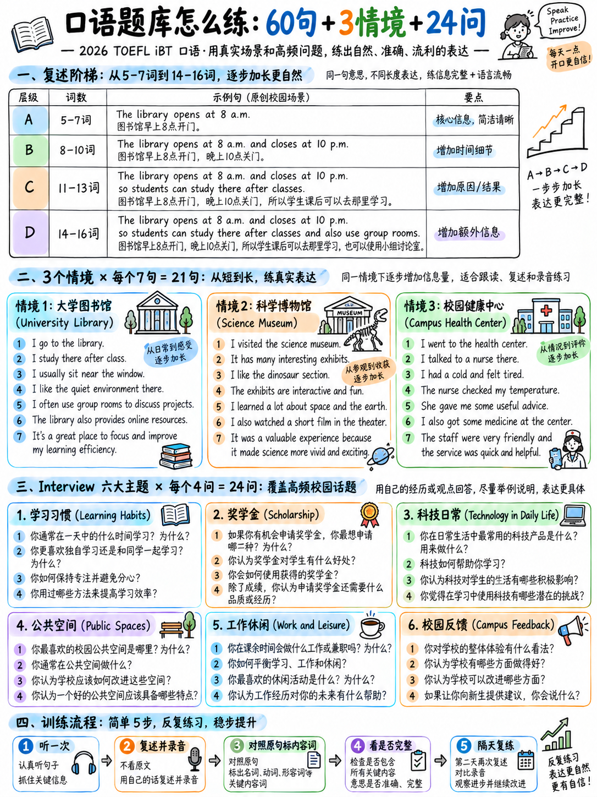

# 2.5口语练习库

本章中的所有材料都是**为本包编写的**以符合官方规范
（句子长度、场景类型、寄存器和问题函数记录在 [1][2][10][11] 中）。
不是转载测试内容。

:::{admonition} 如何使用Listen and Repeat 库
:class: tip
1. **不要**先读这句话。
2. 以**正常速度**朗读一次 - 文本转语音或与伙伴一起朗读。
3. 等待一秒钟。然后重复。
4. 根据 {doc}`01-how-speaking-is-scored` §2.1.3 中的官方指南给自己打 0-5 分。
5.然后才看文字。

生成音频：`espeak-ng -v en-us -s 150 -f sentences.txt`或任何TTS。参见
{doc}`../60-toolkit/07-free-tools-and-self-testing` §6.7.3。
:::

## 2.5.1 银行的组织方式

|设置|造句 |长度 |目的|
|---|---|---|---|
| **一个** | 15 | 15 5–7 个字 |天梯第 1 阶段 |
| **B** | 15 | 15 8–10 个字 |天梯第 2 阶段 |
| **C** | 15 | 15 11–13 个字 |天梯第 3 阶段，围绕七个陷阱构建 |
| **D** | 15 | 15 14–16 个字 |阶梯阶段 4 — 故意高于实际最大值 |
| **E** | 3个完整场景|每句 7 个句子，升序 |全任务模拟|

## 2.5.2 60句分级银行

####组A — 5至7个字

> 1. 图书馆八点开门。
> 2. 请把行李寄存在这里。
> 3.实验室在二楼。
> 4. 每周五我们提供免费游览。
> 5.入口附近设有储物柜。
> 6.不要在机房内饮食。
> 7. 巴士停在正门外。
> 8. 报名将于三月底截止。
> 9. 所有访客必须先签到。
> 10. 咖啡厅供应热食至四点。
> 11. 学生卡将在抵达时发放。
> 12. 请小声说话。
> 13. 讲座十分钟后开始。
> 14. 每页打印成本五美分。
> 15. 该出口通向停车场。

### B 组 — 8 至 10 个字

> 16. 阅览室很安静，请保持手机静音。
> 17. 您一次最多可以借六本书。
> 18. 我们的营业时间列于主布告栏上。
> 19. 科学大楼就在庭院对面。
> 20. 用餐结束后请将托盘归还柜台。
> 21. 音乐会门票可在学生服务台购买。
> 22. 健身房在公共假期和周末关闭。
> 23. 如果警报响起，请立即离开建筑物。
> 24. 我们的工作人员可以帮助您找到您需要的任何书籍。
> 25. 展览每个月都会变化，所以要经常回来。
> 26.自行车应停放在大门外的停车架上。
> 27. 下周您将通过电子邮件收到时间表。
> 28. 欢迎访客使用底层电脑。
> 29. 游泳池需要单独的会员卡。
> 30. 请向前台报告任何损坏的设备。

### 设置 C — 11 至 13 个单词，围绕七个陷阱构建

|陷阱|造句 |
|---|---|
|三人名单 | 31、36、41 |
|复合名词 | 32、37、42 |
|消极命令| 33, 38 |
|分词修饰语 | 34、39、43 |
|条件开场白 | 35、40、44 |
|介词字符串 | 45 |

> 31. 中心为所有注册学生提供打印机、扫描仪和投影仪。
> 32. 员工停车场附近的问讯处六点关门。
> 33. 请勿携带食物或饮料进入演讲厅。
> 34. 位于主厅后面的房间用于研讨会。
> 35. 如果您丢失了卡，请立即到接待处挂失。
> 36. 我们这学期的课程涵盖平面设计、工程和环境科学。
> 37. 体育中心接待处处理所有设备请求和预订。
> 38. 请勿将个人物品留在学习区域无人看管。
> 39. 九点后到达的学生应使用图书馆旁边的侧门。
> 40. 如果天气不好，户外活动将被取消。
> 41. 我们在学期开始时提供笔记本、铅笔和文件夹。
> 42. 健康中心候诊室位于接待处左侧。
> 43. 上周借出的任何书籍必须在周四下午之前归还。
> 44. 如果您需要帮助，我们的一名工作人员会过来。
> 45. 您可以在图书馆后面的办公室领取您的包裹。

### Set D — 14 至 16 个字

> 46. 国际新生迎新活动九点在主厅开始。
> 47. 如果您尚未填写在线表格，请在周五下午之前完成。
> 48. 存放在地下室的设备，包括显微镜，每六个月检查一次。
> 49. 希望改变课程的学生应首先与其学术顾问联系。
> 50. 请记住，这个房间的计算机仅供研究使用。
> 51. 导览游从游客中心入口处开始，时长约四十分钟。
> 52. 任何有兴趣加入志愿者计划的人都应该在门口签署名单。
> 53. 所有实验室用户必须始终佩戴防护眼镜和封闭式鞋子，无一例外。
> 54. 自助餐厅位于东楼底层，七点关门。
> 55. 如果您无法参加研讨会，请提前通知办公室。
> 56. 我们系还为白天全职工作的学生提供晚间课程。
> 57. 回收箱放置在每栋建筑物外，通常靠近自行车停放区。
> 58. 请定期查看布告栏，因为房间变更仅提前一天公布。
> 59. 去年发行的会员卡在6月底后将不再有效。
> 60. 两年前翻修过的博物馆现在藏有大量摄影作品。

## 2.5.3 三个完整场景集（E 集）

 完全像真实任务一样使用这些：一次听证，一秒停顿，8-12 秒发言。

### 场景 1 —“你正在学习引导参观者参观大学图书馆。”

> 1. 欢迎来到主图书馆。
> 2.门口有自助服务机。
> 3.安静的自习室位于三楼。
> 4. 您最多可以借用笔记本电脑四个小时。
> 5.团体房间需提前网上预订。
> 6. 我们的服务台可以协助搜索和参考。
> 7. 档案馆位于地下室，仅限预约开放。

### 场景 2 —“您正在学习欢迎参观者来到科学博物馆。”

> 1. 早上好，欢迎来到博物馆。
> 2. 售票处位于您的右侧。
> 3.我们的主要展览涵盖能源和环境。
> 4.请勿触摸一馆模型。
> 5. 从此时起，导游每小时出发一次。
> 6. 儿童工作坊每周六和周日上午开放。
> 7. 位于咖啡馆旁边的礼品店在博物馆开馆前三十分钟就关门了。

### 场景 3 —“您正在学习向校园健康中心介绍新员工。”

> 1. 这是校园健康中心。
> 2.可在前台预约。
> 3. 预约时间为每天十点至十二点。
> 4.每次预约时请携带学生证。
> 5. 药房位于等候区对面。
> 6. 我们的护士可以提供有关疫苗接种和旅行健康的建议。
> 7. 如果您在开放时间以外需要紧急帮助，请拨打门口的电话号码。

## 2.5.4 面试练习 - 六个场景，24 个问题

每个场景遵循官方的四槽升级（{doc}`03-take-an-interview` §2.3.2）。给予
每题**45 秒**，无需准备，记录一切。

### 场景 1 — 关于学习习惯的研究

> *您已同意参加一项关于学生如何学习的研究。你将会有一个短暂的
> 研究员在线访谈。*

1。回想一下您上次为重要考试而学习的情况。你是如何准备的，做了哪些准备
   效果好吗？
2. 有些人喜欢独自学习；其他人则喜欢在小组中学习。你更喜欢哪一个，以及
   你为什么有这样的感觉？
3. 有些人认为学生从做项目中学到的东西比听讲学到的东西更多
   讲座。你同意？为什么或为什么不呢？
4. 您认为大学应该允许学生在线参加所有考试吗？为什么或为什么不？

### 场景 2 — 奖学金申请面试

> *您正在申请奖学金。委员会会问你一些问题。*

1。告诉我一个你喜欢学习的科目。你为什么喜欢它？
2. 有些学生选择一门学科是因为他们喜欢它；其他人选择其中之一是因为它会带来好处
   工作机会。哪一个对您来说更重要，为什么？
3、有人说出国留学是学习语言的最好方式。你同意？为什么或
   为什么不呢？
4. 如果你的大学有多余的钱，你认为应该把它花在建筑上还是教学上
   工作人员？各给出一个理由。

### 场景 3 — 关于技术和日常生活的研究

1。想想您每天使用的应用程序或设备。你用它做什么？
2. 有些人发现科技节省了他们的时间；其他人则认为这浪费了他们的时间。这是
   对你来说更真实，为什么？
3.有些人认为，孩子在十四岁之前不应该使用智能手机。你同意？为什么或为什么不呢？
4. 您认为在家工作会对城市产生怎样的积极和消极影响？请
   

### 场景 4 — 关于公共空间的城市调查

1。描述您居住的地区。它是什么样的？
2. 有些人喜欢热闹的街区；其他人则喜欢安静的。哪个更适合您，以及
   为什么？
3. 有些人认为城市应该禁止汽车驶入市中心。你同意？为什么或为什么不呢？
4.您认为地方政府应该花钱为公众提供体育设施吗？为什么或
   为什么不呢？

### 场景 5 — 关于工作和空闲时间的研究 

1。告诉我你在空闲时间做的一些事情。你是怎么开始这样做的？
2、有些人喜欢仔细规划自己的空闲时间；其他人则更喜欢当天做出决定。哪个
   你是吗？为什么？
3. 有些人认为每周工作四天可以提高人们的工作效率。你同意？为什么或为什么不呢？
4. 缩短工作周会对企业产生哪些积极和消极影响？举个例子
   

### 场景 6 — 大学反馈面试

1。想想你参加过的一门课程或课程。老师做了什么对你有帮助的事情？
2. 有些学生更喜欢定期小测试；其他人则更喜欢最后参加一场大考试。你是哪一个
   更喜欢，为什么？
3. 有人说不应该强制听课。你同意？为什么还是为什么
   不是吗？
4. 如果一所大学想要帮助新生安顿下来，它应该做哪一两件事，以及
   为什么？

## 2.5.5 两个完整的面试答案

### 有效答案A — 场景1，问题1（个人经历）

> **问题：** *回想一下您上次为重要考试而学习的情况。你准备得怎么样了，
> 什么效果好？*

> “我参加的最后一次重要考试是大约一年前在学校的期末数学考试。**我
> 主要通过做旧论文来准备**——我想我在前两周做了大约十篇论文。
> 真正有效的是**用计时器**，因为对我来说最困难的部分从来都不是
> 数学，按时完成了。 **例如**，在第一篇论文中我只回答了一半
> 问题，但到了第十次我就在还剩十分钟的时候结束了。另一件有帮助的事情
> 下午和朋友一起学习，因为向别人解释问题表明
> 你很快就知道你是否真正理解了它。 **所以总的来说**，我想说的是在规定时间内练习
> 压力是造成差异的因素。”

|特色 |哪里 |为何得分 |
|---|---|---|
|直接回答第1句| “我参加的最后一次重要考试是……” |马上切入主题|
|用*原因* 来推理 | “因为对我来说最难的部分......” |阐述|
| **带有数字的具体示例** | “十篇论文”，“第一篇论文......一半问题......第十篇......还剩十分钟”| 4-5 段“精心设计”|
|第二点| “另一件事有帮助......” |范围 |
|结束语 | “所以总的来说……”|回复完毕 |
|长度 | 142 个字 ≈ **43 秒**，150 WPM |填充窗口 |

### 有效答案 B — 场景 3，问题 4（广泛，“每个例子一个”）

> **问题：** *您认为在家工作可能如何积极和消极地改变城市
> 方法？请分别举一个例子。*

> “**我认为它可以在两个方向上极大地改变城市。**从积极的一面来看，更少
> 人们每天早上出行意味着更少的交通和更清洁的空气。 **例如**，在我的城市
> 每天早上八点，进入市中心的主干道完全被封锁，期间
> 大流行期间几乎空无一人——你实际上可以呼吸。 **不利的一面**，市中心
> 取决于那些通勤者。 **一个很好的例子是**小餐馆和咖啡馆
> 靠近办公室；如果没有人进来，他们就会关门，然后这个地区到了晚上也会感觉死气沉沉的。
> **所以我想说**空气变得更好，但中心变得更空，城市可能不得不
> 改变中心的实际用途。"

|特色 |哪里 |
|---|---|
|第 1 句中的位置 | “双向”——立即回答双面问题 |
| **路标结构** | “积极的一面......消极的一面......” |
| **两个带标签的例子**，正如问题所要求的 | “例如，在我的城市……”/“一个很好的例子是……”|
|个人的、具体的细节| “每天早上八点就被堵住” |
|结束综合| “空气变得更好，但中心却变得更空旷”|
|长度 | 136 个字 ≈ **41 秒** |

:::{note} 两个答案都包含什么
没有高级词汇。没有复杂的条件。没有记住的短语。最高级别的词是
*流行病*、*通勤者*和*生产力*。两者都会根据阐述、速度和清晰度进行评分——
不在词汇范围内。
:::

## 2.5.6 自评分表

 将其复印，或重写在纸上，并在每次录制的会话后使用它。

### 听并重复 — 对 7 个项目中的每个项目进行评分 

| ＃| 5 准确 | 4 个小改动 | 3句完整，内容最多| 2 片段 | 1 几句话 | 0 没有 |
|---|---|---|---|---|---|---|
| 1 | | | | | | |
| 2 | | | | | | |
| 3 | | | | | | |
| 4 | | | | | | |
| 5 | | | | | | |
| 6 | | | | | | |
| 7 | | | | | | |

**共 35 个：______**

:::{important} 首先唯一重要的数字
数一下这七个句子中有多少是**完整的句子**（即得分为 3 分或以上）。到 7/7
在您担心准确性之前。完整的句子至少得 3 分；片段是
价值2或更少。
:::

### 参加面试 — 对 4 个答案分别进行评分

| | Q1 | Q2 |第三季度 |第四季度 |
|---|---|---|---|---|
| 3秒内开始 | | | | |
|先回答字面上的问题| | | | |
|至少一个*因为* | | | | |
|至少一个具体例子 | | | | |
|发言时间≥35秒| | | | |
|说完最后一句话| | | | |
|停顿时间不得超过 3 秒 | | | | |
|没有重复使用问题的措辞| | | | |
| **等级（您的估计 0-5）** | | | | |

**20 项中的总数：______** · **从 55 项中的原始总数来看：__**

### 每周追踪器

|周 | LR /35 | TI /20 |总计/55 |最大单笔亏损|
|---|---|---|---|---|
| 1 | | | | |
| 2 | | | | |
| 3 | | | | |
| 4 | | | | |

---

**下一个：** {doc}`../30-writing/01-how-writing-is-scored` — 写作部分，其中一半的分数
是一个词序谜题。