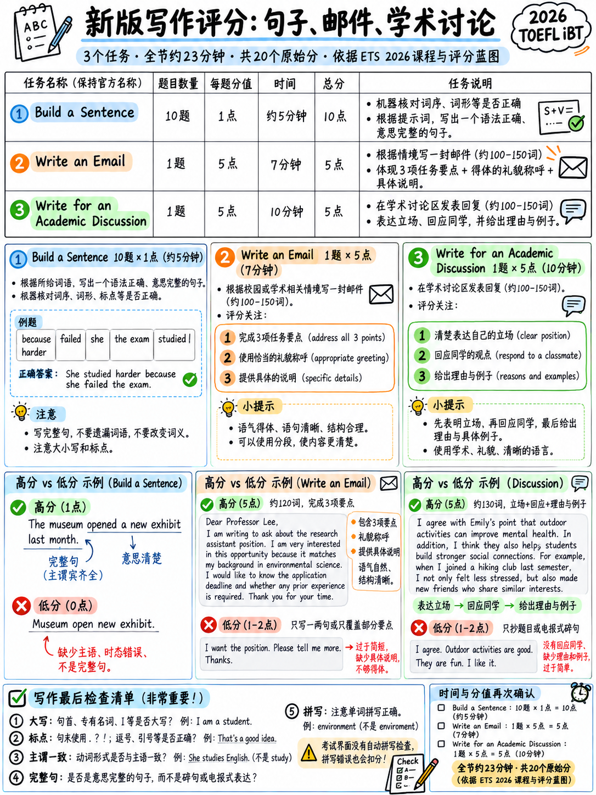

# 3.1 写作部分如何评分




## 3.1.1 部分概览

| | |
|---|---|
|职位| **第三**，听后，说前|
|长度 | **约23分钟** [1] |
|项目 | **12** [1][2] |
|原始点 | **20** [1][2] |
|频段范围 | 1-6 | 1-6
|字数统计工具 | **是的**，对于两个长期任务 [18] |
|拼写检查 | **不。执行任何任务。** [18] |
|标记|造一个句子 = **机器**;电子邮件和讨论 = **AI**，0–5 指南 [1][2] |

```
  WRITING  (12 items, 20 raw points, ~23 minutes)
  ┌─────────────────────────────┬──────────────────┬──────────────────────────┐
  │  Build a Sentence           │  Write an Email  │  Academic Discussion     │
  │  10 items × 1 pt = 10 (50%) │  1 × 5 pts (25%) │  1 × 5 pts (25%)         │
  │  machine scored             │  7 minutes       │  10 minutes              │
  └─────────────────────────────┴──────────────────┴──────────────────────────┘
       ≈ 6 minutes                   7 minutes             10 minutes
```

（总共 23 分钟减去 7 和 10 剩下大约 6 分钟用于 10 个造句项目 — 大约
**每次 35 秒**。 ETS 不会为造句发布单独的时钟；练习测试
只说“时钟会告诉你需要多少时间来完成这项任务”[10]。 6分钟
该数字是**根据已发布的总数计算得出的**，而不是 ETS 声明。）

:::{important} 标题
**写作部分的一半原始分数来自重新排列给你的单词。**
没有想法，没有词汇，没有拼写，没有打字速度。纯语法。

不会写段落的初学者仍然可以拿下这10分中的8或9分。仅此一点就是
从写作带 1 到写作带 3 的大部分距离。
:::

## 3.1.2 官方声明

> **声明 3：** “考生能够说出语法准确且符合上下文的内容
> 涵盖各种学术和人际场合的书面英语，包括**句子-
> 水平构建**、多句响应和扩展的学术讨论。” [2]

三个级别——句子、多句、段落——与三个任务完全匹配。

## 3.1.3 两个AI评分细则

均为0-5。它们是紧密平行的；差异已突出显示。

### 写一封电子邮件 [1]

|分数 |完整描述 |
|---|---|
| **5** | “完全成功的回应。回应是有效的，表达清晰，并且在语言使用方面表现出一致的便利性。 • **有效支持沟通目的的详细阐述** • 有效的句法多样性和精确、惯用的词语选择 • **一致使用适当的社会惯例**（例如，礼貌、语域、信息组织和提出请求、拒绝、批评等行动） • **除了有能力的人所期望的错误之外，几乎没有词汇或语法错误作家在定时条件下写作**（例如，常见的拼写错误或常见的拼写错误或像there/their这样的替换）” |
| **4** | “总体上是成功的回应。回应大多有效且易于理解。语言能力足以完成任务。 • 充分阐述以支持交流目的 • 句法多样性和适当的词语选择 • **大多是适当的社会惯例** • **很少**词汇或语法错误”|
| **3** | “部分成功的回应。该回应通常完成了任务。语言设施的限制可能会妨碍部分信息完全清晰和有效。 • **部分**支持交流目的的阐述 • 适度的语法和词汇范围 • **在结构、单词形式、惯用语言和/或社会习俗的使用方面存在一些明显的错误**” |
| **2** | “大部分不成功的回应…… • 有限或不相关的阐述 • 一些相关的句子级语言，语法和词汇范围有限 • **错误的积累**” |
| **1** | “不成功的回应…… • 很少详细说明（如果有的话） • **电报语言**（即简短和/或不连贯的短语和句子） • 严重且频繁的错误 • **最少的原始语言；任何连贯的语言大多是从刺激中借用的**” |
| **0** | “空白，拒绝主题，不是英文，完全是从提示中复制的，与提示完全无关或由任意击键组成。” |

### 撰写学术讨论 [1]

|分数 |完整描述 |
|---|---|
| **5** | “完全成功的回复。该回复是对在线讨论的**相关且非常明确表达的贡献**，并且它在语言使用方面表现出一致的便利性。 • **相关且详尽的解释、例证和/或细节** • 有效使用各种句法结构和精确、惯用的词语选择 • 除了有能力的作家在定时条件下写作所预期的错误之外，几乎没有词汇或语法错误” |
| **4** | “总体上成功的回应……语言使用的便利**使作者的想法易于理解**。 • 相关且**充分阐述**的解释、例证和/或细节 • 各种句法结构和适当的词语选择 • 很少有词汇或语法错误” |
| **3** | “部分成功的回应……**大部分相关且大部分可以理解**。 • 详细说明解释、示例或细节的哪一部分**可能缺失、不清楚或不相关** • 句法结构和词汇范围存在一些变化 • 一些明显的词汇和语法错误”|
| **2** | “大多数情况下不成功的回应……局限性**可能使想法难以遵循**。 • 想法可能阐述得不够详细或仅部分相关 • 句法结构和词汇范围有限 • 错误的积累” |
| **1** | “不成功的回应…… • **表明试图解决任务的单词和短语，但很少或没有连贯的想法** • 范围严重有限 • 严重且频繁的错误 • 原始语言最少；任何连贯的语言大多是从刺激中借用的”|
| **0** |如上所述。 |

## 3.1.4 标题证明的七件事

**1。拼写错误不会阻止第 5 段。**
这两项任务的第 5 级明确允许“常见的拼写错误或常见的拼写错误或替换，例如
那里/他们的”。 ETS 自己的高级电子邮件范例包含*参与*、*成功*、*已收到*
[1][18].
→ **不要校对拼写。** 没有拼写检查 [18]，也没有完美奖励。

**2。 “精致”这个词决定了你的乐队。**
它出现在两个标题的每个区域中。第五级：“精心设计”。第 4 组：“充分
详细阐述”。等级 3：“部分解释、示例或细节**可能缺失**”。频段 2：
“阐述不充分”。
→ **每个主张都需要一个*因为*和一个例子。** 这就是 3 和 4 之间的全部区别。

**3。 “社交惯例”是电子邮件中的评分标准，并且仅在电子邮件中。**
第 5 级：“一致使用适当的社会习俗（例如礼貌、语体……）”。乐队 4：
“最合适”。第 3 级：“社会惯例”中的错误与语法错误一起列出。
→ **问候、礼貌的框架和结束都是值得打分的。**写下来。

**4。复制提示显然是两个尺度的底部。**
第 1 级：“最少的原始语言；任何连贯的语言大部分都是从刺激中借用的。”
Band 0 包括“完全从提示中复制”。
→ **解释场景； never lift sentences from it.**

**5. “电报语言”是频段 1。**
笔记式写作 —“表格有问题。不确定已收到。请检查。” — 明确为频段 1。
→ **始终保持完整的句子。** 屏幕上的说明甚至是这样说的：“尽可能多地写
和**完整的句子**" [10].

**6。两个标题中都没有长度标准。**
“话”字没有出现。屏幕上显示了 100 字的讨论图
指令 [1]，而不是标题行 — ETS 自己的高级示例是 **79 个字**。
→ **写得足够详细，然后停止。** 填充会增加错误机会，而不是标记。

**7。 “句法结构的多样性”位于第 3、4 和 5 段。**
→ **每个中至少使用一个关系从句、一个从句和一个复合句**
长期任务。 {doc}`02-build-a-sentence` §3.2.3 中有八种执行此操作的模式 — 相同的模式


## 3.1.5 标点符号和大写是标记的一部分

两个长任务列表的 ETS 任务描述，作为被测量的东西：

>“遵循英语的**机械约定（拼写、标点符号和大写）**”
> [1]

五个规则几乎涵盖了所有内容：

|规则|错误|对|
|---|---|---|
|一句话以句号结束 | “我喜欢，很有用。” | “我喜欢它，它很有用。” |
|两个独立子句需要一个连词或分号 | “下雨了，我们就呆在里面。” | “正在下雨，**所以**我们呆在里面。” |
|介绍性元素后的逗号 | “不过我不同意。” | “但是**，**我不同意。” |
|每个句子开头的大写字母以及 *I* | “我认为这很好。它有帮助。” | “**我**认为这很好。**我**没有帮助。” |
| *that* | 之前没有逗号“我认为，这是真的。” | “我认为这是真的。” |

 逗号拼接（第 2 行）是学习者写作中最常见的错误，也是最容易修复的错误。

## 3.1.6 23 分钟时钟

|分钟|任务|应该发生什么 |
|---|---|---|
| 0:00–6:00 |造一个句子 |每个项目约 35 秒。如果某个项目在 40 秒后出现抵抗，请做出您的最佳猜测并继续 - **错误答案不会受到惩罚** |
| 6:00–13:00 |写一封电子邮件 | 1 分钟阅读 + 计划 · 5 分钟写作 · 1 分钟检查三个要点是否已涵盖 |
| 13:00–23:00 |学术讨论 | 2 分钟阅读所有三篇文章 + 决定一个位置 · 7 分钟写入 · 1 分钟检查 |

:::{warning} 时钟是每个任务的，不是池化的
实践测试表明每个任务都有自己的时钟[10]。您不能从“构建”中借用时间
延长您的电子邮件的句子。将这三项视为三项单独的考试。
:::

## 3.1.7 现在输入很重要

两个长任务都是在硬时钟下输入的。该电子邮件为您提供 **7 分钟阅读和写作**
[18]。 ETS 的高级范例是**118 个字**。

|你的打字速度|需要 118 个字 |判决 |
|---|---|---|
| 60 瓦/分钟 | 2 分钟 |舒适|
| 40 瓦/分钟 | 3 分钟 |很好|
| 25 瓦/分钟 | 4.7 分钟 |紧张——你有大约 2 分钟的时间来阅读和思考 |
| 15 瓦/分钟 | 7.9 分钟 | **你无法完成。** 首先解决这个问题 |

如果您的打字速度低于 25 WPM，请每天花 15 分钟，连续一周接受免费打字训练。它是
为您提供的最便宜的写作改进方案，而且无需英语费用。
({doc}`../60-toolkit/03-spelling-and-typing` §6.3.6.)

## 3.1.8 每个任务的最终检查

|任务| 30 秒检查 |
|---|---|
|造一个句子 |每个空白都填满了吗？这句话读起来是对第一句话的回答吗？ |
|写一封电子邮件 | **所有三颗子弹都已覆盖？** 问候语和结束语都存在吗？还有一句话没说完吗？ |
|学术讨论 |第 1 句中的立场是否明确？至少一个*因为*？至少有一个例子？我有没有提到这两个学生中的一个？ |

 注意这些列表中**不**的内容：拼写、文章错误或优雅。那些不是在哪里
你的分数是。

---

**下一个：** {doc}`02-build-a-sentence` - 仅通过语法即可获得的十分。