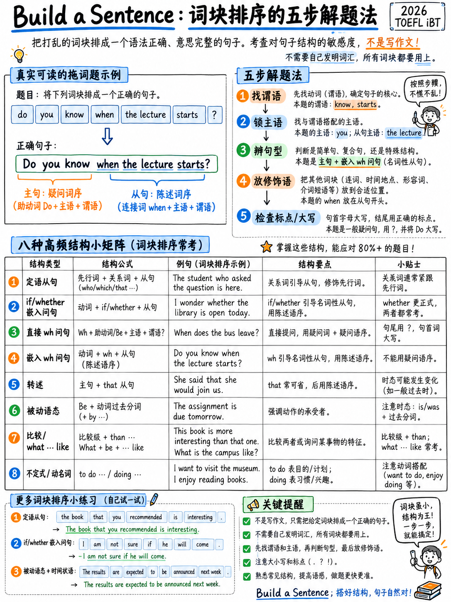

# 3.2 构建一个句子




**10 项。 10 个原始点。写作部分的一半。机器评分。没有英文制作
必填 — 单词已提供给您。**

## 3.2.1 任务是什么

>“考生看到**一个完整的句子，后面跟着另一个句子，其中包含单词或短语
> 顺序错误**。这两个句子形成说话者之间的交流。考生移动单词
> 和短语组成**符合上下文的语法句子**。这个
> 任务衡量考生对句子结构的掌握程度，这是一项至关重要的技能
> 沟通。” [1]

屏幕说明[10]：*“移动框中的单词以创建符合语法的句子。一个时钟
将显示您需要多少时间来完成此任务。"*

**官方示例** [1]:

```text
Make an appropriate sentence.

  What was the highlight of your trip?

  The _____ _____ _____ _____ _____ _____ fantastic.

  were / the / was / old city / showed us around / who / tour guides
```

**答案：** *带我们参观老城区的导游非常棒。*

:::{note} 两个重要的细节
1.这些作品是**单词或短语**，而不是单个单词——“带我们参观”和“老城”移动
   作为单个块。数空格，而不是单词。
2. 池中可能包含**比空白更多的棋子**（上面的示例有 7 个棋子，相当于 6 个棋子）
   空白——*曾经*是一个干扰因素）。 **先数一下空格。**
:::

## 3.2.2 完整的官方答案，模拟测试 1

 ETS 模拟测试 1 [10] 中的所有十个答案，因为其中可以看到模式库存：

| ＃|提示|回答 |图案|
|---|---|---|---|
| 1 |您旅行的亮点是什么？ |导游**带我们参观了老城区**非常棒。 |关系从句（主语）|
| 2 |我听说安娜升职了。 | **你知道**她是否会调到不同的部门吗？ |嵌入式是/否 |
| 3 |我们计划下周末去山里旅行。 | **你能告诉我**小木屋是否可用吗？ |嵌入式是/否 |
| 4 |我很期待这个周末的音乐会。 | **几点开始？** |直接wh-问题|
| 5 |博物馆展览下个月开幕。 | **你知道门票多少钱**吗？ |嵌入式wh- |
| 6 |我打算明天去海滩。 | **每年这个时候的水温是多少**？ | *什么……喜欢* |
| 7 |我今天需要买杂货。 | **你有购物清单吗？** |简单的是/否 |
| 8 |这个周末我要去上烹饪课。 | **您将学习哪些食谱？** |直接 wh- 与对象 |
| 9 |关于你正在读的书，玛丽亚问了你什么问题？ |她**想知道在哪里可以买到一本**。 |举报问题 |
| 10 | 10你是如何准备考试的？ |我使用了**教授提供的学习指南**。 |被动关系从句 |

:::{important} 读取图案栏
十项； **八种不同的句法模式**，十种中的六种是关于**问题的
形成或嵌入问题**。这不是一般的语法测试。这是一个狭隘的测试
结构数量少——这意味着它可以在几个小时内完全学会。
:::

## 3.2.3 八种模式 — 学习这些，您就有任务

### 模式 1 — 关系从句

A 描述名词的从句，由 **who**（人）、**which/that**（事物）引入，或者什么都没有
所有当它是对象时。

```
   The tour guides [ who showed us around the old city ] were fantastic.
   └── subject ──┘ └──── relative clause ────────────┘ └── main verb ──┘
```

**学习者打破的规则：**主要动词出现在整个关系从句的**之后。保留
主题和它的描述在一起，然后添加动词。

|类型 |示例|
|---|---|
|主体亲属（谁/那个）|坐在我旁边的学生**帮助了我。 |
|相对对象（that/which/∅）| **您提到的**文章很有用。 |
|被动亲属 |指南**由教授提供** |
|减少相对| **位于大厅后面**的房间用于研讨会。 |

### 模式 2 — 嵌入式是/否问题：*if* / *whether*

```
   Direct:    Will the cabins be available?
   Embedded:  Can you tell me  whether  the cabins will be available ?
                                        └── NORMAL word order ──┘
```

:::{danger} 这个任务中最大的一个陷阱
**在嵌入式问题中没有反转，也没有*do*。**

| ✗ 错误 | ✓ 右 |
|---|---|
|你知道**会**开放吗？ |你知道**它会**开放吗？ |
|你能告诉我**时间**变了吗？ |你能告诉我**时间**变了吗？ |
|你知道**她在这里工作**吗？ |你知道**她是否在这里工作**？ |

图案：`[question opener] + if/whether + SUBJECT + VERB`
:::

### 模式 3 — 直接提问

```
   What  time  does  it  start ?
   └ wh ┘      └aux┘ └S┘ └verb┘
```

顺序：**wh-词（+名词）→助动词→主语→主要动词**.

|需要辅助 |示例|
|---|---|
| *do/does/did* 带有简单时态 | **它们花了多少钱**？ |
| *将/可以/应该* | **访问需要多长时间？ |
| *be* 自行移动 | **会议在哪里**举行？ |
|当 wh 词**是**主语时，没有助词 | **谁告诉**你的？ / **发生了什么**？ |

### 模式 4 — 嵌入 wh- 问题

 与模式 2 相同的无反转规则，用 wh-word 代替 *if*。

| ✗ | ✓ |
|---|---|
|你知道**几点开门**吗？ |你知道**几点开门**吗？ |
|您能告诉我**我们正在使用哪个房间**吗？ |你能告诉我**我们正在使用哪个房间**吗？ |
|我不确定在哪里**可以下载**它们。 |我不确定在哪里**我可以下载**它们。 |

### 模式 5 — 报告演讲和报告问题

```
   She wanted to know  where  she  could  buy a copy.
                       └wh┘   └S┘ └modal┘
```

规则：**无倒装**，**无问号**，时态通常**后移**一步
（*可以→可以*，*将→会*，*是→曾经*，*有→有*）。

|直接|报道 |
|---|---|
| “哪里可以买到一本？” |她想知道**在哪里**可以买到一本。 |
| “期限已延长。” |他说**截止日期已被延长**。 |
| “为什么表格被拒绝了？” |他们解释了**为什么该表格被**拒绝。 |

### 模式 6 — 被动

```
   The study guide  was  provided  by the professor.
   └── subject ──┘ └be┘ └ past participle ┘ └ agent ┘
```

形式：**be + 过去分词**。代理（如果存在）遵循 **by**.

|紧张|示例|
|---|---|
|一般过去时|样本**于去年夏天采集**。 |
|现在连续 |大厅**正在装修**。 |
|现在完美|您的申请**已被审核**。 |

 要记住的词序：*has* + *already* + *been* + *reviewed* — 副词在第一个之后
辅助.

### 模式 7 — *什么……喜欢*，比较和数量问题

|结构|示例|
|---|---|
| *X 是什么样的？*（要求描述）| **每年这个时候的水温是多少**？ |
| *多少/多少* | **有多少学生参加**讲座？ |
|比较 + *比* |科学图书馆比主图书馆**安静得多。 |
|最高级| **哪一所距离**校园最近？ |

注意**什么...喜欢**被分割：*什么*在前面，*喜欢*在最后。这是一道经典的炒菜——


### 模式 8 — 不定式、动名词和目的从句

|结构|示例|
|---|---|
|目的：*to* + 动词 |我很早就来**查看**日程安排。 |
|动词 + 动名词 |我真的**喜欢在实验室工作**。 |
|动词+不定式 |我**同意帮助**举办开放日活动。 |
|介词+动名词|我正在**考虑注册**。 |
|动名词作为主语补语 |最困难的部分**是找到**足够的时间。 |

 记住哪些动词采用：*享受、完成、避免、建议、考虑、介意* → **-ing**；
*同意、决定、想要、希望、计划、提供、拒绝* → **到 +** 动词.

## 3.2.4 五步法

|步骤|行动|时间 |
|---|---|---|
| 1 | **数一下空格。**这就是您放置的块数。多余的部分会分散注意力。 | 3 秒 |
| 2 | **阅读第一句话。**它会告诉您回复是问题还是陈述 - 查看空行的最后标点符号。 | 3 秒 |
| 3 | **在词块中找到主要动词**。一切都是围绕它构建的。 | 5 秒 |
| 4 | **找到主语**，并确定它是在动词之前（陈述/嵌入问题）还是在助动词（直接问题）之后。 | 5 秒 |
| 5 | **放置其余**：时间和地点表达式放在最后； *by + 代理*位于最后；像“已经”这样的副词位于第一个助动词之后。 | 15 s |

**然后对自己说。** 如果这听起来像一个人会说的话，那么它可能是对的。

:::{tip} 标点符号告诉你
看看最后一个空白后面的内容。 **`?`** 表示您需要疑问词顺序 - 可以直接
倒置，或在开场白后嵌入的问题，例如“你知道吗”。 **`.`** 表示声明
订单。这一看就解决了一半的问题。
:::

## 3.2.5 机器将捕获的错误清单

|错误 |示例|修复 |
|---|---|---|
|嵌入式问题中的反转 | *你知道**在哪里**吗？* | *它在哪里*** |
| *做*保留在嵌入式问题中| *我想知道他**想要什么。* | *他**想要什么* |
|直接问题中缺少辅助词 | *什么时间**开始**？* | *什么时间**开始**？* |
|形容词和名词颠倒 | *老城* | *老城区* |
|动词和宾语之间的副词 | *我非常喜欢这门课程。* | *我非常喜欢这门课程。* |
|介词搁浅错误 | *关于你告诉我的文章* | *你告诉我的文章***关于*** |
| *由*-代理人在错误的地方 | *由教授提供* | *由教授提供** |
|关系代词错误 | *坐着的**学生* | *坐着的学生* |

## 3.2.6 四十个练习项目

 以十个为一组进行这些练习，每个练习的时间为 **35 秒**。答案在 §3.2.7 中——不要看，直到
你已经完成了一个完整的块。

1。 **你周末过得怎么样？**

 音乐会 _____ _____ _____ _____ _____ 太棒了。

 `to / went / we / on Saturday / was`

2。 **我应该先读哪本书？**

 _____ _____ _____ _____ _____ 是最好的。

 `recommended / week / the professor / that / last`

3。 **谁帮助你完成了这个项目？**

 学生 _____ _____ _____ _____ 帮助了我。

 `in the lab / who / next to me / sits`

4。 **你找到这篇文章了吗？**

 我昨天找到了这篇文章 _____ _____ _____ _____.

 `you / told me / about / that`

5。 **您对这次旅行有何看法？**

 导游 _____ _____ _____ _____ 非常棒。

 `the museum / who / around / took us`

6。 **我听说图书馆提前关门了。**

 你知道 _____ _____ _____ _____ _____吗？

 `will be / if / tomorrow / open / it`

7。 **实验室课程已移动。**

 你能告诉我 _____ _____ _____ _____吗？

 `the time / has / changed / whether`

8。 **我可能会申请奖学金。**

 你知道_____ _____ _____ _____吗？

 `whether / apply / can / international students`

9。 **七点有公交车。**

 我想知道 _____ _____ _____ _____.

 `if / stops / the bus / near the station`

10。 **注册下个月开始。**

 你能告诉我_____ _____ _____ _____吗？

 `if / need / I / a student card`

11。 **我稍后要去参加研讨会。**

 _____ _____ _____ _____ _____?

 `What / start / does / time / it`

12。 **我们正在参观研究中心。**

 _____ _____ _____ _____ _____?

 `take / the visit / will / long / How`

13。 **我在网上买了票。**

 _____ _____ _____ _____ _____?

 `cost / they / did / How / much`

14。 **她正在教授一门新课程。**

 _____ _____ _____ _____ _____?

 `teaching / is / subject / Which / she`

15。 **他们移动了会议。**

 _____ _____ _____ _____ _____?

 `the meeting / being / held / Where / is`

16。 **博物馆的开放时间不同。**

 你知道 _____ _____ _____ _____ _____吗？

 `it / what / on Sundays / time / opens`

17。 **今天下午有几个房间是空闲的。**

 你能告诉我_____ _____ _____ _____吗？

 `we / are using / which / room`

18。 **表格在网上某处。**

 我不确定 _____ _____ _____ _____ _____.

 `I / them / download / can / where`

19。 **他提前离开了会议。**

 没人知道 _____ _____ _____ _____.

 `left / why / so early / he`

20。 **结果即将发布。**

 你知道 _____ _____ _____ _____吗？

 `the results / when / will be / announced`

21。 **玛丽亚问了你什么？**

 她 _____ _____ _____ _____ _____ _____ _____.

 `to know / buy / wanted / she / where / could / a copy`

22。 **教授有说什么吗？**

 他 _____ _____ _____ _____ _____.

 `had been / that / the deadline / said / extended`

23。 **顾问告诉你什么了？**

 她 _____ _____ _____ _____ _____ _____.

 `I / two electives / told me / should / choose / that`

24。 **你和办公室谈过了吗？**

 他们 _____ _____ _____ _____ _____.

 `rejected / why / the form / was / explained`

25。 **你的导师有什么建议？**

 他 _____ _____ _____ _____ _____.

 `suggested / apply / that / for the programme / I`

26。 **您是如何准备考试的？**

 我使用了学习指南 _____ _____ _____ _____.

 `provided / was / that / by the professor`

27。 **这些样本来自哪里？**

 样本 _____ _____ _____ _____.

 `by the research team / last summer / were / collected`

28。 **设备是新的吗？**

 显微镜 _____ _____ _____ _____.

 `in the lab / were / two years ago / replaced`

29。 **为什么大厅关闭？**

 主大厅 _____ _____ _____ _____.

 `being / is / at the moment / renovated`

30。 **我的申请发生了什么？**

 您的申请 _____ _____ _____ _____.

 `has / already / reviewed / been`

31。 **我打算明天游泳。**

 _____ _____ _____ _____ _____?

 `What / like / the water / at this time of year / is`

32。 **两门课程看起来都很有趣。**

 _____ _____ _____ _____ _____?

 `more / is / Which / useful / course`

33。 **那里有很多人。**

 _____ _____ _____ _____ _____?

 `many / the lecture / attended / students / How`

34。 **这两个库有很大不同。**

 科学库 _____ _____ _____ _____ _____.

 `is / the main one / much / than / quieter`

35。 **我需要选择宿舍。**

 _____ _____ _____ _____ _____?

 `one / is / Which / closest / to campus`

36。 **你为什么这么早到？**

 我来得很早 _____ _____ _____ _____.

 `before the class / to / check / the schedule`

37。 **您喜欢这门课程吗？**

 我 _____ _____ _____ _____.

 `really / in the laboratory / enjoy / working`

38。 **周五你有空吗？**

 我 _____ _____ _____ _____.

 `with the open day / agreed / to help / have`

39。 **最难的部分是什么？**

 最难的部分 _____ _____ _____ _____.

 `enough time / to study / is / finding`

40。 **你会参加这次旅行吗？**

 我 _____ _____ _____ _____ _____.

 `thinking / am / signing up / about / for it`

## 3.2.7 答案

| ＃|回答 |图案|
|---|---|---|
| 1 |我们周六去听的音乐会非常棒。 |关系从句 |
| 2 |教授上周推荐的那个是最好的。 |关系从句 |
| 3 |实验室里坐在我旁边的学生帮助了我。 |关系从句 |
| 4 |我找到了你昨天告诉我的那篇文章。 |关系从句 |
| 5 |带我们参观博物馆的导游很棒。 |关系从句 |
| 6 |你知道明天开门吗？ |嵌入的是/否（如果/是否）|
| 7 |你能告诉我时间是否改变了吗？ |嵌入的是/否（如果/是否）|
| 8 |你知道国际学生可以申请吗？ |嵌入的是/否（如果/是否）|
| 9 |我想知道公共汽车是否停在车站附近。 |嵌入的是/否（如果/是否）|
| 10 | 10你能告诉我是否需要学生证吗？ |嵌入的是/否（如果/是否）|
| 11 | 11它什么时候开始的？ |直接wh-问题|
| 12 | 12访问需要多长时间？ |直接wh-问题|
| 13 |他们花了多少钱？ |直接wh-问题|
| 14 | 14她教哪个科目？ |直接wh-问题|
| 15 | 15会议在哪里举行？ |直接wh-问题|
| 16 | 16你知道周日几点开门吗？ |嵌入式 wh- 问题 |
| 17 | 17你能告诉我我们正在使用哪个房间吗？ |嵌入式 wh- 问题 |
| 18 | 18我不确定在哪里可以下载它们。 |嵌入式 wh- 问题 |
| 19 | 19没有人知道他为什么这么早离开。 |嵌入式 wh- 问题 |
| 20 |你知道结果什么时候公布吗？ |嵌入式 wh- 问题 |
| 21 | 21她想知道在哪里可以买到一本。 |报道演讲|
| 22 | 22他说，最后期限已被延长。 |报道演讲|
| 23 | 23她告诉我应该选两门选修课。 |报道演讲|
| 24 |他们解释了该表格被拒绝的原因。 |报道演讲|
| 25 | 25他建议我申请这个项目。 |报道演讲|
| 26 | 26我使用了教授提供的学习指南。 |被动|
| 27 | 27这些样本是研究小组去年夏天收集的。 |被动|
| 28 | 28实验室里的显微镜是两年前更换的。 |被动|
| 29 | 29目前正殿正在装修。 |被动|
| 30|您的申请已被审核。 |被动|
| 31 |每年这个时候的水怎么样？ |什么…类似/比较/数量 |
| 32 | 32哪个课程更有用？ |什么…类似/比较/数量 |
| 33 | 33有多少学生参加了讲座？ |什么…类似/比较/数量 |
| 34 | 34科学图书馆比主图书馆安静得多。 |什么…类似/比较/数量 |
| 35 | 35哪一个离校园最近？ |什么…类似/比较/数量 |
| 36 | 36我在课前早早地来查看时间表。 |不定式/ger和 |
| 37 | 37我真的很喜欢在实验室工作。 |不定式/动名词 |
| 38 | 38我已同意协助举办开放日活动。 |不定式/动名词 |
| 39 | 39最困难的部分是找到足够的时间来学习。 |不定式/动名词 |
| 40 | 40我正在考虑注册它。 |不定式/动名词 |

:::{note} 第 1–5 项注释
其中一些也以稍微不同但仍然符合普通语法的排列方式工作
英语（例如第 4 项，*我找到了您昨天告诉我的文章*，删除了*那个*）。上
真正的测试是构建块池，以便只有一种安排使用**所有**块。总是
使用给你的每一块。
:::

## 3.2.8 为期 7 天的造句课程

|日 |工作（25 分钟）|
|---|---|
| 1 |阅读§3.2.3 模式 1-4。不计时地完成第 1-10 项。查看。 |
| 2 |模式 5-8。第 11-20 项，不限时。查看。 |
| 3 |第 21-30 项，每项 45 秒。重新阅读你错误的每一个模式。 |
| 4 |第 31-40 项，每项 45 秒。写出你认为最难的五个句子，每个句子三遍。 |
| 5 |再次全部 40 次，每次 **35 秒**。目标：34/40。 |
| 6 |练习测试 1 [10] 的官方 10 分和练习测试 2 [11] 的 10 分，计时。 |
| 7 |全部 40 个，每个 30 秒。目标：37/40。 |

A 初学者诚实地这样做，在实际任务中从大约 4/10 移动到大约 8/10。那
写作部分的 20 分是 **4 个原始分**——整个部分的五分之一，从一周开始


（改进数据是**分析**；ETS 没有发布这方面的数据。）

## 3.2.9 为什么这个任务也是你的语法课程

 这里的八个模式与两个长写作任务和口语任务的结构相同
面试奖励为“多种句法结构”[1]。您花在构建上的每一个小时
句子同时为：

-写作10分，
- 电子邮件和讨论中的*语法多样性*标准，
-《接受采访》中的“准确语法范围”标准，
- 以及在完成单词中必须认识的结构
  （{doc}`../40-reading/02-complete-the-words`）。

是测试中任何单个任务的最高横截面支出。

---

**下一个：** {doc}`03-write-an-email` - 七分钟，三颗子弹，五分。