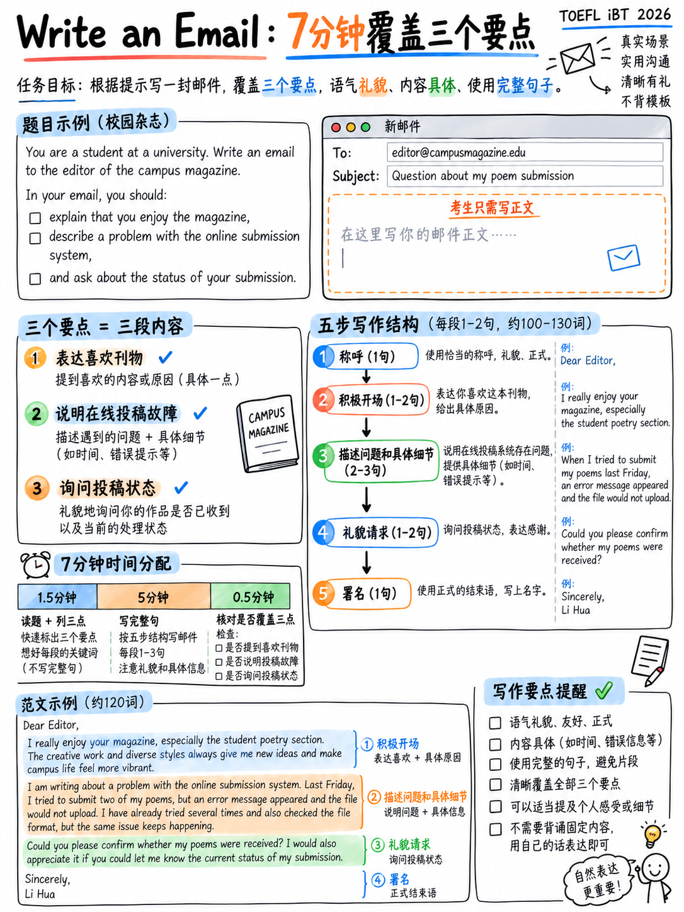

# 3.3 写一封Email




**一个任务。 5 个原始分——写作部分的四分之一。七分钟阅读*和*写作。**

## 3.3.1 任务是什么

>“向考生呈现一个有关学术或社会的文本场景
> 设置。要求考生以书面形式分享特定交际信息
> 目的 — 例如，**提出建议、发出邀请或提出建议
> 问题的解决方案**。考生有 **7 分钟** 来完成这项任务。” [1]

>“对于撰写电子邮件任务，您将有**总共七分钟的时间来阅读和回复**。” [18]

 任务衡量什么 [1]：

-“实现指定的交际目标，**遵循基本的社会惯例**”
- “**充分阐述**、清晰且具有凝聚力”
-“准确、恰当地使用一系列语法结构和词汇”
- “遵循英语的**机械约定**（拼写、标点符号和大写）”

**屏幕始终显示：**

```
   [a scenario paragraph — 2 or 3 sentences]

   Write an email to ____. In your email, do the following.
      • bullet 1
      • bullet 2
      • bullet 3

   Write as much as you can and in complete sentences.

   Your Response:
   To:      [given]
   Subject: [given]
```

**收件人** 和 **主题** 行已为您填写 [10][11]。您只写正文。

## 3.3.2 发布的两个提示

**提示A** [1][10]:

> *一本新诗杂志已向其读者征集意见，您决定提交其中的两个
> 你的诗。但是，您在使用在线提交表格时遇到了问题，并且您不确定
> 您提交的材料已收到。*
>
> 给杂志编辑写一封电子邮件。在您的电子邮件中，执行以下操作。
> • 告诉编辑您喜欢这本新杂志的哪些方面。
> • 描述您遇到的问题。
> • 询问您提交的状态。

**提示 B** [11]:

> *您的同事 Kevin 最近推荐了一家新餐厅供您的团队参观。你拿了
> 团队在那里，但每个人都很失望。食物没有想象中那么好，服务也不错
> 很慢。您需要告知凯文有关情况并讨论未来的午餐选择。*
>
> 给凯文写一封电子邮件。在您的电子邮件中，执行以下操作。
> • 解释餐厅出了什么问题。
> • 描述团队对此次访问的反应。
> • 建议替代午餐安排。

:::{important} 结构洞察
**两个提示都恰好有三个项目符号，并且这三个项目符号始终是三个不同的
沟通性动作。** 通常一种*积极/社交*动作，一种*信息性*动作，以及一种
*行动*移动（请求、问题或建议）。

因此，您的电子邮件始终包含三个正文段落 - 或至少三个清晰分隔的段落
句子组，每个项目符号一个。不需要其他任何东西。
:::

## 3.3.3 官方高层回应，分析

ETS 发布了提示 A [1][18] 的**示例高级响应**，完整内容：

> *编辑您好，*
>
> *我希望你一切都好！我想说我真的很喜欢新的《阳光诗歌》杂志。这是
> 如此多样化的声音令人耳目一新，布局也非常引人入胜。然而，我
> 当我尝试提交我的两首诗时，在线提交表格遇到了一些问题。之后我
> 上传文件并点击提交，页面不断加载，最终，我
> 不确定我的诗是否能成功发送。请确认您是否收到我的
> 提交内容？我很高兴能成为你们杂志的一员，并且非常感谢您提供的任何帮助
> 可以提供解决此问题的方法。期待您的回复。*
>
> *最诚挚的问候。*

**测量和观察：**

|特色 |价值|
|---|---|
|总长度| **118字**（直接从正文中计算） |
|段落| **一个**身体块|
|问候/结束| “编辑您好”/“最诚挚的问候。” |
|第 1 点（你喜欢什么）| “我真的很喜欢……令人耳目一新……多样化的声音……布局” |
|项目符号 2（问题）| “我在在线提交表单时遇到了一些问题......页面一直在加载” |
|第 3 点（状态问题）| “请问您是否收到我提交的材料？” |
| **拼写错误** | *参与*、*成功*、*收到* — **3** |
| **语法错误** | “带有在线提交表格”（缺少*the*）； “如果我的诗**能成功发送**”（断动词短语）— **2** |
|避险/礼貌| “我希望你一切都好”，“你可以吗”，“希望得到任何帮助” |

:::{danger} 这个包中最令人解放的事实
ETS 自己的**高级**电子邮件示例包含三个拼写错误、一篇缺失的文章和一个
动词短语完全错误的句子 - 并且它仍然是已发布的模型。

Band 5 允许“**几乎没有**词汇或语法错误**除了预期的错误之外
有能力的作家在定时条件下写作**”[1]。里面有一些定时书写的纸条
那个津贴。

**停止校对。开始涵盖项目符号。** 一封涵盖所有三个项目符号的电子邮件
五个错误胜过一封包含两个错误的完美电子邮件。
:::

## 3.3.4 移动模板

这是一个**移动**模板，而不是内容模板 - 每个句子都是根据提示填写的。它
是安全的，因为该标题明确奖励“持续使用适当的社会惯例
（例如，礼貌、语气、信息组织和行动制定，例如
请求、拒绝、批评）” [1].

```
GREETING          Dear [name], / Hi [name],

OPENING LINE      I hope you're well. / Thanks for recommending ___.
                  I'm writing about ___.                        ← names the situation

BULLET 1          [2–3 sentences]
BULLET 2          [2–3 sentences, usually the longest]
BULLET 3          [2–3 sentences, ending in a question or a suggestion]

CLOSING LINE      Thanks in advance. / Looking forward to hearing from you.

SIGN-OFF          Best regards, / Best wishes,
                  [Your name]
```

### 通过移动来存储短语

|移动|短语|
|---|---|
| **开放/说明目的** | “我写信是为了让你知道……”·“我想联系……”·“谢谢……”·“我希望你一切都好。” |
| **说一些积极的话** | “我真的很喜欢……”·“我最喜欢的是……”·“这是个好主意……”·“我很感激你……”|
| **描述问题** | “不幸的是，我遇到了一个问题……”·“问题是……”·“当我尝试……时，它……”·“它没有按预期工作。” |
| **报告反应** | “大家都觉得……”·“普遍的反应是……”·“有几个人提到……”·“说实话，我们大多数人都很失望。” |
| **提出请求** | “您能确认一下是否……吗？” ·“有可能……吗？” · “如果你能……我将不胜感激” · “你知道什么时候……吗？” |
| **提出建议** | “我建议我们……”·“怎么样……？” · “一个选择是……” · “也许我们可以……”|
| **缓和批评** | “我确信这只是休息日，但是……”·“这可能很不寻常，但是……”·“我不想消极，但是……”|
| **关闭** | “提前致谢。” ·“让我知道你的想法。” · “期待你的答复。” |

:::{tip} 注册：如何正式？
与人相匹配。 *亲爱的陈教授/亲爱的先生或女士* + 工作人员和
陌生人。 *嗨凯文* + 同事或朋友的宫缩。两个已发布的提示均显示
范围：未知编辑（半正式）和指定同事（非正式）。

 犯此错误是“社会惯例”错误，在第 3、4 和 5 段中命名为 [1]。
:::

## 3.3.5 七分钟时钟

|时间 |行动|
|---|---|
| **0:00–0:45** |读一遍场景。阅读这三个项目符号**两遍**。决定登记册（正式/非正式）。 |
| **0:45–1:00** |输入问候语和开头行。 （立即执行此操作 - 无需任何成本即可启动动力。）
| **1:00–2:45** |项目符号 1。
| **2:45–4:45** |第 2 条——通常是最需要细节的一条。 |
| **4:45–6:15** |项目符号 3，以问题或建议结尾。 |
| **6:15–6:45** |结束线和签字。 |
| **6:45–7:00** | **仅一项检查：所有三颗子弹都被覆盖了吗？**没有其他。 |

:::{warning} 故障模式
几乎所有在这项任务中得分低于 3 分的人都会做同样的事情：写一个漂亮的开头，
详细阐述了项目符号 1 四分钟，然后时间耗尽，而项目符号 2 和 3 保持不变。
该标题的首要标准是“实现**指定的沟通目标**”——并且
指定目标实际上是三颗子弹。

**每颗子弹 90 秒。看时钟。即使在思考中也继续前进。**
:::

## 3.3.6 长度目标

| | |
|---|---|
| ETS 的高层典范 | **118字** |
|屏幕说明 | “尽可能多地写出完整的句子”|
|评分标准要求 |无 — 评分指南中不显示字数 |
| **实际目标** | **110–150 个单词**，每个项目符号大约 2–3 个句子 |

 低于大约 80 个单词，就很难“充分阐述”三个单独的动作。以上
大约180，你花费了你没有的时间，并在没有奖励的情况下添加错误表面。

## 3.3.7 两个工作模型

###模型A - 提示A（诗歌杂志），134字

> *亲爱的编辑，*
>
> *我希望这条消息对您有好处。我正在写我提交给阳光的两首诗
> 上周诗歌杂志。*
>
> *首先，我想说一下我有多喜欢这本新杂志。编剧的选择非比寻常
> 多种多样，我特别喜欢每一期将知名诗人与新声音混合在一起的方式。*
>
> *不幸的是，我在在线提交表格时遇到了问题。我把两者都附上后
> 文件并点击“提交”，页面持续加载几分钟，然后返回到
> 开始。我又尝试了两次，得到了相同的结果，所以我不确定是否发送了任何内容。*
>
> *请确认我的提交材料是否已收到？如果不是的话，我很乐意
> 通过电子邮件再次发送。*
>
> *非常感谢您的帮助。*
>
> *最诚挚的问候，*
> *丽娜*

|评分标准 |哪里满意|
|---|---|
|沟通目标|所有三个项目符号，每个项目符号都有自己的段落|
|阐述|子弹2有四个具体细节：附加、点击、继续加载、返回开始、尝试两次|
|社会习俗|问候语，“我希望您收到此消息”，“请问您好吗”，主动提供帮助，谢谢，结束 |
|句法多样性 | *在我附加...*（从属）之后，*每个问题混合的方式...*（相对），*如果不是，我很乐意...*（有条件）|
|力学|引号、介绍性元素后的逗号、段落分隔符 |

### 模型 B — 提示 B（餐厅），132 个单词

> *嗨凯文，*
>
> *再次感谢您建议橡树街的新地方——您想到了这个地方真是太好了。
> 不过，我确实想让你知道事情进展如何。*
>
> *老实说，这不太好。主菜我们等了将近四十分钟，其中两道菜
> 菜品冷了。这些部分也比我们预期的价格小得多。*
>
> *团队的反应非常失望。几个人不得不在甜点之前离开
> 因为我们已经过了午餐时间，从那以后就没有人建议回去了。*
>
> *下次去车站附近的泰国店怎么样？速度快，价格便宜，而且他们接受
> 预订。或者，我们可以在会议室点餐并用餐。*
>
> *让我知道你的想法。*
>
> *最好，*
> *山姆*

|技术|哪里 |
|---|---|
| **缓和批评** | “你能想到这一点真是太好了……不过我确实想让你知道”|
|具体的、可数的细节| “四十分钟”、“两道菜”、“几个人” |
|正如项目符号所暗示的，提供了 **两种** 替代方案 |泰国地点/订单 |
|与同事匹配的非正式登记册 | “嗨，凯文”，缩写，“最好”|

:::{note} 字数统计
两种模型均按照与 ETS 范例相同的基础进行机械计数（所有数据均来自
对签名的问候）：**模型 A = 134 个单词，模型 B = 132 个单词。** 两者都位于
118 字的官方示例和 110-150 目标之内。
:::

## 3.3.8 人们失去分数的八种最常见的方式

|错误|成本|修复 |
|---|---|---|
|仅覆盖两颗子弹|降至 2-3 级（“阐述**部分**支持交流目的”）| 90 秒规则 |
|复制场景措辞| 1 级风险（“主要来自刺激措施”）|用你自己的话来解释 |
|没有问候或签字| “社会习俗”错误|始终包含两者 |
|注释式短语 |第一组：“电报语言” |完整的句子 |
|语域错误（对教授的俚语，或对朋友的拘谨）| “社会习俗”|检查收件人是谁 |
|一大段|危害“信息组织” |每个项目符号一个段落 |
|花最后一分钟修正拼写|零增益|检查子弹覆盖范围 |
|写250字|耗费时间，增加错误| 110–150 |

## 3.3.9 练习协议

1。从 {doc}`05-writing-practice-bank` §3.5.2 中选择一个场景。
2. **设置正好 7 分钟的计时器。** 在阅读之前启动它。
3. 在纯文本编辑器中键入**拼写检查关闭** - 真正的测试没有 [18]。
4. 7:00 停止，甚至是说到一半。
5.给自己打分：三颗子弹被覆盖？问候/结束？字数？然后标记错误——但是
   **计算**它们而不是修复它们，然后看看计数是否逐周下降。

做其中八个。写作时间不到一个小时，这就是整个准备工作
任务需求。

---

**下一篇：** {doc}`04-write-for-an-academic-discussion` — 十分钟，100字，一个任务
这是从旧托福考试中幸存下来的。