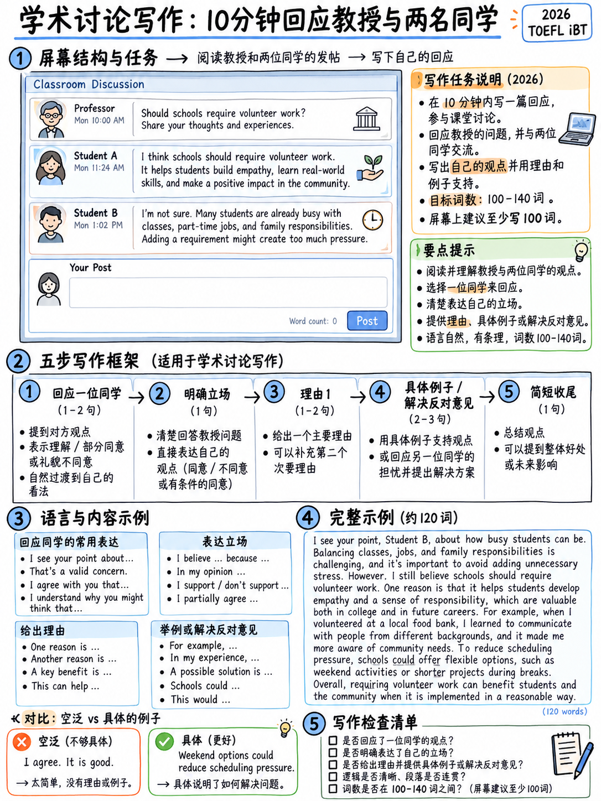

# 3.4 撰写学术讨论




**一项任务。 5个原始点。十分钟。 2026年写作部分唯一存在的任务
2026 年之前 - 因此 2023 年之后有关它的材料仍然有效。**

## 3.4.1 任务是什么

>“要求考生在 **在线课程的背景下陈述和支持观点
> 讨论论坛**。教授的帖子简要阐述了主题并提出了意见
> 与班级讨论的主题相关的问题。 **两位学生的简短帖子**然后
> 就该问题提出不同立场。考生在这个问题上贡献自己的立场
> 提出问题，用**他们自己的推理、经验或知识**支持他们的观点。他们
> 有 **10 分钟** 来完成此任务。” [1]

屏幕上[1][10]:

```
   Your professor is teaching a class on ____. Write a post responding to the
   professor's question.

   In your response, you should do the following.
     • Express and support your opinion.
     • Make a contribution to the discussion in your own words.

   An effective response will contain at least 100 words.

   [professor's post — a definition/framing + a question]
   [student 1 — one position, ~45 words]
   [student 2 — the opposite position, ~45 words]
```

任务衡量的内容 [1]:

-“清楚地阐述了某个立场的论点，**回应论点，和/或使用
  以短文本形式提供的信息**”
-“得到充分支持、清晰且有凝聚力”
-“准确、恰当地使用一系列语法结构和词汇”
- 机械约定

## 3.4.2 发布提示及回复

**教授帖** [1]:

> *志愿服务是指在没有经济补偿的情况下提供时间和服务的行为
> 使社区、组织或事业受益。虽然许多人志愿服务主要是为了提供帮助
> 另外，一些机构有强制性的志愿者计划。高中就是一个例子，其中
> 学生可能需要完成一定数量的志愿者时间才能毕业。你做什么
> 认为？高中生应该被要求做志愿者吗？为什么或为什么不？*

**学生 1：** *是的……它可以帮助学生建立公民责任感。许多青少年不
自然地想到帮助别人，这个要求可以让他们认识到：
他们的时间和努力可以真正改变他人的生活。*

**学生 2：** *我认为不应该要求志愿者时间，因为许多学生已经有
空闲时间有限。有些人做兼职工作或放学后照顾弟弟妹妹。添加一个
强制性的志愿者要求可能会造成额外的压力……*

**ETS 的高级响应样本** [1]，完整内容：

> *虽然我明白安德鲁关于有限空闲时间的观点，但我认为强制执行是件好事
> 高中的志愿者时间。志愿服务教会学生同理心和社区服务，
> 帮助他们成长为负责任的成年人。学校可以提供适合学生的灵活选择
> 时间表，例如周末或夏季志愿服务。更重要的是，志愿服务可以让你从工作中解脱出来。
> 学业压力，允许学生从事校外有意义的活动。对于
> 例如，帮助社区花园既令人满足又具有教育意义。*

### 测量

|特色 |价值|
|---|---|
|长度 | **79 个字** — 直接从已发表的文本中计算 |
|屏幕上规定的最低限度| “至少 100 个字”|
|开盘动作| **说出一位同学的名字并承认他们的观点**（“虽然我明白安德鲁的观点是……”）|
|职位|在**第一句**中说明 |
|原因 |二（“教导同理心”；“摆脱学业压力”）|
|反驳反对意见| “学校可以提供灵活的选择……例如周末或夏季志愿服务”|
|示例| “在社区花园帮忙”|
|错误 | *学生的*为*学生的*； *社区* |

:::{important} 79 字范例的三个教训
1. **规定的 100 字最少是建议，而不是评分标准。** 它不会出现在
   标题 [1]。 ETS 自己的模型位于其下方。 **您仍应以 100–140 为目标** — 但切勿填充到
   达到一个数字。
2. **价值最高的举动是回应指定的同学。** 任务描述中提到
   响应应该是“响应参数”[1]，并且示例正是通过这样做来打开的。
   这就是“对**讨论**的贡献”的意思。
3. **它包含两个错误，但仍然是模型。** 与电子邮件相同：定时书写单是
   在 Band-5 津贴之内。
:::

## 3.4.3 有效的结构

五个动作，100–140 个单词，10 分钟。

```
1. CONCEDE + POSITION   (1 sentence)
   "While I see [Student]'s point about ___, I think ___."

2. MAIN REASON          (2 sentences)
   "The main reason is that ___. [expand with a consequence]"

3. ANSWER THE OBJECTION (1–2 sentences)
   "It's true that ___, but ___ / this could be solved by ___."

4. CONCRETE EXAMPLE     (1–2 sentences)
   "For example, at my school ___."

5. CLOSE                (1 sentence)
   "So overall I'd argue that ___."
```

:::{tip} 为什么步骤 1 值得先做
它杀死了两只鸟：它表明您阅读了其他帖子（这就是区分
*对讨论的贡献*来自一篇通用文章），它为您提供了一个简单的、符合语法的
时间压力下的简单开场白。
:::

### 框架，而不是模板

 下面的每个空白均由提示填充。在阅读本文之前，这里什么都不能写
问题。

|移动|框架|
|---|---|
| **让球+位置** | “虽然我看到 [姓名] 关于 ___ 的观点，但我认为 ___。” · “我同意 [姓名] 的观点，但我会更进一步说 ___。” · “[姓名] 提出了关于 ___ 的合理观点；即便如此，___。” |
| **直接表明立场** | “在我看来， ___。” · “我认为___。” · “我自己的立场更接近[姓名]：___。” |
| **主要原因** | “主要原因是___。” · “这很重要，主要是因为___。” · “让我信服的是___。” |
| **展开理由** | “这意味着___。” · “因此， ___。” · “随着时间的推移，这往往会___。” |
| **回答异议** | “确实是___，但是___。” · “这个问题可以通过___来解决。” · “虽然___，但这是一个真正令人担忧的问题。” |
| **示例** | “例如，在我的大学___。” · “根据我自己的经验，___。” · “一个很好的例子是___。” |
| **关闭** | “所以总的来说，我会说___。” · “出于这些原因，我认为___。” |

## 3.4.4 浪费语言的短语

 这些是 2026 年前托福课程的开仓题。在一篇 100 字的帖子中，他们可以消耗
四分之一的文字，什么也不说。该标题奖励“相关且详尽的
解释”[1]——不是清嗓子。

|删除|原因 |
|---|---|
| “当今的现代社会，随着科技的飞速发展……”| 11个字，零内容|
| “这是一个有争议的问题，已被广泛讨论。” |教授已经告诉你这是一个问题 |
| “这个问题既有优点也有缺点。” |什么也没说；还避免采取任务所需的立场 |
| “就我而言，从我的角度来看……”|加倍对冲； “我认为”就足够了 |
| “最后但并非最不重要的......”|你有两点，而不是五点|
| “总而言之，总而言之，总而言之……” |一个结束语，而不是三个 |

 比较：ETS 的范例开始 **“虽然我明白安德鲁关于有限空闲时间的观点，但我认为这是
在高中有强制性的志愿者时间是件好事。”** 职位和参与度，首先
21个字。

## 3.4.5 十分钟时钟

|时间 |行动|
|---|---|
| **0:00–1:30** |阅读教授的帖子。在实际的**问题**下划线。阅读两篇学生帖子并记下您将命名哪一篇。 |
| **1:30–2:00** |用一句话决定你的立场。选择**一个**主要原因和**一个**例子。不要计划更多。 |
| **2:00–8:30** |按照五个动作进行写作。不要停下来编辑。 |
| **8:30–9:30** |在你最薄弱的动作中再添加一句阐述——通常是例子。 |
| **9:30–10:00** |检查：(1) 我的立场是否在第 1 句中表述？ (2) 我有说出同学的名字吗？ （3）有具体例子吗？ **不检查拼写。** |

:::{warning} 最常见的故障
花四分钟决定你的“真实”想法。该标题不对质量进行评分
您的意见 - 您的意见是否**相关、清晰且详尽** [1] 进行评分。任意
防守位置很好。在 30 秒内选择一个并花时间对其进行详细阐述。
:::

## 3.4.6 两个工作模型

### 模型A — 志愿服务提示，132 个字

> *虽然我理解玛雅对已经有兼职工作的学生的担忧，但我认为
> 强制性的志愿者工作时间值得保留。*
>
> *主要原因是大多数青少年永远不会尝试志愿服务，除非有什么推动他们
> 投入其中，第一次经历通常会改变他们的想法。一旦学生看到两个
> 他们每周的几个小时确实对某人有帮助，他们中的许多人在事后继续工作而没有受到影响
> 问。*
>
> *时间问题确实存在，但可以通过设计来解决，而不是通过废弃
> 要求。学校可以将总时长设定为低水平——比如每年二十个小时——并允许这样做
> 在假期。*
>
> *在我自己的学校，要求是十五个小时，几乎没有人觉得这很困难。*
>
> *所以我会保留规则，但保持较小。*

|评分标准 |哪里 |
|---|---|
| “回应争论”|命名玛雅并处理她的具体反对意见 |
| “相关且详尽的解释” |主要原因是一个后果（“一旦学生看到……他们中的很多人就会继续”）|
|具体举例| “十五小时”、“一年二十小时”|
| “各种句法结构”| *虽然…*（让步），*除非…*（条件），*一次…*（时间），*但它可以通过…*（被动+介词）解决|
|凝聚力| “时间问题确实存在，但是……”不重复地回述 |

### 模型 B — 技术提示，131 个字

> **教授：** *现在很多大学都会录制讲座并在网上发布。有人争论这一点
> 改善访问；其他人则表示，这会降低出勤率并削弱课堂效果。大学应该
> 录制所有讲座？为什么或为什么不？*
>
> **您的帖子：**
>
> *丹尼尔是对的，空荡荡的演讲厅令人沮丧，但我不认为录音是
> 真正的原因，我会记录下一切。*
>
> *最有力的论点是访问。生病、轮班或不说话的学生
> 英语作为第一语言从能够暂停和倒带中受益匪浅。对于一个
> 对于第二语言学生，一次重播可能决定听完一节课还是输掉课程
> 整整一周的课程。*
>
> *出勤是一个单独的问题。如果学生因为录音效果更好而跳过讲座
> 与现场版本相比，现场版本告诉我们一些有关讲座的信息，而不是有关技术的信息。*
>
> *我自己的第一年统计课程是我拥有的最明显的例子：我参加了每一节课程并且
> 仍然重看了一半。*
>
> *所以我会把它们全部记录下来。*

|技术|哪里 |
|---|---|
|承认，然后重新构建 | “丹尼尔是对的......，但我不认为录音是真正的原因” |
| **重新提出异议**而不是否认它 | “出勤是一个单独的问题” |
|具体的个人例子| “我自己的第一年统计课程......重看了其中一半” |
|简短而果断的结束| “所以我会把它们全部记录下来。” |

## 3.4.7 故意弱化的版本，诊断

这里有相同的志愿服务提示，大致在第2段回答。阅读它，然后阅读诊断。

> *在当今的现代社会，志愿服务是一个非常有争议的话题，被广泛讨论
> 受到各界人士的好评。有人认为这是好的，有人认为这是坏的。
> 在我看来，我认为志愿服务很好，因为它对社会有帮助，而且可以
> 让学生变得更好。这对他们的未来也有好处。既有优点又有
> 缺点。总之，我认为应该需要志愿服务，因为它非常重要
> 对每个人都很重要。*（83 个字）

|问题 |标题后果|
|---|---|
|没有参与任何一个学生帖子 |未能“对 **讨论** 做出贡献”；任务说“回应论点” [1] |
|以 18 个填充词开头 |开场没有详细说明|
| “它对社会有帮助”/“它可以让学生变得更好”|第 3 级：“部分解释……可能缺失或不清楚”——这些是主张，而不是解释 |
| **根本没有例子** |频带 3-4 边界是示例 |
| “有利有弊”与所声明的立场相矛盾 |清晰度|
|句子结构：7个简单句子，全部*主语+ be +形容词* | “句法结构的有限范围”——第 2 段 |
|结论重复开头|无发育|

###修复的四招

1。 **将第一句**替换为命名同学的让步。
2. **用机制代替“对社会有帮助”**：*因为第一次的经验是
   通常是什么改变了他们的想法*。
3. **添加一个带有数字的具体示例**。
4. **删除“有利有弊”**及填充结论；结束于
   单子句位置。

这四步将第2段的83个单词变成了第4段的大约130个单词，没有一个新的
词汇项。

## 3.4.8 主题来源

ETS 将上下文描述为跨一般本科科目[2] 的“学术语言使用”。
发布的提示是社会研究；模拟测试使用社会和政策问题。期待
主题取自：

|面积 |典型问题形状 |
|---|---|
|教育政策| X 应该是必需的/可选的/在线的吗？ |
|科技与社会| X 是有帮助还是有害？是否应该受到限制？ |
|工作与经济|公司/政府应该做X吗？ |
|环境 |个人或政府应该对X负责吗？ |
|城市生活和交通|城市应该投资X吗？ |
|媒体与传播| X 使我们在 Y 方面变得更好还是更差？ |
|健康与生活方式|学校/雇主应该鼓励X吗？ |

**您不需要主题知识。** 每个发布的提示都在
教授的职位（“志愿服务是指……的行为”）。您需要的内容是您自己的
经验。

## 3.4.9 练习协议

1。接受 {doc}`05-writing-practice-bank` §3.5.3 中的提示。
2. **十分钟，计时器打开，拼写检查关闭。**
3. 使用五个动作写 100-140 个单词。
4. 仅检查三件事：句子 1 中的位置 · 名为同学 · 具体示例。
5. 数数你的字数。数一下你的错误。每周跟踪一次 — 错误计数应该下降，而
   字数保持平稳。

四篇定时帖子足以为这项任务做好准备。第五个加了一点。

---

**下一个：** {doc}`05-writing-practice-bank` — 12 个电子邮件场景、20 个讨论提示以及
检查床单。