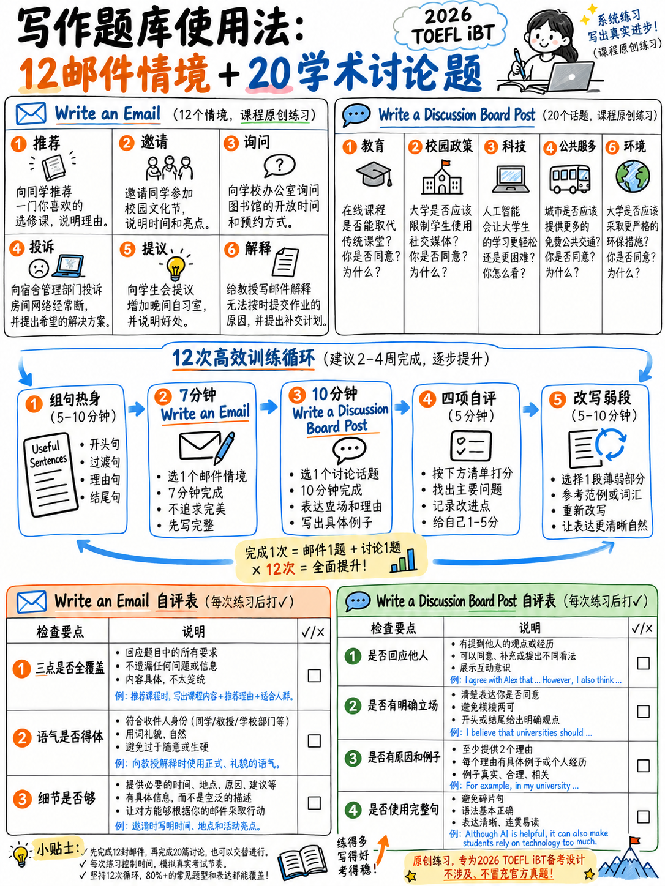

# 3.5 写作练习库

 本章所有提示都是**为本包而写的**，与已发布的相匹配
任务类型、场景样式、项目符号结构和长度 [1][2][10][11] 的规范。他们是
不转载测试内容。

## 3.5.1 如何进行练习

| |电子邮件 |学术讨论 |
|---|---|---|
|定时器| **7:00**，在阅读之前开始 | **10:00**，阅读前开始 |
|拼写检查 | **关闭** | **关闭** |
|目标长度| 110–150 字 | 100–140 字 |
|停止|准时，如有必要，可说到一半|相同|
|事后检查 |三颗子弹都被盖住了？ |职位·点名同学·示例|

使用纯文本编辑器（记事本、`gedit`、`nano`、纯模式下的TextEdit）。文字处理器
自动更正您的拼写并为您提供错误的图片。

## 3.5.2 十二个编写电子邮件场景

每个都遵循官方形状：2-3个句子的场景，指定的收件人，以及恰好三个
项目符号说明。

---

**电子邮件 1 — 学术，请求**

> 您的大学图书馆已宣布将在疫情期间关闭六周进行翻修
> 学期。您正在进行一个研究项目，该项目所依赖的书籍无法
> 借来的。
>
> 给图书馆经理写一封电子邮件。在您的电子邮件中，执行以下操作。
> • 解释关闭将如何影响您的工作。
> • 描述您最需要哪些材料。
> • 询问是否可以使用任何替代访问方式。

---

**电子邮件 2 — 社交、邀请**

> 您已加入徒步俱乐部，并被要求组织下一次旅行。奥马尔的同学，
> 提到他想尝试徒步旅行，但从未去过。
>
> 给奥马尔写一封电子邮件。在您的电子邮件中，执行以下操作。
> • 邀请他参加旅行并提供详细信息。
> • 解释他需要携带什么。
> • 向他保证难度级别。

---

**电子邮件 3 — 学术，问题**

> 您三周前注册了晚间课程，但您的名字没有出现在课堂上
> 列出并且您尚未收到任何课程材料。
>
> 给课程管理员写一封电子邮件。在您的电子邮件中，执行以下操作。
> • 清楚地解释问题。
> • 描述您已经尝试过的内容。
> • 询问您下一步应该做什么。

---

**电子邮件 4 — 工作场所，推荐**

> 您的经理已要求团队中的每个人推荐一款软件，该软件可以
> 他们的工作更加轻松。您一直在使用节省时间的日程安排工具。
>
> 给您的经理写一封电子邮件。在您的电子邮件中，执行以下操作。
> • 推荐该工具并说明其用途。
> • 解释它如何帮助您。
> • 建议团队如何开始使用它。

---

**电子邮件 5 — 社交、道歉和解决方案**

> 您向邻居 Priya 借了一台相机，准备周末旅行。镜头盖丢失并且
> 身体上有一个小划痕。
>
> 给 Priya 写一封电子邮件。在您的电子邮件中，执行以下操作。
> • 道歉并解释发生的事情。
> • 诚实地描述损坏情况。
> • 提出你将如何把事情做好。

---

**电子邮件 6 — 学术、礼貌处理投诉**

> 您参加了一个宣传为“实践”的周末研讨会。实际操作中几乎没有
> 实际工作，房间对于参加人数来说太小了。
>
> 给研讨会组织者写一封电子邮件。在您的电子邮件中，执行以下操作。
> • 说出您认为有用的内容。
> • 描述两个主要问题。
> • 建议下次可以改进的地方。

---

**电子邮件7 — 住宿，要求更改**

> 您住在大学宿舍。您房间旁边的建筑工作每天早上六点开始
> 两周后你就要考试了。
>
> 给住宿办公室写一封电子邮件。在您的电子邮件中，执行以下操作。
> • 描述情况及其对您的影响。
> • 说出您已经采取的措施。
> • 询问是否可以临时换房间。

---

**电子邮件 8 — 工作场所，礼貌拒绝**

> 一位同事 Ana 邀请您加入周六项目团队。您已经有两项承诺
> 那个周末不能承担更多的工作。
>
> 给安娜写一封电子邮件。在您的电子邮件中，执行以下操作。
> • 感谢她并说明为什么该项目听起来很有趣。
> • 解释您无法加入的原因。
> • 提供您可以提供帮助的替代方式。

---

**电子邮件 9 — 学术，要求延期**

> 您已经生病十天了，无法完成周五到期的作业。你的
> 导师要求所有学生如有任何困难请直接与她联系。
>
> 给你的导师写一封电子邮件。在您的电子邮件中，执行以下操作。
> • 解释您的情况。
> • 说出您已完成多少工作。
> • 请求一个具体的新截止日期并给出理由。

---

**电子邮件 10 — 服务、信息请求**

> 您想要加入在布告栏上广告的语言交换计划。海报
> 仅提供电子邮件地址和会议时间。
>
> 给项目协调员写一封电子邮件。在您的电子邮件中，执行以下操作。
> • 自我介绍并说明您感兴趣的原因。
> • 提出两个有关该计划如何运作的具体问题。
> • 说明您的空闲时间。

---

**电子邮件 11 — 社交、组织团体**

> 你们的五人学习小组在一家太吵闹的咖啡馆里聚会。大家
> 已要求您寻找更好的安排。
>
> 给群组写一封电子邮件。在您的电子邮件中，执行以下操作。
> • 解释为什么当前的安排不起作用。
> • 建议两种替代方案。
> • 要求小组在特定日期之前选择。

---

**电子邮件 12 — 工作场所，提出解决方案**

> 共享办公室的打印机几乎每周都会出现故障，人们浪费时间等待
> 它。预算中有钱购买小型设备。
>
> 给办公室经理写一封电子邮件。在您的电子邮件中，执行以下操作。
> • 描述问题及其发生频率。
> • 解释对团队的影响。
> • 提出具体的解决方案。

---

## 3.5.3 二十个学术讨论提示

E 每个给出一个教授的框架问题和两个简短的学生帖子，就像实际任务一样。写
**10 分钟内 100–140 个单词**，命名其中一名学生。

---

**1。教育——评估**
> **教授：** 许多课程完全通过期末考试进行评估；其他人使用连续
> 课程作业。哪个能带来更好的学习效果，为什么？
> **Lena：** 考试更公平。每个人都在相同的条件下坐在同一张纸上，没有人
> 可以在家里获得额外的帮助。
> **Tomás：** 课程作业更好地反映了实际工作。在工作中，没有人要求你产出
> 两小时内完美的东西，没有资源。

**2。技术——研究中的人工智能**
> **教授：**大学应该允许学生使用人工智能写作工具做作业吗？
> **Hana：** 禁止它们是毫无意义的。它们现在是专业工作的一部分，学生应该
> 学会很好地使用它们。
> **Ben：** 如果一个工具为你写下你的论点，那么你还没有学会如何争论。那就是
> 整篇文章的要点。

**3。环境——个人责任与机构责任**
> **教授：** 谁应该对减少浪费承担最大责任：个人或
> 组织？
> **娜迪亚：** 个人。数以百万计的小变化加起来，消费者的需求才是推动发展的动力
> 公司。
> **菲利克斯：** 一家工厂一天产生的垃圾比一千个家庭一年产生的垃圾还多。
> 关注个人会分散注意力。

**4。工作——每周工作四天**
> **教授：** 一些公司已经改为每周工作四天，但工资没有减少。
> 这应该成为标准吗？
> **拉维：** 是的。有证据表明，人们在休息时工作效率更高，通勤天数更少
> 对环境也有帮助。
> **卡拉：** 它只适用于某些行业。医院和商店不能简单地在周五关门。

**5。城市——无车中心**
> **教授：** 市中心是否应该禁止私家车通行？
> **乔纳斯：** 当然。当街道变得可用、空气得到改善、商店实际上做得更好时
> 人们走路。
> **梅：** 假设每个人都可以步行或骑自行车。老年人和残疾人依赖
> 能够开车靠近他们要去的地方。

**6。教育——义务教育**
> **教授：** 参加大学讲座应该是强制性的吗？
> **莎拉：** 是的。逃课的学生落后了，大家的讨论都受到影响
> 其他。
> **阿里：** 成年人应该决定如何利用他们的时间。如果讲座值得参加，人们会
> 参加。

**7。媒体——新闻消费**
> **教授：** 社交媒体改善还是损害了人们了解时事的方式？
> **优素福：** 改进了。在媒体受到审查的地方，人们现在可以直接听到目击者的声音。
> **埃琳娜：** 损坏。速度取代了准确性，大多数人从不检查任何东西。

**8。健康——学校锻炼**
> **教授：** 学校是否应该要求所有学生每天进行体育锻炼？
> **Priya：** 是的，它应该像任何其他主题一样安排时间表。最后在学校养成的习惯
> 一生。
> **马克：** 强迫锻炼会让人讨厌它。学校应该提供更多选择。

**9。经济学——免费公共交通**
> **教授：** 一些城市已经免费提供公共交通。这是公共资金的善用吗？
> **迭戈：** 是的。它减少了交通，帮助低收入人群，并消除了成本
> 收取车费。
> **安娜：** 没有更多运力的免费交通只会意味着公共汽车拥挤。钱应该是
> 花在更多路线上。

**10。教育——学习第二语言**
> **教授：** 学习第二语言是否应该成为大学的必修课，无论
> 主题？
> **狮子座：** 是的。它改变了您对自己语言的看法，并且它在任何地方都很有用。
> **英格丽德：** 必修语言课程培养出可以通过测试但不会说话的人。做到这一点
> 可选并正确执行。

**11。技术 — 远程工作**
> **教授：** 永久远程工作对年轻员工有好处吗？
> **Zara：** 它给了他们自由，并为他们节省了租金和旅行费用。
> **彼得：** 年轻员工通过观察他人来学习。远程工作恰恰消除了这一点。

**12。环境——个人飞行限制**
> **教授：** 一个人每年可以乘坐的航班数量是否应该受到限制？
> **科菲：** 是的。航空业是增长最快的排放源之一，其他任何行业都没有
> 工作了。
> **朱莉娅：** 限制将对因移民而离散的家庭造成最严重的打击，而富人则会
> 只需支付即可。

**13。工作——自动化**
> **教授：** 随着自动化取代日常工作，政府应该做什么？
> **Hugo：** 对人员进行再培训。工作会像往常一样发生变化。
> **法蒂玛：** 再培训假设有一些东西需要再培训。我们可能需要重新思考如何
> 收入分配。

**14。教育——大学费用**
> **教授：** 高等教育应该对所有人免费吗？
> **克拉拉：** 是的。教育造福于社会，而不仅仅是个人，因此社会应该付出代价。
> **尼基尔：** 免费教育是通过从未上过学的人的税收来支付的。那不是
> 显然公平。

**15。城市——住房**
> **教授：** 城市应该向上建设还是向外建设来解决住房短缺问题？
> **德米特里：** 向上。密度提高了运输和服务的效率，并保护了外部土地
> 城市。
> **艾莎：** 高层建筑价格昂贵，而且居住起来往往不愉快。较小的城镇相连
> 通过铁路工作效果更好。

**16。健康——糖税**
> **教授：** 对含糖饮料征税真的能改善公众健康吗？
> **马可：** 是的。物价上涨时消费下降；这就是需求的运作方式。
> **林：** 他们是倒退的。低收入人群支付最多，变化最少。

**17。技术——在线隐私**
> **教授：**是否应该允许公司免费收集个人数据作为交换
> 服务？
> **罗莎：** 如果交流明确并且人们同意，是的。
> **蒂姆：** 没有人阅读协议，也没有人可以真正拒绝。那不是同意。

**18。教育——小组项目**
> **教授：** 小组项目是评估学生的有效方法吗？
> **艾玛：** 是的。几乎所有专业工作都是协作的，因此评估也应该如此。
> **艾哈迈德：** 在实践中，一个人完成工作，每个人都得到分数。这教导了
> 错误的教训。

**19。社会——志愿服务和社区**
> **教授：** 政府应该向人们支付社区志愿服务费用吗？
> **努尔：** 付费的人可以让那些无力付出的人也能参与志愿服务
> 免费时间。
> **Stefan：**一旦你付了钱，它就是一份工作，而不是志愿服务，动机就会改变
> 完全。

**20。环境——修复胜于更换**
> **教授：**法律是否应该要求制造商提供可维修的产品？
> **格蕾丝：** 是的。旨在丢弃的产品会浪费资源和金钱。
> **维克托：** 可修复性增加了成本和重量。很多人宁愿拥有更便宜的产品。

---

## 3.5.4 十二节写作计划

|会议|任务|焦点 |
|---|---|---|
| 1 |造句第 1-20 项 |模式 1–4 |
| 2 |造句第 21-40 项 |模式 5–8 |
| 3 |电子邮件 1，定时 |时钟纪律——涵盖所有三点|
| 4 |电子邮件 2，定时 |注册：非正式地给同学|
| 5 |讨论 1，定时 |命名同学；句子 1 中的位置 |
| 6 |电子邮件 3 + 电子邮件 4，定时 |问题报告和推荐 |
| 7 |讨论 5，定时 |承认然后重新构建 |
| 8 |造一个句子，每个 40、35 秒 |速度|
| 9 |电子邮件 6（投诉）+ 电子邮件 8（拒绝）|礼貌惯例 |
| 10 | 10讨论 11，定时 |阐述：一个理由，全面延伸|
| 11 | 11完整写作部分模拟：23 分钟内 10 BAS + 1 封电子邮件 + 1 次讨论 |任务之间的转换 |
| 12 | 12使用不同的提示重复模拟 |一致性 |

## 3.5.5 自标记表

### 写电子邮件

| | ✓ |
|---|---|
|向收件人表达适当的问候 | |
|开场白说明了目的| |
| **项目符号 1 包含 ≥ 2 个句子** | |
| **项目符号 2 包含 ≥ 2 个句子** | |
| **项目符号 3 包含 ≥ 2 句话** | |
|项目符号 3 以问题或具体建议结束 | |
|结束语 + 结束 | |
| 110–150 字 | |
|至少一个从句 (*because /though /when / if*) | |
|至少一个关系从句 (*who / that /which*) | |
|没有从场景中复制任何句子 | |
|在计时器之前完成 | |

**分数：___ / 12.** 9 或更多对应于官方术语中的 4 级演奏
指导；六到八是第 3 段。
*（该映射是**分析** - ETS 未发布清单到频段的转换。）*

### 为学术讨论撰写

| | ✓ |
|---|---|
|第 1 句中明确阐述了立场 | |
|两名学生中的一名名叫 | |
|一个主要原因，用*因为*介绍 / *主要原因是* | |
|该原因通过结果或机制**扩展** | |
|反对的观点得到了解决，而不是被忽视 | |
| **一个具体的例子**（一个数字、一个地点、一次个人经历） | |
|陈述立场的一句话结束 | |
| 100–140 字 | |
|没有开瓶器（“在当今的现代社会......”）| |
|至少三种不同的句子结构 | |
|没有任何内容抄袭教授或学生的帖子 | |
|在计时器之前完成 | |

**分数：___ / 12.**

### 错误计数跟踪器

**不**修复练习片段中的错误。计算并记录它们。数字应该下降
同时你的字数保持稳定。

|会议|话|拼写 |文章 |动词形式|词序|标点符号|总计 |
|---|---|---|---|---|---|---|---|
| 1 | | | | | | | |
| 2 | | | | | | | |
| 3 | | | | | | | |
| 4 | | | | | | | |

 哪一列最大就是 {doc}`../60-toolkit/02-grammar-minimum` 的那一列。

---

**下一步：** {doc}`../40-reading/01-scoring-and-section-tactics` — 阅读部分，开始
测试并设置您的适应性上限。
