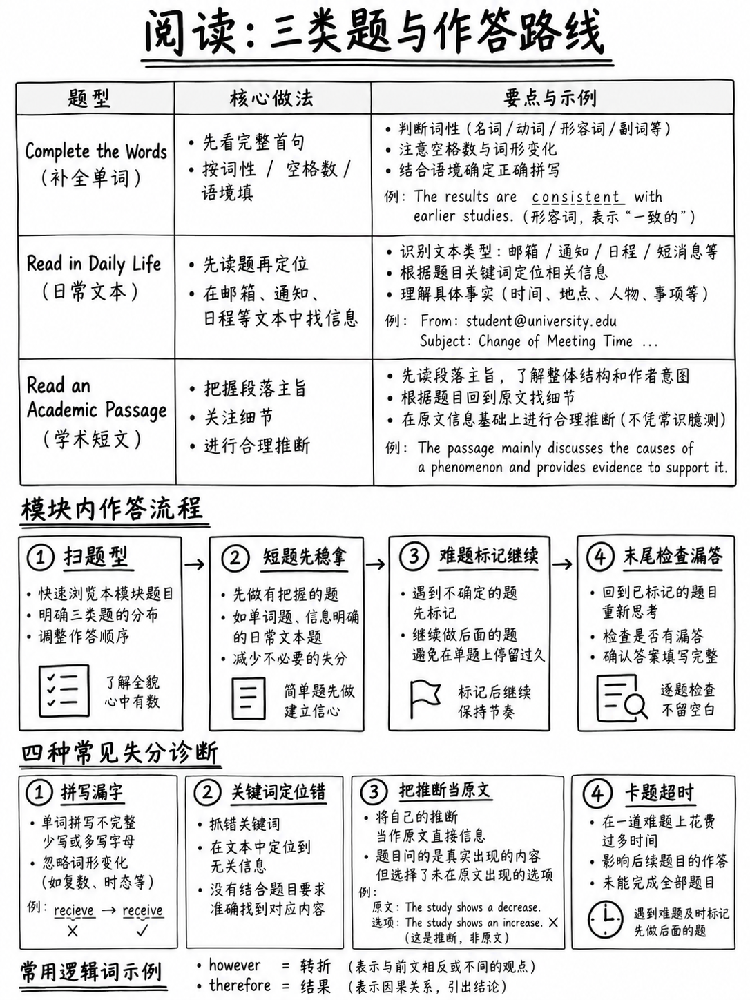

# 4.1 阅读部分：得分与战术




## 4.1.1 部分概览

| | |
|---|---|
|职位| **第一** |
|长度 | **约27分钟** [1] |
|项目 | **考生页面上的 35–48**；蓝图中**50**（差异为预测试项） [1][2] |
|原始分数范围 | **0–30** [1]（蓝图：35 分 [2]）|
|每件商品积分 | **1. “对于阅读部分中得分的项目，每项最高分为 1 分。”** [2] |
|结构| **两级自适应**：路由器 18–21 分钟 → 第二个模块 9 分钟 [2] |
|导航 | **模块内**下一个/上一个； **一旦开始模块 2，您就无法返回模块 1** [10] |
|标记|机器，精确匹配[2] |

```
  READING  (~27 minutes, 2 modules)
  ┌──────────────────────────────────┬─────────────────────┐
  │  MODULE 1 — the router           │  MODULE 2           │
  │  18–21 minutes                   │  9 minutes          │
  │  you may go Back within it       │  lower OR upper     │
  └──────────────────────────────────┴─────────────────────┘
          ↑ roughly two-thirds of the section
```

## 4.1.2 三种任务类型及其权重

|任务|物品（蓝图）|欧洲共同语言参考标准 |分享物品 |
|---|---|---|---|
| **完成单词** | **30** | B1–C1+ | **60%** |
| **日常生活中阅读** | 5–15 | A1–C1 | — |
| **阅读学术文章** | 5–15 | B1–C2 | — |

来源：[2].

:::{important} 阅读部分的百分之六十是填字任务
不是理解题。不是段落。 **三个短段落中有三十个空白。**

这是2026年阅读部分最重要且最缺乏教导的事实。每个
2026年之前的阅读策略——略读、扫描、段落映射、“先读问题”——
解决的任务现在仅占本节的一小部分。

{doc}`02-complete-the-words` 是本模块中最有价值的章节。
:::

## 4.1.3 Timing

ETS 不发布每个项目的时钟。算术：

| | |
|---|---|
|项目（评分+预测试）| 〜35–48 |
|时间 | ~27 分钟 = 1,620 秒 |
| **每件商品的平均值** | **大约 35–45 秒** |

但是这些物品的成本非常不平等：

|项目类型 |现实时间 |
|---|---|
| 1 完成单词空白 | **10–20 秒** |
|完整完成单词段落（10 个空白）| **2.5–3.5 分钟**，包括阅读 |
|日常生活阅读：阅读15-150字的文字+2-3个问题| **1.5–2.5 分钟** |
|阅读一篇学术文章：阅读 200 个单词 + 5 个问题 | **3.5–4.5 分钟** |

### 可行的模块计划

 对于 20 分钟的路由器模块，大约包含 2 个完成单词段落、2 个日常生活
文本和1篇学术文章：

|分钟 |内容 |
|---|---|
| 0–3 |完成单词 #1 |
| 3-6 | 3-6完成单词 #2 |
| 6–8 |日常生活文本#1 |
| 8–10 |日常生活文本#2 |
| 10-14 | 10-14学术文章 |
| 14–18 |剩余物品 |
| 18–20 | **扫一扫：填满每个空框** |

:::{warning} 硬规则
**没有完成单词间隙可以留空。** 错误答案不会受到惩罚，并且
合理的猜测有时是正确的。空框保证为零。

 保留每个模块的最后 60-90 秒进行扫描。
:::

## 4.1.4 自适应路由器：该怎么办

```
   MODULE 1 (router, 18–21 min)   →   performance   →   MODULE 2 (9 min)
                                                         lower ─ easier, lower ceiling
                                                         upper ─ harder, higher ceiling
```

**三个实际后果：**

1。 **开始热身。** 路由器是整个测试中最先做的事情，占了三分之二
   该部分。在寒冷中行走并在前五分钟内“安顿下来”会花费你
   天花板。离家前热身：大声朗读 200 个英语单词并完成 5 个
   单词间隙。

2。 **不要沙袋。** 更简单的第二个模块没有任何优势。下部模块有一个
   较低的最高分数。

3。 **在模块内使用“返回”，切勿跨越模块。**“您将无法返回到模块 1
   一旦您开始模块 2" [10]。在单击前进之前完成扫描。

:::{note} 适应性*不*意味着什么
这并不意味着每个问题都会适应最后一个问题。它是**两阶段**：一个决策点，
路由器之后。在模块内，项目是固定的。所以没有理由为任何事情而苦恼
单个项目。
:::

## 4.1.5 模块内的攻击顺序

 屏幕将以固定顺序呈现项目，但您可以控制花费的时间。推荐
优先级：

|优先|任务|为什么 |
|---|---|---|
| **1** | **完成单词** |大多数项目、每点最快的项目以及您跳过的间隙都将永远消失 |
| **2** | **日常生活中阅读** |文字短，问题具体，命中率高 |
| **3** | **阅读学术文章** | 5 个问题，但每点阅读次数最多 |

 如果您在一个模块中的时间不足，您放弃的项目应该是学术文章
推理问题 — 不是完成单词间隙。

## 4.1.6 未知单词策略

>“回答问题所需的所有信息都包含在文本中。” [4]
> “该任务的设计不需要背景知识。” [1]

|情况|这样做|
|---|---|
| **完成单词**空白中的未知单词 |使用语法槽。您通常可以在不知道单词的情况下提供结尾 ({doc}`02-complete-the-words` §4.2.3) |
|段落中其他地方出现未知单词 |忽略它，除非间隙取决于它 |
|问题词干中的未知词 |阅读选项；它们经常揭示含义|
| **是**问题的未知单词（上下文中的词汇）|将其替换为“X”并阅读该句子；周围的逻辑通常决定 |

**永远**停止翻译。一个不认识的单词最多扣一分；它引发的恐慌可以
花费五。

## 4.1.7 阅读速度：你真正需要的

|文字|长度 |需要|
|---|---|---|
|完成单词段落 | 70–100 字 [1] |仔细阅读两遍 |
|日常生活中阅读 | 15–150 字 [1] |完整阅读一次 |
|阅读学术文章 | ~200 字 [1] |完整阅读一次，然后回答 |

**整个部分的总阅读量大约为 900–1,400 字。** 需要旧托福
2,000–3,000。速度不再是限制； **精度**是。

这改变了训练。不要练习略读。练习阅读 200 字的段落*一次*
并能够说出每句话的主张。

:::{tip} 三周精密钻
取任意 200 字的文本。以正常速度读一遍。关闭它。写一句话概括
原文的每句话，按顺序。查看。每天十分钟。

这完全构建了学术通道问题测试的技能：“思想之间的关系”
和“全部或部分文字的目的”[1]。
:::

## 4.1.8 答案机制

|规则|详情 |
|---|---|
| **拼写** |完整的单词是机器标记的，完全匹配 [2]。拼写错误的正确答案得分为零 |
| **案例** |准确输入单词所需的内容。句子中间的单词小写； `How_ _ _ _` 是大写的，因为 *However* 开始一个句子 |
| **猜测** |总是。无处罚 [2] |
| **多项选择** |四个选项，一个答案，始终只有一个 |
| **空白答案** |永远不要留下一个 |

## 4.1.9 最常见的四件事 阅读标记

|损失|典型尺寸|修复 |
|---|---|---|
| **填写空白的单词框** | 3–8 分 |模块结束扫描 |
| **拼写完成单词** | 2–5 分 | {doc}`../60-toolkit/03-spelling-and-typing` |
| **选择一个重复文本中的单词的选项** | 2–4 分 | {doc}`03-read-in-daily-life` §4.3.4 陷阱表 |
| **在一篇学术论文上花费过多** |其他地方 3-6 分 | §4.1.3 |

 中的模块规划请注意，**四个中的三个是机械**。对于初学者来说，阅读的提高大多不是


## 4.1.10 为期三周的阅读计划

|周 |每日（25 分钟）|每周 |
|---|---|---|
| 1 | 1 完成单词段落 + 拼写列表中的 10 个单词 |完整阅读§4.2；执行第 1-3 段 |
| 2 | 1 个 CTW 段落 + 1 个日常生活文本 + 5 个拼写单词 |第 4-7 段； §4.3 | 中的陷阱表
| 3 | 1 个 CTW 段落 + 1 篇学术文章，限时 |第 8-10 段； {doc}`05-reading-practice-set` |

--- 的全定时模块

**下一个：** {doc}`02-complete-the-words` — 该部分的百分之六十。