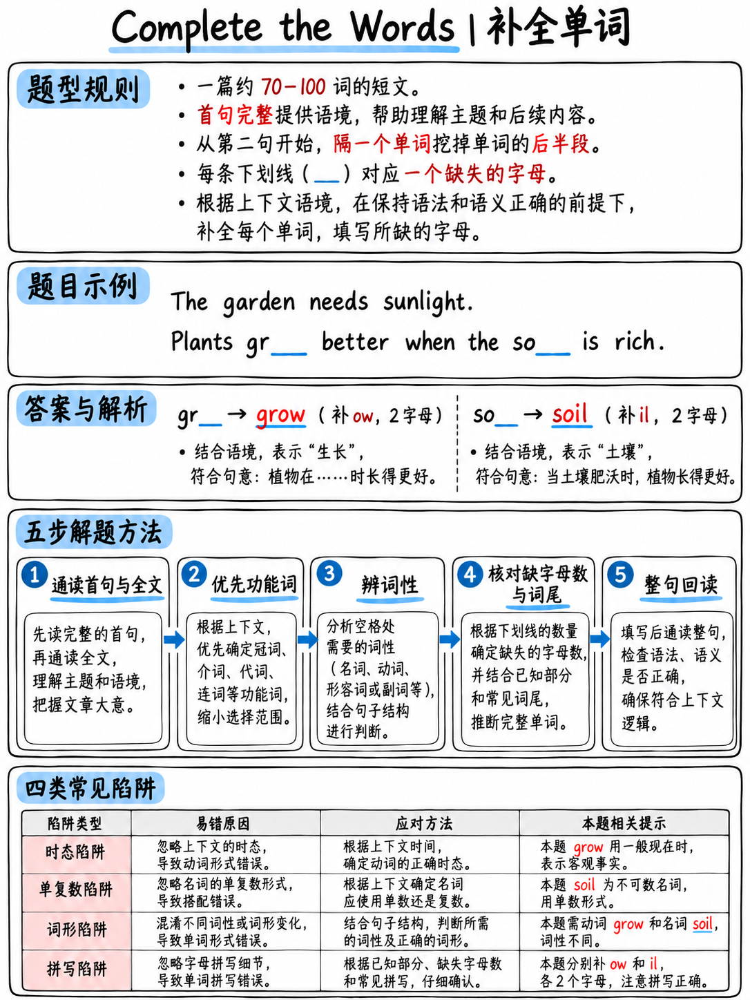

# 4.2 完成50个阅读项目中的单词




**30。 2026年托福考试最大的单项任务。以前不存在
2026 年 1 月 21 日，所以几乎没有准备材料涵盖它。**

## 4.2.1 任务的具体构建方式

>“完成单词任务评估处理书面文本的含义和形式的能力。
> 它向考生提供**段落长度（约 70-100 个字）的学术文章**。正在关注
> **第一句完整**，**每隔一个词的后半部分被删除**，并且
> 考生必须提供缺失的字母。 **每篇文字包含10个单词，有缺失
> 字母。**" [1]

这是一个 **C 测试**，自 20 世纪 80 年代以来应用语言学中使用的一种格式，作为一种快速、可靠的格式
熟练程度衡量标准。知道名字可以让你找到额外的练习。

###删除规则，解码

以官方示例[1][10]计数：

> *我们从洞穴中保存一万多年的图纸中得知，早期人类
> 作为集体活动表演舞蹈。* ← **句子 1，未受影响**
>
> 我们***mi**ight²认为***th**at⁴史前⁵**人**ple⁶集中⁷**仅**ly⁸于⁹**ba**sic**⁰
> 生存11。 **怎么**曾经
> **dan**cing²⁰ 很重要…

|规则|证据|
|---|---|
|第 1 句已完成 |在 ETS 描述和示例中均得到确认 |
|从第 1 句**之后**第一个单词开始计数，并**连续跨越句子边界** | *然而* 是单词 12（偶数）并且有间隙，即使它开始一个新句子 |
| **每个偶数单词**都是有间隙的 | 2、4、6、8、10、12、14、16、18、20 |
|第十个间隙后，文字又完好无损 |该段落的其余部分没有间隙 |
| **您保留单词的前半部分**，向下舍入 | *可能* (5) → 保留 2 · *人* (6) → 保留 3 · *但是* (7) → 保留 3 · *是* (2) → 保留 1 |
| **空格的数量等于缺失字母的数量** | *mi_ _ _* = 正好 3 个字母 |

:::{important} 免费为您提供两件事
**1.您确切知道要输入多少个字母。** `th_ _` 不能是*这个*（4 个字母 = 2 个缺失 →
*th__* 将是 *at* 或 *is* 或 *em*… 事实上 *that*、*this*、*them*、*then* 都符合该模式；
但带有三个空格的 `th_ _ _` 排除了所有四个字母的选项）。数一下你面前的空格
想想意义。

**2。位置是可预测的。** 因为每隔一个单词就有一个间隙，大约一半的间隙落在
**功能词** - *that, only, is, from, the, and, was, with, for* - 取决于语法，
不是在词汇上。
:::

## 4.2.2 为什么这是初学者最好的阅读任务

 再看一下官方答案键[10]：

| ＃|差距|回答 |全字|类型 |
|---|---|---|---|---|
| 1 |米___ |右 |可能|情态动词|
| 2 | th__ |在 |那|连词|
| 3 |人___ |请 |人 |普通名词|
| 4 |在__ | ly |仅|副词 |
| 5 |巴___ |原文如此 |基本 |常用形容词 |
| 6 |怎么____ |曾经|然而|连接器|
| 7 |我_ | s |是 |动词 *be* |
| 8 | fr__ |唷|来自 |介词|
| 9 |记录 |订单|记录|名词，**出现在文本的其他地方** |
| 10 | 10丹____ |青 |跳舞|名词，**出现在文本的其他地方** |

**十个中的七个是语法单词或极其常见的单词。** 两个主题词（*记录*，
*跳舞*）都以未剪辑的形式出现在同一段落的其他地方 - *舞蹈*和*录制*是
两者都有。

这不是词汇测试。这是一个**语法槽和拼写**测试。

## 4.2.3 方法：五个步骤

|步骤|行动|
|---|---|
| **1** | **阅读整个段落一次**，包括间隙和所有内容，以了解主题。暂时不要输入任何内容。 20秒。 |
| **2** | **先做功能词。** 扫描看起来像 *th__、a__、t__、o_、w__、fr__、b_、wi__、ha__* 的间隙 - 这些是最便宜的，它们也解锁了它们周围的句子结构。 |
| **3** | **使用语法槽**来填补剩余的空白：此处必须包含哪个词性？动词是否需要 *-s*、*-ed*、*-ing*？名词是复数吗|
| **4** | **数一下空格**并检查你的答案是否有那么多字母。 |
| **5** | **扫一扫。** 任何仍为空的间隙：输入最合理的字母。切勿将方框留空。 |

### 步骤 2 详细说明 — 功能词反射 

 立即了解这些。下面的每个模式都极其频繁，并且每个模式都值相同的 1 分
作为一个硬内容词。

|所示阀杆 |字母缺失 |可能的单词 |
|---|---|---|
| `t_` | 1 | **至** |
| `o_` | 1 | **的**、**或**、**上** |
| `i_` | 1 | **是**、**在**、**它**、**如果** |
| `a_` | 1 | **作为**、**在**、**一个** |
| `b_` | 1 | **由**，**是** |
| `t__` | 2 | **这个**，**两个** |
| `a__` | 2 | **和**、**是**、**全部**、**任何** |
| `w__` | 2 | **是**，**是谁**，**为什么** |
| `n__` | 2 | **不是** |
| `f__` | 2 | **对于** |
| `b__` | 2 | **但是** |
| `h__` | 2 | **有**，**有** |
| `c__` | 2 | **可以** |
| `th__` | 2 | **那个**，**这个**，**然后**，**他们**，**他们**，**比** |
| `th___` | 3 | **这些**，**那些**，**他们的**，**那里** |
| `wi__` | 2 | **与**、**将** |
| `we__` | 2 | **是**，**好** |
| `ha__` | 2 | **有** |
| `be__` | 2 | **曾经** |
| `fr__` | 2 | **来自** |
| `on__` | 2 | **仅** |
| `mo__` | 2 | **更多**，**大多数** |
| `so__` | 2 | **一些** |
| `su__` | 2 | **这样** |
| `ma__` | 2 | **很多**，**制造** |
| `al__` | 2 | **还有** |
| `wh__` | 2 | **何时** |
| `wh___` | 3 | **哪个**，**哪里**，**同时** |
| `mi___` | 3 | **可能** |
| `co___` | 3 | **可以** |
| `wo___` | 3 | **会** |
| `ot___` | 3 | **其他** |
| `ab___` | 3 | **关于** |
| `af___` | 3 | **之后** |
| `si___` | 3 | **自** |
| `st___` | 3 | **仍然** |
| `un___` | 3 | **下** |
| `bec____` | 4 | **因为** |
| `bet____` | 4 | **之间** |
| `how____` | 4 | **然而**（句子开头的大写 **How____**） |
| `thr____` | 4 | **通过** |
| `wit____` | 4 | **没有** |
| `ano____` | 4 | **另一个** |
| `exa____` | 4 | **示例** |
| `alth____` | 4 | **虽然** |
| `ther_____` | 5 | **因此** |
| `diff_____` | 5 | **不同** |
| `impo_____` | 5 | **重要** |

:::{warning} 始终重新计数
上面的每一行都遵循相同的规则：**保留 ⌊n/2⌋ 字母，删除其余字母。** *因此* 有 9
字母→保留4个（`ther`），缺失5个。 *有*有4个→保留2个(`ha`)，2个缺失。两个字看起来
相似的可以以不同的方式拆分：`th__` 是一个 4 个字母的单词（*that、this、then*），但 `th___` 是一个
5 个字母之一（*这些、那里、他们的*）。

**数屏幕上的空白。**切勿根据记住的模式回答。
:::

### 步骤 3 详细信息 — 语法槽

 针对每个内容词间隙询问三个问题：

1。 **这里的句子需要什么词性？**
   *“建筑物和道路吸收___阳光”* - 需要一个复数一致的动词 → **吸收**。
2. **语法强制什么结尾？**
   - 在 *are / is / was / were* 之后 → **-ing** 或 **-ed**
   - *have / has / had* 之后 → 过去分词
   - 复数主语 → 不带 *-s* 的动词
   - *a / an* 之后 → 单数名词
   - 在数字或*许多/几个*之后 → 复数名词
3. **这个词（或其家族）是否出现在段落的其他地方？**
   作家重复。 *跳舞* → *跳舞*; *记录* → *记录*; *授粉* → *花粉*.

## 4.2.4 后缀库存

 大多数内容-单词间隙可以通过识别插槽所需的**后缀**来解决。学会这些20.

|后缀 |使... |示例 |
|---|---|---|
| **-tion / -sion** |名词|信息**、决策**、污染** |
| **-ment** |名词|发展**、政府**、设备** |
| **-ity** |名词|活动**性**、质量**、多数** |
| **-性** |名词|黑暗**，意识** |
| **-ance / -ence** |名词|导入**，差异** |
| **-er / -or / -ist** |人/事|老师**、发明**或**、科学家** |
| **-ing** |动词/名词 |建造**、跳舞**、增加** |
| **-ed** |过去|开发**、录制** |
| **-s / -es** |复数，第三人称 |道路**，盒子**，吸收** |
| **-ly** |副词 |慢**地**，快**地**，通常**地**，主要**地** |
| **-al** |形容词|国家**、物理**、原创** |
| **-ive** |形容词|昂贵**、有效**、主动** |
| **-能够/-能够** |形容词|可用**，可能**，有价值** |
| **-完整** |形容词|有用**，强大** |
| **-少** |形容词|使用**少**，家**少** |
| **-ous** |形容词|危险**，先前**，明显** |
| **-ic** |形容词|基本**、特定**、经济** |
| **-吃** |动词/形容词 |创建**，分离** |
| **-ise / -ize** |动词|组织**，真实** |
| **-真实** |名词|温度**，结构**，未来** |

**工作示例。**间隙：`sev____ degrees warmer`。空格 = 4. 复数前面需要一个量词
名词。 *几个*（7 个​​字母，保留 3 = `sev`，缺少 `eral` = 4）。 ✔

## 4.2.5 八个陷阱

|陷阱|示例|防御|
|---|---|---|
| **正确的单词，错误的拼写** |键入 `recieved` |机器需要精确匹配[2]。学习 {doc}`../60-toolkit/03-spelling-and-typing` §6.3.4 中的 120 个单词列表 |
| **正确的单词，错误的字母数量** |将 `at` 键入 `th_ _ _` |数一下空格 |
| **忘记首都** | `however` 句子开头的单词 | `however`看前面的标点|
| **复数/单数不匹配** | `road` 其中动词是复数 |检查动词 |
| **时态不匹配** | `absorb` *后* |检查辅助 |
| **一个合适但更长的词** | *此外*对于`How____` |计数：*但是* = 4 缺失，*而且* ≠ |
| **在艰难的差距中惊慌并离开它** | — |猜测;无处罚 [2] |
| **在一个间隙上花费 90 秒** | — |最多 20 秒，然后继续扫频并返回 |

## 4.2.6 如何练习 

1。 **完成以下十段。** 给自己计时：每段 3 分钟，包括阅读。
2. **自己制作。** 取任意 70-100 字的英语段落，保持句子 1 完整，然后删除
   此后每隔一个单词的后半部分，直到有十个间隙。回来再说三
   几天后。做练习比做练习更快地教会你这个模式。
3. **阅读大量短篇非小说类作品。** 这种格式奖励对普通学术知识的熟悉
   措辞——*作为结果*、*相比*、*到时候*、*在实践中*。
4. **修正拼写。** 对于许多初学者来说，这就是标记实际所在的位置。

:::{note} 显示约定
ETS 将间隙显示为间隔下划线 — `mi_ _ _`。这个包使用连续的下划线 -
`mi___`——因为更容易计数。下划线的个数就是缺失的个数
两者中都有字母。
:::

## 4.2.7 十个练习段落

涵盖答案。每段给自己 **3 分钟**。

### 第 1 段 — 睡眠和记忆（72 个字）

```text
Scientists have known for a long time that sleep affects how well people remember new information. During sl___, the br___ appears t_ replay rec___ experiences a__ strengthen t__ connections bet____ them. Stud____ who st___ late a__ then sleep normally usually perform better than those who stay awake all night. However, the effect is not the same for every kind of learning. Facts seem to benefit most, while physical skills improve more slowly.
```

### 第2段——咖啡的传播（73字）

```text
Coffee is now one of the most widely traded products in the world. It w__ first gr___ in t__ highlands o_ Ethiopia a__ later car____ north b_ traders. B_ the sixt_____ century, cof___ houses had appeared in several large cities, and they quickly became places where people met to talk and argue. Some governments tried to close them because they feared political discussion. These attempts generally failed, and the drink continued to spread.
```

### 第 3 段 — 为什么城市变暖（72 个字）

```text
Anyone who has walked through a city on a summer evening has felt the heat rising from the pavement. Buildings a__ roads abs___ sunlight dur___ the d__ and rel____ it slo___ after da__. As a result, la___ cities c__ be sev____ degrees warmer than the countryside around them. Planting trees and painting roofs in lighter colours can reduce the difference. Many councils have begun to treat this as a serious health issue.
```

### 第4段——纸的发明（71字）

```text
Paper was invented in China around two thousand years ago and changed the way information was stored. Before pa___, writing w__ done o_ silk, bam___ or cl__, all o_ which we__ heavy o_ expensive. T__ new mate____ was light, cheap and easy to produce in large quantities. Knowledge of the method travelled slowly westwards along trade routes and reached Europe much later. By then, printing had made paper even more valuable.
```

### 第 5 段 — 蜜蜂和农业（71 个字）

```text
Most people think of bees as producers of honey, but their more important role is pollination. Many o_ the cr___ that w_ eat dep___ on ins____ to mo__ pollen bet____ flowers. Wh__ bee popul______ fall, far____ may have to pollinate plants by hand, which is slow and expensive. Scientists are still arguing about the main causes of the decline. Pesticides, disease and the loss of wild flowers are all possible explanations.
```

### 第 6 段 — 洋流（66 个字）

```text
The oceans are never still, and their movement has a powerful effect on climate. Warm wa___ travels aw__ from t__ equator a__ carries he__ towards t__ poles. Wit____ this pro____, northern Eur___ would b_ far colder than it is today. Researchers monitor these currents using floating instruments that record temperature and salt levels. Their measurements suggest that some currents have slowed over the past few decades.
```

### 第 7 段 — 早期摄影（65 个字）

```text
The first photographs required the subject to sit still for several minutes. Because o_ this, ea___ portraits sh__ serious fa___ and st___ poses rat___ than nat____ expressions. Photog_______ used me___ plates coa___ with chemicals that reacted slowly to light. As materials improved, exposure times fell from minutes to fractions of a second. Only then did photography begin to record ordinary life as it actually happened.
```

### 第 8 段 — 地图的历史（72 个字）

```text
Maps have always revealed as much about their makers as about the land they describe. Medieval Euro____ maps of___ placed reli_____ sites a_ the cen___ rather th__ at th___ true posi____. Later mapm_____ used car____ measurement and mathematics to produce more accurate representations. Even so, every flat map distorts the surface of a round planet in some way. Choosing which distortion to accept remains a practical decision rather than a scientific one.
```

### 第 9 段 — 噪音和浓度（64 个字）

```text
Open-plan offices were designed to encourage communication between colleagues. In prac____, many wor____ report th__ constant backg_____ noise ma___ concentration diff_____. Studies comp_____ quiet a__ noisy condi_____ have fo___ measurable differences in accuracy on demanding tasks. Some companies have responded by creating small rooms for work that requires silence. Others simply allow staff to work from home on days when they need to focus.
```

### 第10段——狼回来了（66字）

```text
Wolves disappeared from much of western Europe during the nineteenth century. Farmers hun___ them bec____ they atta____ sheep, a__ governments off____ rewards f__ every ani___ killed. I_ recent dec____, legal prote_____ has allowed small populations to recover and spread. Their return has been welcomed by conservationists and resisted by many farming communities. Managing the conflict between these groups has proved harder than protecting the animals themselves.
```

## 4.2.8 答案

**第 1 段：** 1 **eep** · 2 **ain** · 3 **o** · 4 **ent** · 5 **nd** · 6 **he** · 7 **ween** · 8 **ents** · 9 **udy** · 10 **nd**

**第 2 款：** 1 **as** · 2 **拥有** · 3 **he** · 4 **f** · 5 **nd** · 6 **ried** · 7 **y** · 8 **y** · 9 **第** · 10 **费用**

**第 3 款：** 1 **nd** · 2 **orb** · 3 **ing** · 4 **ay** · 5 **轻松** · 6 **wly** · 7 **rk** · 8 **rge** · 9 **an** · 10 **eral**

**第 4 段：** 1 **per** · 2 **as** · 3 **n** · 4 **boo** · 5 **ay** · 6 **f** · 7 **re** · 8 **r** · 9 **he** · 10 **rial**

**第 5 段：** 1 **f** · 2 **ops** · 3 **e** · 4 **end** · 5 **ects** · 6 **ve** · 7 **ween** · 8 **en** · 9 **ations** · 10 **mers**

**第 6 段：** 1 **ter** · 2 **ay** · 3 **he** · 4 **nd** · 5 **at** · 6 **he** · 7 **hout** · 8 **cess** · 9 **open** · 10 **e**

**第 7 段：** 1 **f** · 2 **rly** · 3 **ow** · 4 **ces** · 5 **iff** · 6 **她** · 7 **ural** · 8 **raphers** · 9 **tal** · 10 **ted**

**第 8 段：** 1 **pean** · 2 **ten** · 3 **gious** · 4 **t** · 5 **tre** · 6 **an** · 7 **eir** · 8 **tion** · 9 **akers** · 10 **eful**

**第 9 段：** 1 **tice** · 2 **kers** · 3 **at** · 4 **round** · 5 **kes** · 6 **icult** · 7 **aring** · 8 **nd** · 9 **tions** · 10 **und**

**第 10 段：** 1 **ted** · 2 **ause** · 3 **cked** · 4 **nd** · 5 **ered** · 6 **or** · 7 **mal** · 8 **n** · 9 **ades** · 10 **action**

## 4.2.9 诊断错误

 在每个段落之后，将错误答案分类到这五列中。最大的栏目是什么
接下来你修复。

|原因 |看起来像什么 |前往 |
|---|---|---|
| **拼写** |您认识这个词，但打错了 | {doc}`../60-toolkit/03-spelling-and-typing` |
| **字母计数** |你的话是对的，但长度错误 | §4.2.1 — 首先计算空格 |
| **语法槽** |你把名词放在动词所属的地方，或者结尾错误 | {doc}`../60-toolkit/02-grammar-minimum` |
| **虚词** |你错过了*那/仅/来自/然而* | §4.2.3 — 功能字表 |
| **词汇** |你真的不认识这个词 | {doc}`../60-toolkit/01-core-vocabulary` — 但这应该是你最小的栏目 |

:::{important} 如果“词汇”不是你最大的栏目，就不要学习词汇
这是通常的结果，它让人们感到惊讶。最完整的单词损失是拼写，
计数和语法——所有这些都可以在几天内解决。
:::

## 4.2.10 现实目标

|舞台|差距纠正满分 10 |
|---|---|
|第一次尝试，无需培训 | 2-4 | 2-4
|学习虚词表后 | 4-6 | 4-6
|经过两周的日常段落+拼写| 6–8 |
|强大的B2阅读器| 8–9 |

在真实测试的 **30 个完成单词项目**中，从 3/10 移动到 7/10 是 **12 个额外的原始内容
点**。鉴于阅读原始分数为 0-30 [1]，这是一个非常大的变动。

（目标是**分析**，基于任务的结构；ETS 不发布此类数据。）

---

**下一个：** {doc}`03-read-in-daily-life` — 通知、电子邮件、时间表和社交媒体帖子。