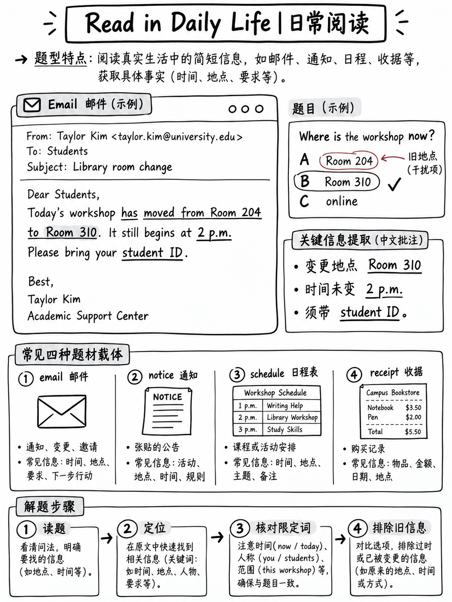

# 4.3 阅读日常生活




**5–15 项。日常生活中的短文，每篇有 2-3 个选择题。 CEFR A1–C1——
**

## 4.3.1 任务是什么

>“您将阅读日常生活中的短文本，例如通知、消息或简短的文本。
> 信息文本。问题衡量您对主要思想、关键细节和
> 隐含的意义。” [4]

刺激格式 ETS 列表 [1]:

| | |
|---|---|
|通知|社交媒体帖子或网页|
|表格|时间表|
|发票|一封电子邮件 |
|一串短信|收据|

| | |
|---|---|
|文字长度| **15 至 150 个字** [1] |
|每个文本的问题 | **2 或 3**，取决于长度 [1] |
|格式| 4 个选项，A-D |
|欧洲共同语言参考标准 | A1–C1 [2] |

 测试的技能，用 ETS 的话来说 [1]:

-“理解常见的信息，**非线性**文本格式”
- “确定书面沟通的**主要目的**”
- “理解**非正式语言**，包括常见的惯用表达方式”
- “根据文本做出**推论**”
- “理解**电报语言**”
-“**浏览和扫描**获取信息”

:::{note}“非线性”和“电报”
*非线性*意味着文本不是连续的句子——它是一张表格、一张表格、一张收据、一份
时间表，线程。 *电报* 是指压缩笔记式语言：“周一至周五 9 点至 5 点，关闭
公共假期。”

许多学习者在这些方面比在散文方面弱得多，因为教科书都是散文。练习
阅读真实的英文时间表、收据和应用程序通知。
:::

## 4.3.2 官方示例

**示例 1 — 通知** [1]:

```text
    Municipal Charter
    Sign up for paperless billing statements today.

    Safe, convenient, easy. Enroll in paperless billing to receive monthly savings
    account statements in an electronic PDF document. Access your Municipal Charter
    account through the mobile app and select account preferences in the upper
    right-hand corner to enroll.

11. What type of business issued the notice?
    (A) An Internet provider   (B) A computer company
    (C) A paper company        (D) A bank                              → key: D

12. How can customers enroll in paperless billing?
    (A) By visiting a Municipal Charter office
    (B) By accessing the Municipal Charter website
    (C) By using the Municipal Charter app
    (D) By calling a Municipal Charter customer service representative → key: C
```

**示例 2 — 社交媒体帖子** [10]：关于周六农贸市场的帖子，包含三个
问题——主要目的，原因（“汤普森流行的原因是什么？
家庭的摊位？”），以及一个细节（“为什么顾客提前去面包店摊位？”）。

**示例 3 — 一封电子邮件** [10]：研讨会确认函，其中包含有关日期和内容的问题
Bring.

## 4.3.3 四种题型以及每种题型的应对方法

|类型 |茎看起来像|方法|
|---|---|---|
| **主要目的** | “主要目的是什么……？” “什么类型的生意……？” “为什么这么写？” |首先阅读**全文**文本。答案很少是一句话；这是整体功能|
| **具体细节** | “什么时候……？” “多少…？” “X应该带什么？” | **扫描**获取号码、姓名或日期。根据问题的确切措辞进行检查 |
| **推论** | “可以推断出什么……？” “作者有何建议？” “为什么顾客……？” |答案是**未说明**。找到暗示它的句子，然后检查后面必然有哪个选项 |
| **词汇/习语** | “X在这里是什么意思？” |将每个选项代入句子 |

## 4.3.4 陷阱表 — 如何构建错误选项

 四个选项中的每一个都是为了吸引特定类型的粗心读者而编写的。学习
五个形状，您可以在不完全理解文本的情况下消除。

|陷阱|它是如何运作的 |官方示例|
|---|---|---|
| **文字回声** |该选项重复使用文本中的突出单词，但说了一些文本没有的内容 | *《市政宪章》通知中的“一家纸质公司”* — “无纸化”一词就在那里 [1] |
| **正确的信息，错误的问题** |该选项是正确的，但没有回答所问的问题 |在研讨会电子邮件中，*“9 月 10 日”* 是文本中的真实日期（预订日期），但问题询问的是 **研讨会** 日期 [10] |
| **太强/太笼统** | “总是”、“全部”、“最好”、“从不” | — |
| **半右** |第一部分与文本匹配，第二部分与文本不匹配 | *“通过访问市政宪章网站”* — 访问正确，网站错误（是**应用程序**） [1] |
| **可信的外部知识** |真实的世界，没有在本文中说明| *“为了获得早上提供的免费样品”* 对于面包店 [10] |

:::{important} 最有用的习惯
**在看选项之前用自己的话回答问题。**

阅读词干，回顾文本，决定答案，*然后*阅读 A–D 并找到符合的选项
匹配。这消除了上面的每个陷阱，因为你不再在四个陷阱之间进行选择
有吸引力的句子——你正在匹配一个。
:::

## 4.3.5 五步法

|步骤|行动|时间 |
|---|---|---|
| 1 | **从形状识别文本类型** — 电子邮件标题、通知框、手机屏幕、表格 | 3 秒 |
| 2 | **全文阅读一次。** 15-150字；你买得起 | 20–40 秒 |
| 3 | **阅读问题主干。暂时不要阅读选项。** 用自己的话回答 | 10 秒 |
| 4 | **找到与您的答案相匹配的选项。**如果没有，请重新阅读相关行 | 10 秒 |
| 5 | **如果有两个选项存在，则按陷阱类型消除** | 10 秒 |

 总计：**每篇文章 1.5–2.5 分钟，包含 2–3 个问题。**

## 4.3.6 阅读非散文格式

 这些是让学习者难以理解的格式。练习每个。

### 电子邮件

 标头携带信息：**收件人**、**发件人**、**日期**、**主题**。问题通常针对
标题而不是正文 - *谁*发送的，*何时*，*它是关于什么的*。

### 时间表和时间表

```text
    Library opening hours
    Mon – Thu        08:00 – 22:00
    Fri              08:00 – 18:00
    Sat              10:00 – 16:00
    Sun              CLOSED
    Public holidays  10:00 – 14:00  (reference section only)
```

典型问题：*“一名学生想要在公共周日使用参考资料部分
假期。他们应该做什么？”* — 这需要合并两行。 **行组合问题是
明细表中最常见的陷阱。**

###收据和发票

注意：小计与总计、税金、折扣、数量×单价、付款方式、退货
截止日期。问题通常要求派生数字，而不是打印数字。

### 短信线程

 注意：谁说了什么、时间戳以及**暗示的**最终决定。最后一条消息是
通常是内容位于前面两条消息的协议。

### 表格

注意：哪些字段是**必填**、小字不包括哪些字段以及截止日期。

## 4.3.7 惯用语和非正式语言

ETS 将“常见惯用表达”命名为测试技能 [1]，社交媒体示例使用
整个过程中随意注册。校园里出现的各种表达方式的简短列表
日常短信：

|表达|意味着|
|---|---|
| *售完/很快售完* |都被买了|
| *必须尝试* |强烈推荐 |
| *早点到达* |先于其他人到达 |
| *顺便拜访/停留* |短暂参观 |
| *注册* |注册 |
| *先到先得* |无需预订；谁先到达 |
| *可能会有变化* |可能会改变|
| *售完即止* |直到用完|
| *牢记* |记住|
| *无需额外费用* |免费|
| *高达 50% 折扣* | **最大** 50%，并非所有项目 |
| *适用条款和条件* |有限制|
| *周五之前回复* |周五回复 |
| *欢迎步入* |无需预约|
| *禁止外带食物或饮料* |你不能自带|

:::{warning}“最多”
*“高达 50% 折扣”*是一个经典陷阱。它并不意味着所有东西都是半价。一个选项
“所有商品半价”的说法是错误的。
:::

## 4.3.8 工作组

阅读、回答，然后对照下面的推理进行检查。

```text
    NORTHGATE SPORTS CENTRE — Membership options

    Standard      £22 / month    Gym and pool. Classes charged separately (£5 each).
    Plus          £34 / month    Gym, pool and all classes included.
    Student       £18 / month    Gym and pool. Classes £3 each. Valid student ID required
                                 at sign-up and at renewal.
    Day pass      £7             Gym and pool only. Not available Sat/Sun before 12:00.

    All monthly memberships require one month's notice to cancel.
    Lockers are free; padlocks are not provided.
```

**Q1。每周上两节课的学生哪种选择支付的费用最少？**
(A) 标准 (B) Plus (C) 学生 (D) 日间通行证

**Q2。该通知建议访客应携带什么？**
(A) 毛巾 (B) 挂锁 (C) 现金 (D) 预订确认书

**Q3。关于一日通票的说法正确的是？**
(A) 包括课程。
(B) 周末不能使用。
(C) 周六上午不能使用。
(D) 必须提前预订。

:::{admonition} 推理
:class: tip
**问题 1 — (B) 加。** 这是一个“派生数字”问题。每周两节课 ≈ 每月 8 节课。
学生：£18 + (8 × £3) = **£42**。标准：22 英镑 + (8 × 5 英镑) = **62 英镑**。加：**34英镑**，课程
包括在内。日票：8 次参观 × 7 英镑 = 56 英镑，并且根本不上课。
陷阱是（C）：“学生”是最便宜的*会员费*，读者扫描最低的
号码停在那里。该问题询问总成本。

**Q2 — (B) 挂锁。** 从“储物柜免费；**不提供挂锁**”推论。什么都没有
文中提到毛巾、现金或预订。 (A) 和 (C) 是看似合理的外部知识陷阱。

**Q3 — (C) 不能在周六早上使用。** 文本显示“周六/周日之前不可用”
12:00”。 (B) 是**太强**陷阱——它可以在周末使用，但不能在中午之前使用。 (一)
与“仅限健身房和游泳池”相矛盾。 (D)被发明。
:::

## 4.3.9 练习协议

1。收集这些类型的十篇真实英语文本——商店收据、电影院列表、健身房
   时间表、航空公司确认电子邮件、大学布告栏帖子、应用程序通知。
2. 对于每个问题，写出第 4.3.3 节中四种类型的两个问题**，并分别写出四个选项，构建在
   一个词回声陷阱和一个太强的陷阱。
3、先放三天再答。

写陷阱教你看。这比做更多的题效率要高得多。

更多的练习，充分的推理，在{doc}`05-reading-practice-set`。

---

**下一篇：** {doc}`04-read-an-academic-passage` — 200字，五题。