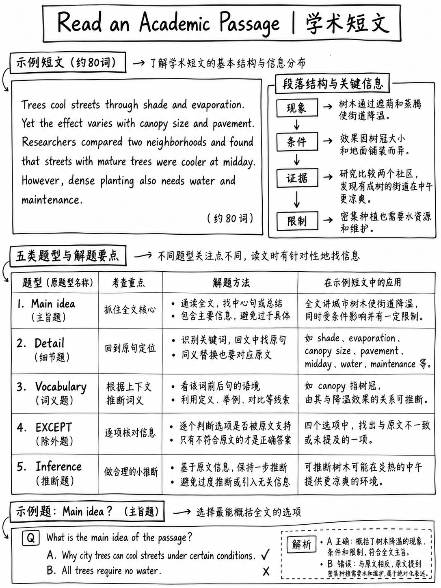

# 4.4 阅读学术文章




**5–15 项。一段约 200 字的说明性文章，包含五个问题。难度最高的阅读
任务（B1–C2）和每分钟最低分。**

## 4.4.1 任务是什么

>“阅读学术文章任务包括 **简短的说明性段落** 典型的
> 中等和高等教育。该任务的设计使得**背景知识不
> 必需**。这些段落涵盖了历史、艺术和音乐等学科领域的主题，
> 商业和经济学、生命科学、物理科学和社会科学。文本是
> **大约 200 字长**，后面是 **五个问题**，可能会问
> **事实信息、上下文中的词汇、推论、想法之间的关系以及
> 全部或部分文本的目的**。” [1]

| | |
|---|---|
|长度 | ~200 字 |
|问题 | 5 |
|欧洲共同语言参考标准 | B1–C2 [2] |
|格式| 4 个选项，A-D |
|文字可见性 | “所有文本在整个任务中保持可见” [2] |

:::{important} 这不是旧的托福阅读
2026 年之前的文章有 650-750 个单词，有 10 个问题，包括插入句子和
散文摘要项目。那些都消失了。 200字的文章相当于**一长段的内容
论据**——你可以而且应该阅读全部内容。
:::

## 4.4.2 官方示例

ETS 发布了一段标题为“镜子测试”[10] 的文章——三段关于自我认知的短文
在动物中，接下来是五个问题：

| ＃|问题 |类型 |
|---|---|---|
| 16 | 16这段话主要讲了什么？ → **(B) 动物认知研究** |主要思想|
| 17 | 17第一句中的“里程碑”一词的含义最接近 → **(A) 成就** |上下文中的词汇|
| 18 | 18为什么科学家要在动物身上画上彩色标记？ → **(B) 它帮助他们确定动物是否认识自己** |细节的目的|
| 19 | 19根据这篇文章，以下关于大象的所有说法都是正确的**除了** → **(D) 它们能理解其他动物的某些信号** |负面细节（除外）|
| 20 | *（第五项）* | — |

**本套中的三个结构课程：**

1。 **一个主要思想问题。**几乎总是存在。答案是该段落的*主题加上它的
   angle*——“动物认知研究”，不是“动物”，也不是“鱼”。
2. **一个上下文中的词汇问题。** 这个词总是可以找到并且总是可以从
   它的句子。
3. **否定（EXCEPT / NOT）项目**很常见。文中给出了三个选项； 

## 4.4.3 200字的段落是如何组织的

这个长度的说明性段落具有可预测的形状：

```
   Sentence 1–2   The hook / the familiar case        "Very young children cannot
                                                       recognize themselves in a mirror…"
   Sentence 3     The turn — the real question        "But what about animals?"
   Middle         The established finding + method    "the mirror test, which involved…"
   End            The complication / recent twist     "But in a more recent experiment…
                                                       a type of fish… This suggests that…"
```

**问题来自哪里：**

|部分段落|它生成的问题类型 |
|---|---|
|转句|主要想法/目的|
|方法说明| “为什么科学家们……？” |
|示例列表 |除了/细节|
|最后的“这表明……” |推论|
|任何不寻常的词|上下文词汇|

知道了这一点，你就可以在阅读问题之前预测问题。

## 4.4.4 方法

|步骤|行动|时间 |
|---|---|---|
| 1 | **以正常速度阅读整篇文章一次。**不要略读； 200 个单词大约需要 60 秒 | 60 年代 |
| 2 | **在看任何问题之前，用一句话告诉自己主要想法** 10 秒 |
| 3 |对于每个问题：**先用自己的话回答**，然后查看选项 |每次 25 秒 |
| 4 | **对照文本进行验证。** 该段落保留在屏幕上 [2]；使用它|包括 |
| 5 | **切勿留空** | — |

 文章及其五个问题总计：**3.5–4.5 分钟**。

:::{warning} 不要先阅读问题
该策略是针对 700 字的段落而设计的，您必须在其中查找信息。拥有 200
换句话说，首先阅读问题意味着阅读片段的文章并且无法理解主要思想
和推理项目，这里占大多数。
:::

## 4.4.5 问题类型按问题类型

### 主要思想

- 答案涵盖**整段文章**，而不是一段。
- 错误选项通常是：一个段落中的细节（太窄）、一般主题领域
  （太宽泛），或者顺便提到过的事情。
- 测试：*这个选项可以作为文章的标题吗？*

在官方设置中，（D）“最近对鱼的实验”太窄了——鱼出现在两条中
句子在最后。 (A) “早期儿童发展阶段”仅是第一句。

### 上下文中的词汇

- 覆盖该单词。读一下句子。你会在那里放什么？
- 然后检查选项。
- 正确答案必须符合 **这个** 句子，而不是该词最常见的含义。

*“他们通常在 18 个月左右达到这个 **里程碑**”* → 取得的成就 →
**成就**。 *距离*是该词的字面来源，是一个故意的陷阱。

### 事实细节

- 找到该句子。 **逐字比较**选项。
- 最常见的错误是几乎正确的选项：正确的事实，错误的原因；正确的数字，
  计算错误。

### EXCEPT / NOT

- **找到并勾选文本中的三个。** 剩下的就是答案。
- 不要试图直接找到假货； 

### 推理

- 答案没有陈述，但它必须**必然**遵循所陈述的内容。
- 拒绝需要任何外部知识的选项。
- 拒绝比文本“更确定”的选项（“证明”、“总是”、“全部”）。
- 看看文章中的双关语：*暗示、可能、似乎、以前怀疑*。的
  正确的推论通常同样受到限制。

### 想法/部分目的之间的关系

-“作者为什么提到X？” — 答案是一个**功能**，而不是一个事实：*介绍，到
  举例说明、对比、限定、提供证据*。
- 立即查看**之前和之后的句子 X.

## 4.4.6 已完成的段落

 读一次，然后回答。推理如下。

```text
                              Why Ice Floats

Almost every substance becomes denser as it cools, because its molecules move more
slowly and pack more closely together. Water behaves this way too — but only down to
about four degrees Celsius. Below that temperature, something unusual happens: water
begins to expand again, and when it finally freezes it occupies roughly nine per cent
more space than it did as a liquid. This is why ice floats rather than sinking.

The explanation lies in the shape of the water molecule. As water cools towards
freezing, its molecules arrange themselves into a rigid, open lattice held together by
weak bonds between hydrogen and oxygen atoms. The lattice is strong but inefficient:
it contains a great deal of empty space.

The consequences are considerable. Because ice forms at the surface of a lake rather
than at the bottom, it acts as an insulating layer, and the water beneath it rarely
freezes solid. Fish and other organisms survive the winter in that liquid layer. Had
water behaved like most other substances, lakes in cold climates would freeze from the
bottom upwards, and it is doubtful whether freshwater life as we know it would have
developed at all.
```

**1.这篇文章主要讲了什么？**
(A) 分子在低温下的行为
(B) 水的不寻常特性及其影响
(C) 为什么湖泊没有完全结冰
(D)ice

**2的化学结构。第 2 段中“刚性”一词的含义最接近**
(A) 坚硬 (B) 沉重 (C) 透明 (D) 临时

**3。根据该段落，水的密度最大的是**
（一）零摄氏度
(B) 约四摄氏度
(C)结冰的那一刻
(D) 低于冰点百分之九

**4。为什么作者在最后一段提到鱼？**
(A) 解释鱼如何在寒冷的天气中生存
(B) 说明冰漂浮的后果
(C) 将湖泊与其他水体进行比较
(D) 表明鱼更喜欢冷水

**5。根据这篇文章，以下所有关于冰格的说法都正确，除了：**
(A) 它包含很多空白空间。
(B) 它是由弱键结合在一起的。
(C) 它是在水冷却至冰点时形成的。
(D) 它比液态水密度大。

:::{admonition} 推理
:class: tip
**1 — (B).** 该段落以水的异常行为开始，以水的后果结束。
(A) 太宽泛——该段落具体是关于水的。 (C) 仅是第 3 段，即
狭窄。 (D) 是第 2 段中的一句话。 *测试：哪一个可能是标题？* 只有 (B) 涵盖
所有三个段落。

**2 — (A) 僵硬。** 覆盖这个词：“它的分子将自己排列成 ___，开放的晶格”。
该句子接着说“格子**强大**但效率低下”。 *僵硬*匹配*强而有力
结构化*。 (B) *重*与整个段落相矛盾，整个段落是关于冰**不**密度的。
(D) *临时*与“强”相矛盾。

**3 — (B) 大约四摄氏度。** 文字说水在冷却时变得更稠密“但仅
降至约四摄氏度。低于这个温度……水再次开始膨胀。”如果它
4℃以下膨胀，4℃时密度最大。这是**从既定事实中得出的推论**，即
为什么它比看起来更难。 (A) 是凝固点，而不是最稠密点 —
合理的知识陷阱。 (D) 是一个单词回声陷阱：“百分之九”在文本中，附在
体积，而不是温度。

**4 — (B) 说明冰漂浮的后果。** 这是一个*细节的目的*问题 —
答案是一个函数，而不是一个事实。前面一句解释了绝缘层；鱼
是插图。 (A) 陈述了句子的内容，但没有说明作者为何将其包含在内，
这是对“作者为什么提到”问题的典型错误答案。

**5 — (D) 它比液态水密度更大。** 找到其中所述的三个：(A)“它包含
大量的空白空间” ✔ (B) “通过弱键结合在一起” ✔ (C) “当水冷却到
冻结时，它的分子会自行排列……” ✔ (D) 与通道中心点相反。
:::

## 4.4.7 何时放弃

 该任务的每分钟得分比例是本节最差的，CEFR 上限最高。

:::{important} 分流规则
如果您已完成模块时钟的一半以上并且**未**完成完成
单词段落，回到它们并留下一个未回答的学术段落推理问题 -
猜测后。

推理：完成单词间隙和推理题都值得**1分** [2]。的
间隙需要15秒；推理题考了60分，你仍然可能会做错。
:::

## 4.4.8 基础技能构建

 段落较短，因此技能要求**精确**，而不是速度。

**每句话练习（每天10分钟）：**
1. 取任意 200 字的说明性文本——维基百科的“简单英语”文章、科学新闻简报、
   教科书的一段话。
2. 以正常速度读一遍。
3. 关闭它。按顺序写一个短句子总结原文的**每句话**。
4.比较。当你无法重建一个句子时，重新阅读该句子并问为什么。

 两周的动作细节和推理准确性比任何数量的问题练习都重要，
因为它攻击的是实际上失败的东西：在回答时牢记段落的论点。

**主题熟悉度是便宜的保险。**你不需要学科知识，但二十分钟
阅读 ETS 列出的六个领域的概述——历史、艺术和音乐、商业和
经济学、生命科学、物理科学、社会科学——使词汇不再那么令人惊讶。

---

**下一步：** {doc}`05-reading-practice-set`——一个带有工作答案的全时模块。