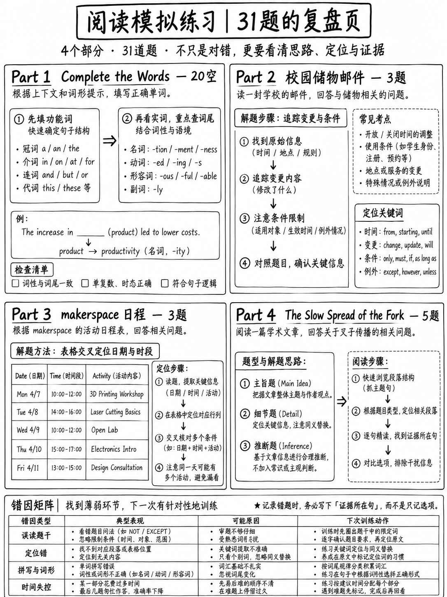

# 4.5 阅读练习集——全定时模块




这是**一个阅读模块**的模拟，按照官方比例构建：两个完成
单词段落（20 个间隙）、两篇日常生活阅读文本（6 个问题）和一篇学术阅读文本
文章（5 个问题）— **31 项**。

 所有材料都是**根据已发布的规范 [1][2] 编写的。它不是
转载测试内容。

:::{admonition} 如何运行它
:class: important
- 设置**20 分钟**的计时器。
- 在计时器停止之前不要看任何答案。
- **填写每个方框。** 永远不要留空。
- 当计时器停止时，停止 - 然后标记，然后阅读第 4.5.6 节中的推理。
:::

---

## 4.5.1 第 1 部分 — 完成单词（20 项）

### 段落 A

```text
The first public street lights in Europe burned oil and were lit by hand every evening. Town coun____ employed lampli______ who wal___ fixed rou___ carrying lad____ and lo__ poles. G__ lighting repl____ oil i_ the ea___ nineteenth century and made the work faster, although the lamplighters remained. Electric lamps finally removed the need for them altogether. Within a single lifetime, an entire occupation had disappeared from city streets.
```

### 段落 B

```text
Psychologists have long noticed that people remember information better in the room where they first learned it. In o__ well-known st___, divers lea____ lists o_ words eit___ on la__ or under_____. Those w__ were tes___ in t__ same environment recalled noticeably more words than those tested elsewhere. The effect is small but consistent, and it appears in many later experiments. Teachers sometimes use it to argue for varying where students study.
```

---

## 4.5.2 第 2 部分 — 日常生活阅读，课文 1（3 项）

```text
    From:    housing@westbrook.ac.uk
    To:      r.okafor@student.westbrook.ac.uk
    Date:    14 March
    Subject: Summer storage — booking now open

    Dear Residents,

    Storage space for the summer vacation can now be booked through the student
    portal. Each room is 1.5 cubic metres and costs £40 for the whole period.
    Spaces are limited and are allocated on a first-come, first-served basis.

    Please note that we cannot store electrical items, liquids, or anything
    perishable. Bicycles are stored separately in the bike shed at no extra charge,
    but must be registered using the same form.

    All items must be removed by 5 September. Anything left after that date will be
    donated.

    Westbrook Accommodation Office
```

**21.** 该电子邮件的主要目的是什么？
(A) 提醒学生离开房间
(B) 告知学生他们可以预订存储空间
(C) 解释存储价格的变化
(D) 警告学生财产受损

**22.** 如果学生想要存放自行车，应该怎么做？
(A) 额外支付 40 英镑
(B) 直接联系自行车棚
(C) 填写相同的在线表格
(D) 9月5日之前删除

**23.** 对于迟申请的学生可以推断出什么？
(A) 他们将付出更高的代价。
(B) 他们可能没有空间。
(C) 他们必须储存更少的物品。
(D) 九月份会联系他们。

---

## 4.5.3 第 3 部分 — 日常生活阅读，课文 2（3 条）

```text
    ┌──────────────────────────────────────────────────────┐
    │  RIVERSIDE MAKERSPACE — Weekly Schedule              │
    ├──────────────────────────────────────────────────────┤
    │  Mon    14:00–20:00   Open workshop                  │
    │  Tue    14:00–20:00   Open workshop                  │
    │  Wed    10:00–13:00   Beginners' session (booking    │
    │                       required, max 8 people)        │
    │         14:00–20:00   Open workshop                  │
    │  Thu    CLOSED — maintenance                         │
    │  Fri    14:00–22:00   Open workshop                  │
    │  Sat    09:00–17:00   Open workshop                  │
    │  Sun    CLOSED                                       │
    ├──────────────────────────────────────────────────────┤
    │  Open workshop: members only. Day membership £6.     │
    │  Beginners' session: £15, includes materials and     │
    │  one month's membership.                             │
    │  Safety induction required before first use of power │
    │  tools — ask any staff member, takes 20 minutes.     │
    └──────────────────────────────────────────────────────┘
```

**24.** 想要使用电动工具并成为会员一个月的完全初学者应该
(A) 在任何开放研讨会日支付 6 英镑。
(B) 预订周三上午的会议。
(C) 周四参加维护。
(D) 周日完成安全入门。

**25.** 创客空间本周最晚开放的时间是几点？
(A) 17:00 (B) 20:00 (C) 22:00 (D) 13:00

**26.** 初学者课程有什么建议？
(A) 对会员免费。
(B) 名额有限。
(C) 每周举行两次。
(D) 不包括电动工具。

---

## 4.5.4 第 4 部分 — 阅读学术文章（5 项）

```text
                        The Slow Spread of the Fork

For most of recorded history, Europeans ate with knives, spoons and their hands.
The fork arrived from the eastern Mediterranean in the eleventh century, and for
the next six hundred years it was regarded with a mixture of suspicion and
amusement. Chroniclers mocked the Byzantine princess who brought one to Venice;
clergy objected that human fingers, being a gift from God, were perfectly adequate
for food.

Historians have proposed several explanations for the delay. One is simply cost:
early forks were made of silver and were luxury objects rather than tools. A more
persuasive account connects the fork to changes in table manners. As dining became
less communal and more individual — with each diner given a plate, a glass and a
seat — touching shared food with the hands came to seem unpleasant rather than
normal.

The fork, in other words, did not succeed because it was efficient. It succeeded
because the social meaning of eating changed around it. That pattern is a familiar
one: the bicycle, the telephone and the personal computer all waited for a change
in habits before they became ordinary.
```

**27.** 这篇文章主要讲了什么？
（一）东地中海叉子的发明
(B) 为什么一个有用的物体需要很长时间才能被接受
(C) 宗教对新技术的反对
(D) 欧洲烹饪方法的变化

**28.** 第 1 段中的“足够”一词的含义最接近
(A) 干净 (B) 充足 (C) 传统 (D) 方便

**29.** 作者为什么提到自行车、电话和个人电脑？
(A) 表明叉子的发明晚于这些物品
(B) 认为技术通常传播得很快
(C) 表明分叉的历史遵循一般模式
(D) 比较不同发明的成本

**30.** 根据本文，作者认为哪种解释更有说服力？
(A) 宗教反对
(B) 早期分叉价格高
（三）饮食习惯的变化
(D) 拜占庭公主的影响

**31.** 文章中提到了以下所有内容，除了：
(A) 叉子曾经是用银制成的。
(B) 神职人员反对使用叉子。
(C) 单独的板块变得普遍。
(D) 叉子首先在威尼斯制造。

---

## 4.5.5 答案

|第 1 部分 — A 段 | |第 1 部分 — B 段 | |
|---|---|---|---|
| 1 | **cils**（理事会）| 11 | 11 **新**（一）|
| 2 | **战士**（点灯者）| 12 | 12 **乌迪**（研究）|
| 3 | **ked**（步行）| 13 | **rned**（已学习）|
| 4 | **tes**（路线）| 14 | 14 **f**（的）|
| 5 | **ders**（梯子）| 15 | 15 **她**（任一） |
| 6 | **ng**（长）| 16 | 16 **nd**（陆地）|
| 7 | **作为**（气体）| 17 | 17 **水**（水下）|
| 8 | **ace**（已替换）| 18 | 18 **何**（谁）|
| 9 | **n**（中）| 19 | 19 **ted**（已测试）|
| 10 | 10 **rly**（早）| 20 | **他**（该）|

|问 |关键| |问 |关键|
|---|---|---|---|---|
| 21 | 21 **B** | | 27 | 27 **B** |
| 22 | 22 **C** | | 28 | 28 **B** |
| 23 | 23 **B** | | 29 | 29 **C** |
| 24 | **B** | | 30| **C** |
| 25 | 25 **C** | | 31 | **D** |
| 26 | 26 **B** | | | |

## 4.5.6 完整推理

### 完成单词、段落 A

|差距|推理|
|---|---|
| `coun____` |四个空格，所以是四个字母的结尾。 “城镇 ___ 雇用的点灯人”需要一个能够雇用人员的复数名词 → **委员会**。 *县* 同样适合字母模式 (*coun* + *ties*)，这就是上下文决定的原因：是 *镇* 议会雇用街道工作人员 |
| `lampli______` |后面的段落完整地使用了*lamplighters*。 **始终在文本中的其他位置查找该单词** |
| `wal___` | *who* 之后的过去式，与 *employee* 平行 → **walked** |
| `rou___` | *fixed* 之后是复数名词；点灯人行走**路线** |
| `lad____` | “携带___和长杆”→ **梯子** |
| `lo__` | *poles* 之前的单音节形容词； `lo` 之后有 2 个空白 → **长** |
| `G__` |大写，句子开头，*照明*之前，更换石油 → **天然气** |
| `repl____` |过去时 → **替换** |
| `i_` |介词在*十九世纪早期*之前 → **在** |
| `ea___` | *十九世纪*之前 → **早期** |

### 完成单词，B 段

|差距|推理|
|---|---|
| `o__` | “在 ___ 众所周知的研究中” — 单数名词前的冠词位置 → **one** |
| `st___` | *众所周知*之后是名词；该段落是关于研究 → **研究** |
| `lea____` |过去时，“divers ___ 单词列表”→ **已学习** |
| `o_` | “列出 ___ 个单词” → ** of ** |
| `eit___` | “___ 在陆地或水下” — 句子后面的*或* 强制**要么** |
| `la__` | “在 ___ 或水下”→ **陆地** |
| `under_____` |与*陆地上* → **水下** | 对比
| `w__` | “那些 ___ 经过测试” — 人的关系代词 → **谁** |
| `tes___` | *之后* → **测试** | 后被动
| `t__` |之前 *相同环境* → **** |

:::{note} 需要注意的模式
在 20 个空格中，**九 个是功能词或限定词**（*in、of、either、who、the、one、long、
Gas*) 和 **four 是出现在同一文本其他地方的单词**（*点灯者、水下、
测试、学习*）。仅需要*议会、梯子、路线、替换、提早、学习、着陆、步行*
真正的内容猜测——所有八个都是常用词。
:::

### 文本 1 — 存储电子邮件

**21 — (B).** 主题行和第一句都宣布预订已开放。 (A) 是
仅作为截止日期提及； (C) 发明“改变”； (D) 发明损害。 *主要目的问题
由文本的开头动作回答。*

**22 — (C).** “自行车单独存放在自行车棚中**不收取额外费用，但必须
使用相同的表格进行注册**。” (A) 与“不收取额外费用”相矛盾——这是一个**半正确**的陷阱，因为
£40 是文中的真实数字。 (B) 是一个似是而非的知识陷阱。

**23 — (B).** “空间**有限**，并按照**先到先得**的原则进行分配。”
没有提及价格 (A) 或数量 (C)。 (D) 是一个单词回声陷阱：*September* 位于
文本，附加到删除，而不是联系。

### 文本 2 — 创客空间时间表

**24 — (B).** 这是一个 **行组合** 问题。初学者课程费用为 15 英镑，“包括
材料**和一个月的会员资格**”，这正是问题所要求的，而且
涵盖初学者。 (A) 提供访问权限，但仅提供一日会员资格，且不提供入门服务。 (C) 已关闭。 (四)
已关闭，入职培训由开放日的工作人员进行。

**25 — (C) 22:00。** 周五运行至 22:00。 (B) 是表中出现次数最多的数字 —
**单词回声**陷阱。 (A) 是周六收市。 *扫描表格上的问题需要您
比较每一行，不要停在第一个可能的数字。*

**26 — (B).**“需要预订，**最多 8 人**”。 (A) 与“£15”相矛盾； (C) 与
周三单个时段； (D) 是发明的——该表没有说明会议涵盖的内容。

### 学术文章 — *分叉的缓慢传播*

**27 — (B).** 文章的结构是：分叉花了 600 年才被接受 → 这里是
解释 → 一般课程。 (A) 是第 2 句的一个从句（太窄）。 (C) 是一个例子
第 1 段内。(D) 根本没有讨论 — 该段落是关于*吃*，而不是*烹饪*。

**28 — (B) 足够。** 覆盖这个词：“人类的手指……非常适合食物”，用作
*反对*需要叉子的争论。只有“足够”才带有“不再需要”的意思。 (一)
*干净*很诱人，因为该段落后来提到“不愉快”，但那是不同的
句子和不同的论点 - **正确的想法，错误的地方**陷阱。

**29 - (C).** “为什么作者提到”问题需要一个 **函数**。前面那句话
是“那个图案很熟悉”，三个物体就是那个图案的插图。
(B) 与该段落的主张相反。 (A) 是一个事实混乱。

**30 — (C).** 文字说：“一个只是成本…… **一个更有说服力的账户** 连接了分叉
餐桌礼仪的改变。” “更有说服力”这句话是作者评价的。 (B) 是
解释被驳回——对于只读第一个解释的人来说是一个陷阱。

**31 - (D).** 找到那里的三个：银✔（“早期的叉子是由银制成的”）；神职人员
✔（“神职人员反对”）；单独的盘子✔（“每个用餐者都有一个盘子、一个玻璃杯和一个座位”）。
威尼斯出现了，但作为公主**带来**叉子的地方，而不是制造叉子的地方——
最纯粹的**文字回声**陷阱。

## 4.5.7 分数解释

|分数/31 |它意味着什么 |下一步|
|---|---|---|
| 26–31 |强的。阅读不是你的瓶颈|将时间转移到口语和写作上 |
| 20-25 | 20-25坚硬的。大多数损失将是拼写和陷阱| {doc}`../60-toolkit/03-spelling-and-typing` 和 {doc}`03-read-in-daily-life` 中的陷阱表 §4.3.4 |
| 13–19 |常见的初学者范围 |每日完成单词段落（{doc}`02-complete-the-words` §4.2.7）|
| 7–12 |功能词和语法槽间隙占主导地位{doc}`02-complete-the-words` §4.2.3 + {doc}`../60-toolkit/02-grammar-minimum` |
| 0–6 |低于该材料假设的水平|先建立一般阅读：三周每天20分钟评分读者 |

## 4.5.8 错误诊断

将每个错误答案排序到一行。最大的争论是你下周的工作。

|原因 |计数 |修复 |
|---|---|---|
|拼写（正确的单词，错误的字母）| | {doc}`../60-toolkit/03-spelling-and-typing` |
|字母计数错误 | |先数一下空格 |
|语法槽（词性或结尾错误）| | {doc}`../60-toolkit/02-grammar-minimum` |
|漏掉了一个虚词 | | §4.2.3 表 |
|选择单词回显选项 | |在阅读选项之前用自己的话回答 |
|选择了一半正确的选项 | |根据文本检查选项的每个单词 |
|选择一个合理的知识选项 | |问：这是*规定的*吗？ |
|没时间了 | | §4.1.3 模块规划 |
| **留空** | | **必须为零** |

:::{danger} 必须为零的三行
**留空·离开模块前没有扫过·在一件物品上花费了超过90秒。**
这些费用标记是您已经获得的权利。
:::

---

**下一个：** {doc}`../50-listening/01-scoring-and-section-tactics` — 听力部分。