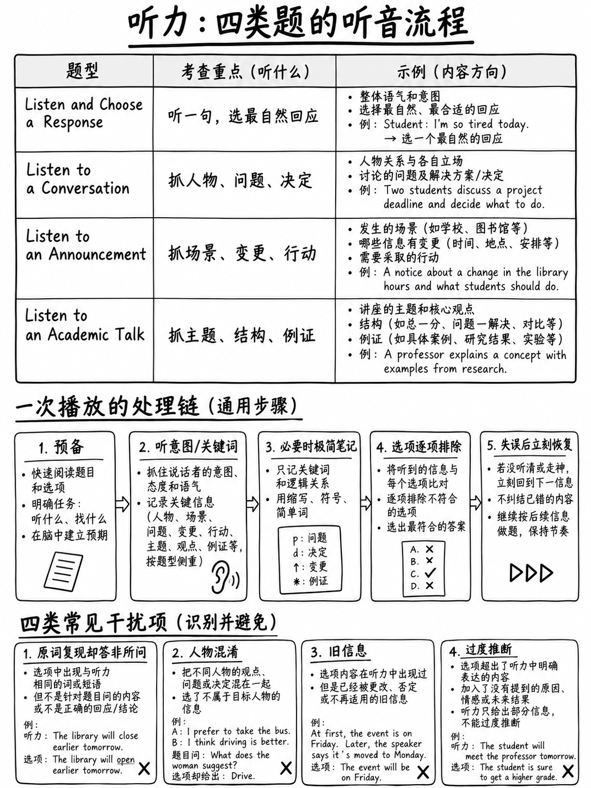

# 5.1 听力部分：计分与战术




## 5.1.1 听力部分概览

| | |
|---|---|
|职位| **第二**，阅读后 |
|长度 | **约18–27分钟** [1][13] |
|项目 | **考生页面上的 35–45**； **47**在蓝图中[1][2] |
|原始分数范围 | **0–30** [1]（蓝图：35 分 [2]）|
|每件商品积分 | **1. “对于听力部分的计分项目，每项最高分为 1 分。”** [2] |
|结构| **两级自适应**：路由器18分钟→下层模块7分钟**或**上层模块11分钟[2] |
|导航 | **“您将无法返回之前的问题。”** [10] |
|音频 |玩过**一次** [2] |
|做笔记| **允许** — “您可以边听边记笔记” [5] |

```
  LISTENING  (2 modules, ~25–29 minutes total)
  ┌──────────────────────────────┬──────────────────────────┐
  │  ROUTER — 18 minutes         │  LOWER  7 min            │
  │  no going back, ever         │   or  UPPER  11 min      │
  └──────────────────────────────┴──────────────────────────┘
```

:::{danger} 改变一切的规则
**听力中没有后退按钮。** 每个问题出现，你回答，它就消失了。 “在一个
实际测试时，时钟会显示您需要多少时间来完成**每个问题**。你可以
使用“下一步”转到下一个问题。您将无法返回之前的问题。” [10]

这使一个习惯变得不可协商：**永远不要提出问题。**回答它 - 猜猜你是否
必须 - 并完全重置下一个音频。听力成绩不好的最常见原因是
失去了第 4、5 和 6 项，但仍在思考第 3 项。
:::

## 5.1.2 四种任务类型及其权重

|任务|商品 [2] |音频长度| CEFR [2] |每个音频的问题 |
|---|---|---|---|---|
| **聆听并选择回应** | **15–19** |一句话，“不超过六个重读音节”| **A1–B2** | 1 |
| **听对话** | **10** | 35–100 字 | A2–C1 | 2 |
| **收听公告** | **6–10** | 40–85 个字 | A2–C1 | 2 |
| **聆听学术讲座** | **8–16** | 100–250 字 | **A2–C2** | 4 |

:::{important} 容易的地方在哪里
**聆听并选择一个答案是本节中最大的任务，也是该部分中 CEFR 等级最低的任务
整个测试（A1–B2）。**每个项目都是一段音频和四个简短的打印选项。

如果您的听力时间有限，请将其花在这里 - 而不是学术演讲。参见
{doc}`../00-foundations/04-priority-triage`。
:::

## 5.1.3 音频：您实际听到的内容

>“使用**人工智能生成的音频，有时还使用真人配音演员**来提供聆听刺激，以
> 模拟各种口音和语音类型的地道英语口语。推广
> 包容性和现实性，评估包含了总体平衡的代表性
> 地区口音和性别声音，例如 **美国/加拿大英语、澳大利亚英语和英国英语
> 品种**。” [2]

（考生页面[5]也有新西兰的名字。）

>“听力刺激中使用的语言包括**惯用语和口语表达**，
> 学术词汇和各种语法结构......并且**以自然的方式提供
> 步伐**。” [2]

>“每个语音输入都伴随着说话者的**视觉表示**，以提供
> 上下文线索。” [2]

|寓意 |该怎么办 |
|---|---|
|多种口音 |与英国**和**美国**和**澳大利亚来源进行练习，没有之一 |
|节奏自然，玩过一次|切勿减慢练习速度（{doc}`../10-pronunciation/06-connected-speech`）|
|明确包含习语 |学习 {doc}`03-conversations` §5.3.6 中的 40 个成语列表 |
|屏幕上的演讲者图像 |使用它们：它们告诉您谁是学生，谁是教职员工 |

## 5.1.4 聆听周期

 对于每个音频项目，运行相同的四阶段循环。这是得分者与得分者的区别
只懂英语的人。

```
   1. PREDICT        read the options (where printed) before the audio starts.
      (before)       What kind of answer is being asked for?

   2. LISTEN         listen for MEANING and STRUCTURE, not words.
      (during)       Who wants what? What changed? What is the speaker doing?

   3. DECIDE         answer immediately. Do not re-weigh.
      (just after)

   4. RESET          forget it completely. The next audio is already starting.
      (immediately)
```

第四阶段是人们跳过的阶段，也是花费最多的阶段。

## 5.1.5 做笔记

 允许做笔记[5]，并且您将有草稿纸或白板[12]。但是：

|任务|你应该做笔记吗？ |
|---|---|
| **聆听并选择回应** | **没有。** 一句话音频；写任何东西都意味着错过它|
| **听对话** | **勉强。** 也许两个字：谁想要什么|
| **收听公告** | **仅限数字和时间** |
| **聆听学术讲座** | **是的** - 但结构，而不是句子。请参阅 {doc}`04-announcements-and-talks` §5.4.5 |

:::{warning} 笔记陷阱
在听力过程中写得很多的学习者总是比写得差不多的学习者得分更差
什么也没有。写作使用与保存句子相同的工作记忆。在测试中**
最长的音频为 250 个单词**，您不需要文字记录 - 您需要理解它。

 只写：数字、名称和每个想法的单字标签。
:::

## 5.1.6 四种干扰模式

 听力中的错误选项每次都以相同的四种方式构建。

|图案|它是如何运作的 |官方示例|
|---|---|---|
| **单词重复** |该选项包含您肯定听说过的一个词 | *“是的，您可以在参考部分找到它”*听到*库* [1] | 后
| **修正** |说话者说了一些话，然后纠正它；该选项给出了原来的 | *“我们不是已经准备好几分钟后去看那场比赛了吗？” — “那就是明天。”* [1] |
| **其他发言者的想法** |这个选项是正确的，但是选错了人|询问“**女人**意味着什么？”的对话项目|
| **正确答案，错误问题** |不回答主干的真实陈述| “教授为什么提到X？”回答*什么* X 是 [10] |

 对所有四个的防御是相同的：**在阅读之前确定答案必须是什么
选项**，格式允许的情况下。

## 5.1.7 恢复练习 - 本节中最重要的习惯

一个漏掉的句子应该花费**一分**，而不是四分。

初学者因为这条链而丢失整个集群：

```
   miss a word  →  try to work it out  →  miss the next sentence  →  panic
        →  miss the question  →  still thinking about it  →  miss the next audio
```

**练习：**练习时，故意将目光移开或捂住耳朵两秒钟
谈话的中间。然后强迫自己从剩下的内容中回答，然后继续前进
干净地。做十次。你正在训练*重置*，而不是听力。

|情况|回应 |
|---|---|
|你漏掉了一个字 |忽略它。继续听|
|你漏掉了一整句话|继续听。问题可能不是关于那句话|
|你不知道答案| **立即猜。** 没有惩罚 [2] 也没有回头路 |
|音频结束，你迷失了 |选择最符合一般情况的选项。然后**重置** |

## 5.1.8 每个部分的目标

 对于初学者来说很现实，如**分析**（ETS 不发布每个任务的数据）：

|任务|第 1 周 |第 4 周 |
|---|---|---|
|聆听并选择回应 | 7/17 | **12/17** |
|听一段对话 | 4/10 | 7/10 |
|收听公告 | 3/8 | 5/8 |
|聆听学术讲座 | 3/12 | 5/12 |

 可用的最大绝对增益位于第一行。这就是训练时间应该去的地方。

## 5.1.9 四项练习活动，排名

|排名|活动 |为什么 |
|---|---|---|
| **1** | **经过转录检查的重播。**听一次，回答，然后*用*转录本再听一次，标记您错过的每个单词|唯一能告诉您您听不到的“内容”的活动 |
| **2** | **听写。** 写下播放过一次的句子 |同时直接训练听选技能和听复技能 |
| **3** | **阴影**（{doc}`../10-pronunciation/05-rhythm-and-chunking` §1.5.6）|训练块级感知 |
| **4** | **观看英文视频，先关闭字幕，然后再打开** |有用，慢|
| ✗ | **被动聆听** — 通勤时听播客 |对于考试准备来说几乎毫无价值。没有检索，没有反馈，没有测量 |

:::{tip} 60/40 规则
将 60% 的聆听时间用于**听写和经过转录检查的重播**，40% 的时间用于
其他一切。大多数学习者都会做相反的事情，并想知道为什么他们的分数没有变化。
:::

## 5.1.10 为期三周的听力课程

|周 |每日（20 分钟）|每周 |
|---|---|---|
| 1 | 10 个听写句子 + 8 个听选项目 |完整阅读第 5.2 节；按原因标记所有错误 |
| 2 | 10 个听写句子 + 2 个对话（带笔录检查）|成语列表，40条；恢复钻×10 |
| 3 | 10个听写句子+1个公告+1个学术演讲 |来自 {doc}`05-listening-practice-set` |

---

 的全定时模块**下一步：** {doc}`02-listen-and-choose-a-response` - 本节中最大且最简单的任务。