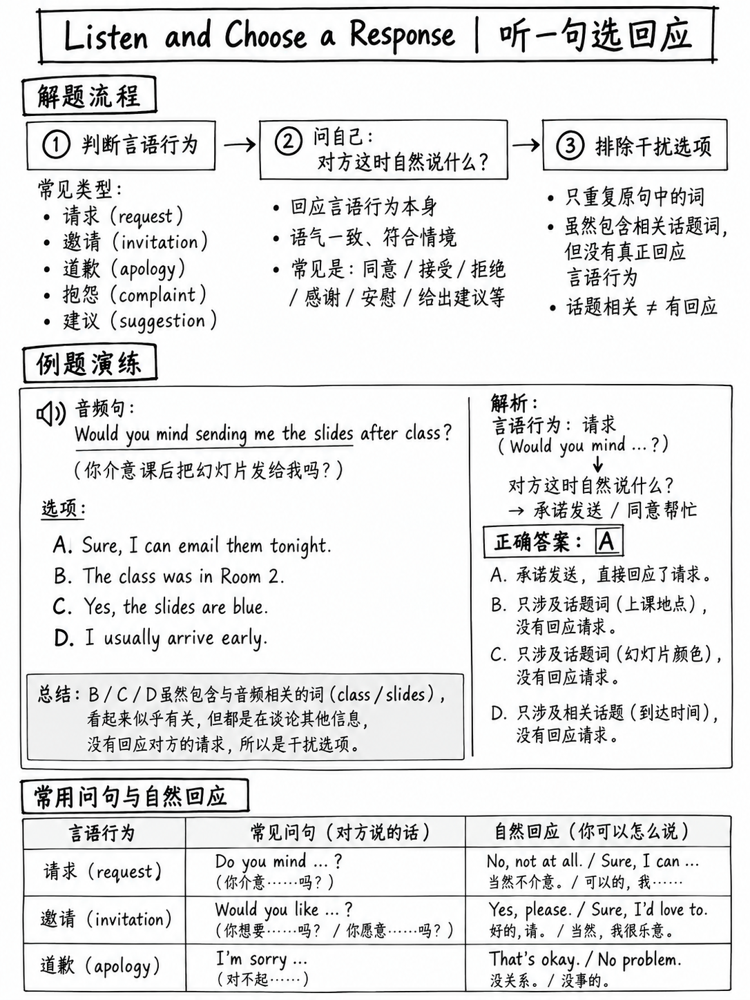

# 5.2 聆听并选择响应




**15–19 项 — 听力部分中最大的任务。 CEFR A1–B2 — 最低难度等级
在整个测试中。每题一个音频句子。**

## 5.2.1 任务是什么

>“考生听到一个问题或陈述，构成**简短交流的第一部分**。
> 问题或陈述**仅被听到，而不是写在屏幕上**。考生
> 然后阅读**四种可能的反应**，并且必须选择最合适的反应
> 发言者的问题或陈述。” [1]

音频长度：“简短的话语 - **不超过六个重读音节**” [2].

测试什么 [1]：

-“理解常用词汇和公式短语”
-“理解简单的语法结构，包括**问题形成模式**”
- “**在简短的口头交流中识别出适合社交的反应**”
-“识别和区分英语**音素**以及常见**语调和重音的使用
  模式**来传达意义”
-“推断**隐含含义、说话者角色或上下文**”

**官方示例** [1]:

```text
Test takers hear:   Didn't I just see you in the library an hour ago?

Choose the best response.
  (A) As a matter of fact, I was returning a book.      ← key
  (B) Yes, you can find it in the reference section.
  (C) I don't think I'll have enough time to do that.
  (D) Actually, I think I can get there a little earlier.
```

## 5.2.2 为什么这是训练 

 的最佳任务|因素 |价值|
|---|---|
|项目 | 15–19 of 47 — **大约占本节的三分之一** |
|每个项目的音频 |短短一句话|
|欧洲共同语言参考标准 | **A1–B2**，测试中最简单的 |
|所需技能 |识别会话*动作*，而不是理解主题 |
|可训练？ | **非常。** 对话动作集小且封闭 |

 听力部分中没有其他任何东西具有这种音量和低难度的组合。

## 5.2.3 方法

 **在音频之前：**选项在屏幕上。 **阅读它们。**它们告诉您什么样的交换
这是——一个关于时间的问题？报价？投诉？这是听力中唯一一个地方
预读确实有帮助，因为音频是一条短线。

|步骤|行动|
|---|---|
| 1 | **在音频加载时阅读四个选项**。注意它们的共同点 |
| 2 | **听动作**，而不是言语：说话者是在询问、提供、抱怨、建议、确认、拒绝吗？ |
| 3 | **听疑问词** - *谁、什么、哪里、何时、为什么、多少、多长时间* - 或没有一个（是/否问题） |
| 4 | **匹配移动。** *哪里*问题需要一个位置。一个要约需要接受或拒绝|
| 5 | **消除回声。** 重复提示中的单词的选项通常是错误的 |

## 5.2.4 走棋表

学习这些配对。他们甚至在词汇变得重要之前就解决了大多数问题。

|如果提示是... |答案通常是…… |响应示例 |
|---|---|---|
| *哪里……？* |一个**地方** | “就在拐角处。” |
| *什么时候…？ / 什么时间…？* |一个**时间** | “直到星期四。” |
| *多少…？ / 有多少……？* | **数量或价格** | “大约二十块钱。” |
| *多久……？* | **持续时间** | “大约三个星期。” |
| *为什么……？* |一个**原因** | “因为实验室已经关闭了。” |
| *谁……？* |一个**人** | “我不确定——我可以找到答案。” |
| *如何……？* | **方法** | “使用聊天功能。” |
| **是/否问题** |是/否 + **额外信息** | “是的，他们正在进行大促销。” |
| **否定问题**（*你不是……吗？难道不是……？*）| a **确认或更正**，通常带有*实际上/事实上* | “事实上，我是在还一本书。” |
| **优惠**（*您想要……吗？*）| **接受或拒绝** | “那就太好了。” |
| **请求**（*你能……吗？*）| **协议或障碍** | “当然，没问题。” /“恐怕我很忙。” |
| **建议**（*我们……/怎么样……？*）| **协议或替代方案** | “那明天晚上怎么样？” |
| **问题陈述** | **同情或解决方案** | “我们上网查一下时间表吧。” |
| **计划声明**（*我要……*）| **加入、反应或提出问题** | “我们应该加入他们吗？” |
| **无法使用的声明**（*恐怕我不能......*）| **替代方案** | “那明天晚上怎么样？” |
| **意见请求**（*我想听听您对……的想法*）| **讨论的安排**，而不是即时的判决 | “我会安排一个会议让我们谈谈。” |

:::{important} 最微妙的图案，也是最值得打分的图案
**否定问题不是询问信息。它正在检查一个假设。**

*“我不是一小时前在图书馆看到你了吗？”* 不是关于图书馆的是/否问题。它
意思是*我想我看到你了；是这样吗？*自然的回答确认、纠正或解释——因此
“**事实上**，我正在归还一本书。”

观看开场白：*实际上……/事实上……/嗯，不——……/是的，我是……*
官方集中的其他负面问题：*“邮局今天不开门吗？”*、*“所以
商店整个周末都营业吗？"* [10]
:::

## 5.2.5 四种干扰形状

 每个错误选项都是其中之一。学会在一秒钟内发现它们。

|形状|它是如何愚弄你的 |示例（来自官方项目）|
|---|---|---|
| **文字回声** |重复提示中的突出单词 |提示*库*→“您可以在**参考部分**找到它”(B) |
| **正确的主题，错误的举措** |相关内容，但不是对此言论行为的回复 | “我认为我没有足够的时间来做这件事”（C）——拒绝，但没有提出任何要求 |
| **正确的行动，错误的方向** |正确的回复类型，但角色互换了 | “我想**我**可以早点到达那里”（D）——回答了一个没人问过的问题 |
| **语法不匹配** |对*wh-*问题的*是*；时间到*地点*问题 | “是的，您可以这样做”，回复*“我如何联系客户服务？”* [10] |

## 5.2.6 练习集 — 24 项

将每个提示朗读**一次**（文字转语音或与伙伴一起朗读），然后选择。请勿阅读
提示行。

| ＃|提示（仅听到）|选项|
|---|---|---|
| 1 | *我在哪里可以领取学生证？* | (A) 大约需要一周时间。 (B) 一楼的办公室。 (C) 是的，您需要一张照片。 (D) 我上学期得到了我的。 |
| 2 | *健身房周日不休息吗？* | (A) 它很受欢迎。 (B) 事实上，他们上个月改变了这一点。 (C) 我每周去三次。 (D) 游泳池在楼上。 |
| 3 | *您希望我向您发送幻灯片吗？* | (A) 这真的很有帮助。 (B) 讲座相当长。 (C) 我在那儿没看到他。 (D) 两点开始。 |
| 4 | *诱导需要多长时间？* | (A) 在主厅。 (B) 大约二十分钟。 (C) 每学期两次。 (D) 您应该先预订。 |
| 5 | *恐怕星期四我不能来。* | (A) 是的，非常棒。 (B) 星期五可以上班吗？ (C) 他也说了同样的话。 (D) 离这里不远。 |
| 6 | *您订到房间了吗？* | (A) 不，他们都被带走了。 (B) 在二楼。 (C) 我会带上我的笔记本电脑。 (D) 大约三十人。 |
| 7 | *这台打印机似乎又缺纸了。* | (A) 我昨天打印了它。 (B) 我会让办公室知道。 (C) 每页花费五美分。 (D) 请黑白。 |
| 8 | *今晚谁发表演讲？* | (A) 我想是七点。 (B) 在科学大楼里。 (C) 来自奥斯陆的研究员。 (D) 应该很有趣。 |
| 9 | *他们为什么要推迟截止日期？* | (A) 到月底。 (B) 因为很多人都生病了。 (C) 我快完成了。 (D) 上周二。 |
| 10 | 10 *我们坐公交车还是步行？* | (A) 大约两公里。 (B) 我们去散步吧——这是一个美好的夜晚。 (C) 公共汽车又晚点了。 (D) 我每天都服用。 |
| 11 | 11 *我整个早上都在努力到达办公室。* | (A) 每周三十点开门。 (B) 这是一个可爱的办公室。 (C) 早上见。 (D) 是的，我达到了。 |
| 12 | 12 * d 多少钱通过了吗？* | (A) 直到六点钟。 (B) 六磅。 (C) 仅限工作日。 (D) 仅限会员。 |
| 13 | *你已经交作业了，不是吗？* | (A) 实际上还没有。 (B) 这相当困难。 (C) 是的，我会把它交给你。 (D) 截止日期是有用的。 |
| 14 | 14 *你知道图书馆有没有副本吗？* | (A) 我去年借的。 (B) 你可以检查目录。 (C) 这是一本非常好的书。 (D) 是的，我有借书卡。 |
| 15 | 15 *那个讲座很难听懂。* | (A) 我知道——前十分钟后我就失去了他。 (B) 在 204 室。 (C) 他每周一讲课。 (D) 我会跟着你。 |
| 16 | 16 *你能帮我拿这些盒子吗？* | (A) 我的手很好，谢谢。 (B) 当然——他们要去哪里？ (C) 大约有十个。 (D) 我昨天把它们打包了。 |
| 17 | 17 *到车站最快的路线是什么？* | (A) 需要十五分钟。 (B) 沿着这条路一直走，在红绿灯处左转。 (C) 火车四点出发。 (D) 我通常骑自行车。 |
| 18 | 18 *我以为考试是在十二号。* | (A) 我也是，但它被移动了。 (B) 我学习了三个星期。 (C) 十二名学生通过。 (D) 这是一个困难的课题。 |
| 19 | 19 *你有机会看看我的草稿吗？* | (A) 我明天起草。 (B) 抱歉，还没有——我今晚就做。 (C) 大约有四页。 (D) 截止日期是星期五。 |
| 20 | *咖啡机又无法工作了。* | (A) 无论如何我更喜欢茶。 (B) 花费两英镑。 (C) 我在这里工作。 (D) 机器是新的。 |
| 21 | 21 *实验室在哪一层？* | (A) 每周三次。 （二）第三个。 (C) 它相当大。 (D) 拉莫斯博士负责管理。 |
| 22 | 22 *你介意我打开窗户吗？* | (A) 完全不是。 (B) 是的，它是开放的。 (C) 外面很冷。 (D) 我早些时候打开过它。 |
| 23 | 23 *我想听听您对该提案的看法。* | (A) 本周我将整理一些评论。 (B) 这是一个很长的提案。 (C) 是的，我听说过。 (D) 他们在周一提出了这个建议。 |
| 24 | *你不是应该四点钟去见莎拉吗？* | (A) 她是一个好朋友。 (B) 哦不——我完全忘记了。 (C) 在主入口处。 (D) 明天我会见到她。 |

### 答案要点及推理

| ＃|关键|为什么，陷阱是什么？
|---|---|---|
| 1 | **B** | *哪里* → 一个地方。 (A) 回答*多长时间*； (C) 对 *wh-* 问题回答 *yes* — 语法不匹配； (D) 正确的主题，错误的举措 |
| 2 | **B** |否定问题=检验假设。 “实际上”表示修正。 (A)(C)(D)是主题回声 |
| 3 | **一个** |报价→接受。其他人忽略言语行为 |
| 4 | **B** | *多长*→持续时间。 (A) 是*哪里*，(C) 是*多久* |
| 5 | **B** |无法使用声明 → 替代方案 |
| 6 | **一个** |是/否+额外信息。 (B)(C)(D) 是与房间相关的回声 |
| 7 | **B** |问题陈述 → 解决方案。 (A)(C)(D) 是打印机回声 |
| 8 | **C** | *谁* → 一个人。 (A) 是*何时*，(B) 是*哪里*，(D) 是注释 |
| 9 | **B** | *为什么* → 一个原因，由*因为*表示。 (A) 是*何时*； (D) 是*当* |
| 10 | 10 **B** |选择题 → 选择一个，并给出理由。其他人对公交车的评论 |
| 11 | 11 **一个** |对未联系到某人的隐含抱怨 → 解释。 (D) 误读*达到* |
| 12 | 12 **B** | *多少钱* → 价格 |
| 13 | **一个** |标记问题检查假设 → 确认或纠正。 “实际上还没有”更正 |
| 14 | 14 **B** |嵌入的是/否问题，演讲者无法回答 → 一种找出答案的方法。 (D) 回答不同的问题 |
| 15 | 15 **一个** |投诉→同意并分享经验。 (D) 是 *follow* | 上的单词回显
| 16 | 16 **B** |请求 → 协议加上澄清问题。 (A) 误读了成语 *帮我一下* |
| 17 | 17 **B** | *最快的方法是什么* → 方向。 (A) 是持续时间； (C) 时间表 |
| 18 | 18 **一个** |错误的信念→纠正。 “我也是，但是……”|
| 19 | 19 **B** |礼貌地询问进展情况 → 道歉加承诺 |
| 20 | **一个** |投诉→反应。 (B)(C)(D) 是机器回声 |
| 21 | 21 **B** | *哪一层* → 序数。 (A) 是“多久一次”； (D) 是*谁* |
| 22 | 22 **一个** | *你介意如果……* → **“一点也不”**意味着**是的，继续**。 (B) 是一个陷阱：对“你介意吗”问题说“是”意味着**不，我反对** |
| 23 | 23 **一个** |征求意见→安排提供意见|
| 24 | **B** |关于忘记约会的否定问题→实现|

:::{warning} 第22条值得自己研究
*“你介意我……吗？”* / *“你介意……吗？”* 颠倒逻辑。 **“不”和“一点也不”意味着是，
继续吧。** “是”表示我反对。学习者犯这个错误的几率远远高于偶然。

其他礼貌的倒装：
- *“你不知道……？”*→“事实上，我知道。” /“抱歉，没有。”
- *“我认为你不能……？”*→“当然。” （这是一个请求，而不是一个声明。）
- *“你为什么不……？”* → **建议**，而不是关于原因的问题。
:::

## 5.2.7 技能培养

|天|钻|
|---|---|
| 1-3 | 1-3了解第 5.2.4 节中的移动表。对于每一行，大声说出提示和回复 |
| 4–7 |通过音频完成第 1-24 项。按干扰器形状标记错误 (§5.2.5) |
| 8–10 |听写：写下曾经播放过的 10 个短问题 ({doc}`05-listening-practice-set` §5.5.2) |
| 11-14 | 11-14以不同的顺序重做第 1-24 项；目标 22/24 |

**免费、无限的练习来源：**任何英文电影或系列。任何一行后暂停
对话并大声说出三种可能的回答，然后再取消暂停。这完全训练了动作-


---

**下一篇：** {doc}`03-conversations` — 两个说话者的交流以及其中的习语。