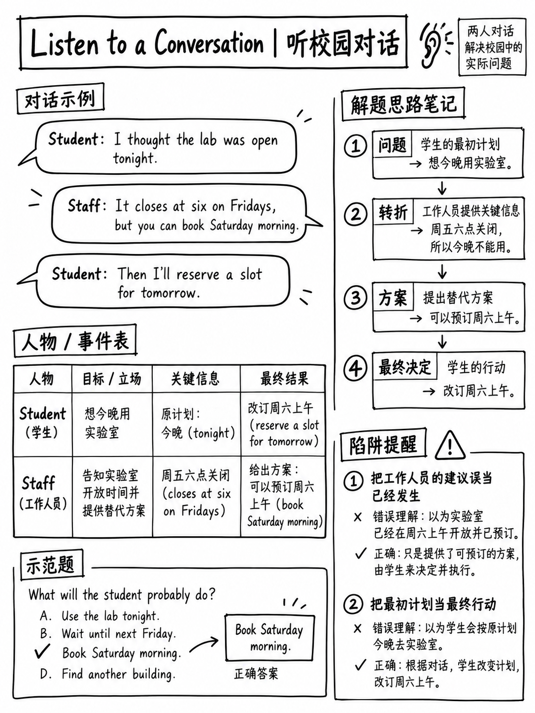

# 5.3 听对话




**10 项 — 五个对话，每个对话两个问题。 35–100 个单词的音频。 CEFR A2–C1.**

## 5.3.1 任务是什么

>“考生听**两个说话者之间的简短对话**并回答**两个
> 关于对话的问题**。对话可能涉及公共领域的主题，例如
> 作为餐饮、社交活动、教育、娱乐、服务、健康、爱好、家庭、
> 购物、通讯和旅行。” [1]

它测试什么[1]：

-主要思想和基本背景·重要细节
-“熟练说话者使用的语法结构范围”
- “广泛的词汇，包括**惯用语和口语表达**”
- “**从未明确说明的信息中推断含义**”
- “认识到说话者说话的**目的**”
- “对演讲者未来的行动做出简单的**预测**”
-“遵循想法之间的联系**跨发言者回合**”

:::{important} 这七个中的四个是推理技能
*推断意义·识别目的·预测未来的行动·遵循各个回合的联系。*
只有两个是字面理解。这就是为什么理解每个单词是不够的——以及为什么
理解对话内容的考生仍然会做错问题。
:::

## 5.3.2 官方示例，剖析

```text
Narrator: Listen to a conversation.
Woman:  Need anything from the supermarket?
Man:    Huh? Aren't we getting ready to go see that play in a few minutes?
Woman:  That's tomorrow.
Man:    Oh. Wow, I'd forget my head if it wasn't screwed on . . .
        Guess I don't need to change my clothes after all.
Woman:  So, you weren't planning to prepare dinner?
Man:    No, but I can. What do you want?
Woman:  Just something light and healthy. So, can you go shopping instead?
Man:    Yeah, sure. How about salmon and salad? Want anything else?
Woman:  No, that's good. Thanks!

Q: What does the woman imply that she was about to do?
  (A) See a play  (B) Change her clothes  (C) Go shopping  (D) Eat dinner
                                           ↑ key [1]

Q: Why does the man say "I'd forget my head if it wasn't screwed on"?
  (A) He forgot what the woman wanted him to buy.
  (B) He forgot about the timing of their plans.      ← key
  (C) He forgot what they were going to eat for dinner.
  (D) He forgot to buy salmon and salad at the supermarket.
```

### 该项目真正测试的是什么

|问题 |技能|
|---|---|
| “那个女人**暗示**她要做什么？” | **推理**。她从不说“我要去购物”。她说*“需要从超市买东西吗？”*（暗示她要去）然后*“你可以去购物**吗**？”*（暗示她要去）|
| “为什么这个人说‘[成语]’？” | **话语的目的** + 习语。这个成语的意思是“我很健忘”。问题是他忘记了什么——前面的几行表明他把**日**搞错了 |

:::{note} “相反”的线索
“你可以去购物吗？”中的*instead*这个词。证明那个女人就是那个人
要去了。一个虚词就解决了整个问题。这是典型的：**推理问题是
通常由一个小的语法信号决定，而不是由一个大的想法决定。
:::

## 5.3.3 六个问题的主干以及如何回答每个问题

|茎|它想要什么 |方法|
|---|---|---|
| “谈话**主要是关于**什么？” |交流的问题或目的 |问：*这两个人为什么开始说话？* |
| “男人/女人**暗示/建议**什么？” |一些真实但未明说的事情 |寻找*相反，实际上，嗯，我想，不是吗* |
| “为什么说话者**说**‘___’？” |一个话语的功能 |阅读**它之前和之后**的行 |
| “男人/女人**接下来可能会做什么**？” |预测|对话中的**最后**协议|
| “这个男人说的‘___’是什么意思？” |成语或口语| §5.3.6 列表 |
| “这个人的**态度/意见**是什么？” |立场|语气词：*最后，至少，老实说，我想，公平* |

## 5.3.4 归因陷阱

H 此任务中的所有错误中有一半是**归因错误** - 将正确的想法分配给错误的想法
扬声器.

|防御|如何|
|---|---|
|使用屏幕上的图像 |提供“讲话者的视觉表示” [2] |
|使用语音性别 |词干表示“男人”/“女人”|
|跟踪每个发言者的一件事 |当你听的时候，按住：*男人想要 ___ · 女人想要 ___* |
| **选择 | 之前**重新阅读主干。 “**那个女人**意味着什么”——检查你正在回答关于她的问题|

## 5.3.5 这些对话的形式

 几乎每个 35-100 字的两人交流都遵循四种形式之一。认识其中的形状
前两轮告诉你问题是什么。

|形状|转图案|可能的问题 |
|---|---|---|
| **误会** | A假设→B纠正→A调整| A做错了什么？ A现在要做什么？ |
| **请求** | A 有问题 → B 提供 → A 接受/修改 | A想要什么？ B会做什么？ |
| **推荐** | A 寻求建议 → B 建议 → A 做出反应 | B 推荐什么？ A的态度是什么？ |
| **安排** | A 提出时间/地点 → B 对象 → 他们定居 |商定了什么？为什么第一个选项被拒绝了？ |

 官方的例子是一个**误会**的形状（男方过错日子）变成了
**请求**（改为购物）。这两个问题都直接来自这两个动作。

## 5.3.6 四十个习语和口语表达

ETS 将习语明确命名为对话中的测试技能 [1]。出现的就是这些种类
在校园和日常交流中。

|表达|意味着|
|---|---|
| *如果不是拧上的话我会忘记我的头* |我很健忘|
| *我忘记了* |我忘了|
| *我被淹没/被雪覆盖* |我的工作太多了 |
| *让我们见机行事* |稍后再决定，没有计划|
| *这是一个远景* |不太可能成功|
| *我持观望态度* |我还没决定|
| *这不是我的菜* |我不喜欢它|
| *算我进来/算我出去* |包括我/排除我 |
| *帮我一下* |帮助我|
| *坚持住* |继续前进，不要放弃|
| *悬而未决* |还没决定|
| *出乎意料* |没想到|
| *小菜一碟* |很容易|
| *花了一大笔钱* |很贵|
| *我精疲力尽/疲惫不堪* |很累|
| *路过/晃过* |短暂参观 |
| *密切关注* |观看、照顾|
| *掌握窍门* |学习如何做|
| *今天就到此为止* |暂时停止工作 |
| *咬紧牙关* |做那些不愉快的必要的事情|
| *同舟共济* |同样的困境|
| *偷工减料* |廉价或粗心地做某事|
| *触摸底座* |进行简短的联系 |
| *迟到* |落后于计划|
| *天气不好* |轻微不适|
| *第二个想法* |对决定的疑虑|
| *注意* |提前警告|
| *无附加条件* |无条件 |
| *我的头顶上没有* |据记忆，大约|
| *临时通知* |没有什么警告|
| *熬夜* |通宵学习或工作|
| *通过测试* |做得很好|
| *考试不及格/失败* |做得很糟糕|
| *落后* |上班迟到|
| *赶上* |达到要求点 |
| *推迟一些事情* |推迟吧|
| *整理一些东西* |解决它 |
| *我没有关注* |我不明白|
| *很公平* |我接受这一点|
| *这对我来说是新闻* |我没听说过 |

:::{tip} 成对学习这些并回复
不要记住定义。将每个都视为两行交换：
> A：*“考试怎么样？”* — B：*“说实话？我搞砸了。”*
> A：*“你能帮我移动这些吗？”* — B：*“当然，请给我一点时间。”*

 这将构建此任务和“聆听并选择响应”奖励的移动识别。
:::

## 5.3.7 三个编写的练习对话

让合作伙伴阅读这些内容，或使用两种声音进行文本到语音转换。听一次**。

### 对话 1

```text
Man:    Did you get the email about the field trip?
Woman:  I did, but I'm not sure I can go. It's the same weekend as my sister's wedding.
Man:    Oh, that's a shame. There's a second date in May, I think.
Woman:  Is there? That wasn't in the email I saw.
Man:    It was at the very bottom, under the equipment list. Easy to miss.
Woman:  I'll look again tonight. If the May one still has space, that solves everything.
```

**1.为什么这位女士不能参加第一次实地考察？**
(A) 她还没有收到电子邮件。 (B) 她有家庭责任。 (C) 她没有
设备。 (D)行程已满。

**2。女人接下来可能会做什么？**
(A) 向组织者发送电子邮件。 （二）购买设备。 (C) 重新阅读电子邮件。 (D) 取消她的计划。

### 对话 2

```text
Woman:  You look like you've been up all night.
Man:    Pretty much. I thought the report was due Friday.
Woman:  It is due Friday.
Man:    Right — but I only realised at midnight that "Friday" meant yesterday's Friday,
        not this week's.
Woman:  Ah. So you've finished it?
Man:    Finished isn't the word I'd use. Submitted, though.
```

**3.这个人犯了什么错误？**
(A) 他完全忘记了这份报告。 (B) 他误解了星期五的意思。 （三）他
提交了错误的文件。 (D) 他认为该报告是可选的。

**4。这个人说的“我不会用“完成”这个词”是什么意思？**
(A) 他没有提交报告。 (B) 他对质量不满意。 (C) 他还有更多
报告要写。 (D) 他不明白这个问题。

### 对话 3

```text
Man:    I'm thinking of moving out of halls next year.
Woman:  Really? I thought you liked it.
Man:    I do, mostly. But three of my friends are sharing a flat near the park and
        there's a room going.
Woman:  It'll cost more, though, won't it?
Man:    Slightly. But it includes bills, so it might work out about the same.
Woman:  Then I'd say go for it. You can always move back in third year.
```

**5.该男子考虑搬家的主要原因是什么？**
（一）成本。 （二）地点。 (C) 他的朋友们。 (D) 房间的质量。

**6。女人的态度是什么？**
(A) 她建议反对。 (B) 她认为太贵了。 (C) 她很支持。 (D) 她是
不确定.

:::{admonition} 答案和推理
:class: tip
**1 — (B).** “这和我姐姐的婚礼是同一个周末。” (A) 与“我做到了[明白]”相矛盾； (三)
(D) 是*设备* 和*空间* 上的文字回声。

**2 — (C).** 她承诺的最后一件事是“今晚我会再看一遍。”预测问题是
几乎总是以**最终协议**来回答。 (A) 似乎合理，但没有说明。

**3 — (B).** “‘星期五’是指昨天的星期五，而不是本周的星期五。” (A) 与“我
认为报告应于周五到期”——他知道这一点。

**4 — (B).** 言语目的问题。他将“完成”与“已提交”进行对比，暗示
工作完成了，但还不够好。 (A) 与“已提交”相矛盾。

**5 — (C).** “我的三个朋友共用一套公寓……还有一个房间”是他给出的原因
首先并且无提示。 (A) 是女方提出的反对意见，而非其理由； (B) 是细节


**6 — (C).** “那我就说去吧。”注意形状：她**提出反对**（“这将花费
不过，更多”）然后**承认**。从谈话中途回答的候选人
选择（B）。 *态度问题由最后一轮决定。*
:::

## 5.3.8 练习协议

1。 **经过抄本检查的重播。** 听一次，回答，然后打开抄本再听一次
   并标记每个你没听清的单词。
2. **对你的错误进行分类**：归因（错误的说话者）·成语·推论·根本没有听到。
3. 对于“根本没有听到”，将这五秒影子二十次
   （{doc}`../10-pronunciation/05-rhythm-and-chunking` §1.5.6）。
4. **写你自己的。** 选取第 5.3.5 节中的四个形状中的任意一个并写一个六轮对话加上
   两个问题。编写推理问题会教您如何构建它们。

**带成绩单的免费资源：** VOA 学习英语、BBC 学习英语“6 分钟英语”、
带有脚本的 ESL 播客。 35-100 个单词的两人对话正是您想要的 — 不是
长达一小时的播客。

---

**下一篇：** {doc}`04-announcements-and-talks` — 独白任务，以及何时减少损失。