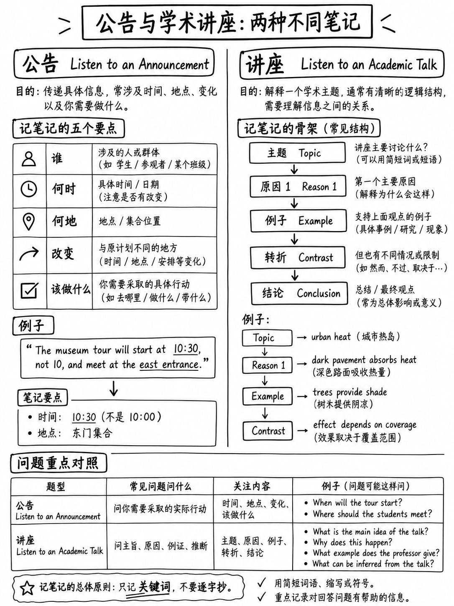

# 5.4 听公告 · 听学术讲座




 两个独白任务。总共 **14–26 项**。公告是可管理的；学术演讲是
测试中最难的任务。

---

## 第 1 部分 — 收听公告

### 5.4.1 它是什么

>“收听公告任务旨在模拟听众会听到的内容
> 在**学术背景下的面对面或广播消息**期间，例如，在
> 课堂或学校相关活动。考生聆听一段与学术相关的简短内容
> 公告（**约 40-85 个字**），然后回答相关问题。该公告可能
> 包括有关 ** 时间表、方向、规则和条例或学生的信息
> 成就**。” [1]

| | |
|---|---|
|项目 | 6–10 [2] |
|音频 | 40–85 个单词 — 大约 20–35 秒 |
|欧洲共同语言参考标准 | A2–C1 [2] |
|问题 |每个公告 2 个 |

 测试技能 [1]：主要思想·重要细节·语法结构·惯用词汇·
推论·“**根据说话者所说的内容预测未来的行动**”·“认识到
发言者消息的**目的**"。

### 5.4.2 官方示例

```text
Man: Good afternoon, everyone. I am excited to inform you that Dr. Cynthia Palmer, a
renowned expert in environmental science, will be giving a guest lecture next Monday at
2 PM in Waldman Auditorium. Dr. Palmer will discuss the latest advancements in
sustainable energy solutions and their impact on global climate change. Due to her
popularity and the high interest in her work, I highly recommend arriving early to
secure a seat.

Q: What is the announcement about?
   (A) A guest lecture ← key   (B) A different location for a class
   (C) Requirements for a class (D) A new university science course

Q: Why does the professor mention Dr. Palmer's popularity?
   (A) To encourage students to read her work
   (B) To indicate why she was invited to the university
   (C) To compare her to other invited experts
   (D) To explain why students should arrive early  ← key
```

:::{important} 第二个问题是学习的模式
“为什么说话者提到X？”是一个**目的**问题。答案就在条款中
立即附加到 X：*“**由于她的受欢迎程度**......我强烈建议**早点到达**。*”

 选项（B）是经典陷阱 - 这是一个“合理”解释为什么受欢迎的专家会得到
邀请，但这不是说话者使用这个词的意思。 **目的问题由以下人员回答
接近性，而不是合理性。**
:::

### 5.4.3 公告模板

 几乎所有 40-85 字的公告都遵循相同的五个动作：

```
   1. GREETING / ATTENTION      "Good afternoon, everyone."
   2. THE NEWS                  "Dr. Palmer will be giving a guest lecture…"
   3. THE DETAILS               who / what / WHEN / WHERE
   4. THE REASON OR BENEFIT     "…the latest advancements in…"
   5. THE INSTRUCTION           "I highly recommend arriving early."
```

**这两个问题几乎总是来自第2步（主要思想）和第5步（指令或目的）。**

|最难听|为什么 |
|---|---|
|问候后的第一个完整句子 |这是主要思想|
| **数字、日期和房间名称** |详细问题在这里。把这些写下来|
|最后一句话|它包含指令，并生成“学生应该做什么？” |
| *由于/因为/因为* |这些介绍了目的，从而产生“为什么说话者提到……？” |

### 5.4.4 练习公告

每人朗读一次。

**公告1**
```text
Woman: Before we start, a quick note about the laboratory sessions. Because the
equipment is being serviced, Thursday's session will move to the smaller lab on the
first floor — room 118, not the usual 204. Numbers are limited there, so the group has
been split in two. Check the noticeboard outside my office this afternoon to find out
which half you are in.
```
**1.** 该公告的主要目的是什么？
(A) 描述新设备 (B) 解释会话的更改 (C) 介绍新实验室
助理 (D) 取消课程

**2.** 学生今天下午应该做什么？
(A) 前往 118 房间 (B) 给发言者发电子邮件 (C) 查看布告栏 (D) 收集装备

**公告 2**
```text
Man: Congratulations to everyone who took part in the regional design competition last
weekend. Two of our second-year teams reached the final, and one of them came second
overall — the best result this department has ever had. Photographs are going up in the
main corridor on Friday. If you would like to be involved next year, registration opens
at the end of this term, and places tend to go quickly.
```
**3.** 该公告主要内容是什么？
(A) 比赛结果 (B) 摄影展 (C) 新课程 (D) 报名截止日期

**4.** 为什么演讲者提到地方“往往去得很快”？
(A) 解释为什么有些学生没有被选中
(B) 鼓励尽早注册
(C) 描述竞赛如何运作
(D) 表扬二年级队

:::{admonition} 答案
:class: tip
**1 — (B).** Move 2 是“星期四的会议将进行”。 (A) 和 (D) 是*设备*上的文字回显
和*会话*。
**2 — (C).** 第 5 步：“检查布告栏……今天下午。” (A) 是他们将继续的地方
周四，而不是今天下午——一个**正确的信息，错误的问题**陷阱。
**3 — (A).** 新闻就是结果；照片和注册的详细信息如下。
**4 — (B).** 邻近性：该条款附加在“本学期结束时开放注册”。 (一)
看似合理，但与该句子无关。
:::

---

## 第 2 部分 — 听学术讲座

### 5.4.5 什么是

>“考生听一段简短的（大约 **100–250 个字**）学术相关的演讲和答案
> 关于它的**四个问题**。” [1]

| | |
|---|---|
|项目 | **8–16** [2] |
|音频 | 100–250 个单词 — 大约 **45–100 秒** |
|欧洲共同语言参考标准 | **A2–C2** — 测试中唯一达到 C2 [2] 的任务 |
|问题 |每讲4个|

技能[1][2]：主要和支持思想·“理解一系列口语和惯用语
表达”·推理·“识别修辞结构（例如比较/对比、原因和
效果）”·“有时解释不太常见或惯用的词汇”。

:::{warning} 期望管理
这是 2026 年托福考试中初学者的努力很难转化为分数的一项任务。它是
具有 C2 能力、独白、听过一次、与完成单词相同的**每项 1 分**
需要十五秒的间隙。

对于大多数短期准备候选人来说，正确的策略是**损害限制**：可靠的
确保主要思想和目的问题并对其余问题进行智能猜测的方法。
:::

### 5.4.6 官方示例及其教学内容

ETS 发表的演讲是关于*硬*和*软迷恋* [1] 的心理学播客。这是它的
骨架：

```
   HOOK          "Did you see that new thriller movie that came out last week?
                  I did and loved it… Time just flew by."
   TERM 1        "What I experienced is what psychologists call HARD FASCINATION."
   DEFINITION    "Hard fascination means intense focus and concentration."
   EXAMPLES      "TV programs, video games…"
   SIGNPOST      "There's ANOTHER type of fascination — SOFT fascination."
   DEFINITION    "effortless attention… but there's still room for other thoughts."
   EXAMPLE       "When I take a walk in the park…"
   CONSEQUENCE   "hard fascination causes mental fatigue… distracted, irritable, stressed."
   CONTRAST      "Soft fascination, IN CONTRAST, engages the Default Mode Network…"
   ADVICE        "So next time… turn off the TV, put down your phone. Take a walk."
```

**已发布的四个问题准确地映射到这个框架上：**

|问题 |答案就在哪里 |
|---|---|
| “演讲的主题是什么？” → *两种类型的魅力* |两条 TERM 行 |
| “演讲者为什么提到电影？” → *引入心理学概念* | HOOK，读作**函数** |
| “演讲者对她在公园散步有什么看法？” → *她的头脑有空间思考与自然无关的想法* |柔软的魅力
| “演讲者对默认模式网络有何看法？” → *它涉及软迷恋* |对比线 |

:::{important} 战略洞察
**每个答案都位于一个结构性地标**：定义、路标、示例、对比。
没有一个要求你遵循整个论点。

所以不要试图理解一切。 **追踪骨架。** 如果你可以说“她定义了两个
的事情，分别给出一个例子，并说其中一个会导致疲劳”，您可以回答四分之三
问题。
:::

### 5.4.7 路标词汇

 这些短语标记地标。训练自己像警报一样对它们做出反应。

|功能|信号|
|---|---|
| **主题/新术语** | “心理学家称之为……”·“这被称为……”·“这个术语是……”|
| **定义** | “X 表示……”·“即……”·“换句话说……”·“我的意思是……”|
| **列表中的另一项** | “还有另一种……”·“第二种类型……”·“那么还有……”·“还有……”|
| **示例** | “例如……”·“举个例子……”·“当我……”·“考虑……”|
| **对比** | “相比之下……”·“另一方面……”·“不像……”·“而……”·“**但是**……”|
| **原因/结果** | “因为这个……”·“结果……”·“接下来是……”·“这导致……”|
| **重要性** | “关键点是……”·“这里重要的是……”·“至关重要的是……”|
| **让步，然后修正** | “**看起来……但事实上**……” |
| **结论/建议** | “所以下次……”·“结果是……”·“简单地说……”|

:::{tip}“但事实上”是值得聆听的最高价值短语
在学术演讲中，“看起来X…**但实际上**Y”是一个标准走法，而该项目
作者将测试 Y，而干扰项提供 X。这同样适用于“**实际上**......”，“**但是**，
最近的工作表明......”和“**事实证明**......”。
:::

### 5.4.8 为演讲做笔记

 笔记唯一有帮助的任务。记下**结构**笔记，而不是句子。

```
   TOPIC: _______________________

   1 ________  =  ________________      ← term + definition
       ex: ______________________

   2 ________  =  ________________
       ex: ______________________

   CONTRAST / CAUSE: ______________

   END ADVICE: ____________________
```

六短线。如果你每次演讲写的字数超过十个字，那么你就是在写而不是
Listening.

### 5.4.9 演讲的四种问题类型

|类型 |如何回答 |
|---|---|
| **主题/主要思想** |答案是**对或关系**，而不是一个术语。 “两种迷恋”，而非“迷恋”|
| **为什么发言者提到X？** |功能，而不是内容。看看 X 之后紧接着发生的事情 |
| **有关一个示例的详细信息** |与您的笔记相匹配。如果您没有注意到，请删除与整体论点相矛盾的选项 |
| **推论** |选择**与演讲者的结论一致**的选项。拒绝任何比她所说的更强烈的事情|

### 5.4.10 放弃协议

如果你在谈话中迷失了三十秒：

|做|不|
|---|---|
|继续倾听路标——结局往往会重述一切 |尝试重构你错过的句子 |
|抓住**最后一句话**；它通常会重申主要思想|冻结|
|对于主要思想问题，如果演讲明确有两个部分，请选择命名**两个**事物的选项 |留空 |
|对于“为什么说话者提到 X”，选择一个**功能**（“介绍”、“说明”）而不是事实的选项 |选择最熟悉的单词选项 |
| **完全重置**以获取下一个音频|带入下一项 |

### 5.4.11 练习讲

听一次。四题

```text
Most people assume that the oldest surviving written documents are literary — poems,
myths, religious texts. In fact, the great majority of early writing is administrative.
Of the tens of thousands of clay tablets recovered from southern Mesopotamia, something
like ninety per cent are receipts, inventories, contracts and ration lists.

This is less disappointing than it sounds. Writing seems to have been invented not to
preserve stories, which were perfectly well preserved by memory and performance, but to
solve a problem that memory could not solve: keeping track of who owed what to whom in
a city of tens of thousands of strangers.

That origin left a mark on the script itself. The earliest signs were pictures of
commodities — a jar, a sheep, a measure of grain — together with marks for quantity.
Only later did scribes begin to use signs for sounds rather than things, and only then
did it become possible to write down a name, a verb, or a poem.

So the usual story is backwards. Literature did not produce writing. Accounting did,
and literature arrived several centuries afterwards.
```

**5.** 主要讲什么？
（一）泥板的装饰
(B) 最初为何发展文字
(C) 美索不达米亚城市之间的差异
(D) 已知最早的诗歌

**6.** 为什么说话者在开头提到诗歌、神话和宗教文本？
(A) 列出药片的内容
(B) 陈述一个她会纠正的常见假设
(C) 解释记忆是如何运作的
(D) 比较两种书写系统

**7.** 根据演讲者的说法，书写解决了什么问题？
(A) 准确保存故事
(B) 教导文士阅读
(C) 记录互不认识的人之间的义务
(D) 使粘土片更容易运输

**8.** 说话者对于声音符号暗示什么？
(A) 它们从一开始就被使用。
(B) 他们使写诗成为可能。
(C) 他们用数量代替了标记。
(D) 它们是在美索不达米亚以外发明的。

:::{admonition} 答案和推理
:class: tip
**5 — (B).** 骨架是：共同信念→修正→证据→结论。最后一步
（“会计出现了，文学在几个世纪后出现”）陈述了主要思想。
(D) 和 (A) 是详细信息。

**6 — (B).** 目的问题。短语*“大多数人假设......”*后跟*“事实上......”*是
**让步然后修正**从§5.4.7 开始。该列表的存在是相互矛盾的。

**7 — (C).** “在一个拥有数万陌生人的城市中记录谁欠谁什么。”
(A) 被明确否认 - 故事“被记忆完美地保存下来”。

**8 - (B).** “直到后来，抄写员才开始使用声音符号……**只有到那时**它才成为
可以写下一个名字、一个动词或一首诗。” (A) 与“稍后”相矛盾； (C) 说
*取代*，这比谈话更强烈——一个**太强**的陷阱。
:::

### 5.4.12 哪里可以找到更多练习

|来源 |为什么适合 |
|---|---|
|科学和历史新闻简报大声朗读（附文字记录）| 100–250 字，说明性，有路标 |
|大学公开课剪辑，仅前 90 秒 |真实学术名录 |
| VOA学习英语《新闻中的科学》|转录、清晰、简短|
|任何播客 — **但仅限前 90 秒，带有文字记录** |长度匹配|

**练习比来源更重要：**听一次→写出六行骨架
§5.4.8 → 检查文字记录 → 遮盖您错过的部分。

---

**下一个：** {doc}`05-listening-practice-set` — 一个全定时模块，带有听写库和音频
说明。