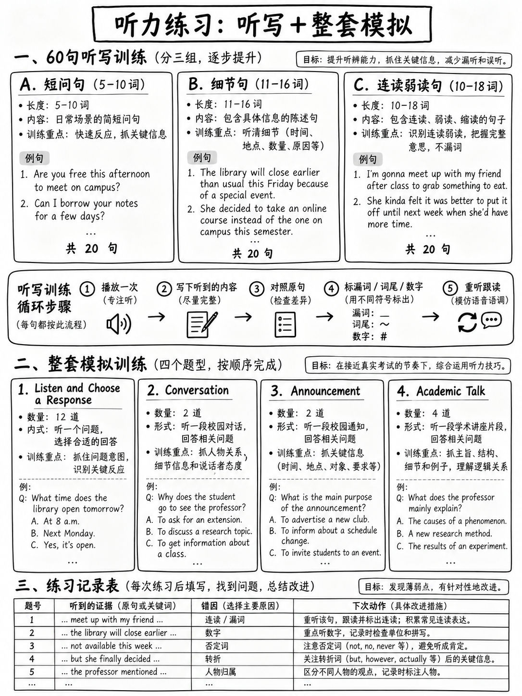

# 5.5 听力练习集




 这里的所有材料都是**为本包编写的**，符合已发布的音频长度规范，
任务类型和 CEFR 频段 [1][2]。它不是复制的测试内容。

## 5.5.1 获取音频：三个选项

您需要英语口语**一次，以自然速度**，您还没有先阅读。

###选项1 - 文本到语音（免费，无限制，离线工作）

在Linux上：

```bash
# install once
sudo apt-get install espeak-ng

# a single sentence, US voice, natural speed
espeak-ng -v en-us -s 150 "Where can I pick up my student card?"

# a whole file, one sentence per line, with a pause between
espeak-ng -v en-us -s 150 -f dictation.txt

# save to a file so you can replay it
espeak-ng -v en-us -s 150 -w out.wav -f dictation.txt
```

macOS 有 `say -v Samantha -r 150 "..."`； Windows 具有内置的讲述人声音和 PowerShell
`System.Speech`。任何基于浏览器的 TTS 都可以使用。

|设置|价值|为什么 |
|---|---|---|
|速度| **每分钟 150 个字** |自然的对话节奏。真实的音频“以自然的节奏传递”[2] |
|语音 |替代 **美国、英国和澳大利亚** |测试使用全部三款[2]|
|重复 | **仅一个** |真正的音频播放一次 |

:::{warning} espeak-ng 听起来很机械 - 这对于听写来说很好
它不适合训练自然韵律的理解。用于听写库；使用
**真实录制的人类语音**（新闻、官方练习材料、电影）用于对话和
会谈。
:::

### 选项 2 — 学习伙伴 

 给他们本章。规则：**读一次**，正常速度，不重复，不放慢速度。一个


### 选项 3 — 自己录音，然后等待

 一次性记录所有 60 个听写句子。等**三天**，然后做。你将会有
忘记内容了，练习有效。

---

## 5.5.2 听写库 — 60 个句子

 听写是效率最高的听力练习：它迫使你解析每个单词，
并且是客观评分的。每个游戏**一次**，写下来，然后检查。

### A 组 — 问题和简短交流（5-10 个单词）
*这些与“聆听并选择响应”音频相匹配：“不超过六个重读音节”[2]。*

> 1. 您将注册表放在哪里？
> 2. 你在这里等了多久了？
> 3. 截止日期不是下周三吗？
> 4. 你能帮我一下吗？
> 5. 图书馆周五几点关门？
> 6. 恐怕房间已经被预订完了。
> 7. 你介意我坐在这里吗？
> 8. 我们或许应该早点离开。
> 9. 有人看到实验室钥匙了吗？
> 10. 我们为什么不在正门外集合？
> 11. 这根本不是我所期望的。
> 12. 打印机从星期一开始就出现故障了。
> 13. 我们坐公共汽车还是步行？
> 14. 我以为你已经交了。
> 15. 星期四下午有一个研讨会。
> 16. 月票多少钱？
> 17. 她说她会通过电子邮件将详细信息发送给我。
> 18. 可以更改日期吗？
> 19. 我整个星期都在努力联系他们。
> 20. 让我们见机行事，稍后再决定。

### B 组 — 详细陈述（11-16 个字）

> 21. 迎新活动于九点在底层大厅开始。
> 22. 如果您尚未填写在线表格，请在周五下午之前完成。
> 23. 由于维修工作，周四的课程已移至一号十八室。
> 24. 想要改变课程的学生应首先与顾问交谈。
> 25. 工程师每六个月检查一次存放在地下室的设备。
> 26. 在我们知道有多少人来之前，我宁愿不预订任何东西。
> 27. 您要求的几本书已到达并正在柜台等候。
> 28. 导览游持续约四十分钟，从游客中心出发。
> 29. 我们需要在七点半之前出发去赶早班火车。
> 30. 任何对志愿者计划感兴趣的人都应该在门口签名。
> 31. 结果将于下月底在网上公布。
> 32. 她提到博物馆整个冬季每周一闭馆。
> 33. 5 月 1 日之前注册的任何人均可享受 20% 的折扣。
> 34. 讲座很有趣，尽管我发现后半部分很难听懂。
> 35. 每次到健康中心预约时，请记得携带您的学生卡。
> 36. 他自 9 月份以来一直致力于该项目，预计将于 6 月份完成。
> 37. 回收箱位于每栋建筑物外，通常靠近自行车停放区。
> 38. 我没有意识到申请必须亲自提交而不是在线提交。
> 39. 他们将周五的营业时间延长至晚上十点。
> 40. 您能告诉我那个周末小屋是否可用吗？

### 组 C — 连接语音和缩减（10–18 个单词）
*这些故意充满了链接、省略和弱形式
{doc}`../10-pronunciation/06-connected-speech`.*

> 41. 你想对此做什么？
> 42. 我上周就应该告诉她这个变化。
> 43. 你知道几点开始吗？
> 44. 实际上，里面有很多有趣的信息。
> 45. 您介意等几分钟吗？
> 46. 如果没有他们的帮助，我不可能完成它。
> 47. 首先，我们来谈谈接下来会发生什么。
> 48.你不觉得这有点问题吗？
> 49. 她已经为此工作了大约一个半小时。
> 50.我们需要尽快找到他们。
> 51. 这根本不是我所期望的那样。
> 52. 如果我早点知道的话我就会告诉他了。
> 53. 他说他不愿意，但没有说明原因。
> 54. 我们中的许多人将不得不重新开始。
> 55. 你不知道办公室在哪里，是吗？
> 56. 我不确定他们是否已被告知这件事。
> 57. 这里附近曾经有一家商店。
> 58. 大多数申请者没有正确阅读说明。
> 59. 如果我是你，我会在本周末之前询问他们。
> 60. 反过来做会更容易。

### 对你的听写进行评分

|结果 |意义|行动|
|---|---|---|
| 90–100% 的单词完全正确 |你的解码很扎实|转向对话和谈话 |
| 70–89% |正常中档 |继续前进;专注于你输得最多的那几盘 |
| 50–69% |解码是你的瓶颈|两周内每天听写 15 个句子 |
|低于 50% |低于该材料假设的水平|仅从 A 组开始，并遮盖每句话 |

:::{important} C 组的诊断价值
如果你在 B 组上得分高，而在 C 组上得分差，那么你的问题**不是**词汇或语法——而是
是**连接语音**。直接前往 {doc}`../10-pronunciation/06-connected-speech` 并
{doc}`../10-pronunciation/03-vowels` §1.3.5（弱形式）。这是其中最常见的一个配置文件
阅读能力强、听力能力弱的学习者。
:::

---

## 5.5.3 全定时模块模拟

**20 项。设置 14 分钟的计时器。每个音频播放一次。没有回头路。**

A 真正的路由器模块大约是这个大小的两倍（18 分钟，约 24 项）。这个半长版
保持官方的**比例**——聆听并选择回应占主导地位，学术演讲
包含四个问题，以便您的百分比分数具有可比性： 12 聆听并选择 ·
1 次对话（2 项） · 1 项公告（2 项） · 1 次学术演讲（4 项）。

### A 部分 — 聆听并选择一个答案（12 项）

 如果您尚未完成，请使用 {doc}`02-listen-and-choose-a-response` §5.2.6 中的项目 1–12，或者
第 13–24 项（如果有）。

### B 部分 — 对话（2 项）

```text
Woman:  Have you decided which elective you're taking?
Man:    Not yet. It's between statistics and the history of science.
Woman:  Statistics has a lot of coursework, I heard.
Man:    That's what's putting me off, honestly. But it's more useful for the
        master's I want to do.
Woman:  Then that settles it, doesn't it?
Man:    Probably. I'll go and talk to the department tomorrow before I commit.
```

**B1.** 该男子对统计数据最关心的是什么？
（一）太难了。 (B) 它涉及大量的课程作业。 (C) 这对他的计划没有用处。
(D) 它与另一个类发生冲突。

**B2.** 这个人接下来可能会做什么？
（一）登记统计。 (B) 选择科学史。 (C) 与部门交谈。
(D) 再次征求女士的意见。

### C 部分 — 公告（2 项）

```text
Woman: A quick reminder about the careers fair next Tuesday. It runs from eleven until
four in the sports hall, and you do not need to register in advance. Bring several
printed copies of your CV — the advice desk can look at it with you, but only between
eleven and one. After one o'clock that desk closes and the employer stands take over
the whole hall.
```

**C1.** 该公告的主要目的是什么？
(A) 要求学生注册 (B) 提供有关活动的实际细节
(C) 描述出席的雇主 (D) 宣布更改地点

**C2.** 为什么发言者提到一点钟？
(A) 说明展会何时结束
(B) 解释体育馆何时开放
(C) 注明简历建议的截止日期
(D) 给出演讲时间

### D部分——学术演讲（4项）

```text
We tend to think of silence as the absence of sound, but for the people who design
concert halls it is nothing of the kind. A hall with no reflected sound at all — an
anechoic chamber — is experienced by most visitors as deeply unpleasant. Within a few
minutes they report hearing their own heartbeat and a ringing in the ears, and many ask
to leave.

What audiences actually want is not silence but a particular pattern of delay. When a
violin note is played, the direct sound reaches the listener first, and reflections from
the walls and ceiling arrive a fraction of a second later. If those reflections arrive
within about thirty milliseconds, the brain merges them with the original note and hears
a single, richer sound. If they arrive much later, the brain separates them, and the
listener hears an echo instead.

Designing a hall is therefore largely a matter of controlling arrival times. That is why
the celebrated nineteenth-century halls are narrow and rectangular: the side walls are
close enough to return sound quickly. Many twentieth-century halls, built wide and
fan-shaped so that more seats would have a clear view of the stage, turned out to sound
noticeably worse — and several have since been rebuilt.
```

**D1.** 主要讲什么？
(A) 为什么电波暗室令人不愉快
(B) 反射声音的时间如何影响音乐厅设计
(C) 十九世纪建筑史
(D) 小提琴与其他乐器的区别

**D2.** 发言者为何提到电波暗室？
(A) 表明沉默不是观众想要的
(B) 解释如何测量回声
(C) 描述一个现代音乐厅
(D) 举一个好的声学设计的例子

**D3.** 根据演讲，当反射到达大约三十以上时会发生什么
直达声后几毫秒？
(A) 声音变得更加丰富。
(B) 听者听到回声。
(C) 反射被吸收。
(D) 音符听起来更安静。

**D4.** 说话者对于扇形大厅意味着什么？
(A) 它们的建造成本更低。
(B) 他们的设计优先考虑视线而不是声音。
(C) 它们是小提琴家的首选。
(D) 它们比旧大厅窄。

---

## 5.5.4 答案和推理

|项目 |关键|推理|
|---|---|---|
| **B1** | **B** | “统计学有很多课程作业……这就是让我望而却步的原因。” (C) 则相反——他说这*是*有用的|
| **B2** | **C** |最后的承诺：“明天**在我做出承诺之前**去和部门谈谈。”预测问题由最后的协议来回答。 (A) 是他最终可能会选择的，而不是他下一步会做什么 - **正确的信息，错误的问题**陷阱 |
| **C1** | **B** |该公告列出了一系列实际细节。 (A) 矛盾（“您不需要注册”）|
| **C2** | **C** |邻近度：“仅在十一点到一点之间。**一点之后，办公桌关闭**。” (A) 是一个**言辞回响**陷阱——四点钟是展会结束的时间 |
| **D1** | **B** |骷髅：安静不是目标 → 重要的是到达时间 → 因此大厅的形状。 (A) 仅是钩子 |
| **D2** | **一个** |目的问​​题。在“我们倾向于认为沉默是没有声音，但是……”之后立即引入了密室 - **让步然后纠正**举动 |
| **D3** | **B** | “如果它们到达得很晚，大脑就会将它们分开，听者就会听到回声。” (A) 描述了*低于*-30 毫秒的情况 - **正确的信息，错误的条件**陷阱 |
| **D4** | **B** | “建造宽阔的扇形**，以便更多的座位可以清楚地看到舞台**，结果听起来明显更糟。” (D) 反转文字|

## 5.5.5 自评分表

|部分|项目 |分数 |
|---|---|---|
| A — 聆听并选择回应 | 12 | 12 /12 |
| B——对话| 2 | /2 |
| C——公告| 2 | /2 |
| D——学术演讲| 4 | /4 |
| **总计** | **20** | **/20** |

### 错误诊断

|原因 |计数 |修复 |
|---|---|---|
|根本没听到这句话| |听写，§5.5.2 |
|听说过但不懂的成语 | | {doc}`03-conversations` §5.3.6 |
|将一个想法归因于错误的演讲者 | | {doc}`03-conversations` §5.3.4 |
|选择单词回显选项 | | {doc}`01-scoring-and-section-tactics` §5.1.6 |
|选择一个看似合理但未说明的选项 | |问：这是*说*的吗？ |
|用事实回答目的问题 | | {doc}`04-announcements-and-talks` §5.4.2 |
|也丢失了以下物品 | | **恢复训练**，§5.1.7 |
| **留空** | | **必须为零** |

:::{danger} 必须为零的两行
**留空**并且**也丢失了以下项目。**都是习惯，不是知识差距，而且都是
本周可以修复。
:::

## 5.5.6 官方听力材料索引

|来源 |它包含什么 |
|---|---|
| *更新 TOEFL iBT 考试概述* [1] |四种听力任务类型中的**每种**的一个有效示例，带有音频脚本和答案 |
| *托福 iBT 模拟考试 1* [10] |两个完整的听力模块（18 + 16 项），带有脚本和答案 |
| *托福 iBT 模拟考试 2* [11] |另外两个完整模块 |
|托福考试准备 [19] |免费的部分采样器和免费的全长音频练习测试|

**最后使用官方材料，而不是首先使用。**它是有限的，不能有意义地重复
一旦你知道答案。在此包中的材料上构建技能，然后使用官方
设置为最终的、诚实的测量。

---

**下一个：** {doc}`../60-toolkit/01-core-vocabulary` — 实际支付的词汇，组织为
它在哪里赚取积分。