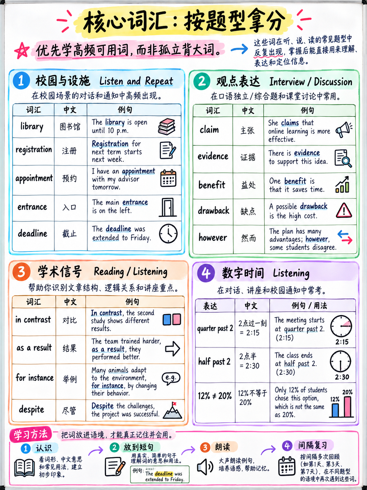

# 6.1 核心词汇——按得分地点组织

:::{admonition} 为什么这个列表很短
:class: important
词汇在2026年托福考试中是低优先级的投资，官方文档说了原因：

-“该任务的设计使得**不需要背景知识**。” [1]
- “回答问题所需的所有信息都**包含在文本中**。” [4]
- 主要的阅读任务，完成单词，是由**功能词和后缀**驱动的，而不是
  通过稀有词汇 — ETS 自己的示例中的 10 个空白中有 7 个是语法单词 [1][10]。
- 口语标准要求“一系列准确的语法和词汇**足以表达
  一般含义**”，不适用于复杂的词汇 [1].

 所以本章**不是** 2,000 个单词的列表。大约 450 个字，之所以选择，是因为每个人都能赚到钱
特定地点的点。
:::

## 6.1.1 第 1 组 — 校园和设施（用于聆听和重复）

 聆听和重复场景是校园和公共设施的导游 [1][11]。知道
这些单词消除了几乎所有的记忆负载，因为你可以预测句子。

**地点：**入口·出口·接待处·前台·帮助台·信息台·走廊·
礼堂·礼堂·演讲厅·研讨室·实验室·车间·工作室·图书馆·
档案室·阅览室·食堂·食堂·食堂·书店·宿舍·礼堂
住宅·更衣室·更衣室·健身房·体育中心·游泳池·庭院·
停车场·自行车棚·地下室·底层·一楼·健康中心·药房·
游客中心

**方向：** 在您的左边 · 在您的右边 · 一直向前 · 再往下 · 刚刚过去 ·
对面·旁边·后面·前面·楼上·楼下·对面·在远端·
就在拐角处·beside

**服务和规则：**可用·仅向会员开放·免费·无需额外费用·
需要预约 · 提前 · 先到先得 · 预约 · 注册 · 会员资格 ·
介绍·时间表·时间表·开放时间·会议·设施·设备·协助·
监督·允许·禁止·无人看管

**经常出现的动词：**提供·提供·包括·要求·允许·收集·返回·
书·登记·检查·报告·联系·协助·避免·保留·带来

## 6.1.2 第2组——意见和论点（用于接受采访和讨论帖子）

不是“高级”词汇——让你“详细阐述”的单词，这是评分标准的得分。

|功能|话|
|---|---|
| **陈述观点** |争论·主张·相信·坚持·我的观点·个人|
| **原因** |因为· 因为· 由于· 原因是· 这就是为什么· 导致· 结果|
| **效果** |影响 · 影响 · 后果 · 结果 · 好处 · 缺点 · 缺点 |
| **学位** |稍微· 明显· 相当大· 极大· 几乎· 勉强· 在某种程度上|
| **频率** |很少·偶尔·经常·一般·通常·几乎总是|
| **对冲** |倾向于·似乎·似乎·在大多数情况下·这取决于·可以说|
| **比较** |而· 而· 不像· 与· 相比· 另一方面· 相比|
| **优惠** |虽然·尽管·诚然·当然·话虽如此|
| **示例** |例如·例如·例如·特别是·取X|
| **添加** |而且·除此之外·还有什么·此外|
| **结论** |总体 · 平衡 · 因此 · 所以 |

:::{warning} 谨慎使用连接器
参加面试 band-4 描述符仅将连接器提到为*可能的东西
缺少* [1]；没有乐队会奖励他们作为一项功能。 45 秒的答案中有四到五个自然的答案是
足够了。每个句子开头的连接符听起来都被记住了，人工智能评分器就是这样
敏感于.
:::

## 6.1.3 第 3 组 — 十二个重复出现的主题区域

 每个八个单词，加上一个您可以改编的现成例句。这些内容涵盖了现实
接受采访并撰写学术讨论主题的范围
（{doc}`../30-writing/04-write-for-an-academic-discussion` §3.4.8）。

|面积 |八个字 |一个现成的例子 |
|---|---|---|
| **教育** |课程·评估·课程作业·讲座·导师·出勤·工作量·资质| *“在我的第一年，我真正记得的是每周都有作业的课程。”* |
| **技术** |设备·应用·平台·自动化·算法·访问·隐私·更新| *“我的手机会记录我学习的时间，这听起来很有用，但主要让我感到焦虑。”* |
| **工作** |雇主·同事·轮班·通勤·工资·升职·截止日期·工作量| *“我的表弟工作四天而不是五天，并说星期五是最好的事情。”* |
| **环境** |排放·废物·回收·可再生·污染·节约·气候·资源| *“我们的大楼去年才配备了回收箱，现在几乎每个人都使用它。”* |
| **城市** |基础设施·公共交通·密度·行人·住房·拥堵·绿地·郊区| *“他们把我家附近的一条旧铁路线变成了一个公园，每天晚上都挤满了人。”* |
| **健康** |生活方式·饮食·心理健康·预防·治疗·运动·健康·压力| *“我开始步行去上课而不是乘公共汽车，而且我睡得更好了。”* |
| **媒体** |来源·准确性·偏见·覆盖范围·受众·标题·错误信息·平台| *“在我相信任何令人惊讶的事情之前，我会检查两个不同的新闻网站。”* |
| **钱** |预算·生活费用·负担·补贴·费用·收入·支出·投资| *“房租占了我收入的一半以上，所以其他一切都是围绕它计划的。”* |
| **旅行** |目的地·住宿·行程·旅游·当地·季节·交通·预订| *“上次我访问大城市时，我和​​朋友住在一起，这改变了整个旅程。”* |
| **社会** |社区·志愿者·不平等·世代·传统·参与·责任·福利| *“我的学校需要十五个小时的志愿服务时间，几乎没有人觉得这很困难。”* |
| **科学** |证据·实验·假设·数据·样本·结果·理论·方法| *“我记得有一堂课，我们重复实验三次，得到了三个答案。”* |
| **文化** |遗产·展览·表演·传统·多样性·身份·节日·保护| *“我的镇上有一个小节日，外面几乎没有人听说过。”* |

:::{tip} 为什么每一行都有一个例句
评分标准奖励**阐述和举例**。每个领域都有一个现成的个人例子意味着你
在口语和口语中，从来不会陷入将第 3 段与第 4 段分开的“例如……”动作
写[1].

**写你自己的十二个。**你的会比我的更有用。
:::

## 6.1.4 第 4 组 — 学术段落路标（用于阅读和听力）

 这些词告诉您作者或演讲者正在*做什么*，即目的和内容
推理题测试。

|功能|信号|
|---|---|
| **声明** |争论·提议·建议·维持·假设|
| **证据** |演示·指示·揭示·确认·展示|
| **怀疑** |问题·挑战·争论·怀疑·尚不清楚|
| **对冲** |似乎·似乎·可能·倾向于·被认为·大致·大约|
| **纠正** |事实上·然而·实际上·恰恰相反·事实证明|
| **测序** |最初 · 随后 · 最终 · 随着时间的推移 · 到那时 |
| **导致** |导致·导致·引起·源于·由于|
| **对比** |而· 不像· 相比之下· 虽然· 尽管|
| **概括** |一般情况下·通常·通常·大多数|
| **限制** |仅仅·仅仅·至少·不超过·除了|

:::{important} 对冲/强度的区别决定推理问题
当一段文字说一个结果“**表明**即使是智力较低的动物**可能**拥有更多
自我意识比先前怀疑的“[10]”，正确的推理选项将同样是
谨慎。 “**证明**鱼和猿一样聪明”的选项是错误的**因为
它的力量**，而不是它的内容。

训练自己注意：*可能、可能、建议、出现、倾向于、一些、经常* vs *证明、总是、
全部、从不、必须*。
:::

## 6.1.5 第5组——数字、时间和数量（听力）

 公告和日常生活课文中的细节问题取决于这些。

|陷阱|详情 |
|---|---|
| **-teen 与 -ty** | *十三* /θɜːˈtiːn/ **第二** 音节上的重音； *三十* /ˈθɜːti/ 在**第一**。如果您听不到结尾，请聆听 **压力** |
| **“哦”** | 204房间→“二**哦**四”； 09:30 → “哦九点三十分”|
| **双打** | 44 → “双四”在英国的用法 |
| **数百** | 1,500 → “一千五百”与“一千五百”一样频繁 |
| **宿舍** | 5:45 → “六点一刻” — 您听到的时间**不是**所指的时间 |
| **日期** | “the one of May”（英国）与“May First”（美国）； 03/04 是 4 月 3 日（英国）或 3 月 4 日（美国）|
| **一个/每** | “五美元 **一页**” = 每页 |
| **最多** | “最高 50% 折扣”= **最高**，并非全部 |
| **截止/直到** | “周五之前”= 截止日期； “直到星期五”=继续 |
| **X 和 Y 之间** |除非另有说明，否则不包括端点 |

**您必须立即听到的序数词：** 第一 · 第二 · 第三 · 第四 · 第五 · 第十二 ·
第二十·第二十一·第三十.

## 6.1.6 第 6 组 — 造句词汇

您不需要为构建句子提供任何单词——它们是给定的。但你必须认识到
这些**结构**项目立即：

|类别 |项目 |
|---|---|
|关系代词 |谁·谁·谁·哪个·那个|
|下属|如果·是否·因为·虽然·同时·当·之前·之后·除非·因为|
|疑问词|什么·哪里·何时·为什么·如何·哪个·谁·多少·多少·多长时间|
|助剂|做 · 做 · 做了 · 有 · 有 · 有 · 将 · 会 · 可以 · 可以 · 应该 · 可能 · 可能 |
|被动标记|是·曾经·是·被|
|不定式/动名词触发器 |想要 · 同意 · 决定 · 享受 -ing · 建议 -ing · 避免 -ing · 考虑 -ing · 期待 -ing |

## 6.1.7 60 字优先列表

 如果你什么都不学，就学这些。选择它们是因为每一个都能带来**多个**的回报
节.

| | | | |
|---|---|---|---|
|可用 |要求 |提供|包括 |
|允许 |援助 |设备 |注册|
|预约|日程 |设施 |会议|
|入口 |进一步|对面|旁边|
|是否 |虽然|因为|然而|
|因此 |而 |尽管|相反 |
|大约|大致|相当大|稍微|
|倾向于|看来 |建议|表明|
|争论|索赔 |展示 |挑战|
|效益 |缺点|后果|影响 |
|影响 |减少|增加|维护|
|访问 |机会|责任|要求|
|证据|样品|方法|结果|
|出席|课程作业 |截止日期|工作量|
|通勤|基础设施|社区 |志愿者|

**如何学习它们：**不是列表。对于每个单词，写下**一个关于你自己生活的句子**，
大声说出来，并记录下来。四天，一天十五个字。可以生成 60 个句子

## 6.1.8 什么不该学

|不|因为|
|---|---|
| 《托福500个学术词汇》榜单 |专为旧测试的 700 字段落而设计 |
|特定学科术语（生物学、地质学、天文学）| “不需要背景知识”[1] |
| *好*、*坏*、*重要*的罕见同义词 |没有标准会奖励词汇的稀有性；精度就是所谓的|
|不能自然使用的习语 |它们出现在*监听*输入中，而不是您必须生成的东西 |
|短语动词巨型列表 |了解校园环境中出现的 15 个内容：*报名、顺便拜访、递交、填写、推迟、整理、签到、查找、查找、迟到、设置、联系、取消、出现、锻炼* |

---

**下一步：** {doc}`02-grammar-minimum` — 八个结构和九个重要错误。