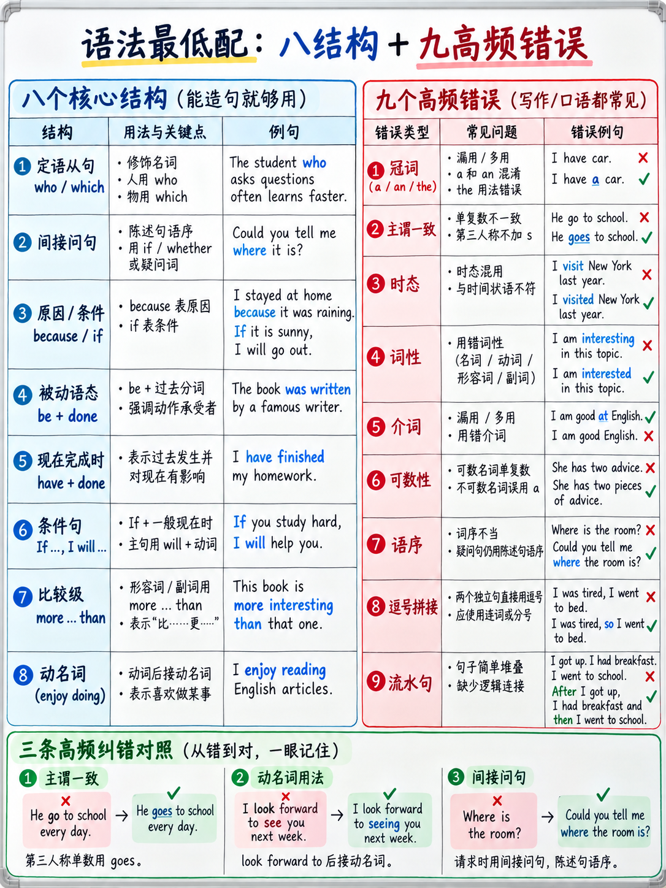

# 6.2 语法minimum




:::{admonition} 本章内容是什么
:class: important
不是语法课程。 **影响 2026 托福考试的最小结构和更正**
分数，之所以选择，是因为每个分数都是直接测试的：

- **构建句子**是一项纯语法任务，价值 **写作部分 20 个原始分中的 10 个** [2]。
- **完成单词** 间隙通过语法槽解决 - 词性、时态、数字 [1]。
- 写作评分标准在第 3、4 和 5 段 [1] 中命名为“各种句法结构”。
- 面试标题在第 5 段命名为“一系列准确语法” [1].

 这里的所有内容至少出现在这四个位置中的两个位置。
:::

## 6.2.1 不要购买语法教科书

 在考试前几周，完成 400 页的语法参考书是最糟糕的之一
使用您可用的时间。它是按*主题*组织的，而不是按*测试内容*组织的，而且大部分都是按*主题*组织的
（过去完成进行时的陈述性言语，否定状语后的倒装，the


本章大约占语法教科书的 3%，涵盖了大约 90% 的语法分数。

## 6.2.2 八种结构

 其中每一种都出现在造句中，在写作中获得“句法多样性”学分，并且是


### 1. 关系从句

> 坐在我旁边的学生**帮助了我。
> 教授提供的指南**很有用。
> **位于大厅后面**的房间用于研讨会。 *（缩减）*

**规则：** who = people ·which/that = things ·主要动词出现在整个子句的**之后**。

### 2.嵌入式问题

>你知道**明天是否开​​放**吗？
> 你能告诉我**我们正在使用哪个房间**吗？

**规则：**在开场白之后，**正常词序** — 不倒置，不*做*。

### 3. 原因、时间、条件、让步的从句

> **因为**设备正在维修，会话已移动。
> **当**我尝试提交时，页面不断加载。
> **如果**没有收到，我很乐意再次发送。
> **虽然**费用较高，但包含账单。

**规则：**从句在前时，在从句后面加逗号；第二个时没有逗号。

### 4. 被动

> 样本**于去年夏天收集**。
> 大厅**正在装修**。
> 您的申请**已被审核**。

**规则：** *be* + 过去分词。副词**在第一个助动词之后**。

### 5. 现在完成时与过去简单

|使用|表格 |示例|
|---|---|---|
|完成时间（昨天，去年，2019年，当时我12岁）| **过去简单** |我于 2019 年在那里**学习**。 |
|未完成的时间，或未说明时间，或“到目前为止”| **现在完成时** |我在那里**学习**了两年。 |
|与*对于/自从/已经/尚未/曾经/从未* | **现在完成时** |我**从未**去过加拿大。 |

:::{warning} HOW LONG 规则
“你在这里住了多久了？” → **“我在这里住了三年。”** 不是 *“我从那时起就住在这里
三年了。”*每次配对都是**现在完美+自/自**以来。这是最
口语面试中明显的学习者错误。
:::

### 6. 条件句（其中两个，而不是五个）

|类型 |表格 |使用|
|---|---|---|
| **真实** | *如果* + 现在，*将* + 动词 | “如果录音好一点，学生们就会跳过这堂课。” |
| **虚幻** | *If* + 过去式，*would* + 动词 | “如果政府这样做，人们会立即使用它。” |

 这两个内容涵盖了参加面试 Q4（假设）和讨论所需的一切
post.

### 7. 比较级和最高级

> 科学图书馆比**主图书馆安静得多。
> 这是我学过的**最有用的**课程。
> 费用是学生费用的**两倍。
> **练习越多**，**就越容易**。

**规则：**一个音节 → *-er/-est*;三个或更多 → *更多/大多数*;两个音节混合在一起
（*更安静*但*更小心*）。 *多/远/略*强化比较级。

### 8. 动名词和不定式

|图案|动词|
|---|---|
|动词 + **-ing** |享受·完成·避免·建议·考虑·思考·实践·想象·推荐|
|动词 + **到** + 动词 |同意·决定·想要·希望·计划·提供·拒绝·管理·负担·期望|
|介词 + **-ing** |对**工作感兴趣·擅长**解决问题·而不是**去干·期待**聆听|
| **to** + 目的动词|我很早就来**查看**日程安排。 |

## 6.2.3 九个错误，按得分频率排列

### 1. 冠词 (*a / an / the* / Nothing)

 对于没有冠词的语言（斯拉夫语、普通话、
日语、韩语、土耳其语、印地语）。三个问题解决大多数情况：

```
   Is it the only one, or already known to the listener?  →  THE
   Is it one of many, mentioned for the first time, singular countable?  →  A / AN
   Is it plural or uncountable, in general?  →  NOTHING
```

> ****图书馆八点开门。 *（具体这个）*
> 我需要**一支**铅笔。 *（任意一个）*
> **Ø** 学生必须注册。 *（一般学生）*
> **Ø** 水结冰时会膨胀。 *（不可数，一般）*

固定短语整体记忆：*去**Ø**大学·去****电影院·在**Ø**家里·
**早上** · 晚上 **Ø** · 乘坐**Ø**巴士 · 乘坐**巴士 · 踢 **Ø** 足球 · 踢球
**钢琴。*

### 2. 主谓一致

> 结果**已发布。 · 学生人数**正在**增加。
> 每个房间**都有**一扇窗户。 · 欢迎大家**欢迎。
> 有**有**几种选择。 · 有**一个问题。

注意主语和动词之间的复数名词：*录音的质量**是**
差。*

### 3.动词时态一致性

选择一个时间范围并停留在其中。过去的故事就留在过去：

> ✗“我去年去过那里，**很拥挤。”
> ✓ “我去年去过那儿，那里**非常拥挤。”

### 4. 词形（词性）

> ✗ “这是一个**成功的**项目。” → ✓“一个**成功的**项目”
> ✗“这非常**好处**。” → ✓“非常**有益**”/“真正的**好处**”

学习家庭，而不是言语：*决定·决定·果断·果断*·
*分析·分析·分析*·*成功·成功·成功·成功*。
这也正是完成单词测试的内容。

### 5.介词

涵盖大多数用法的三十个：

| | | |
|---|---|---|
|依赖**依赖** |对**感兴趣 |擅长** |
|负责**| **原因** | **结果** |
|类似于**至** | **不同于** | **与**相比 |
|到达**（一个地方）|到达**（城市）|属于**属于** |
|由**组成** |参与** |聚焦**于** |
|依赖**依赖** |申请**（工作）|申请**到**（大学）|
| **成功** |意识到** |能够**的** |
|负责**的** |根据**根据** |由于**由于** |
|代替**的** |除了**到** |贡献于** |
|受**于** |保护**免受** |防止**|

### 6. 可数与不可数

不可数（无复数，无*a*）：*信息·建议·研究·设备·家具·
知识·进度·作业·新闻·金钱·交通·住宿·软件·证据*。

> ✗“我有很多**信息**。” → ✓“大量**信息**”/“**几条**信息”
> ✗“一条**建议**”→ ✓“**一些**建议”/“一条**建议”

### 7. 词序

|规则| ✗ | ✓ |
|---|---|---|
|名词前的形容词 |城市老|老城区|
|副词不在动词和宾语之间 |我非常喜欢这个课程 |我非常喜欢这个课程 |
|频率副词在主要动词之前，在 *be* 之后 |我总是去|我总是去/我总是迟到|
|嵌入式问题中没有倒装 |我想知道他在哪里 |我想知道他在哪里 |
|间接对象​​顺序 |我向他解释了问题|我向**他解释了问题 |

### 8. 逗号拼接

> ✗ “当时正在下雨，我们呆在里面。”
> ✓ “正在下雨，**所以**我们呆在里面。” /“当时正在下雨。我们呆在里面。”

两个完整的句子不能单独用逗号连接。这是最常用的标点符号
学习者写作中的错误，写作任务将“机械约定……标点符号”列为
评估 [1].

### 9. 连续句子

 带有四个*和*的 60 字句子比三个干净句子更难评分。评分细则
奖励**多种多样**，其中包括短句。目标是平均 15-20 个单词。

## 6.2.4 二十句纠正练习

Eeach 恰好包含一个错误。更正，然后检查。

> 1. 我自 2021 年以来一直住在这个城市。
> 2.你知道实验室在哪里吗？
> 3. 邮件内容不明确。
> 4.她昨天向我解释了规则。
> 5.虽然贵，但是我还是买了。
> 6. 申请人数不断增加。
> 7. 我有兴趣学习经济学。
> 8. 他建议在入口处见面。
> 9. 这门课比上一门容易一些。
> 10. 如果我有时间，我会参加这次旅行。
> 11. 我通常午饭后去图书馆。
> 12. 旧房间用于研讨会。
> 13. 欢迎大家参加。
> 14. 我不知道截止日期。
> 15. 这取决于有多少人来。
> 16. 她从三月起就在这里工作。
> 17. 造成这种情况的原因有很多。
> 18. 我期待收到您的来信。
> 19. 设备是去年更换的。
> 20. 下雨了，我们决定呆在室内。

:::{admonition} 答案
:class: tip
1. 我自 2021 年以来**一直居住在这座城市**。*（现在完成时 + 自那时起）*
2. 你知道**实验室在哪里**吗？ *（嵌入式问题中没有倒装）*
3. 电子邮件中的**信息**不明确。 *（不可数）*
4. 她昨天向我解释了**规则**。 *（向某人解释+）*
5、虽然贵，但我还是买了。 *（删除“但是”）*
6. 申请人数**正在**增加。 *（主语是“数字”）*
7. 我对**学习**经济学感兴趣。 *（介词 + -ing）*
8. 他建议**在入口处见面**。 *（建议+-ing）*
9. 这门课程比上一门**容易**。 *（不是“更多”和“-呃”）*
10. 如果我**有**时间，我会参加这次旅行。 *（不真实的条件）*
11.我**通常在午饭后去**图书馆。 *（主要动词之前的频率副词）*
12. **旧房间**用于研讨会。 *（名词前的形容词）*
13. 欢迎大家**参加。 *（每个人=单数）*
14. 我不知道截止日期。 *（在“did”之后，基本形式）*
15. 这取决于**有多少人来。
16. 她自三月以来**一直在这里工作**。
17. 造成这种情况的原因有很多。
18. 我期待着**收到**您的来信。 *（这里“to”是介词）*
19. 去年更换了**设备**。 *（不可数）*
20. 下雨了，**所以**我们决定待在室内。 *（逗号拼接）*
:::

## 6.2.5 不该学什么

|跳过|为什么 |
|---|---|
|第三个条件和混合条件|两个条件满足您需要的一切 |
|否定状语后的倒装（*我从来没有……*）|从来不需要；尝试有风险|
|虚拟语气超出*暗示 X 做* |罕见|
|短语动词详尽列表 |了解 {doc}`01-core-vocabulary` §6.1.8 中的 15 个校园内容 |
|将来完成进行时和相似 |未经测试|
|包含每个专有名词的文章 |为小利而设的深兔子洞|
|用分号和破折号标点 |句号总是安全的 |

:::{important} 80/20
如果你的时间极其有限，请做以下三件事：
1. **嵌入问题规则**（无倒装）——这是最常见的造句模式。
2. **现在完成时+ for/since**——这是最常见的口语错误。
3. **逗号拼接** — 这是最常见的书写错误。

 每个二十分钟。九个错误中的三个，而且是出现最多的三个。
:::

---

**下一个：** {doc}`03-spelling-and-typing` — 机械标记，在此测试中比机械标记更重要
任何以前的托福成绩。