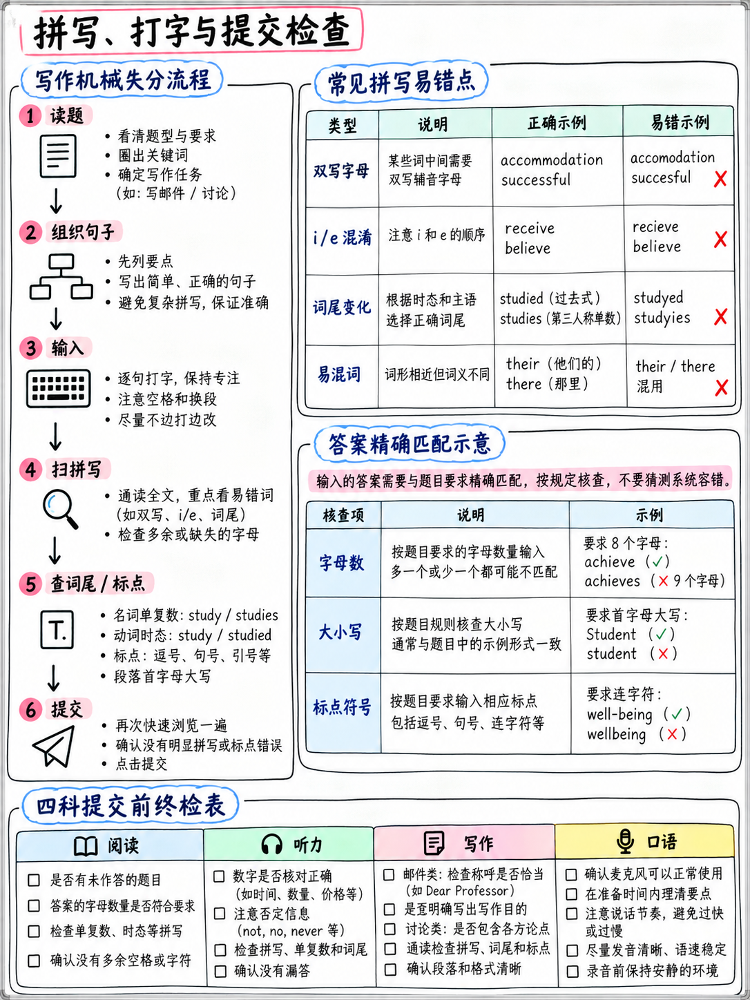

# 6.3 拼写、打字和作答机制

:::{admonition} 为什么本章存在于托福包中
:class: important
**旧托福从不要求你拼写任何东西。** 阅读和听力完全是多重的
选择，写作没有拼写检查，也没有精确匹配评分。

2026 年的测试改变了这一点。 **完成单词 - 50 个阅读项目中的 30 个 - 有机器标记
精确字母匹配** [1][2]。正确答案拼写错误分数为零，就像空白一样。

对于许多学习者来说，这是测试中最大的可恢复分数池，并且它具有
与英语能力无关。
:::

## 6.3.1 机械标记丢失的地方

|损失|哪里 |典型尺寸|可修复于 |
|---|---|---|---|
|拼写错误 完成单词答案 |阅读| **2–6 分** |天|
|输入的字母数量错误 |阅读| 1–3 分 |分钟（数空格）|
|句首间隙缺少大写 |阅读| 0–2 分 |分钟 |
|空白框|阅读| 2–8 分 |立即（扫一扫）|
|未完成的电子邮件/讨论帖 |写作 |最多整个乐队|为期一周的定时练习 |
|打字速度太慢，无法完成 |写作 | 1–2 个频段 |一周打字练习|

**未受过训练的初学者估计总分：6-15分。**都不需要更多英语。

（数字是根据已发布的任务结构**分析**；ETS未发布任何错误数据。）

## 6.3.2 精确匹配规则

|规则|详情 |
|---|---|
| **字母计数** |空格数 = 缺失字母数 |
| **大写** |匹配位置。 `How____` 是大写的，因为 *However* 开始一个句子 |
| **没有多余的字符** |框内无空格、无标点符号 |
| **英式或美式拼写** |两者都是标准英语。 *（ETS 没有说明对完成单词的偏好，也没有官方来源解决这个问题 - 请参阅下面的未经验证的注释。）* |
| **猜测** |总是。无处罚 [2] |

:::{warning} [未验证] 完成单词中的英式拼写与美式拼写
我们发现 **没有官方 ETS 声明** 关于“组织/组织”或“中心/中心”是否两者都是
接受完成单词。该任务删除单词的**后半部分**，即

**安全策略：**在两个拼写不同的空白处，使用 **美国** 形式 -
测试是美国的，周围的文本将使用美国惯例，并且可见的前半部分
无论如何，这个词通常会解决它（`cen___` → *center* 保留 `cen`；*centre* 也保留 `cen`，所以
那个人确实是模棱两可的； `organ___` → *组织* 与 *组织* 仅一字母不同）。

将此视为一个不可避免的小风险，而不是值得烦恼的事情。
:::

## 6.3.3 书写中的 -ed 和 -s 结尾

 这些规则与 {doc}`../10-pronunciation/02-consonants` §1.2.7 中的规则相同，但拼写不同
单独变更事项：

|规则|示例 |
|---|---|
|辅音 + **y** → **ied** |学习 → 学习** · 进行 → 进行** · 应用 → 应用** |
|元音 + **y** → 只是 **ed** |玩→玩**ed** ·享受→享受**ed** |
|沉默 **e** → 放弃 |希望 → 跳跃**ed** · 使用 → 我们**ed** · 到达 → 到达**ed** |
|短元音 + 单辅音（重读）→ **双** |停止 → 停止** · 计划 → 计划** · 参考 → 参考** · 发生 → 发生** |
|但当压力来得更早时就不会了|访问 → 访问** · 开放 → 开放** · 报价 → 报价**红色** |
| **-ing** 遵循相同的加倍规则 |运行·策划·开始·但参观、开业|
| s、x、z、ch、sh 后的复数 → **es** |类**es** · 盒子**es** · 手表**es** · 愿望**es** |
|辅音 + y → **ies** |国家** · 研究** · 城市** |
| **-f / -fe** → **ves** | life→li**ves** ·shelf →shel**ves** ·knife →kni**ves** |

## 6.3.4 120 个单词的拼写列表

 这些是学习者实际出错的单词，按错误机制分组。通过以下方式测试自己

### 第 1 组 — 双字母

 住宿 · 地址 · 开头 · 委员会 · 沟通 · 差异 · 尴尬 ·
立即·必要·场合·发生·机会·拥有·专业·推荐·
成功·明天·直到*（一升）*·通常·写

###第2组-*ie*/*ei*

实现·相信·天花板·构想·高效·经验·领域·外国·朋友·
身高·闲暇·邻居·感知·接受·救济·科学·社会·他们的·体重·
怪异

### 第3组——无声字母

答案·商业·城堡·柱子·设计·疑问·环境·外国·政府·
诚实·岛屿·知识·倾听·肌肉·经常·收据·节奏·剪刀·星期三·
是否

### 第 4 组 — 词尾混乱

advice *（名词）* / suggest *（动词）* · 影响 *（动词）* / 效果 *（名词）* · 肯定 · 依赖 ·
发展 *（无 e）* · 存在 · 独立 · 维持 · 发生 · 实践 *（名词）* /
实践 *（动词，英国）* · 偏好 · 参考 · 相关 · 单独 · 相似 · 重要 ·
真诚 · 学习 · 惊喜 · 温度

### 第 5 组 — 常见混淆对

他们/那里/他们是·你的/你是·其/它是·到/太/两个·然后/比·
影响/影响·失去/放松·安静/相当·原则/原则·接受/除外·
建议/建议·天气/是否·地点/景象·过去/通过·领导/领导

###第6组-学术用语

分析*（复数分析）*·适当·大约·特征·因此·
相当大·一致·强调·证据·假设*（复数假设）*·
解释·然而·特别·现象*（复数现象）*·研究
*（不可数）*·意义·实质性·充分·技术·多样性

:::{tip} 如何学习它们
不是通过阅读。 **听写。** 让列表一次读十个单词给您听，写下来，标记
并只重演那些你做错的部分。三个十分钟的疗程可以清除大部分内容
大多数人的清单。
:::

## 6.3.5 一周拼写修复

|日 |工作（10 分钟）|
|---|---|
| 1 |听写第 1 组和第 2 组（40 个单词）。标记。重新钻探错误|
| 2 |第 3 组和第 4 组（40 个字）。标记。重新钻探错误|
| 3 |第 5 组和第 6 组（35 个单词）。标记。重新钻探错误|
| 4 |第 1-3 天的所有错误，再次听写 |
| 5 | -ed/-s 规则：写 20 个过去式动词和 20 个复数名词 |
| 6 |两个完成单词段落；将**拼写错误与其他错误分开** |
| 7 |重新听写您整周错过的每个单词 |

## 6.3.6 打字速度

 两个长写作任务都是根据硬时钟打字的。该电子邮件需要 **7 分钟阅读并
写** [18].

|你的速度|是时候输入 120 个字了 |判决 |
|---|---|---|
| 60 瓦/分钟 | 2:00 | 2:00舒适|
| 45 瓦/分钟 | 2:40 | 2:40很好|
| 30 瓦/分钟 | 4:00 |紧张——剩下 3 分钟阅读和思考 |
| 20 瓦/分钟 | 6:00 | **您将无法完成电子邮件** |
| 10 瓦/分钟 | 12:00 | 12:00不可能 |

### 如何测试自己

 键入此内容并计时。 **120 个字** — 大约是一个好的电子邮件回复的长度，并且
几乎与 ETS 自己的高级范例的长度相同（118 个字） [1].

> *亲爱的编辑，我希望您能顺利收到此消息。我正在写我提交的两首诗
> 上周你的杂志。首先，我想说一下我有多喜欢这本新刊。的选择
> 作家异常多样化。不幸的是，我在网上提交表格时遇到了问题。
> 在我附上两个文件并单击“提交”后，页面持续加载了几分钟，并且
> 然后返回起点。我又尝试了两次，得到了相同的结果，所以我不确定
> 任何东西都已发送。您能否确认我提交的材料是否已收到？如果他们是
> 不，我很乐意通过电子邮件再次发送它们。非常感谢您的帮助。此致。*

|所用时间 |每分钟字数 |
|---|---|
| 2:00 | 2:00 60|
| 3:00 | 40 | 40
| 4:00 | 30|
| 5:00 | 24 |
| 6:30 | 18 |

**如果您的速度低于 30 WPM，请每周每天花 15 分钟接受免费打字训练。**
您可以获得回报率最高的非英语作品。

:::{warning} 练习您将使用的键盘布局
测试中心提供标准 QWERTY 键盘，通常为美式布局。如果您通常键入
不同的布局，或者在手机上，在全 QWERTY 键盘上进行定时练习。家庭版
用户：在您将测试的机器上进行练习。
:::

## 6.3.7 每节最终检查例程

### 阅读 — 每个模块的最后 60 秒
1. 向后滚动浏览每个“完成单词”段落。
2. **是否有任何方框是空的？** 填充它。
3. 是否有任何答案的字母数量错误？数一次。
4. 然后进入模块 2 — 永不回头。

### 听力
没有什么可检查的；您不能退回 [10]。唯一的规则是：**回答前面的每一项
消失。**

### 写作 — 每个任务
|任务| 20秒检查|
|---|---|
|造一个句子 |每个空白都填满了吗？它读起来是对第一句话的答复吗？ |
|电子邮件 | **所有三颗子弹都已覆盖？** 问候语和结束语都存在吗？ |
|讨论 |第 1 句中的位置？同学叫？一个具体的例子？ |

**永远不要**把最后几秒花在拼写上。 Band 5 明确容忍“常见错别字或常见错误”
拼写错误” [1].

### 说话
|任务|规则|
|---|---|
|听并重复| **把每句话都说完**，即使是错的 |
|接受采访 |继续说话，直到时钟停止。永远不要说“我不知道” |

---

**下一篇：** {doc}`04-error-log-method` — 如何通过练习真正提高你的分数。
