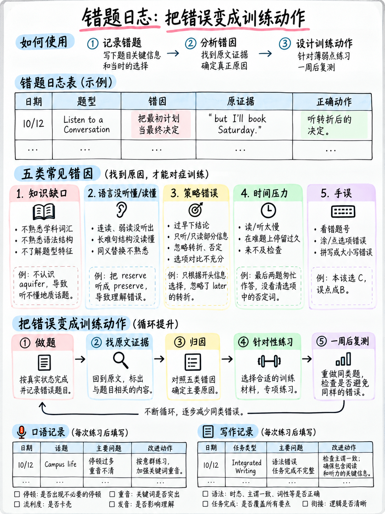

# 6.4 错误日志方法




:::{admonition} 解决的问题
:class: important
大多数人通过做问题、检查答案、对错误的问题感到难过以及
做更多的问题。分数几乎没有变化，因为**相同的错误不断发生在不同的地方
原因，没有什么可以区分它们**。

错误日志将“我弄错了”替换为“我弄错了**因为**”，并且只有*因为*是
可行的。
:::

## 6.4.1 五个原因

 托福考试中的每个错误答案都只有一个主要原因。将每个错误分类到其中之一
五个，没有别的。

```
  ┌──────────────┬────────────────────────────────────┬──────────────────────┐
  │ KNOWLEDGE    │ I did not know the word / rule     │ Study it             │
  ├──────────────┼────────────────────────────────────┼──────────────────────┤
  │ PROCESS      │ I knew it but used the wrong       │ Change the method    │
  │              │ method (read options first, etc.)  │                      │
  ├──────────────┼────────────────────────────────────┼──────────────────────┤
  │ TIME         │ I ran out, rushed, or over-spent   │ Change the pacing    │
  ├──────────────┼────────────────────────────────────┼──────────────────────┤
  │ MECHANICAL   │ Right answer, wrong spelling /     │ Drill the mechanics  │
  │              │ letter count / left blank          │                      │
  ├──────────────┼────────────────────────────────────┼──────────────────────┤
  │ TRAP         │ I chose a deliberately attractive  │ Learn the trap shape │
  │              │ wrong option                       │                      │
  └──────────────┴────────────────────────────────────┴──────────────────────┘
```

:::{important} 通常的分布让人惊讶
对于 2026 TOEFL 初学者来说，典型的第一个错误日志如下所示：

|原因 |分享 |
|---|---|
|机械| 〜30% |
|陷阱| 〜25% |
|流程| 〜20% |
|时间 | ~15% |
|知识 | ~10% |

**只有十分之一的错误实际上是“我需要更多英语。”** 其他九个本周可以修复。
这就是为什么错误记录值得花费二十分钟的时间。

（分布是根据任务结构进行**分析**，而不是 ETS 统计数据。）
:::

## 6.4.2 日志格式

五列。纸质或电子表格，都没关系。

|日期 |项目 |我放了什么/什么是正确的 | **原因** |我会采取什么不同的做法 |
|---|---|---|---|---|

### 一个工作示例

|日期 |项目 |我的→右|原因 |行动|
|---|---|---|---|---|
| 3 月 3 日 | CTW 差距 7 | *已收到* → *已收到* |机械|拼写列表第 2 组 |
| 3 月 3 日 | CTW 间隙 2 | *在* → *应该*（`th___` 不是 `th__`）|机械| **先数一下空格** |
| 3 月 3 日 | CTW 差距 9 |空白 → *来自* |机械|扫完每个模块 |
| 3 月 3 日 |日常生活Q2 | B → C | TRAP（单词回显）|在阅读选项之前用我自己的话回答 |
| 3 月 3 日 |学术 Q4 | A → B |流程| “为什么作者提到”想要一个**功能** |
| 3 月 3 日 |学术 Q5 | D → 跳过 |时间 |将通道限制在 4 分钟 |
| 3 月 4 日 |听力项目 6 |乙 → 甲 |流程|我还在考虑第 5 项。 **重置** |
| 3 月 4 日 |听力项目 11 | C → D |知识 |成语：*在空中*|
| 3 月 4 日 |造一个句子 14 | *她正在教哪个科目* → *她正在教哪个科目* |知识 |直接wh-疑问句需要倒装 |
| 3 月 4 日 |听并重复 6 |减少到 8 个字 |流程| **始终把句子说完** |

注意：十个错误中，**两个**是知识差距。剩下的都是习惯。

## 6.4.3 每周统计

每周日，按原因统计你的日志并绘制它。

```
   MECHANICAL  ████████████████  16
   TRAP        ███████████       11
   PROCESS     █████████          9
   TIME        █████              5
   KNOWLEDGE   ███                3
```

然后仅对**最高的栏**进行操作。

|最高的酒吧 |本周行动|
|---|---|
| **机械** |为期一周的拼写修复（{doc}`03-spelling-and-typing` §6.3.5）+模块结束扫描，每一次练习课 |
| **陷阱** |重新读取陷阱表（{doc}`../40-reading/03-read-in-daily-life` §4.3.4、{doc}`../50-listening/01-scoring-and-section-tactics` §5.1.6）。然后做 20 项，在选择 | 之前，你必须在每个错误选项中**说出陷阱**。
| **流程** |将完成该任务的方法写在卡片上，并逐字逐句地执行 20 个项目，即使感觉很慢 |
| **时间** |使用可见的时钟和硬帽进行练习。故意丢弃物品来感受它的代价 |
| **知识** |直到现在，多学英语才是正确答案——而且仍然是最小的条 |

## 6.4.4 生产技能日志

口语和写作需要不同的格式，因为没有“正确答案”可以比较。

### 口语日志

每次录制后：

|日期 |任务| LR分数/35 | TI 分数 /20 | **重复出现的问题** |
|---|---|---|---|---|
| 3 月 3 日 |套装A | 19 | 19 11 | 11第 5-7 句的拖沓 |
| 3 月 5 日 | B组| 23 | 23 12 | 12第七名的排名仍然落后；面试答案到25秒为止|
| 3 月 7 日 |设置C | 26 | 26 14 | 14现在7个都完成了。面试：没有例子|

“重复出现的问题”栏目就是重点。如果同一个短语连续三周出现，
这是一种**僵化的习惯**，需要在§6.4.6.

### 写作 log

| 中进行刻意练习。日期 |任务|话|子弹/动作涵盖|拼写 |文章 |动词形式|逗号拼接 |词序|
|---|---|---|---|---|---|---|---|---|
| 3 月 3 日 |电子邮件 1 | 94 | 94 2 共 3 | 4 | 3 | 2 | 1 | 1 |
| 3 月 5 日 |电子邮件 2 | 118 | 118 3 共 3 | 5 | 2 | 1 | 0 | 1 |
| 3 月 7 日 |讨论1 | 126 | 126全部 5 | 3 | 2 | 1 | 0 | 0 |

**读取列，而不是行。**这里，拼写是稳定的（没有改进，但绑定也没有改进）
约束），而子弹覆盖范围从 2/3 变为 3/3 — 这是实际移动的变化
乐队.

## 6.4.5 两周工作周期

**起点：**阅读14/31，听力9/20，口语18/55，写作7/20。

**第1周日志记录：**机械18·陷阱9·过程7·时间4·知识 2.

**采取的行动：**
- 第 1-3 组拼写列表，每天听写（10 分钟）
- “先数数空格”写在卡片上，然后按字面意思进行
- 在每次练习中强制执行模块结束扫描
- 每次听和重复设置之前大声说“始终完成句子”

**第2周结果：**阅读21/31，听力12/20，口语27/55，写作11/20。

**变化是什么：**没有学到新的英语。收益来自于：

|改变|标记 |
|---|---|
|完成单词中的拼写错误：6 → 2 | +4 |
|空白框：3 → 0 | +3 |
|聆听并重复：3 个片段 → 0 个片段 | +3 至 +6 |
|构建一个句子：嵌入问题规则中的 2 个额外权利 | +2 |
|听力：在错过一件物品后不再丢失物品 | +2 |

:::{important} 这是早期改善的正常形状
认真准备的前两周几乎总是会产生毫无意义的大跳跃
与语言能力有关。不要误以为它是流利的——也不要跳过它，因为它是
分数中最便宜的部分。

（上面的数字是一个说明性的工作示例，不是测量数据。）
:::

## 6.4.6 僵化错误

一个僵化错误是你多年来犯下的错误，仅靠纠正并不能解决：*“我活着
自2021年起就在这里"*、*"信息"*、*"我非常喜欢它"*.

|步骤|方法|
|---|---|
| 1 | **选择一个。** 不是三个 |
| 2 | **将正确的形式写在卡片上**并大声朗读十遍 |
| 3 | **用十句话讲述你自己的生活**，大声，录音 |
| 4 | **明天重复，三天后重复，一周后重复** - 间隔，而不是集中|
| 5 |然后才开始下一篇 |

正确清除三个化石错误胜过十次纠正和忘记。

:::{warning} 不要过度纠正
*说话时*监控你的语法会产生面试时的断断续续的节奏
band-3 描述符惩罚 [1]。修正练习中的错误； **请勿在表演期间进行监控。**
:::

## 6.4.7 可以复制的空白日志

```text
ERROR LOG — week of ____________

DATE | ITEM           | MINE → RIGHT            | CAUSE      | ACTION
-----|----------------|-------------------------|------------|---------------------
     |                |                         |            |
     |                |                         |            |
     |                |                         |            |
     |                |                         |            |
     |                |                         |            |

WEEKLY TALLY
  MECHANICAL ______   TRAP ______   PROCESS ______
  TIME ______         KNOWLEDGE ______

TALLEST BAR: ______________
THIS WEEK I WILL: _________________________________________

SPEAKING          LR ___/35   TI ___/20   recurring: ______________
WRITING           words ___  moves covered ___  biggest error type ______
```

## 6.4.8 记录多少才够

|会话类型 |记录下来吗？ |
|---|---|
|全定时练习部分 | **总是**，每个错误 |
| 20 项练习 |是的，但只有错误 |
|每日聆听并重复|只有乐谱和一个反复出现的音符 |
|读书为乐|否 |

**一小时练习后记录十五分钟是正确的比例。**如果您是
记录的次数多于练习的次数，说明你已经走得太远了；如果你从不登录，那么你就是在重复


---

**下一个：** {doc}`05-study-plans` — 28、14、7 和 3 天的每日计划。