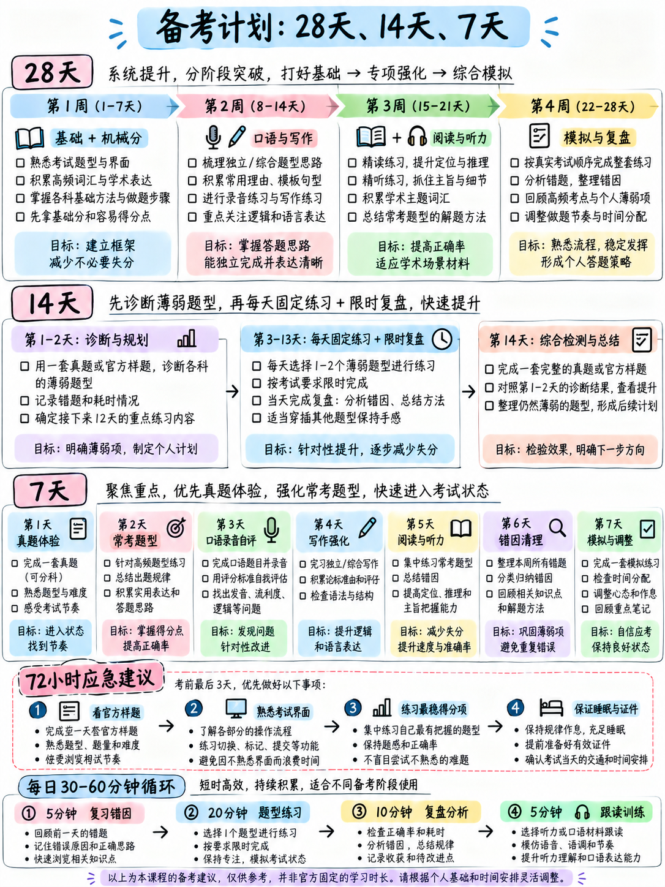

# 6.5 学习计划

 四个计划，看你有多久。它们都遵循相同的优先顺序，该顺序来自
{doc}`../00-foundations/03-how-scoring-works` §0.3.5 中的原始点分布和分类
{doc}`../00-foundations/04-priority-triage`.

## 6.5.1 哪个方案

|你有 |计划|目标运动|
|---|---|---|
| 4 周，每周约 15 小时 | §6.5.2 — **28 天** | +0.5 至 +1.0 整体频带 |
| 2 周，每周约 12 小时 | §6.5.3 — **14 天** | +0.5 整体带 |
| 1 周 | §6.5.4 — **7 天** |主要是格式熟悉度+机械标记|
| 3 天 | §6.5.5 — **紧急** |避免灾难；考虑重新安排 |

:::{warning} 在开始任何计划之前
在 {doc}`../00-foundations/06-choose-your-target` §0.6.3 中进行**第一天诊断**。需要55
分钟，它决定了您可以压缩这些计划的哪些部分。
:::

---

## 6.5.2 28 天计划

**每日不可协商（每天 25 分钟，包括休息日）：**

- **听并重复练习** — 7 个句子，记录，评分（15 分钟）
- **听写** — 10 句话（10 分钟）

 下面的所有内容都是**除此之外**。

### 第 1 周 — 基础和机械标记

|日 |工作（~90 分钟）|
|---|---|
| **1** |第一天诊断。读取 {doc}`../00-foundations/01-what-the-test-is` 和 {doc}`../00-foundations/02-task-type-inventory`。设置您的错误日志 |
| **2** | {doc}`../00-foundations/03-how-scoring-works` + {doc}`../00-foundations/04-priority-triage`。 {doc}`../10-pronunciation/01-start-here-sound-system`：44 个声音，schwa，审核段落 |
| **3** | {doc}`../10-pronunciation/02-consonants` §1.2.7 — -ed 和 -s 规则 + 20 句练习。完成单词第 1 段 |
| **4** | {doc}`../30-writing/02-build-a-sentence` 模式 1–4 + 项目 1–10（不计时）。拼写列表第 1 组 |
| **5** |构建句型 5–8 + 项目 11–20。拼写组 2。CTW 第 2 段 |
| **6** | {doc}`../50-listening/02-listen-and-choose-a-response` 完全 + 项目 1–12。拼写组 3 |
| **7** | **检查点：** 7 个“听并重复”项目得分 · 10 个造句项目计时 · 1 个 CTW 段落计时。记录一切。每周统计 |

### 第 2 周 — 生产性任务

|日 |工作（~90 分钟）|
|---|---|
| **8** | {doc}`../10-pronunciation/04-word-stress` + 60字练习。 CTW 第 3 段 |
| **9** | {doc}`../30-writing/03-write-an-email`完全。写电子邮件 1，时长 7 分钟 |
| **10** | {doc}`../20-speaking/03-take-an-interview`完全。记录场景 1 的 4 个答案 |
| **11** | {doc}`../10-pronunciation/05-rhythm-and-chunking` + 对两个官方 Listen 和 Repeat 集进行块标记。 CTW 第 4 段 |
| **12** |电子邮件 2，定时。 {doc}`../50-listening/03-conversations` + 成语列表（前20条）|
| **13** | {doc}`../30-writing/04-write-for-an-academic-discussion`完全。讨论提示1，时长10分钟|
| **14** | **检查点：** 完整的写作部分模拟（23 分钟）。日志。每周统计 |

### 第 3 周 — 理解部分

|日 |工作（~90 分钟）|
|---|---|
| **15** | {doc}`../40-reading/02-complete-the-words` 重读+第 5 和第 6 段。迄今为止所有错误的拼写重新听写 |
| **16** | {doc}`../40-reading/03-read-in-daily-life` + 工作组。记录 4 个采访答案，场景 2 |
| **17** | {doc}`../50-listening/04-announcements-and-talks` + 两个练习公告。成语列表（第20条）|
| **18** | {doc}`../40-reading/04-read-an-academic-passage` + 已完成的通道。 CTW 第 7 段 |
| **19** |电子邮件 3 和电子邮件 4，定时。构建句子第 21-40 项，时间为 45 秒 |
| **20** | {doc}`../50-listening/05-listening-practice-set` §5.5.3 全模块，定时。按原因记录每个错误 |
| **21** | **检查点：** {doc}`../40-reading/05-reading-practice-set` 全模块，定时。每周统计 |

### 第 4 周 — 模拟和巩固

|日 |工作（~90 分钟）|
|---|---|
| **22** | **官方模拟测试 1** [10]，阅读和听力部分，计时。日志|
| **23** |针对您最大的错误类别采取行动。讨论提示5，定时。记录场景3 |
| **24** | **官方练习测试 1**，写作和口语，限时。根据官方评分标准评分 |
| **25** |仅最弱的任务——无论日志怎么说。在 35 秒内造出全部 40 个句子 |
| **26** | **官方模拟测试2** [11]，完整，一口气，没有休息，正确的部分顺序|
| **27** |审查。重读{doc}`06-exam-day-checklist`。仅轻度练习 — 7 个听并重复项目、10 个听写句子 |
| **28** | **休息。**阅读 {doc}`06-exam-day-checklist` §6.6.5 中的一页卡片。睡眠 |

---

## 6.5.3 14 天计划

**每日不可协商：20 分钟的聆听和重复，录制。**

|日 |工作（~75 分钟）|
|---|---|
| **1** |诊断。 {doc}`../00-foundations/02-task-type-inventory` — 了解所有九种任务类型 |
| **2** |构建一个句子：所有八个模式 + 项目 1–20 |
| **3** |完成单词：方法 + 虚词表 + 第 1-2 段。拼写组 1-2 |
| **4** | {doc}`../50-listening/02-listen-and-choose-a-response` + 项目 1–24。拼写组 3 |
| **5** |写电子邮件：方法 + 电子邮件 1 和 2，定时 |
| **6** |接受采访：四个槽位+场景1录制并评分|
| **7** | **检查点：** 阅读练习模块，定时。按原因记录 |
| **8** |造句第 21-40 项，限时。 CTW 第 3-4 段 |
| **9** |学术讨论：方法+一帖，限时。成语列表|
| **10** |听力练习模块，定时。日志|
| **11** |电子邮件 3，定时。采访场景 3 已录制。 CTW 第 5 段 |
| **12** | **官方模拟测试 1** [10]，完整，定时 |
| **13** |仅针对最大的错误类别采取行动。轻钻|
| **14** |休息 + 一页卡片 |

---

## 6.5.4 7 天计划

**仅**这些事情。其他一切都是噪音。

|日 |工作（~2 小时）|
|---|---|
| **1** |从头到尾阅读{doc}`../00-foundations/02-task-type-inventory`。做一次完整的官方模拟测试 [10] — **为了震撼，而不是为了分数** |
| **2** | **听并重复**：30 分钟练习，记录。 **造一个句子**：八个模式 + 项目 1–20 |
| **3** | **听并重复** 30 分钟。 **完成单词**：虚词表 + 第 1-3 段 |
| **4** | **听并重复** 30 分钟。 **写一封电子邮件**：移动模板+两封定时电子邮件。听写拼写组 1-3 |
| **5** | **听并重复** 30 分钟。 **聆听并选择答案** 第 1-24 项。 **接受采访**：记录一个场景|
| **6** | **听并重复** 30 分钟。构建一个句子项目 21-40 个，限时。一篇讨论帖已定时。一个 CTW 段落 |
| **7** |仅进行轻度审查。阅读 {doc}`06-exam-day-checklist`。睡八小时|

**你故意跳过的内容：**学术演讲、超出一读的学术文章、
词汇表、口音练习、任何需要几周时间才能显示结果的事情。

---

## 6.5.5 72 小时紧急方案

:::{danger} 首先，考虑重新安排时间
您可以重新安排，费用为 [12]。如果您从未见过“完成单词”屏幕或“聆听”
重复任务，三天不足以避免因纯粹的不熟悉而丢分——而且
浪费时间的费用比重新安排费用还要高。

 如果出现以下情况，请重新安排： 您无法说出九种任务类型 · 您从未输入过定时电子邮件 · 您的
打字速度低于 20 WPM。

 如果满足以下条件，请继续：您的截止日期不可更改，或者您的目标不高，您主要需要不要惊慌。
:::

|小时区块 |工作|
|---|---|
| **第 1 天 2 小时** |读取 {doc}`../00-foundations/01-what-the-test-is` 和 {doc}`../00-foundations/02-task-type-inventory`。然后做**一次官方练习测试** [10]，所有四个部分，按时间顺序|
| **第 1 天 1 小时** |聆听并重复：A 组和 B 组中的 20 个句子，已录制。学习一条规则：**始终完成句子** |
| **第 2 天 1 小时** |造一个句子：八个模式+ 20 个项目。这是 10 个原始点，一小时内即可学会 |
| **第 2 天 1 小时** |完成单词：虚词表+ 3 段。学习：**数空格，绝不留空格** |
| **第 2 天 1 小时** |写一封电子邮件：移动模板+一封定时电子邮件。学习：**每颗子弹 90 秒** |
| **第 3 天，45 分钟** |聆听并重复：2 个完整场景。聆听并选择：12 项 |
| **第 3 天，30 分钟** |接受采访：四个插槽。记录四个答案 |
| **第 3 天，15 分钟** |阅读 {doc}`06-exam-day-checklist` §6.6.5，一页卡片 |
| **第三天晚上** | **停止。睡觉。** |

### 如果您没有学到其他东西，请记住这五个规则

1。 **始终在“听并重复”中完成句子**。完成的错误句子是 3；一个
   被遗弃的1是2。
2. **切勿将“完成单词”框留空。** 猜测不会受到惩罚。
3. **每个电子邮件项目符号 90 秒。** 每次都是三者。
4. **在面试中回答前五个字中的字面问题**，然后继续说话
   40秒。
5. **在听力中，永远不要提出问题。** 猜测，然后重新设置。

---

## 6.5.6 十二个行为检查点

 在行为中比在分数中更容易看到进步。当它们成为现实时，勾选这些。

| | ✓ |
|---|---|
| 1. 我无需看就能说出所有九种任务类型 | |
| 2.即使我失去了单词，我也会听完每一个句子并重复| |
| 3. 面试问题出现后3秒内我就开始说话 | |
| 4. 我在每个面试答案中用了 45 秒中的 40 秒 | |
| 5.我在每一个口头回答中都举一个具体的例子| |
| 6. 在输入完整单词答案之前，我会数一下空格 | |
| 7. 我从来不会把盒子留空 | |
| 8. 我在 7 分钟内涵盖了所有三封电子邮件要点 | |
| 9. 我在每个讨论帖子中都会提到一位同学的名字 | |
| 10. 在阅读选项之前，我会用自己的话回答多项选择题| |
| 11. 当我在听力 | 中错过某些内容时，我会丢失一项，而不是三项。 |
| 12. 我按原因记录每个错误，而不仅仅是对/错 | |

**打勾十个或更多=你准备好了**，无论你的练习成绩如何。这十二种行为
比你在有限的时间内学习任何额外的英语都更有价值。

---

**下一个：** {doc}`06-exam-day-checklist`。