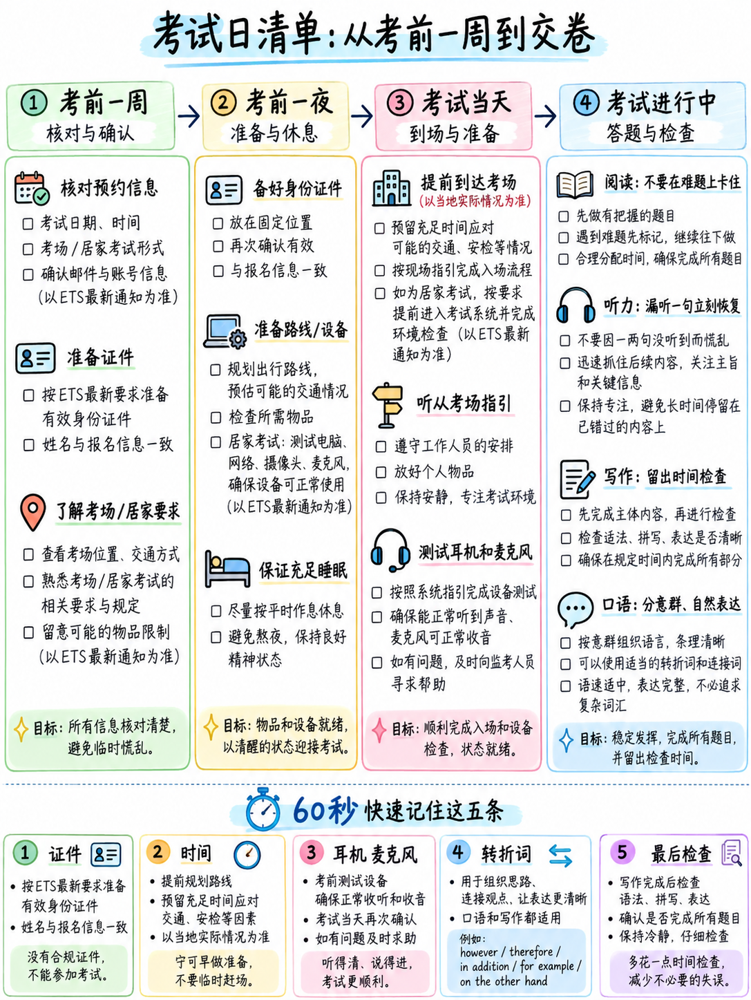

# 6.6 考试日检查清单




 本章中的所有规则均来自 **2026–2027 TOEFL iBT 信息公告** [12] 和
在家要求页面 [20]。验证任何影响您当前 ETS 旅行计划的内容


## 6.6.1 考试前一周

| | ✓ |
|---|---|
|在您的 ETS 帐户中确认您的**考试时间和时区** | |
|确认**考点地址**以及路程需要多长时间 | |
|检查您的 **ID**：原件，未过期，带有照片和签名，姓名与您的注册**完全一致** [12][21] | |
|携带**第二种形式的身份证件** — ETS 建议携带至少两个 [21] | |
|添加您的**分数接收者**（最多包含 4 个）- 您可以在晚上 10 点之前更改它们。当地时间前一天[12] | |
| **仅限家庭版：** 在“我的托福之家”中运行设备检查；下载托福考试应用程序 [12] | |
| **仅限家庭版：**注册后尽快完成身份验证 | |
| **仅限家庭版：**准备笔记材料 - 带有可擦记号笔的小白板，**或**带有可擦记号笔的透明纸张保护器内的一张空白纸 [12] | |
|按照正确的部分顺序进行一次**全时练习测试** | |
|检查您将使用的键盘上的**打字速度** | |

:::{danger} 名称不匹配是最常见的可避免的灾难
“如果 ID 无效或名称与您的帐户不完全匹配，您将无法进行测试，
且费用不予退还”[21]。检查中间名、口音和姓氏顺序
**今天**，不是考试日。
:::

## 6.6.2 前一天晚上

| | ✓ |
|---|---|
| **傍晚之前停止学习。** 今晚学到的东西明天就无法恢复了 | |
|出示身份证件，对于考试中心：除了食物/饮料/药物外，别无其他东西可留在外面| |
|设置两个闹钟 | |
| **睡八小时。** 这比你可以做的任何修改都更重要 | |
|重新阅读第 6.6.5 节中的一页卡片 — 十分钟，不再 | |

## 6.6.3 测试日上午

| | ✓ |
|---|---|
|吃点东西。测试**没有安排休息** [12]，持续约两个小时 | |
| **热身你的英语 15 分钟** — 参见下面的方框 | |
|考试中心：**至少提前 30 分钟到达** [12] | |
|家庭版：**提前 15 分钟**办理登机手续；您在您的时段**后**30分钟内开始签到，否则您的测试将被取消且不予退款 [12] | |
|家庭版：禁用所有屏幕共享和远程访问软件[12] | |
|家庭版：**独自**在封闭的房间里；清理桌子；有电话或手镜办理登机手续 [12] | |

:::{important} 15 分钟热身 — 不要跳过此步骤
**阅读路由器是您要做的第一件事**，它是该部分 27 [2] 中的 18-21 分钟。
在寒冷中行走会消耗自适应天花板。

1。 **大声朗读 200 个英语单词**（5 分钟）——任何文章。
2. **从您已经完成的段落中完成五次填空单词**（3 分钟）。
3. **大声说出听并重复库中的七个句子**（4 分钟）。
4. **对“告诉我你住在哪里”（1 分钟）说一个 45 秒的答案**。

 在第一个屏幕出现之前，你的大脑应该已经是英语了。
:::

## 6.6.4 房间内

|规则|来源 |
|---|---|
|除身份证件外，不得携带任何个人物品 - 不得携带手机、手表、耳机或任何电子设备 | [12] |
|发饰、领带、围巾、夹克、大型珠宝**进入前请取下**。结婚戒指和订婚戒指可能会留下来[12] |
| **考试中心：**提供铅笔和草稿纸；你不能自带| [12] |
|除了草稿纸之外，你不能在任何东西上写字——不能写在桌子上，不能写在你的身份证上| [12] |
|考试前或各部分之间不得使用草稿纸，且必须全部归还 | [12] |
| **没有安排休息** | [12] |
| **家庭版：**耳机和耳机**不允许**；仅一台显示器；台式机或笔记本电脑，而不是平板电脑或手机 | [20] |
|您的会议由人工监考人员记录和监控 | [12] |

### 逐节

|部分|重要的三件事 |
|---|---|
| **阅读**（约 27 分钟）| 1.先完成单词。 2. 数一下空格。 3. **离开模块 1 之前清扫空箱子** — 您无法回来 [10] |
| **听力**（约 18–27 分钟）| 1. 在打印音频之前阅读选项。 2. **立即回答每一项** — 不回头 [10]。 3.每项后重置 |
| **写作**（约 23 分钟）| 1. 造一个句子：每个约 35 秒，猜测并继续。 2. 电子邮件：**每个项目符号 90 秒**。 3.讨论：句子1中的位置，同学的名字，一个例子|
| **口语**（约 8 分钟）| 1. **说完每句话。** 2. 永远不要说“我不知道”。 3. 在 3 秒内开始，填写 45 个中的 40 个 |

## 6.6.5 五张单页卡片 

 用手抄出这些卡片。编写它们的行为本身就是修订。

### 卡 1 — 自由标记

```
   NEVER LEAVE A BOX EMPTY.            no penalty for guessing
   COUNT THE BLANKS.                   letters = blanks, exactly
   SWEEP BEFORE LEAVING A MODULE.      you cannot return
   FINISH EVERY SPOKEN SENTENCE.       finished-wrong = 3; abandoned = 2
   COVER ALL THREE EMAIL BULLETS.      90 seconds each
   NEVER SAY "I DON'T KNOW."           that is a zero
```

### 卡 2 — 四部分，各一行

```
   READING    27 min · 2 modules · Complete the Words first · no going back after Module 1
   LISTENING  18-27 min · played once · no going back ever · reset after every item
   WRITING    23 min · 10 word-order items, 7-min email, 10-min discussion post
   SPEAKING   8 min · 7 repeats (no prep), 4 interview questions (45 s each, no prep)
```

### 卡 3 — 书写结构

```
   EMAIL  (7 min, 110-150 words)
     Greeting → purpose line
     Bullet 1  (2-3 sentences)
     Bullet 2  (2-3 sentences)
     Bullet 3  (2-3 sentences, ends in a question or suggestion)
     Closing line → Sign-off

   DISCUSSION  (10 min, 100-140 words)
     1. "While I see [Name]'s point about ___, I think ___."
     2. "The main reason is that ___."   + one consequence
     3. "It's true that ___, but ___."
     4. "For example, ___."              ← a number, a place, a real experience
     5. "So on balance, ___."
```

### 卡 4 — 说话引擎

```
   LISTEN AND REPEAT
     hear → wait 1 second → say a COMPLETE sentence
     lost a word?        say it anyway without that word
     lost the middle?    bridge it and finish
     lost everything?    say any full sentence about the setting

   INTERVIEW  (45 s each)
     0-3 s    direct answer to the literal question
     3-15 s   reason, with "because"
     15-30 s  second point or concession
     30-40 s  "For example, ..."           ← always
     40-45 s  one closing clause
```

### 卡 5 — 算术

```
   Overall band = average of the four sections, rounded to the nearest half band.
   Your four scores must TOTAL at least (4 x target - 1):

      target 3.5  ->  13.0        target 4.5  ->  17.0
      target 4.0  ->  15.0        target 5.0  ->  19.0

   So 5.0 / 5.0 / 3.0 / 3.0 = 16.0 = overall 4.0
      4.0 / 4.0 / 4.0 / 4.0 = 16.0 = overall 4.0

   UNLESS your institution sets a per-section minimum. Check that.
```

## 6.6.6 第六十版本

如果你还记得六件事：

1。 **说完每句话**你开始说话。
2. **切勿将任何内容留空。**
3. **在输入“完成单词”答案之前数一下空格**。
4. **每个电子邮件项目符号 90 秒**，全部三项。
5. **每个口头和书面答案中都有一个具体例子**。
6. **每个听力项目后重置。**

## 6.6.7 测试后立即

| | |
|---|---|
|您将在屏幕上看到**非官方阅读和听力分数** [12] | |
|您可以 **取消** - 但所有四个部分都一起取消，且不退款 [12]。对于几乎每个人来说，**报告分数**：MyBest 只会帮助您，取消会破坏您需要的写作和口语反馈 | |
|官方成绩将在 **~3 天**内发布到您的 ETS 帐户 [12] | |
|您的电子分数**1 天后**即可获得 PDF 报告 [9] | |
|口语和/或写作的分数审核：**30 天内**，需付费，并且**仅当您尚未发送分数时** [12] | |
|重考：**在任何 3 天内不得超过一次**，没有总体限制 [12] | |
|根据记忆写下最糟糕的三件事。在一个小时内完成——明天你就不会记得了，这是你重考时最有价值的数据| |

---

**下一步：** {doc}`07-free-tools-and-self-testing` — 如何免费构建完整的练习设置。