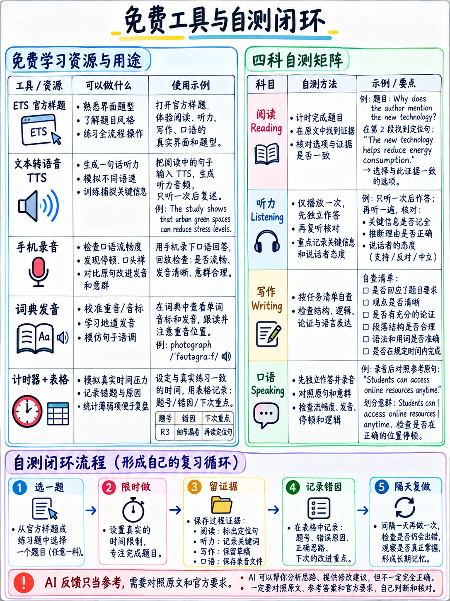

# 6.7 免费工具和自测试




## 6.7.1 官方免费资料——全部使用

|资源 |它给你什么 |哪里 |
|---|---|---|
| **更新的 TOEFL iBT 考试概述**（28 页 PDF）| **九种任务类型**中的每一种**的一个有效示例，带有脚本和答案键，**加上完整的所有四种评分标准** | [1] |
| **2026 年测试蓝图和规范**（18 页 PDF）|项目数量、原始分数、CEFR 目标、文本和音频长度、自适应设计 | [2] |
| **练习测试 1** 和 **练习测试 2**（各 36 页）|两项完整纸质测试与 2026 年 1 月 21 日起的测试一致，并附有答案 | [10][11] |
| **托福考试准备** |一个免费帐户，包含免费的完整练习测试（AI 评分）、免费的部分采样器和日常活动 | [19] |
| **2026–2027 年信息公告**（17 页）|每条规则：身份证、个人物品、草稿纸、评分、取消、重考 | [12] |
| **分数量表更新页面** | 1-6 级、CEFR 映射、0-120 分的一致性以及雅思比较 | [8] |

:::{important} 在阅读其他内容（包括本包的其余部分）之前，请先阅读 [1]
二十八页。它包含每个任务类型的官方示例和**完整的文本
所有四个评分指南**。几乎没有候选人会读它。它是免费的。
:::

:::{warning} 两个不适合此测试的官方资源
- **TOEFL iBT 考试准备计划** — 仍从准备页面 [19] 链接的 8 周计划。它
  是为 2026 年之前的测试而写的。使用前请检查其内容。
- **任何流通中的 TPO（托福在线练习）套装。** 所有旧格式。
:::

## 6.7.2 制作自己的音频

### 文本转语音

```bash
# Linux
sudo apt-get install espeak-ng
espeak-ng -v en-us -s 150 "Free weights are in the back."
espeak-ng -v en-gb -s 150 -f sentences.txt          # whole file
espeak-ng -v en-us -s 150 -w out.wav -f sentences.txt   # save to a file

# macOS
say -v Samantha -r 150 "Free weights are in the back."
say -v Daniel -r 150 -f sentences.txt -o out.aiff
```

|语音 |旗帜|
|---|---|
|美国 | `-v en-us` (espeak) · `-v Samantha` (macOS) |
|英国 | `-v en-gb` · `-v Daniel` |
|澳大利亚 | `-v en-029` 或在线 TTS |

 旋转口音：测试使用“美国/加拿大、澳大利亚和英国英语变体”[2].

:::{note} espeak-ng 足以用于听写，但不适用于韵律
将其用于 60 句听写库。对于对话、公告和演讲，请使用 **real
人类语音**：官方练习音频[19]，新闻广播，或者学习伙伴。合成的
声音不会教你自然节奏，而这正是“聆听和重复”实际上所需要的。
:::

### 自己录制

```bash
# Linux — record 15 seconds to a file
arecord -f cd -d 15 answer.wav
aplay answer.wav

# convert / trim / change speed with ffmpeg
ffmpeg -i answer.wav -af "atempo=1.0" answer.mp3
ffmpeg -i long.mp3 -ss 00:01:30 -t 00:00:90 clip.mp3   # extract 90 seconds
```

手机语音备忘录应用程序就足够了。唯一的要求是你**倾听**。

:::{tip} 记录您将测试的方式
家庭版禁止耳机和耳机 [20]，因此您将对着笔记本电脑的内置扬声器说话
麦克风与扬声器发声。 **完全按照该配置进行练习。** 房间回声和
扬声器漏音是真实存在的，在测试当天发现它们的成本很高。
:::

## 6.7.3 模拟各部分

|部分|如何模拟|
|---|---|
| **阅读** |什么也不打印。在屏幕上、在纯文本窗口中滚动阅读——这就是测试。使用**可见的倒计时器** |
| **聆听** |仅限一场。如果您要在家测试，请使用计算机扬声器。 **隐藏项目之间的笔记**以模拟无法返回 |
| **写作** |纯文本编辑器，具有**拼写检查和自动更正功能** [18]。三个独立的计时器：~6 分钟、7 分钟、10 分钟 |
| **讲话** |屏幕上显示 45 秒倒计时。记录。 **无需准备时间** — 读完问题后立即开始录音 |
| **全面测试** |两个小时，没有休息，在另一个房间打电话，正确顺序：**阅读 → 听力 → 写作 → 口语** [1] |

:::{important} 模拟中部分顺序不是可选的
经过近两个小时的全神贯注后，演讲是**最后**的。如果你只练习
当新鲜的时候说话，你会对考试当天的感觉感到惊讶。模拟疲劳
至少两次。
:::

## 6.7.4 免费练习输入源

|需要|来源 |
|---|---|
| **两人简短对话及文字记录** | VOA 学习英语、BBC 学习英语“6 分钟英语”、任何带脚本的 ESL 播客 |
| **100–250 字的说明性演讲** |大声朗读科学新闻简报；任何大学讲座剪辑的前 90 秒 |
| **200字学术文章** |简单英文百科全书文章；科学与历史新闻摘要|
| **日常生活文本** |你自己的生活（英语）：收据、时间表、应用程序通知、航空公司电子邮件。将手机切换至英语 |
| **完成单词材料** |任何 70-100 字的段落。自行应用规则（{doc}`../40-reading/02-complete-the-words` §4.2.1）|
| **听并重复句子** |博物馆、体育馆、图书馆和校园参观视频 — ETS 使用的确切寄存器 |
| **上下文中的习语** |任何电影或连续剧，逐行暂停 |

## 6.7.5 词典和参考

|需要|工具|
|---|---|
|用国际音标和音频发音 |剑桥词典· 韦氏词典· 朗文| English
|哪个介词与单词搭配 |任何学习者的词典——看例句，而不是定义 |
|一个单词是否可数 |学习者词典标记 `[C]` / `[U]` |
|词族（*决定/决定/果断*）|词典条目的“相关词” |
|搭配 |搜索引号中的短语，看看真实页面是否使用它 |

**练习时不要使用双语词典。** 它给你翻译并抢走你的
面试奖励的英语定义技能
({doc}`../20-speaking/04-fluency-engine` §2.4.2).

## 6.7.6 合理使用人工智能工具

|使用|判决 |为什么 |
|---|---|---|
|生成额外的完成单词段落 | **好** — 但请自行应用删除规则并检查字母计数 |机械的，可验证的|
|生成构建句子项目 | **好** - 然后验证是否只有一种安排使用了所有块 |可验证 |
|生成目标长度的听写句子 | **好** |可验证 |
|寻求对您的电子邮件或讨论帖子的反馈 | **有用，但要小心** - 要求它根据 [1] 中的 **官方标题文本** 进行评分，您可以将其粘贴到 |标题是基本事实，而不是模型的品味 |
|要求它写出一个标准答案供你记忆| **不好** |记忆的语言是第 1-2 级领域：“最少的原始语言；任何连贯的语言大多是借用的” [1] |
|要求它“提高”你的写作 | **有风险** |你吸收了一个不属于你的寄存器，并且无法在 7 分钟时钟下复制 |
|问它托福格式是什么 | **危险** |大多数模型的训练数据早于 2026 年 1 月 21 日，并将描述旧测试 |

:::{danger} 寄存器陷阱
如果你的练习论文是由模型润色的，会发生两件事：你的定时、独立写作
不再符合你的练习写作，你开始写出你无法维持的句子。人工智能
记分员正在寻找*您*一致的语言能力，而不是您最好的编辑句子。

**自己写，在时钟下。仅使用该工具进行标记。**
:::

## 6.7.7 支付什么，如果支付任何东西

按优先顺序：

1。 **第二次开庭**，如果您的机构接受 MyBest 并且您的部分参差不齐
   （{doc}`../00-foundations/03-how-scoring-works`§0.3.8）。
2. **关于口语和写作的人为反馈**——老师、导师、会告诉你的流利的朋友
   老实说你是否听得懂。这是你真正无法独自完成的一件事。
3. **TOEFL TestReady 付费等级**，以正确的格式进行更多 AI 评分的完整模拟测试
   [19]。
4. **没有别的了。** 具体来说：不是一本 600 页的准备书（大部分是 2026 年之前的），不是词汇表
   应用程序，不是不使用单词*完成单词*.

## 的通用英语课程 6.7.8 最小日常套件

 您每天所需的一切都在一个地方：

```
   □ A timer you can see          (phone in clock mode, or a kitchen timer)
   □ A recorder                   (phone voice memo)
   □ A plain text editor          (spell-check OFF)
   □ Headphones for practice —    but a speaker/mic dry run if you test at home
   □ The error log                (a notebook or one spreadsheet)
   □ The 60-sentence bank         ({doc}`../20-speaking/05-speaking-practice-bank` §2.5.2)
   □ The spelling list            ({doc}`03-spelling-and-typing` §6.3.4)
   □ One official PDF open        ([1], for the rubrics)
```

这就是整个设置。它不需要任何成本。

---

**下一篇：** {doc}`../70-references/01-sources-and-reliability` - 使用的每个源，每个源是什么
证明了，还有什么尚未证实。