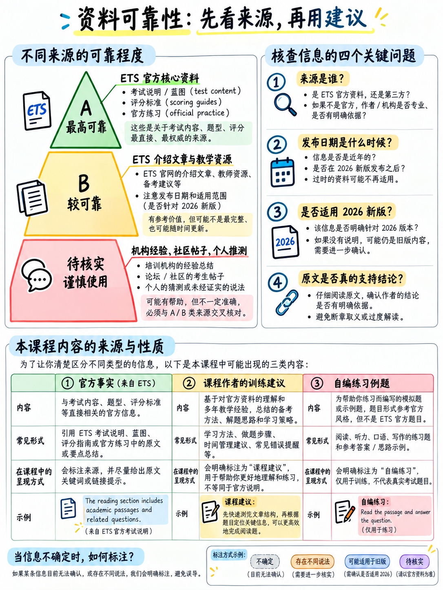

# 7.1 来源、可靠性和尚未验证的内容

## 7.1.1 本封装中使用的可靠性等级

|等级 |意义|
|---|---|
| **A — 明确** |为此版本的测试发布的 ETS 文档。视为事实 |
| **B — 可靠** | ETS 营销、传单、新闻或教材。有时内部不一致；与 A 级交叉检查 |
| **C — 分析** | **针对此包**根据 A 级事实进行推理。无论出现在哪里，都被标记为分析 |
| **D — 未经验证** |我们无法找到这一说法的来源。已标记并在第 §7.1.4 节中列出 |

**下面的每个 URL 均于 2026 年 10 月 13 日返回 HTTP 200。**

## 7.1.2 来源

### [1] *更新的 TOEFL iBT® 测试概述* — A

 年级 A

28 页 PDF，© 2025美国教育考试服务中心。
`https://www.eu.ets.org/pdfs/toefl/toefl-ibt-test-at-a-glance.pdf`
还发布为*更新的 TOEFL iBT 考试概述*：
`https://www.in.ets.org/content/dam/ets-india/pdfs/toefl/toefl-ibt-test-overview.pdf`
*（这两个文件有几个词不同——“需要不到两个小时”与“大约需要
两个小时” - 并且在结构表的布局中。内容在其他方面是相同的。）*

→ **证明：** 部分结构和顺序； **所有九个的完整描述和工作示例
任务类型**；音频和文本长度； 7 分钟和 10 分钟写作时钟； 8-12秒
和 45 秒的演讲窗口； **所有四个 0-5 评分指南的完整文本**；表1（原始
分数范围 0–30 / 0–30 / 0–20 / 0–55)；表2（CEFR映射）；表 3（0-30 的一致性和
0–120）；我最好的； 

**这是所有 2026 年 TOEFL 考生最重要的文档，而且是免费的。**

### [2] *TOEFL iBT® 测试：2026 更新 — 测试蓝图和规范文档* — A

 年级 18 页 PDF。
`https://www.ets.org/content/dam/ets-india/pdfs/toefl/toefl-ibt-test-specifications-2026.pdf`

→ **证明：** 每个任务项目都很重要（完成单词 30；聆听并选择答案 15–19；
构建句子 10；听并重复7；参加面试 4); **每件商品的原始积分**（1 表示
阅读、听力和造句； **每封电子邮件、讨论、重复和采访 5 次
项目**）；总共120个项目和145个原始点；最短/最长测试时间 1 小时 23 – 1 小时 29 分；路由器和
模块计时；每项任务的 CEFR 目标；文本难度范围；音频长度；四节
索赔；口音；人工智能生成的音频；机器与人工智能评分；预测试项目的存在。

**文档本身中打印的警告：**“本文档中概述的测试规范是
作为持续开发和验证过程的一部分，可能会进行细微修改，直到
正式启动评估。”

### [3] *TOEFL iBT 测试内容*（考生页面）— 等级 A

`https://www.ets.org/toefl/test-takers/ibt/about/content.html`
→ **证明：**当前结构表（50 / 47 / 12 / 11 项；30 / 29 / 23 / 8 分钟）；
“大约需要两个小时”； “随着测试的调整，测试时间和项目可能会有所不同”；总体
分数是四个部分的平均值，四舍五入到最接近的半段（例如：5.125 → 5）；的
最小响应规则；没有预定的休息时间。

### [4]–[7] 四个部分页面 — 年级 A

- [4] 阅读 — `https://www.ets.org/toefl/test-takers/ibt/about/content/reading.html`
- [5] 听力 — `.../content/listening.html`
- [6] 写作 — `.../content/writing.html`
- [7] 口语 — `.../content/speaking.html`

→ **证明：** ETS 自己的话的任务类型描述； “您需要回答的所有信息
问题包含在正文中”； “您不需要先了解该主题”； “你可以
边听边记笔记”；口音列表； “评分重点在于你如何清晰有效地
传达您的想法，而不是写出完美的初稿。”

### [8] *TOEFL iBT 分数量表 1 至 6：CEFR 和 IELTS 比较* — A

`https://www.ets.org/toefl/institutions/ibt/score-scale-update.html`
→ **证明：** 1-6 等级生效 **2026 年 1 月 21 日**； CEFR 对照表；的
一致性为 0-30 和 0-120； **推荐要求表（100→5、90→4.5、80→4、70→3.5）**；
“TOEFL iBT 5 分相当于 95 分及以上（至 106 分）”；舍入示例 (5.125 → 5;
5.25→5.5）； TOEFL-IELTS 对照表。

*已知的内部不一致：* 该页面在范围表中将 4.5 列为“86+”，并在其常见问题解答中注明
4.5 与 **90**（中点）一起报告。两种陈述均在页面上。

### [9] *TOEFL iBT 分数细分 — 您的分数意味着什么* — 成绩 A

`https://www.ets.org/toefl/test-takers/ibt/scores/understand-scores.html`
→ **证明：** 测试后 3 天发布分数；有效期2年； 4份免费成绩报告； PDF报告
电子成绩后1天；纸质副本 11-15 天； 30天内进行分数审核； “没有
通过或未通过 TOEFL 计划或 ETS 设定的分数。“

### [10] *TOEFL iBT® 模拟考试 1* — A

36 页 PDF 成绩，© 2025 ETS，封面声明：“此模拟考试 **与 TOEFL iBT 测试一致
2026 年 1 月 21 日**。它并不是实际测试的精确复制；方向和问题有
已针对纸张格式的可用性进行了调整。”
`https://www.in.ets.org/content/dam/ets-india/pdfs/toefl/toefl-ibt-full-length-practice-test-1.pdf`

→ **证明：** 每项任务的屏幕说明；阅读和听力两个模块
结构； “一旦开始第 2 单元，您将无法返回第 1 单元”； “你不会
能够返回之前的问题”（听力）； “不会提供准备时间”
（都是口语任务）； “仅重复一次”；完成单词的完整答案
段落和十个构建句子项目。

### [11] *TOEFL iBT® 模拟测试 2* — A

`https://www.in.ets.org/content/dam/ets-india/pdfs/toefl/toefl-ibt-full-length-practice-test-2.pdf` 等级
→ **证明：** 第二套完整的内容，包括校园健身房聆听和重复场景以及
通勤习惯面试——这就是四时段面试模式的方式
{doc}`../20-speaking/03-take-an-interview` §2.3.2 是通过三个独立示例建立的。

### [12] *2026–2027 TOEFL iBT® 信息公告* — A

17 年级 PDF，© 2026 ETS，文件于 2026 年 6 月 29 日创建。
`https://www.eu.ets.org/pdfs/toefl/toefl-ibt-bulletin.pdf`
→ **证明：** {doc}`../60-toolkit/06-exam-day-checklist` 中引用的每条规则 — 3 天重考
规则；提前30分钟到达；家庭入住登记窗口；违禁物品；草稿纸规则；
家庭笔记材料；没有预定的休息时间；最小响应规则；取消和
恢复分数； 30天内进行分数审核；我最好的； 2年有效期； **澳大利亚签证
例外**.

### [13] *TOEFL iBT 正在进入一个新时代*（顾问传单） — B

2 级 PDF，© 2025 ETS。
`https://www.in.ets.org/content/dam/ets-india/pdfs/toefl/toefl-ibt-updates-flyer-for-advisors.pdf`
→ **证明：** 发布日期为 2026 年 1 月 21 日； “72小时内的分数”；并排的
新旧结构的比较；项目范围 35–48 和 35–45。

### [14] *TOEFL iBT — 即将更新*（考生） — B

`https://www.in.ets.org/toefl/test-takers/ibt/upcoming-updates-jan-2026.html`
→ **证明：**“于 2026 年 1 月 21 日在全球推出”； “将提供 0-120 个可比较的结果
两年”；阅读段落现在包括“杂志和网站摘录”。

### [15] *即将更新*（教师、顾问和代理人）— B

`https://www.ets.org/toefl/teachers-advisors-agents/ibt/teaching/upcoming-updates-jan-2026.html` 级
→ **证明：** “测试的阅读和听力部分会根据学习者的水平进行调整”；
“传统的学术主题已被现代相关的、现实生活的内容所补充。
学术生活。”

### [16] *托福转型公告*（新闻稿）— B 级

`https://www.ets.org/news/press-releases/toefl-transformation-announcement.html`
→ **证明：** 三阶段部署（2025 年 5 月家庭版更改；2025 年 7 月准备资源；
2026 年 1 月适应性、内容、评分和周转）； “测试将根据实时调整
关于学生的表现”；分数“在 72 小时或更短时间内”；更换考试中心
带定制立体声耳机的耳机。

### [17] *TOEFL iBT® 课程计划：口语* — B

`https://www.in.ets.org/content/dam/ets-india/pdfs/toefl/toefl-ibt-lesson-plan-speaking.pdf`
→ **证明：**“考生将听到七个句子……每个句子只会听到一次”；
面试式答案的课堂练习时间。

### [18] *TOEFL iBT® 课程计划：写作* — B

`https://www.ets.org/content/dam/ets-india/pdfs/toefl/toefl-ibt-lesson-plan-writing.pdf`
→ **从它自己的答案证明：** “对于写电子邮件任务，您将有 **七分钟
总共阅读和回复**”； “建议的讨论最少为 **100 个字**”；
“您**可以**利用**字数统计**功能”； “**写作部分的任务不包括
拼写检查功能**用于回复。“

### [19] *TOEFL iBT 测试的测试准备* / **TOEFL TestReady** — B

`https://www.ets.org/toefl/test-takers/ibt/prepare.html` 级
`https://www.ets.org/toefl/test-takers/ibt/prepare/toefl-testready.html`
→ **证明：** 存在哪些官方免费和付费准备；免费的完整练习测试
具有AI评分功能；免费切片采样器。 *注意：“TOEFL iBT Test Prep Planner”链接自此
该页是为 2026 年之前的测试编写的 8 周计划。*

### [20] *在家测试要求* — A

`https://www.ets.org/toefl/test-takers/ibt/register/at-home-requirements.html` 年级
→ **证明：** 仅限台式机或笔记本电脑（不是平板电脑或手机）； **一台显示器**； **耳机和
不允许使用耳机**； 360°房间景观；第二个摄像头要求（如果适用）。

### [21] *身份 (ID) 要求* — 等级 A

`https://www.ets.org/toefl/test-takers/ibt/register/id.html`
→ **证明：** 仅限原件，未过期，有照片和签名；名称必须完全匹配；的
建议携带两种表格；不可接受的文件清单。

###也参考过，不单独引用

- *测试内容和结构*（机构） —
  `https://www.ets.org/toefl/institutions/ibt/about/content-structure.html` — 结构相同
  表为[3]，为机构编写。
- *获取您的 TOEFL iBT 成绩* —
  `https://www.ets.org/toefl/test-takers/ibt/scores/get-scores.html`
- *重新参加 TOEFL iBT 考试的 6 个技巧* —
  `https://www.ets.org/toefl/blog/retaking-the-toefl-ibt-tips.html`
- *设置 TOEFL iBT 分数要求*（针对机构）—
  `https://www.ets.org/toefl/institutions/ibt/set-score-requirements.html`

### 社区和第三方材料

A 多个考试准备网站发布了 2026 个解释器（Study.com、lingoleap、goarno、prepex、
大学理事会、master-toefl、toefmocktests、mliesl、aflo 等）。 **它们都没有被引用为
此包中任何地方的证据。** 只读它们只是为了检查官方是否有任何内容
被错过了，并且他们在测试长度、项目数量和时间安排上存在分歧。

:::{danger} 为什么第三方 2026 年材料存在风险
在格式更改后的几个月内，准备站点重新发布速度很快，验证速度很慢。期间
对此包的研究中，第三方来源给出的测试长度各不相同，为 70-90 分钟，
“大约两个小时”，90分钟；并给出了与 [1] 和 [2] 都不匹配的项目计数。

**如果索赔对您的准备工作很重要，请在 [1]、[2] 或 [12] 中进行检查。**
:::

:::{note} Reddit 和论坛
用于此软件包的搜索工具**无法访问** Reddit，因此没有论坛报告
参考了2026年的真实测试经验。这是一个真正的差距：候选人报告将是
有关自适应路由在实践中的感受等内容的最佳来源。对待你读到的任何东西
一个论坛为 D 级，直到您可以将其与官方文档相匹配。
:::

## 7.1.3 此包装的原始内容

 清楚地标记，以便您知道要仔细检查的内容。

|内容 |状态 |
|---|---|
|所有结构、时间、评分标准和评分声明 | **引自 [1][2][3][12]** |
| (4 × 目标 − 1) 规则 | **分析**，源自官方舍入规则并根据 ETS 自己的工作示例进行验证 (5.125 → 5; 5.25 → 5.5) |
|每个任务的原始分数百分比细分 | **算术**来自 [2] |
|声称 60% 的阅读项目已完成单词 | **算术**，来自 [2]（30 条，共 50 条）|
|完整单词删除规则的解码（保留 ⌊n/2⌋；句子 2 中的每个偶数单词；跨句子继续计数）| **分析**，统计ETS公布的例子及其答案[1][10] |
|四槽面试模式| **分析**，来自三篇已发表的采访 [1][10][11] |
| Listen and Repeat 的句子长度概况（5-15 个单词，升序）| **根据两个已发布的场景 [1][10][11] | 测量**
| ETS 样本回复的字数统计（电子邮件 118，讨论 79）| **根据已发表的文字[1] | 计算**
|所有练习材料 — 60 个听写句子、60 个听并重复句子、40 个造句项目、12 个完整单词段落、24 个听选项目、12 个电子邮件场景、20 个讨论提示、3 个阅读段落、3 个对话、3 个公告、2 个学术演讲 | **为此包编写**，符合已发布的规范。不记得测试内容 |
|所有模型答案 | **为此包而写**；字数统计机器验证 |
|层级列表、努力百分比、预期收益表、错误原因分布 | **分析**。标记到位 |
| “80–180 个单词”和“110–150 个单词”目标 | **从示例长度和标题进行分析** |
|第一语言干扰表 | **对比音韵学**，不是托福内容。标记为 |

## 7.1.4 未经验证的声明

 无法获取此包中的三个声明。每个在出现的地方都有标记。

**1。完成单词是否都接受英式和美式拼写。**
位置：{doc}`../60-toolkit/03-spelling-and-typing` §6.3.2。
未找到 ETS 声明。该任务删除一个单词的后半部分，这是两个单词的位置
约定不同。建议：使用美国表格。

**2。构建句子任务的确切时钟。**
位置：{doc}`../30-writing/01-how-writing-is-scored` §3.1.1 和 §3.1.6。
ETS发布整个部分23分钟，两个长任务[1][18] 7 + 10分钟，
还剩下大约 6 分钟。练习测试只说“时钟会告诉你你花了多少时间”
必须完成这个任务“[10]。每个项目大约 35 秒的数字是**算术**，而不是 ETS
声明。

**3。哪些阅读和听力项目是预测试（不计分）。**
位置：{doc}`../00-foundations/01-what-the-test-is` §0.1.2。
ETS 表示存在预测试项目，并且“所有考生都将收到阅读或听力
预测试项目”[1][2]，但没有给出哪些、多少或在哪里的指示。

## 7.1.5 规定的限制

**1。不存在公开的原始分数到等级的转换。** 我们知道阅读的得分为 30 分，并且
讲出55 [1]；我们不知道什么原始分数产生了乐队 4。任何发布这样的网站
表发明了它。此包中的每个原始分数目标都标记为analysis.

**2。没有关于改善率的数据。** 中的预期收益表
{doc}`../00-foundations/06-choose-your-target` §0.6.2 和每任务目标
{doc}`../50-listening/01-scoring-and-section-tactics` §5.1.8 是合理的估计，而不是
测量值。

**3。该蓝图明确是临时的。** [2] 声明其规格“受
小修改......直到正式发布”。该项目计入 [2]（50 阅读，47 听力）和
实时页面 [3] (35–48, 35–45) 上已经有所不同。将精确计数视为近似值；对待
*比例*可靠。

**4。该软件包于 2026 年 10 月**编译，即发布九个月后。 ETS 继续
更新其页面。检查任何影响决策的内容。

## 7.1.6 如何检查此包中的任何内容

|问题 |去哪里看|
|---|---|
| “这种任务类型是真实的吗？” | [1]，任务说明|
| “这些东西一共有多少？” | [2]，蓝图表|
| “标题实际上说了什么？” | [1]，评分指南部分，第 22–28 页 |
| “我还有多少分钟时间？” | [1] 用于写作和口语时钟； [2]为自适应时序模块|
| “我需要什么乐队？” | [8]，推荐要求表——然后**询问机构** |
| “考试当天有什么规则？” | [12] |
| “我可以带X吗？” | [12]，个人物品|
| “真实物品的格式是什么？” | [10] 和 [11] |

---

**下一篇：** {doc}`02-outdated-advice-red-flags` — 如何在十秒内判断是否是托福
资源描述了您正在参加的测试。