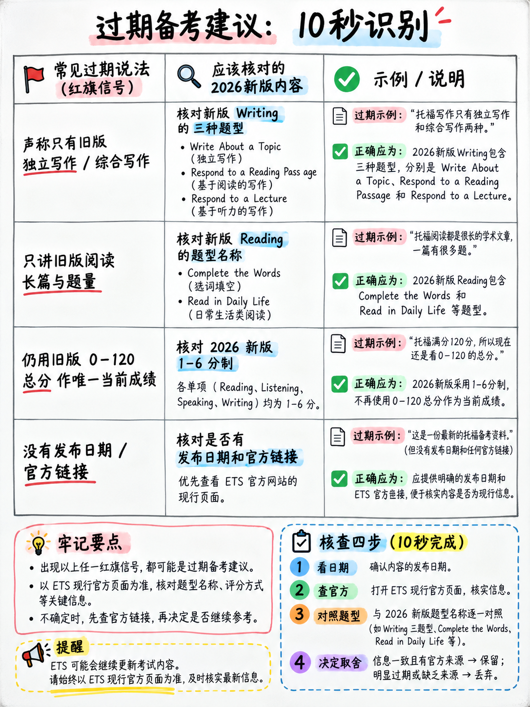

# 7.2 过时的建议：红旗




:::{admonition} 为什么本章存在
:class: danger
TOEFL iBT 于 **2026 年 1 月 21 日**发生了变化。几乎所有关于托福的文章——数十篇
数以千计的书籍、视频、课程、论坛帖子和“完整指南”——描述了以前的内容
测试。其中大部分仍在出售。其中一些已重新发布，标题中带有“2026”，
里面的旧内容。

这一章是过滤的。将其用于您获取的每一项资源，包括这一资源。
:::

## 7.2.1 十秒测试

在任何资源中搜索这三个字符串：

```
   "Complete the Words"      "Build a Sentence"      "Listen and Repeat"
```

**如果这三个都不存在，则该资源描述的测试不再存在。**停止阅读它。

另外两项检查：

|检查 |当前答案 |
|---|---|
|它给出的部分分数是否为**30**？ |错误的。部分为 **1–6 半频带** [1][8] |
|是否说测试需要 **3 小时** 或 **2 小时以内**，并有 **10 分钟休息时间**？ |错误的。 **大约 2 小时，无计划休息** [1][12] |

## 7.2.2 12 个过时标记

 其中每个标记本身都将资源的日期追溯到 2026 年之前。

|标记|现在的情况是怎样的 |
|---|---|
| “**独立写作任务** — 30 分钟，300 字” | **不存在。** 最长的写作任务是一篇 100-140 字的讨论帖 [1] |
| “**综合写作**——阅读一篇文章，听一场讲座，总结”| **不存在** [1] |
| “**口语任务 1**：15 秒准备，45 秒谈论个人喜好”| **不存在。**口语是7次重复+4道面试题，**没有准备时间** [1][10] |
| “**综合口语任务 2–4**” | **不存在** [1] |
| “阅读段落**700字**，3-4段，每段10个问题”| **200字**，5个问题 [1] |
| “**讲座时长 4-6 分钟**，有 6 个问题”| **100–250 字**，4 个问题 [1][2] |
| “您的总分是 **满分 120**” | 1-6。提供类似的 0–120 **仅两年** [1][8] |
| “每个部分的得分 **0–30**” | 1–6 半频带 [1] |
| “听完后有**10分钟的休息时间**” | “**没有安排休息**”[12] |
| “**在文章中插入一句话**”/“**散文摘要**”项 |消失了 [1] |
| “该测试**在问题级别上具有适应性**”| **两级**自适应：一个路由器，一个第二模块，仅阅读和听力 [2] |
| “托福不测试拼写”| **完整的单词是机器标记的精确字母匹配** [1][2] |

## 7.2.3 十四条目前严重错误的建议

|常见建议 |为什么现在就错了 |
|---|---|
| “记住 5 段论文模板。” |没有论文。讨论帖为 100-140 个单词，记忆的语言为第 1 级：“任何连贯的语言大多是从刺激中借用的” [1] |
| “写350+字即可获得高分。” |两个写作标题中都没有出现字数统计。 ETS自己的高级讨论范例是**79字** [1] |
| “学习2000个学术词汇。” | “不需要背景知识”[1]； ETS 自己的完成单词示例中的十个空白中有七个是语法单词 [1][10] |
| “先浏览文章，然后阅读问题。” |文章有200字。正确阅读一次[1] |
| “阅读文章之前的问题。” |专为 700 字的段落而设计。 200字就让你无法通过主要思想和推理项目 |
| “上课时做详细的笔记。” |最长的音频为250字[2]。写作需要听力所需的记忆 |
| “尽可能多地使用先进的连接器。” |采访标题仅将连接器命名为频段 4 [1]“可能缺少”的东西。没有什么可以奖励他们|
| “口语任务 1 是最简单的——为其准备模板。” |没有任务 1。有聆听和重复，无需准备 |
| “用 15 秒的准备时间做笔记。” | **“不会提供准备时间”** — 对于两项口语任务 [10][11] |
| “完美的语法和拼写至关重要。” | ETS 自己的高级电子邮件示例包含*参与*、*成功*、*已收到*和一个不完整的动词短语 [1][18] |
| “永远不要使用填充词。” | ETS 自己的高级面试范例在其第一个答案中包含七个“嗯”[1] |
| “通过 TPO 测试进行练习。” |每个流通的 TPO 集都是旧格式 |
| “托福考试的目标是100分。” |以新的规模表达您的目标。 100 ≈ 带 **5** [8] |
| “你可以在最后返回并更改你的听力答案。” | **“您将无法返回到之前的问题。”** [10] |

## 7.2.4 对任何资源的四项精度测试

 询问一本书、一门课程或一个视频。当前资源正确回答了所有四个问题。

|问题 |正确答案|
|---|---|
|有多少部分，按什么顺序？ |四：**阅读→听力→写作→口语** [1] |
|口语部分有多长？ | **约 8 分钟**，11 件 [1] |
|演讲前你有多少准备时间？ | **无** [10][11] |
|您将阅读的最长文本是什么？ | **约200字** [1] |

## 7.2.5 按来源类型划分的风险

|来源 |过时的风险 |
|---|---|
| 2026 年之前印制的一本书 | **肯定** |
|一本 2026 年印刷的书，内容页上没有新任务名称 | **非常高** |
| 2026 年之前上传的 YouTube 视频 | **肯定** |
| 2026 年上传的视频从未说过“完成单词”| **非常高** |
|仍教授独立论文的预科课程 | **肯定** |
|免费的“TOEFL 2026 指南”博客文章 | **高** — 许多内容是重新发布的旧内容，或由人工智能根据 2026 年之前的训练数据生成 |
|人工智能聊天机器人问“托福格式是什么？” | **高** — 大多数模型的知识早于变化 |
| ets.org | **低** - 但检查页面本身的日期并对照实时页面交叉检查 PDF |

:::{warning} AI 生成的指南问题
现在在线的“TOEFL 2026”页面很大一部分是由语言模型生成的，这些模型
训练数据早于 2026 年 1 月 21 日。他们自信地用新日期描述了旧格式


**用§7.2.4测试它们。** 一个资源说“口语给你 15 秒的准备时间”
描述一个不再存在的测试，无论其标题是什么。
:::

## 7.2.6 值得纠正的十大错误信念

|信念|现实|
|---|---|
| “对于初学者来说，口语是最难的部分。” | **64% 的口语原始点来自重复句子** [2]。对于初学者来说，这可能是最容易移动的部分 |
| “写作需要好的想法。” |写作部分的 50% 是一个词序谜题，提供的单词为 [2] |
| “读书讲究的是速度。” |总阅读量约为 900-1,400 字。精度，而非速度 |
| “词汇是托福考试的关键。” |理解 [1][4] 显然不需要，并且主要的阅读任务在语法单词上运行 |
| “适应性测试会因为你的糟糕开始而惩罚你。” |它选择第二个模块。这是测量，而不是惩罚——但路由器占了该部分的三分之二，所以**热身** |
| “错误的答案比没有答案更糟糕。” |没有处罚。 **空白绝对比猜测更糟糕** [2] |
| “你应该取消一个坏成绩。” |取消将删除所有四个部分，并且不予退款 [12]。 MyBest 只为您提供帮助 |
| “0-120的分数已经废除了。” |它仍然作为可比较的总体数字**两年** [1][8] |
| “MyBest 意味着我一次只需要准备一个部分。” |仅当您的机构接受 MyBest 时。许多人不 - **问** |
| “每个人都会接受同样的测试。” |写作和口语是线性且共享的； **阅读和听力是自适应的，并包含预测试项目** [2] |

## 7.2.7 *这个*包中的内容将首先变得陈旧

写于2026年10月。最有可能改变的事情：

|可能会改变 |为什么 |
|---|---|
| **准确的物品数量** | [2] 表示其规格“可能会进行细微修改”； [2] 和 [3] 已经存在分歧（50 vs 35–48）|
| **两年 0–120 参考** |预计于 2028 年 1 月左右结束 [1][14] |
|费用、考试日期和中心可用性 |不断变化；经常查看 ets.org |
|免费准备资源列表 [19] | ETS 正在积极添加 2026 年特定材料 |
|机构分数要求 |大学正在以不同的速度按 1-6 级重述它们 |
|澳洲签证例外[12] |明确描述为“当前”|

|不太可能很快改变 |为什么 |
|---|---|
|九种任务类型 |这种规模的重新设计不会很快重复|
| 1-6 级及其 CEFR 映射 |已发布的、面向机构的标准 |
|四大评分指南|量规是稳定的资产|
|章节顺序和总持续时间|核心设计|
|公告中的规则 |政策，最多每年更新 |

:::{important} 要保持的习惯
在测试之前，请花二十分钟在 [1]、[2] 和 [12] 上，并确认其中没有任何内容。
{doc}`../00-foundations/01-what-the-test-is` 已更改。这就是整个维护成本
这个包。
:::

---

**返回:** {doc}`../index`