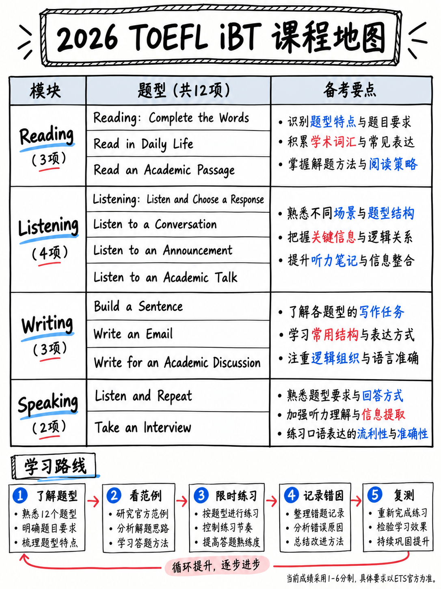

# TOEFL iBT 2026：零基础完整备考课程

> **课程定位**：面向第一次准备 TOEFL iBT、备考时间有限，或英语口语基础较弱的学习者。课程依据素材包所述的 2026 年新版考试结构，从考试规则和目标分规划入手，带学习者逐步掌握四科题型与考场策略。
>
> **课程特点**：以题型、评分和时间分配为主线，强调“先练高回报的基础题，再处理耗时的学术任务”。重点训练听后复述、句子排序、补全单词和听后选择回应，并从发音、节奏和意群训练打好口语与听力基础。配套分级练习、错题记录、7/14/28 天学习计划、考前清单和官方资料可靠性说明。

:::{admonition} 请先阅读此框
:class: danger

**TOEFL iBT 于 2026 年 1 月 21 日进行了全面改革。** 几乎所有书籍、课程和视频仍在介绍旧版托福：独立论文、综合口语任务、
700 字的段落，0-120 分。所有这些都消失了。

这个包描述了现在的测试，包括每一个结构、时间和评分声明
引用自为此版本发布的 ETS 文件。 **所有源 URL 均已验证
2026 年 10 月 13 日。**

 对您获取的任何其他资源进行十秒测试：搜索 **“完成单词”**，
**“造一个句子”**和**“听并重复”**。如果这三个都缺失，则描述的是
测试不再存在。 → {doc}`70-references/02-outdated-advice-red-flags`
:::



*图：新版 TOEFL iBT 四科结构、自适应模块与新版旧版题型对照。*

## 塑造一切的五个事实

| ＃|事实|来源 |
|---|---|---|
| 1 |考试时间**约2小时**，四部分，**无休息**，按照固定顺序**阅读→听力→写作→口语** | [1][3][12] |
| 2 |每个部分的分数为 **1-6 半分**，总体分数为 **普通平均值**，四舍五入到最接近的半分 | [1][8] |
| 3 | **口语部分的原始分数的 64% 来自重复刚刚听到的句子**（7 项 × 5 分，共 55 分）| [2] |
| 4 | **写作部分的原始分数的 50% 来自词序谜题**（10 项 × 20 分中的 1 分）| [2] |
| 5 | **60% 的阅读项目是填空字母任务**（50 项中的 30 项） | [2] |

 事实 3、4 和 5 是此包看起来与其他托福指南不同的原因。三个
2026 年测试中最大的分数是 **机械** - 他们不需要想法，不需要意见，不需要
学术词汇，没有主题知识。对于从零开始学习英语的人来说
这是一个非常好的消息，这就是你应该花时间的地方。
→ {doc}`00-foundations/04-priority-triage`

## 如何使用此包

|如果你有…… |开始于 |
|---|---|
| **一个晚上** | {doc}`00-foundations/02-task-type-inventory`，然后是 {doc}`60-toolkit/06-exam-day-checklist` 中的一页卡片 §6.6.5 |
| **三天** | {doc}`60-toolkit/05-study-plans` §6.5.5，紧急协议 |
| **一周** | §6.5.4 |
| **两周** | §6.5.3 |
| **四个星期或更长时间** | §6.5.2，完整的 28 天计划 |
| **完全没有英语口语经验** | {doc}`10-pronunciation/01-start-here-sound-system` — 从零开始的音响系统 |

**在您计划任何事情之前**，请进行 55 分钟的诊断
{doc}`00-foundations/06-choose-your-target` §0.6.3。它决定了您可以计划的哪些部分
skip.

## 什么样的主张是什么

|内容类型 |可靠性 |
|---|---|
|结构、时间安排、项目计数、标题文本、规则 | **引自 ETS 文件。** 视为事实 |
|对这些数字进行算术（百分比，(4 × target − 1) 规则）| **推导**，推导如图|
|层级列表、努力百分比、预期收益、错误分布 | **此包的分析。** 已标记到位 |
|所有练习材料和示范答案| **根据已发布的规范为此包编写。不记得测试内容 |
|第一语言干扰表 | **对比音系**，不是托福内容 |
|三项具体主张| **[未经验证]** — 列于 {doc}`70-references/01-sources-and-reliability` §7.1.4 |

## 内容

```{toctree}
:maxdepth: 2
:caption: 00 基础篇

00-foundations/01-what-the-test-is
00-foundations/02-task-type-inventory
00-foundations/03-how-scoring-works
00-foundations/04-priority-triage
00-foundations/05-glossary-and-myths
00-foundations/06-choose-your-target
```

```{toctree}
:maxdepth: 2
:caption: 10 零基础发音

10-pronunciation/01-start-here-sound-system
10-pronunciation/02-consonants
10-pronunciation/03-vowels
10-pronunciation/04-word-stress
10-pronunciation/05-rhythm-and-chunking
10-pronunciation/06-connected-speech
10-pronunciation/07-first-language-interference
```

```{toctree}
:maxdepth: 2
:caption: 20 口语

20-speaking/01-how-speaking-is-scored
20-speaking/02-listen-and-repeat
20-speaking/03-take-an-interview
20-speaking/04-fluency-engine
20-speaking/05-speaking-practice-bank
```

```{toctree}
:maxdepth: 2
:caption: 30 写作

30-writing/01-how-writing-is-scored
30-writing/02-build-a-sentence
30-writing/03-write-an-email
30-writing/04-write-for-an-academic-discussion
30-writing/05-writing-practice-bank
```

```{toctree}
:maxdepth: 2
:caption: 40 阅读

40-reading/01-scoring-and-section-tactics
40-reading/02-complete-the-words
40-reading/03-read-in-daily-life
40-reading/04-read-an-academic-passage
40-reading/05-reading-practice-set
```

```{toctree}
:maxdepth: 2
:caption: 50 听力

50-listening/01-scoring-and-section-tactics
50-listening/02-listen-and-choose-a-response
50-listening/03-conversations
50-listening/04-announcements-and-talks
50-listening/05-listening-practice-set
```

```{toctree}
:maxdepth: 2
:caption: 60 备考工具箱

60-toolkit/01-core-vocabulary
60-toolkit/02-grammar-minimum
60-toolkit/03-spelling-and-typing
60-toolkit/04-error-log-method
60-toolkit/05-study-plans
60-toolkit/06-exam-day-checklist
60-toolkit/07-free-tools-and-self-testing
```

```{toctree}
:maxdepth: 2
:caption: 70 参考资料

70-references/01-sources-and-reliability
70-references/02-outdated-advice-red-flags
```

## 今天要确认两件事

:::{important}
**1.您所需的分数，在新的等级上，以及是否有每个部分的最低分数。**
大学仍然发布“托福80”和“托福100”。 ETS的官方翻译是100 → **5**，
90 → **4.5**、80 → **4**、70 → **3.5** [8]。但如果该机构还设定了最低*每
部分*，{doc}`00-foundations/03-how-scoring-works` §0.3.4 中的平衡策略不
适用于你。发电子邮件并询问；保留回复。

**2。 TOEFL iBT 已被接受用于您的目的。** 特别是 2026-2027 年信息
公告指出，“只有在 2026 年 1 月 21 日之前进行的考试和 TOEFL iBT Australia
目前已批准用于 **澳大利亚签证** 目的”[12]。
:::

## 如果你只有一个晚上

1。 **{doc}`00-foundations/02-task-type-inventory`** — 了解所有九种任务类型。格式化震动开启
   考试当天花费的分数比任何英语差距都高。
2. **{doc}`30-writing/02-build-a-sentence` §3.2.3** — 八种模式。十个原始点，可学习
   一小时内。
3. **{doc}`40-reading/02-complete-the-words` §4.2.3** — 功能字表和“计算
   空白”。
4. **{doc}`20-speaking/02-listen-and-repeat` §2.2.5** — 恢复规则。 “永远完成
   句子”本身就值得几个原始点。
5. **{doc}`60-toolkit/06-exam-day-checklist` §6.6.5** — 五张单页卡片。

 来源自始至终编号为 **[1]–[21]**，并完整列出，每张卡片都证明了什么，
{doc}`70-references/01-sources-and-reliability`。
