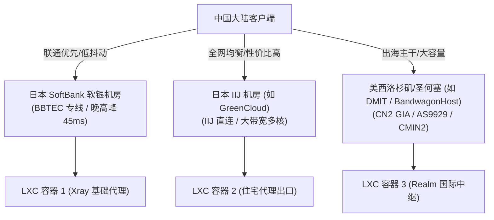
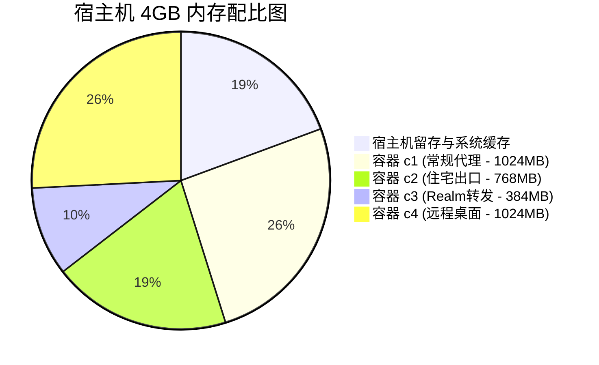

# 1.1 VPS 硬件选型基准、KVM 虚拟化校验与规格配比

> **深入理解 VPS 底层虚拟化技术差异，掌握日本软银、IIJ 与美西主流线路实测特点，确立单机多容器的高可用硬件资源配比公式。**

---

## 一、 底层虚拟化架构准入门槛：为什么必须是 KVM / 裸金属？

在规划 LXC / LXD 容器集群时，**宿主机底层的虚拟化机制是不可逾越的红线**：

| 虚拟化类型 | 特性描述 | 能否运行 LXD 容器集群 | 潜在风险与痛点 |
| :--- | :--- | :--- | :--- |
| **KVM / Proxmox VE (独立 VM)** | 真正的全虚拟化，拥有独立内核与虚拟硬件，支持完整的 cgroup v2 隔离与内核模块加载。 | **完全支持（首选）** | 性能接近物理机，网络命名空间完全可控。 |
| **裸金属服务器 (Bare Metal)** | 无虚拟化层损耗，物理 CPU/网卡完全直通。 | **极致支持** | 成本较高，但单机可支撑数十个高密度轻量容器。 |
| **OpenVZ / 共享型 LXC 容器 VPS** | 操作系统级虚拟化，宿主机与所有租户共享一个宿主 Linux 内核，缺少独立特权与嵌套能力。 | **坚决避开（无法运行）** | 无法创建 `lxdbr0` 托管网桥，内核缺失 BBR，缺少 cgroups 挂载权限。 |

### 宿主机底层快速检测命令

在购买或初始化一台新的 VPS 后，使用以下命令快速验证虚拟化架构与 CPU 指令集支持：

```bash
# 1. 验证是否为标准 KVM 架构
hostnamectl | grep -E "Virtualization|Operating System"

# 2. 检查 CPU 核心数与硬件特性
lscpu | grep -E "Model name|CPU\(s\):|Thread|Architecture"

# 3. 检查系统内存与交换空间配比
free -h

# 4. 检查磁盘剩余空间与挂载文件系统
df -hT /
```

> [!CAUTION]
> 如果 `hostnamectl` 中显示 `Virtualization: lxc` 或 `Virtualization: openvz`，说明当前 VPS 本身就是一个受限的下级容器，绝无法作为 LXD 容器集群的宿主机运行。

---

## 二、 主流机房线路特点与实测对比

针对跨境节点编排与出海运营业务，不同机房线路对三大运营商（电信/联通/移动）的表现差异巨大：



### 1. 日本 SoftBank 软银专线（以实测 203.0.113.186 宿主机为例）
* **线路特征**：走 BBTEC 国际出口，北方及沿海联通网络直连往返仅 35-50ms，抖动极低；
* **业务定位**：适合部署高交互实时业务、SSH 极速跳板机、以及前置 VLESS-REALITY 直连节点。

### 2. 日本 IIJ 线路（以实测 198.51.100.150 宿主机为例）
* **线路特征**：日本本土核心运营商网络，晚高峰略有丢包，但服务器提供商（如 GreenCloud）通常给足内存与磁盘配比（如 4GB 内存 / 22GB 固态）；
* **业务定位**：完美适配 **“单机 4 容器黄金拓扑”**，可将宿主机划分为代理容器、住宅出口容器与 Realm 流量转发中继。

### 3. 美西骨干网（以实测 192.0.2.201 宿主机为例）
* **线路特征**：虽然物理延迟在 130-160ms，但拥有极其充沛的国际带宽储备与清洁 IP 资源；
* **业务定位**：作为国际跨域中继的核心枢纽，连接美东、欧洲以及跨国业务 API。

---

## 三、 单机容器集群规格配比算力模型

为了确保宿主机系统守护进程、LXD 守护引擎以及各业务容器不发生内存颠簸（OOM），本体系在实际工程中沉淀了如下规格模型：

| 规划容器数 | 推荐宿主机规格 | 推荐 Swap 配比 | 单容器默认切分规范 | 典型适用业务场景 |
| :--- | :--- | :--- | :--- | :--- |
| **1 容器** | 1 vCPU / 1 GB RAM / 10 GB SSD | 1 GB Swap | 1 vCPU / 768 MB RAM / 8 GB Disk | 单独业务隔离、轻量微服务 |
| **2 容器** | 2 vCPU / 2 GB RAM / 20 GB SSD | 1-2 GB Swap | 2 vCPU / 768 MB RAM / 8 GB Disk | 代理节点 + 单点轻量桌面 |
| **4 容器（黄金拓扑）** | **2-4 vCPU / 4 GB RAM / 22-30 GB SSD** | **2 GB Swap** | **分级弹性分配（见下文）** | **代理 + 住宅出海 + Realm 中转 + XRDP 桌面** |

### 4 容器黄金拓扑精细化资源切分规范

在实测典型的 2 vCPU、4GB RAM、22GB 磁盘宿主机上，资源按业务优先级分级设定（通过 cgroups v2 强制约束）：



* **c1（常规代理节点）**：内存软硬上限 1024MB，CPU 优先级 `8`（保障代理转发高吞吐）；
* **c2（纯净住宅出口节点）**：内存上限 768MB，CPU 优先级 `8`；
* **c3（Realm 端口转发中继）**：内存上限 384MB，CPU 优先级 `8`（Golang/Rust 轻量转发几乎不占内存）；
* **c4（XRDP 远程桌面节点）**：内存上限 1024MB，CPU 优先级降为 `3`（即使桌面渲染突发占用算力，也绝不抢占代理节点的网络包调度）；
* **宿主机留存**：预留 768MB 物理内存供 Linux 内核协议栈、LXD 守护进程与 iptables 连接跟踪表（`nf_conntrack`）运行。

---

## 🔗 参考资料

* **Canonical LXD 系统规格规范**：[LXD System Requirements](https://documentation.ubuntu.com/lxd/en/latest/requirements/)
* **RFC 5737 文档保留 IP 规范**：[Special-Use IPv4 Addresses](https://datatracker.ietf.org/doc/html/rfc5737)
* **Linux 虚拟化检测工具**：[systemd-detect-virt(1)](https://man7.org/linux/man-pages/man1/systemd-detect-virt.1.html)
