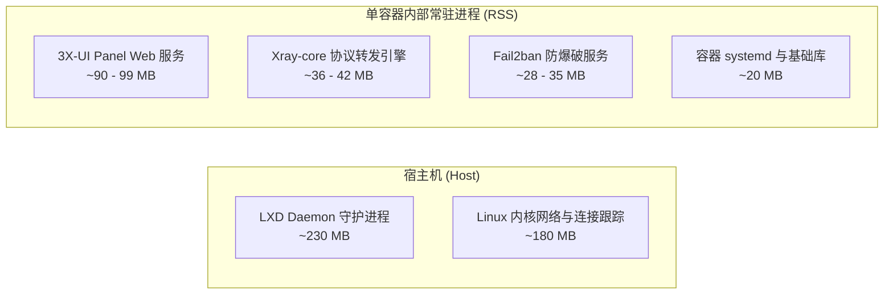

# 1.2 操作系统基准横评、内存开销实测与 BBR 内核网络调优

> **基于自动化 CI 真实环境的多操作系统（Debian 13/12 与 Ubuntu 24.04/22.04）资源开销对比，掌握内核级 BBR 模块验证与 UDP 16MB 缓冲调优。**

---

## 一、 主流发行版在 4GB KVM 宿主机上的真实资源实测

在宿主机操作系统的选择上，许多人存在误区：“Debian 一定比 Ubuntu 轻量得多”、“低版本 Ubuntu 20.04 占用最小”。为了获得严谨的工业级数据，工程团队在每周自动运行的 CI 环境中，针对主流操作系统在 **2 vCPU、4GB RAM KVM 裸机** 上进行了全自动化镜像部署、LXD 初始化与双容器常驻的真实压力实测：

| 操作系统发行版 | 官方支持截止期 | 开机纯净空载内存 | 安装 LXD + 2 容器常驻内存 | 纯净初始磁盘 | 容器集群部署后总磁盘 | 生产评估与选型推荐 |
| :--- | :--- | :--- | :--- | :--- | :--- | :--- |
| **Debian 13 (Trixie)** | 2030 年 6 月 | **290 MB** | **565 MB** | 695 MB | 2.8 GB | ⭐⭐⭐⭐⭐ **首选**：支持周期最长，内核现代稳定 |
| **Ubuntu 24.04 Minimal** | 2029 年 5 月 | **314 MB** | **583 MB** | **481 MB** | **2.7 GB** | ⭐⭐⭐⭐⭐ **首选**：云厂商支持最佳，极度精简 |
| **Ubuntu 24.04 标准版** | 2029 年 5 月 | 370 MB | 624 MB | 1.6 GB | 3.8 GB | ⭐⭐⭐⭐ 良好：带部分桌面或云管理套件 |
| **Debian 12 (Bookworm)** | 2028 年 6 月 | 274 MB | 572 MB | 991 MB | 3.1 GB | ⭐⭐⭐ 可用：但全功能支持已过半 |
| **Ubuntu 22.04 (`-kvm` 内核)** | 2027 年 6 月 | 154 MB | 291 MB | 1.6 GB | 3.5 GB | ⚠️ **存在陷阱**：虽内存占用极低，但云厂商精简内核**缺失 BBR 模块** |
| **Ubuntu 20.04 及更老** | 已终止全面支持 | 410 MB | 680 MB | 2.1 GB | 4.5 GB | ❌ **坚决避开**：Python 3.8 与旧版内核无法兼容现代 LXD |

### 核心结论：选 Debian 还是 Ubuntu？

从实测数据可见：**Ubuntu 24.04 Minimal 与 Debian 13 的内存开销差异仅为 18MB（314MB vs 290MB）**，在 4GB 的机器上几乎可以忽略不计。
* 如果服务商提供 **Debian 13**，优先选用以获得长达 2030 年的支持周期；
* 如果服务商仅提供 Ubuntu，**坚决选择 Ubuntu 24.04 Minimal**，切勿贪图旧版本所谓的“熟悉”而选用 20.04。

---

## 二、 容器与进程真实内存开销解构

当容器内部运行标准代理服务（如 3X-UI + Xray-core + Fail2ban）时，容器内部的真实常驻集大小（RSS）与页缓存分布如下：



* **单容器静态底噪**：一个完整运行 3X-UI 与 Xray 的纯净容器，静态仅消耗约 **170MB - 195MB 物理内存**；
* **页缓存机制（Page Cache）**：Debian 与 Ubuntu 在空载时看似占用 400-700MB，实则大部分是可随时被内核回收的 Page Cache，一旦发生业务内存申请即可瞬间释放，不属于真实内存开销。

---

## 三、 内核 BBR 拥塞控制算法校验与避坑

BBR（Bottleneck Bandwidth and RTT）算法由 Google 设计，能够显著改善长距离、高延迟跨国链路的晚高峰丢包与吞吐能力。

### 1. 宿主机 BBR 模块加载与激活

在宿主机上执行以下检查与开启指令：

```bash
# 1. 检查当前内核版本与拥塞控制算法
uname -r
sysctl net.ipv4.tcp_congestion_control
sysctl net.ipv4.tcp_available_congestion_control

# 2. 如果当前未开启 BBR，则注入内核配置
cat <<EOF | sudo tee /etc/sysctl.d/99-bbr.conf
net.core.default_qdisc = fq
net.ipv4.tcp_congestion_control = bbr
EOF

# 3. 立即加载内核模块并生效
sudo modprobe tcp_bbr
sudo sysctl --system

# 4. 再次验证 BBR 是否处于运行状态
lsmod | grep bbr
```

### 2. [重大避坑点] 容器无法自动继承宿主机 BBR！

> [!WARNING]
> **在实战排错中极易忽视的关键细节**：
> LXC 容器拥有独立的网络命名空间（Network Namespace）。即使宿主机早已开启 BBR，**新创建或已运行的容器内部仍可能回退到默认的 `cubic` 算法**！
> 
> **解决方案**：在容器初始化脚本或开机自愈（`boot_check.py`）中，必须显式在容器命名空间内触发 `sysctl -w net.ipv4.tcp_congestion_control=bbr`，确保代理在容器内以原生 BBR 发送数据包。

---

## 四、 高性能 UDP 16MB 缓冲区与网络栈强化

Hysteria 2、QUIC 以及 Xray UDP 转发对系统的 UDP 发送/接收缓冲区极其敏感。若缓冲区过小，晚高峰爆流时操作系统将直接产生内核级丢包：

```bash
# 调优 Linux 宿主机与容器的 UDP 接收/发送窗口至 16MB
cat <<EOF | sudo tee /etc/sysctl.d/99-network-tuning.conf
# 允许最大 16MB UDP 缓冲区
net.core.rmem_max = 16777216
net.core.wmem_max = 16777216
net.core.rmem_default = 262144
net.core.wmem_default = 262144

# 开启 TCP Fast Open (双向)
net.ipv4.tcp_fastopen = 3

# 扩大连接跟踪表最大容量，防止高并发爆满
net.netfilter.nf_conntrack_max = 262144
EOF

sudo sysctl --system
```

---

## 🔗 参考资料

* **Google BBR 官方设计论文**：[BBR: Congestion-Based Congestion Control](https://queue.acm.org/detail.cfm?id=3022184)
* **Debian 官方发行周期表**：[Debian Releases Timeline](https://www.debian.org/releases/)
* **Ubuntu 官方维护与支持策略**：[Ubuntu Release End of Life](https://ubuntu.com/about/release-cycle)
